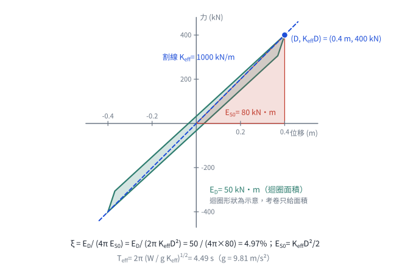

### 考題編號：SD-2023-3

**主分類：** `SD-U3-2` 隔減震原理
**副分類：** `SD-U2-2` 建築耐震設計規範
**分析方法：** 概念題（含計算）
**標籤：** `隔震設計` `等效線性化` `有效勁度` `等效阻尼比` `隔震週期` `消能能力` `LRB` `FPS` `靜力分析法適用條件` `抗傾倒` `遲滯迴圈面積`

---

## 1. 題目（考卷原文見題目正本）

> 考卷原文、公式／附表、附圖與判讀清單（已確認）見 [`SD-2023-3-problem.md`](SD-2023-3-problem.md)。本節只列解題時最容易讀錯的地方與本解使用的記號；題意以題目正本為準。

### 常見誤讀

| 項目 | 正確判讀 | 常見誤讀 |
|------|---------|---------|
| 總靜載重 | $W=5000$ kN 是重量，$m=W/g$；考卷沒給 $g$，本解取 9.81 m/s²（判讀 #1、#3，使用者授權依建議確認） | 把 5000 kN 直接當質量 |
| 等效阻尼比 | $\beta_{eff}=W_D/(2\pi K_{eff}D_D^2)$（判讀 #2） | 分母漏 $2\pi$，或寫成 $W_D/(4\pi K_{eff}D_D^2)$ |
| 遲滯迴圈面積 | 設計位移下一個完整循環的消能 50 kN·m（判讀 #4） | 當成半循環 |
| 靜力分析適用條件 | 9.2.1：規則性、$T_e\le2.5$ s、第一／二類地盤且非近斷層、隔震系統具回復力且不受加載率影響 | 美國 A–E 場址類別、「等效阻尼比 ≥10%」、「4 層／20 m」 |
| 抗傾倒 | 9.4.2.7：傾倒力矩以 1.5 倍設計地震力計、抗傾倒力矩以 0.9 倍上部構造物重量計 | 傾倒力矩用 MCE、抗傾倒只計死載重 |
| 規範依據 | ㈡、㈣依現行建築物耐震設計規範（111 年版）隔震章節（判讀 #6） | 引用舊版條文 |

**本解記號：** 本解以 $W_D$ 表示遲滯迴圈面積（題目正本記為 $E_D$），注意與重量 $W$ 區別；$D_D$ 設計位移、$K_{eff}$ 有效勁度、$T_{eff}$ 有效週期、$\beta_{eff}$ 等效阻尼比。

---

## 2. 考題核心精神與出題者意圖

**核心觀念：** 隔震設計的原理（延長週期 + 增加阻尼）、等效線性化分析法的核心公式，以及規範對靜力分析法適用條件和抗傾倒設計的規定。

**出題者意圖：**
1. (一) 測驗對隔震系統「延長週期 → 位移增大 → 需消能控制位移」此物理邏輯的理解
2. (二) 測驗規範條文的記憶與理解
3. (三) 測驗等效線性化的兩個核心公式（$T_{eff}$、$\beta_{eff}$）
4. (四) 測驗隔震建築抗傾倒規定：傾倒力矩以 1.5 倍設計地震力計，抗傾倒力矩以 0.9 倍上部構造物重量計（9.4.2.7）

---

## 3. 解題戰略地圖與陷阱分析

**關鍵陷阱：**

| # | 陷阱 | 應對策略 |
|---|------|---------|
| 1 | $T_{eff}$ 公式用 $K_{eff}$ 除以 $W$，忘記換算質量 | $m = W/g$，$T_{eff} = 2\pi\sqrt{W/(g \cdot K_{eff})}$ |
| 2 | $\beta_{eff}$ 分母忘記 $2\pi$ | 能量法：$\beta_{eff} = W_D / (2\pi K_{eff} D_D^2)$ |
| 3 | (四) 傾倒力矩的地震力層級 | 依 9.4.2.7 以**設計地震力的 1.5 倍**計算 |
| 4 | (四) 抗傾倒力矩的重量 | 依 9.4.2.7 取**上部構造物重量的 0.9 倍** |
| 5 | (二) 套用美國規範的場址類別、阻尼比限制 | 依 9.2.1 四項條件作答（規則性、$T_e\le2.5$ s、地盤與斷層、隔震系統屬性） |

---

## 3.5 變數層次分析（Variable Hierarchy Analysis）

> 複習提示：第一次解題後，在每個卡住的知識點旁標記 `⚠`；第二次複習時只看有 `⚠` 的項目。

### 最終目標

`(三) 有效週期 T_eff、等效阻尼比 β_eff`

### 本題關鍵公式（依計算順序）

$$\text{Step 1 (三): } T_{eff} = 2\pi\sqrt{\frac{W}{g \cdot K_{eff}}}$$

$$\text{Step 2 (三): } \beta_{eff} = \frac{W_D}{2\pi \cdot K_{eff} \cdot D_D^2}$$

### L1：題目直接給定

| 符號 | 數值 | 說明 |
|------|------|------|
| $W$ | 5000 kN | 上部結構總靜載重 |
| $D_D$ | 0.4 m | 設計位移 |
| $K_{eff}$ | 1000 kN/m | 設計位移下有效（割線）勁度 |
| $W_D$ | 50 kN-m | 遲滯迴圈面積（每循環消散能量） |

### L2：需知識點推導

| 符號 | 公式／來源 | 卡關? |
|------|----------|:-----:|
| $m = W/g$ | $5000/9.81 = 509.68$ kN·s²/m | |
| $T_{eff}$ | $2\pi\sqrt{509.68/1000} = 4.49$ s | |
| $\beta_{eff}$ | $50/(2\pi \times 1000 \times 0.16) = 4.97\%$ | |

### L3：深層知識（不懂就卡住）

| 知識點 | 說明 | 卡關? |
|--------|------|:-----:|
| 有效勁度（割線剛度）的定義 | $K_{eff} = F_{max}/D_{max}$（過原點的割線），非切線剛度 | |
| 等效阻尼比的能量推導 | 線性系統每循環儲能 $= \frac{1}{2}K_{eff}D_D^2$，遲滯消能 $W_D$，$\beta_{eff}=W_D/(4\pi\times\frac{1}{2}K_{eff}D_D^2)$ | |
| 靜力分析法的適用限制 | 靜力法不能捕捉扭轉、高振態與速率相依行為；9.2.1 限用於規則、$T_e\le2.5$ s、第一／二類地盤且非近斷層、隔震系統具回復力且不受加載率影響者 | |
| 抗傾倒的係數 | 9.4.2.7：傾倒力矩＝1.5 倍設計地震力之力矩、抗傾倒力矩＝0.9 倍上部構造物重量之力矩；用意在限制高寬比、避免支承局部上舉 | |

---

## 4. 步驟化詳細計算過程

### 第(一)題：隔震裝置消能能力的必要性（6 分）

**消能能力的必要性：**（規範 9.1.1 解說列隔震系統應具備的條件之一：具有消能裝置以控制建築物因週期延長所可能導致的位移增加）

隔震設計的核心目的是「延長結構自然週期，遠離地盤卓越週期」，降低加速度反應。然而，延長週期帶來副作用——**位移反應譜值 $S_d$ 隨週期增長而增大**，隔震層將產生大幅相對位移。

若缺乏足夠消能能力：
1. **隔震層位移過大**：超過隔震支承允許的最大剪切變形量，支承破壞
2. **穿越隔震層的構件損傷**：管線、電梯井、柱腳等在超大相對位移下損壞
3. **隔震縫需求過大**：建築物四周的隔震縫（隔震溝）過寬，增加設計與施工困難
4. **整體穩定性問題**：大位移時可能引發 P-delta 效應，影響結構穩定

**具備消能能力的隔震裝置（至少兩種）：**

| 裝置 | 消能機制 |
|------|---------|
| **鉛芯橡膠支承（LRB）** | 鉛芯在反覆剪切中降伏（塑性流動），形成穩定的矩形遲滯迴圈，提供遲滯阻尼 |
| **摩擦擺隔震支承（FPS）** | 球形凹面上的滑動摩擦力提供消能，同時凹面的曲率半徑決定等效週期 |
| **高阻尼橡膠支承（HDR）** | 特殊配方橡膠本身具有高阻尼（$\xi \approx 10\sim20\%$），內部粘彈性提供消能 |
| **附加黏滯阻尼器** | 在隔震系統中另外裝設黏滯阻尼器，以速度相關力提供額外消能 |

---

### 第(二)題：靜力分析法適用條件（7 分）

依現行《建築物耐震設計規範及解說》第九章「隔震建築物設計」9.2.1 節，符合下列條件者得採靜力分析（地震力可分別作用於兩水平主軸方向）：

1. **規則性**：隔震系統及其上方之結構屬規則性配置。
2. **有效週期上限**：結構隔震後之有效週期 $T_e \le 2.5$ 秒。
3. **地盤與斷層**：結構座落於第一類及第二類地盤，且距第一類活動斷層有適當距離（解說：工址不屬第 2.4 節的近斷層區域，或雖屬近斷層區域但其震區係數與表 2-1 相同）。
4. **隔震系統屬性**：(1) 隔震系統能產生回復力（9.4.2.4 節：於任何垂直力加水平力下，其勁度應為正值）；(2) 隔震系統之力與位移特性明顯不受加載率影響。

不符合 9.2.1 者，以反應譜分析設計（9.3.1）；非線性歷時分析可用於所有隔震結構。

**限制的理由：** 靜力法把隔震建築當成「剛體上部結構＋等效線性隔震層」的單自由度系統——
- 不規則配置會產生扭轉與高振態，單一振態的豎向分配不再適用；
- 週期過長、軟弱地盤（第三類地盤、臺北盆地）與近斷層速度脈衝，使長週期段的設計譜難以準確代表地震需求；
- 隔震系統沒有回復力（殘餘位移累積）或力–位移特性隨加載率改變時，以割線勁度與等效阻尼比做的等效線性化會失準。

> 條文來源：國土管理署網站公布之《建築物耐震設計規範及解說》第九章檔案（未標示版本；條號與數值以 111 年版公報核對，條文待核版本）。

---

### 第(三)題：有效震動週期與等效阻尼比（6 分）

**已知：** $W = 5000$ kN，$D_D = 0.4$ m，$K_{eff} = 1000$ kN/m，$W_D = 50$ kN-m

#### 有效震動週期

隔震系統等效質量：
$$m = \frac{W}{g} = \frac{5000}{9.81} = 509.68 \text{ kN}\cdot\text{s}^2/\text{m}$$

有效震動週期（等效線性系統週期）：

$$T_{eff} = 2\pi\sqrt{\frac{m}{K_{eff}}} = 2\pi\sqrt{\frac{W}{g \cdot K_{eff}}} = 2\pi\sqrt{\frac{5000}{9.81 \times 1000}}$$

$$= 2\pi\sqrt{\frac{5000}{9810}} = 2\pi\sqrt{0.5097} = 2\pi \times 0.7138$$

$$\boxed{T_{eff} = 4.49 \text{ s}}$$

#### 等效阻尼比

等效阻尼比由能量法推導：

$$\text{線性系統每循環儲存彈性應變能：} U = \frac{1}{2}K_{eff}D_D^2$$

$$\text{每循環消散能量（遲滯迴圈面積）：} W_D = 50 \text{ kN-m}$$

$$\beta_{eff} = \frac{W_D}{4\pi \cdot \frac{1}{2}K_{eff}D_D^2} = \frac{W_D}{2\pi K_{eff} D_D^2}$$

$$= \frac{50}{2\pi \times 1000 \times (0.4)^2} = \frac{50}{2\pi \times 1000 \times 0.16} = \frac{50}{1005.3}$$

$$\boxed{\beta_{eff} = 0.0497 \approx 4.97\% \approx 5\%}$$

**驗算：** 儲存彈性應變能 $U = \frac{1}{2} \times 1000 \times 0.4^2 = 80$ kN-m；$\beta_{eff} = 50/(4\pi \times 80) = 50/1005.3 = 4.97\%$ ✓

*圖 1　等效阻尼比＝迴圈面積 ÷（4π × 割線三角形面積）。三角形是 K_eff 割線下的彈性應變能 E_S0＝K_eff D²/2＝80 kN·m，不是迴圈面積；分母漏 2π 會得 31%，誤用 4πK_eff D² 會得 2.5%。迴圈形狀為示意（考卷只給面積）。*

> **物理意義：** 等效阻尼比約 5%，屬於較低阻尼隔震系統（相比 LRB 的 15~25%），可能為天然橡膠支承（NRB）附加少量消能元件，或以其他方式補充阻尼。

---

### 第(四)題：抗傾倒要求（6 分）

依現行規範第九章：

- **9.2.9 傾倒**：構造物之設計應能抵禦地震引致之傾倒作用；任一層須抵抗之傾倒力矩，為其上各層依 9.2.6 節豎向分配所得地震力所產生之力矩。
- **9.4.2.7 抗傾倒**：隔震系統之抗傾倒力矩不得小於傾倒力矩。**傾倒力矩以設計地震力之 1.5 倍計算；抗傾倒力矩依隔震系統上部構造物重量之 0.9 倍計算。** 位移不致使隔震元件或其他構件應力過大或不穩定時，得允許個別元件局部上舉，但須增設抗上舉措施。

$$M_{OT} = 1.5\sum_{i} F_i\,h_i, \qquad M_{R} = 0.9\,W\,x_c, \qquad M_{R} \ge M_{OT}$$

其中 $F_i$ 為依 9.2.6 節分配之第 $i$ 層設計地震力，$h_i$ 為其至隔震層之高度，$W$ 為隔震系統上部構造物重量，$x_c$ 為重心至傾倒側最外緣隔震支承之水平距離。

#### 規定理由

| 項目 | 規定 | 理由 |
|------|------|------|
| **傾倒力矩 1.5 倍設計地震力** | $M_{OT}$ 以 1.5 倍設計地震力計 | 隔震支承（尤其橡膠支承）受拉能力低，上舉會使支承失穩、甚至整體傾覆；放大地震力提高安全餘裕 |
| **抗傾倒力矩 0.9 倍重量** | 只計上部構造物重量的 0.9 倍 | 重量估計與垂直地震向上分量的不確定性，回復力矩取折減值以偏保守 |
| **整體用意（解說）** | 兩個係數合併使用 | 限制上部構造物的高寬比，使隔震元件較不易發生局部上舉 |

**設計要求：** $M_R \ge M_{OT}$；不足時須降低高寬比、調整支承配置，或增設抗上舉措施並檢核局部上舉時元件的應力與穩定。

---

## 5. 關鍵爭議點與進階探討

**爭議點1：等效阻尼比的公式**

$$\beta_{eff} = \frac{W_D}{2\pi K_{eff} D_D^2}$$

此式來自線性黏滯阻尼系統的等效（以儲能為基準）：
- 線性彈簧儲能 $= \frac{1}{2}kA^2$
- 線性黏滯阻尼每循環消散能量 $= \pi c \Omega A^2 = 2\pi \xi k A^2$（共振時）
- 故 $\beta_{eff} = W_D/(2\pi K_{eff} D_D^2)$

部分規範改寫為 $\beta_{eff} = W_D/(4\pi \cdot U_{max})$，其中 $U_{max} = \frac{1}{2}K_{eff}D_D^2$ 為最大應變能，兩式等價。

**爭議點2：靜力分析法適用條件與抗傾倒規定的版本來源**

本庫舊版 ㈡ 曾列「隔震層以上不超過 4 層、20 m」「場址類別非 E 類」「等效阻尼比不得小於 10%」「$T_{eff}\ge 3T_{fixed}$」，混用美國規範的用語與數值，現行台灣規範 9.2.1 沒有這些條件：台灣地盤分類為第一、二、三類地盤與臺北盆地，不用 A–E 場址類別；ASCE 7 對靜力法的阻尼條件是有效阻尼的上限，而非下限。舊版 ㈣ 寫「傾倒力矩採 MCE、抗傾倒力矩僅計死載重」，與 9.4.2.7 的 1.5 倍設計地震力、0.9 倍上部構造物重量不同。兩者已改依現行規範（條文來源：國土管理署網站公布之《建築物耐震設計規範及解說》第九章檔案（未標示版本；條號與數值以 111 年版公報核對，條文待核版本））。

**爭議點3：本題㈢的有效週期超過靜力法上限**

㈢ 求得 $T_{eff} = 4.49$ s，大於 9.2.1 的 2.5 s；若為實際設計，此隔震建築不符合靜力分析條件，須改用反應譜或非線性歷時分析。㈢ 只問有效週期與等效阻尼比，答案不受影響。

**進階觀念：阻尼修正係數 $B$**

隔震設計位移隨有效週期 $T_{eD}$ 增大而增大、隨阻尼修正係數 $B$ 增大而減小；$B$ 依等效阻尼比查規範表 3-1（$B_S$、$B_1$，線性內插；5% 時為 1.00）。完整設計位移式見規範第九章（條文待核）。本題 $\xi \approx 5\%$，$B \approx 1.0$，阻尼效果有限，設計位移幾乎等於 5% 阻尼的譜位移。

*修正日期：2026-11-16（§1 改為指向題目正本）*

*修正日期：2026-11-16（勘誤：§4㈡ 靜力分析適用條件改依現行規範 9.2.1（規則性、Te≤2.5 s、第一／二類地盤且非近斷層、隔震系統具回復力且不受加載率影響），刪除查無依據的「4 層／20 m」「場址非 E 類」「等效阻尼比 ≥10%」「Teff≥3Tfixed」；§4㈣ 抗傾倒改依 9.2.9、9.4.2.7（傾倒力矩 1.5 倍設計地震力、抗傾倒力矩 0.9 倍上部構造物重量），原「MCE、僅計死載重」作廢；§1 常見誤讀、§2、§3、§3.5、§5 同步，§5 補 Teff＝4.49 s＞2.5 s 說明、B 改為表 3-1 定性說明。㈢ T＝4.49 s、ξ＝4.97% 不變。依據：國土管理署網站規範第九章檔案（條文待核版本）。驗證：scripts/fixes/2026-11-16_verify_SD-2023-3.py，MISMATCHES: 0；與盲解比對 B-U3-2-G4 一致）*

*修正日期：2026-11-16（非勘誤）圖解補繪：figs/SD-2023-3-fig-1-energy.svg（割線勁度、E_S0 三角形與遲滯迴圈面積），腳本 gen_SD-2023-3.py，答案不變*
