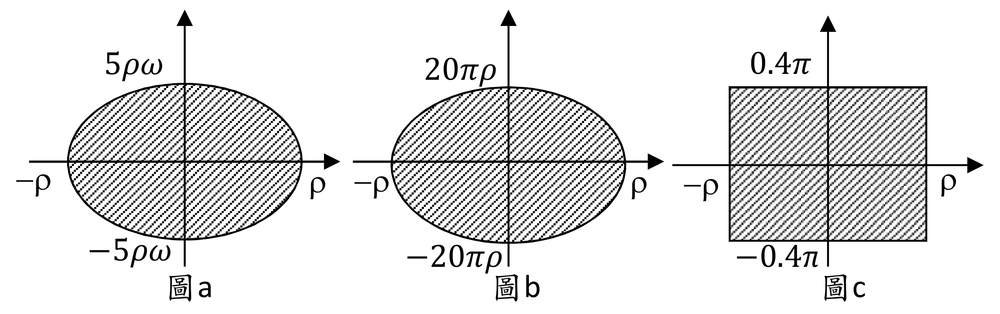

# SD-2023-4 題目正本

> 本檔只記錄考卷上寫了什麼、圖上畫了什麼，不含任何解法。解析見同資料夾 `SD-2023-4.md`。
> 判讀清單經使用者確認前，狀態為「待確認」；確認後本檔原則上不再修改（改動須回考卷原圖並記 log）。

| 項目 | 內容 |
|---|---|
| 考卷 | `raw/exams/SD-2023_結構動力分析與耐震設計.pdf`，第 2 頁（頁次 2－2），第四題 |
| 考年 | 2023（民國112年）專技高考結構工程技師「結構動力分析與耐震設計」 |
| 配分 | 25 分（㈠15 分、㈡10 分） |
| 附圖 | `SD-2023-4-fig-1.png`（舊擷取，圖下方空白處有手形游標）、`SD-2023-4-fig-2.png`（2026-11-16 由考卷 500 dpi 重擷取） |
| 判讀狀態 | **已確認（2026-11-16，使用者授權依 Claude 建議）**（原轉錄：2026-11-16；PyMuPDF 110 dpi 整頁＋500 dpi 局部放大，PDF 文字層核對原文、PDF 向量座標核對附圖；盲讀於開啟解析前完成） |

## 1. 考卷原文（逐字）

四、已知單自由度動力系統之質量 m = 1 kg，勁度 k = $16\pi^2$ N/m。

㈠試求如下圖 a~c 所表現的三種遲滯迴圈特性的消能器分別在外力頻率為 $2\pi$ rad/sec、$4\pi$ rad/sec 作用下，振幅分別為 0.01 m，0.02 m 時的等值線性黏滯阻尼比（共計十二種組合）。圖 a 及圖 b 為橢圓形遲滯迴圈，圖 c 為矩形遲滯迴圈，且圖 a 中的符號 ω 表示振動頻率，所有力量單位為 N，質量單位為 kg，長度單位為 m。（15 分）

㈡詳細說明最新建築物耐震設計規範中建築物使用消能減震技術的數量以及安裝位置及消能器所能承受力量與位移之規定，並說明其規定用意。（10 分）

## 2. 考卷給的公式、附表與參數

- 考卷沒有給參考公式。
- 給定：$m=1$ kg、$k=16\pi^2$ N/m；外力頻率 $2\pi$、$4\pi$ rad/s；振幅 0.01 m、0.02 m；三種迴圈（圖 a、b 橢圓，圖 c 矩形）。
- 圖面參數：圖 a 縱軸截距 $\pm5\rho\omega$、橫軸 $\pm\rho$；圖 b 縱軸截距 $\pm20\pi\rho$、橫軸 $\pm\rho$；圖 c 矩形上下緣 $\pm0.4\pi$、左右 $\pm\rho$。
- 考卷沒有給：圖中 $\rho$ 的文字定義、座標軸名稱、等值黏滯阻尼比的定義式、是否以外力頻率或自然頻率計算。
- 卷首注意事項：㈠可以使用電子計算器。㈡不必抄題，作答時請將試題題號及答案依照順序寫在試卷上，於本試題上作答者，不予計分。㈢本科目除專門名詞或數理公式外，應使用本國文字作答。考試時間：2 小時。

## 3. 附圖

*證據圖 SD-2023-4-fig-2.png（500 dpi 重擷取；舊圖 SD-2023-4-fig-1.png 內容相同，圖下方有手形游標）*

圖面文字照錄：5ρω、−ρ、ρ、−5ρω、圖a；20πρ、−ρ、ρ、−20πρ、圖b；0.4π、−ρ、ρ、−0.4π、圖c

## 4. 判讀清單

| # | 項目 | 判讀 | 圖上／題文依據 | 把握 |
|---|---|---|---|---|
| 1 | 等值線性黏滯阻尼比定義 | 考卷沒有給。**定案**：以每循環消能 $E_D$ 等值，$c_{eq}=E_D/(\pi\omega\rho^2)$、$\xi_{eq}=c_{eq}/(2m\omega_n)$，亦即 $\xi_{eq}=\dfrac{1}{4\pi}\dfrac{\omega_n}{\omega}\dfrac{E_D}{E_{S0}}$（$E_{S0}=k\rho^2/2$，$\omega$ 為外力頻率）。理由：圖 a 為線性黏滯阻尼器（力 ∝ 速度），此定義使其阻尼比與頻率、振幅無關，物理上一致；只在 $\omega=\omega_n$ 時與 $E_D/(4\pi E_{S0})$ 相同 | 題文「等值線性黏滯阻尼比」「外力頻率」；圖 a 標 $5\rho\omega$ | 不確定（影響答案：$\omega\ne\omega_n$ 的組合差 $\omega_n/\omega$ 倍；依 Claude 建議定案） |
| 2 | 座標軸 | 橫軸為消能器變形（位移），縱軸為消能器力（N）；兩軸考卷皆未標名 | 題文「遲滯迴圈」「所有力量單位為 N」；橫軸交點 ±ρ | 確定（解讀） |
| 3 | $\rho$ | 振幅（題文的 0.01 m、0.02 m），橫軸最大位移 | 題文「振幅分別為…」；圖上橫軸極值 ±ρ | 確定（解讀） |
| 4 | 圖 a | 橢圓，最大力（$x=0$ 處）$5\rho\omega$ N，隨振幅與頻率成正比 | 圖面標註；橢圓中心在原點（PDF 向量：橢圓 x＝156.5–242.8、縱軸 x≈199.6 pt） | 確定 |
| 5 | 圖 b | 橢圓，$x=0$ 處力 $20\pi\rho$ N，與振幅成正比、與頻率無關 | 圖面標註 | 確定 |
| 6 | 圖 c | 矩形，力 $\pm0.4\pi$ N 定值（與振幅、頻率無關），位移範圍 $\pm\rho$ | 圖面標註；矩形對稱於縱軸（PDF 向量：矩形 x＝398.8–471.5、縱軸 x≈435.1 pt） | 確定（解讀） |
| 7 | 「圖 a 中的符號 ω 表示振動頻率」 | 即外力（穩態振動）圓頻率，單位 rad/s，代入 $2\pi$ 或 $4\pi$ | 題文 | 確定（解讀） |
| 8 | 自然頻率 | $\omega_n=\sqrt{k/m}$，由 $m=1$ kg、$k=16\pi^2$ N/m 求得 | 題文 | 確定 |
| 9 | 組合數 | 3 種迴圈 × 2 頻率 × 2 振幅＝12 種 | 題文「共計十二種組合」 | 確定 |
| 10 | ㈡規範依據 | 依現行建築物耐震設計規範及解說（111 年版）消能減震相關規定作答 | 題文「最新建築物耐震設計規範」 | 確定（解讀） |
| 11 | 考卷沒有給 | 阻尼比定義式、座標軸名稱、$\rho$ 的文字定義 | 題文、圖面 | 確定 |

---
*轉錄：2026-11-16（SD-U3-2 題目正本推廣・組 U3-2-G4）*
*確認：2026-11-16 使用者授權依 Claude 建議確認（SD-U3-2 組 U3-2-G4，關卡一）*
