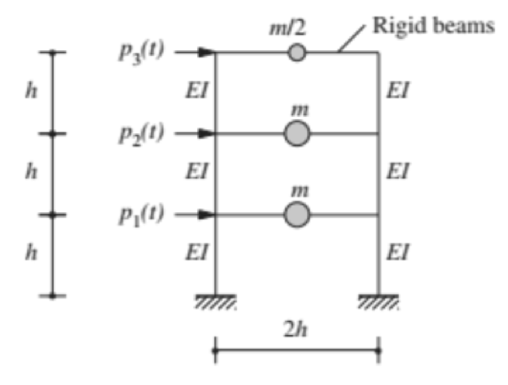

# SD-2024-1 題目正本

> 本檔只記錄考卷上寫了什麼、圖上畫了什麼，不含任何解法。解析見同資料夾 `SD-2024-1.md`。
> 判讀清單經使用者確認前，狀態為「待確認」；確認後本檔原則上不再修改（改動須回考卷原圖並記 log）。

| 項目 | 內容 |
|---|---|
| 考卷 | `raw/exams/SD-2024_結構動力分析與耐震設計.pdf`，第 1 頁（正面），第一題 |
| 考年 | 2024（民國113年）專技高考結構工程技師「結構動力分析與耐震設計」 |
| 配分 | 25 分（㈠3 分、㈡3 分、㈢7 分、㈣12 分） |
| 附圖 | `SD-2024-1-fig-1.png`（舊擷取，圖左下方有游標）、`SD-2024-1-fig-2.png`（2026-11-15 由考卷 500 dpi 重擷取；考卷內嵌點陣圖原解析度 392×305 px，線條略糊） |
| 判讀狀態 | **已確認**（2026-11-15 使用者授權依 Claude 建議確認。原轉錄：2026-11-15 轉錄；PyMuPDF 110 dpi 整頁＋500 dpi 局部放大，PDF 文字層核對原文；盲讀於開啟解析前完成） |

## 1. 考卷原文（逐字）

一、有一棟三層樓剪力屋架，如下圖所示，請回答下列問題：

㈠請推導運動方程式，並以圖中的符號表示。（3 分）

㈡請求出對應三個模態之模態頻率。（3 分）

㈢分別求出對 3F 正規化及對模態質量正規化之模態向量，並說明其差異。（7 分）（照考卷原文：「對 3F 正規化」加粗底線）

㈣請求出三個模態之模態參與質量，除了討論其參與百分比，並驗證其總和與三個自由度的總質量一致。（12 分）

## 2. 考卷給的公式、附表與參數

- 考卷沒有給參考公式。
- 給定（圖上，全為符號）：樓高皆 $h$、跨度 $2h$；每層兩根柱 $EI$；梁為剛性（Rigid beams）；質量由下往上 $m$、$m$、$m/2$；外力 $p_1(t)$、$p_2(t)$、$p_3(t)$ 作用於各樓版。
- 考卷沒有給：數值、柱底以外的邊界說明（柱底以斜線表示固定）、阻尼、軸向變形。
- 卷首注意事項：㈠可以使用電子計算器。㈡不必抄題，作答時請將試題題號及答案依照順序寫在試卷上，於本試題上作答者，不予計分。㈢本科目除專門名詞或數理公式外，應使用本國文字作答。考試時間：2 小時。

## 3. 附圖

*證據圖 SD-2024-1-fig-2.png（500 dpi 重擷取；舊圖 SD-2024-1-fig-1.png 內容相同，圖左下有游標）*

圖面文字照錄：m/2、Rigid beams、p3(t)、EI、EI、m、p2(t)、EI、EI、m、p1(t)、EI、EI、h、h、h、2h

## 4. 判讀清單

| # | 項目 | 判讀 | 圖上／題文依據 | 把握 |
|---|---|---|---|---|
| 1 | 層勁度 | 每層兩根兩端固接（剛性梁、柱底固定）的柱，層勁度 $2\times12EI/h^3=24EI/h^3$，三層相同 | 圖上每層兩根柱皆標 EI、梁標 Rigid beams、柱底斜線；題文「剪力屋架」 | 確定（解讀） |
| 2 | 質量位置 | 一樓版（$p_1$ 高度）$m$、二樓版 $m$、頂樓版（$p_3$ 高度）$m/2$ | 圖上圓圈與標字 | 確定 |
| 3 | 自由度 | 三個樓版水平位移，依 $p_1$、$p_2$、$p_3$ 由下往上編號（圖上未另畫位移符號） | 圖上外力箭頭 $p_1\sim p_3$ 向右 | 確定（解讀） |
| 4 | 「3F」 | 指頂樓版（第三個自由度、質量 $m/2$ 那層）；對 3F 正規化＝頂層分量取 1 | 題文「對 3F 正規化」；三層樓的最上層樓版 | 確定（解讀） |
| 5 | 柱底 | 固定 | 圖上兩柱底斜線 | 確定 |
| 6 | 尺寸 | 三段樓高皆 $h$（尺寸線節點對齊各樓版）；跨度 $2h$ 量兩柱中心（剪力屋架下不影響側向勁度） | 左側尺寸線三段、底部尺寸線端點對齊兩柱 | 確定 |
| 7 | 模態參與質量 | 對應水平地表運動（影響向量全為 1），總質量 $m+m+m/2=2.5m$ | 題文「總和與三個自由度的總質量一致」 | 確定（解讀） |
| 8 | 所求 | ㈠運動方程式（符號）；㈡三個模態頻率；㈢兩種正規化的模態向量與差異；㈣模態參與質量、百分比、總和驗證 | 題文 | 確定 |
| 9 | 考卷沒有給 | 數值、阻尼、柱軸向變形 | 題文與圖 | 確定 |

---
*轉錄：2026-11-15（SD-U1-3 題目正本推廣・批 3）*
*確認：2026-11-15 使用者授權依 Claude 建議確認（SD-U1-3 題目正本推廣・批 3，關卡一）*
