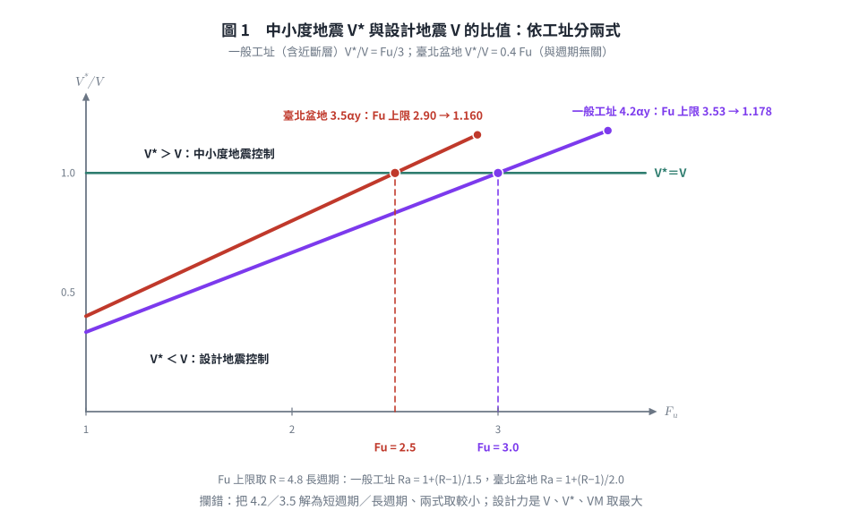
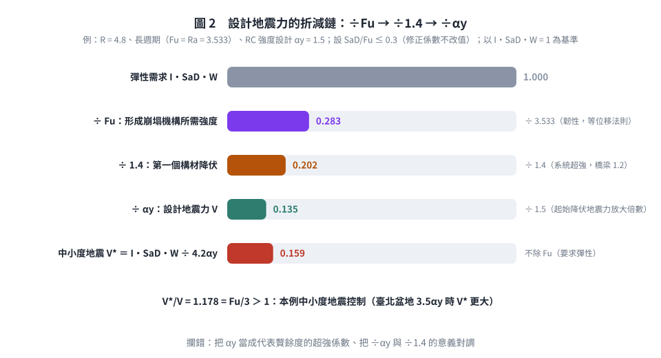

# 考題編號：SD-2024-3

**主分類：** `SD-U2-2` 建築耐震設計規範
**副分類：** `SD-U2-1` 地震力之設計規範、`SD-U2-3` 橋梁耐震設計規範
**分析方法：** 概念題（規範論述）
**標籤：** `耐震設計原則` `三水準設計` `小震不壞` `中震可修` `大震不倒` `設計地震力` `韌性折減` `超強係數` `用途係數` `回歸期` `超越機率` `彈塑性設計` `韌性需求` `建築耐震規範` `橋梁耐震規範`

---

## 1. 題目（考卷原文見題目正本）

> 考卷原文、公式／附表、附圖與判讀清單（已確認）見 [`SD-2024-3-problem.md`](SD-2024-3-problem.md)。本節只列解題時最容易讀錯的地方與本解使用的記號；題意以題目正本為準。

### 常見誤讀

| 項目 | 正確判讀 | 常見誤讀 |
|------|---------|---------|
| $V^*$ 兩式的適用條件 | 考卷大括號旁沒有寫條件；依現行規範 $4.2\alpha_y$＝一般工址（含近斷層）、$3.5\alpha_y$＝臺北盆地（判讀 #1，使用者授權依建議確認）。與週期無關（2026-11-16 勘誤前舊解誤寫為短週期／長週期並「取較小者」） | 解讀成短週期區／長週期區，或兩式取小 |
| 最大考量地震分母 | 考卷 $V_M$ 分母為 $1.4\alpha_y$（判讀 #4） | 本庫舊 §1 寫成 $1.4\alpha_{yM}$（考卷沒有 $\alpha_{yM}$） |
| 「最小設計水平總橫力」 | 指設計地震公式 $V$（判讀 #2） | 當成另一條最小值檢核式 |
| ㈡「分母為何又不同」 | 涵蓋 $4.2$ 與 $3.5$ 之間、以及相對 $V$ 的 $1.4$ 的差異（判讀 #7） | 只答其中一項 |
| 題型 | 純論述題，無附圖、無數值（判讀 #10）；同頁簡支梁圖屬第四題 | 把第四題的圖當本題附圖 |

**本解記號：** $V$、$V^*$、$V_M$ 為設計地震、中小度地震、最大考量地震設計地震力；$(\cdot)_m$ 為規範修正係數；建築 $1.4\alpha_y$、橋梁 $1.2\alpha_y$。

---

## 2. 考題核心精神與出題者意圖 (Core Concepts & Examiner's Intent)

**核心觀念：** 台灣建築耐震設計規範的三水準設計哲學，以及各設計地震力公式背後的工程邏輯。

**出題者測驗的能力：**
1. 是否理解「三水準耐震設計」（小震不壞／中震可修／大震不倒）與三個公式的對應關係
2. 能否從工程邏輯解釋建築 1.4 vs 橋梁 1.2 的差異（超強與冗餘度）
3. 能否區分「中小度地震」公式中 4.2αy（一般工址、近斷層）、3.5αy（臺北盆地）的由來
4. 能否準確說明 $S_{aD}$、$F_u$、$\alpha_y$、$I$ 等符號的三個面向含義

---

## 3. 解題戰略地圖與陷阱分析 (Strategic Roadmap & Trap Analysis)

**作戰計畫：**
1. 先建立「三水準→三公式」的對應表
2. 說明超強係數的工程意義 → 解釋 1.4 vs 1.2
3. 說明中小度地震公式的推導邏輯（從 SaD 轉換回中小地震水準）
4. 按三面向系統性論述各符號

**關鍵陷阱：**

| # | 陷阱 | 應對 |
|---|------|------|
| 1 | 誤以為三公式對應三種「不同結構」→ 實際對應三個「不同地震水準」 | 先釐清地震強度等級 |
| 2 | 混淆 $F_u$（韌性折減係數）與 $R$（美規 Response modification factor） | $F_u$ ≈ $R_\mu$（僅含韌性部分）；$R = F_u \times \alpha_y \times \cdots$ |
| 3 | 忽略 $V^*$ 中的 $F_u$ 分子 → 漏掉「中小地震不用韌性折減」的物理含義 | 細看 $V^* = IF_u/(4.2\alpha_y) \times (S_{aD}/F_u)$ → $F_u$ 消去 |
| 4 | 不知道 4.2 和 3.5 的由來，或誤為短／長週期 | $4.2=1.4\times3$（一般工址、近斷層）、$3.5=1.4\times2.5$（臺北盆地）：設計地震譜值約為中小度地震的 3 倍（盆地約 2.5 倍），與週期無關 |
| 5 | 以為三者次序固定 $V^*<V<V_M$ | $V^*/V=F_u/3$（盆地 $0.4F_u$）可大於 1；$V_M/V$ 依 $S_{aM}/S_{aD}$ 與 $R/R_a$ 而定；$V$ 不得小於 $V^*$、$V_M$，即取最大值 |

---

## 3.5 變數層次分析 (Variable Hierarchy Analysis)

### 最終目標
完整論述三水準耐震設計原則與各公式符號的物理意義

### 本題關鍵概念邏輯鏈（依論述順序）

$$\text{三水準原則} \longrightarrow \text{三個地震危害等級} \longrightarrow \text{三個設計地震力公式}$$

$$\text{彈塑性折減：} V_{design} = \frac{V_{elastic}}{F_u \cdot \alpha_y \cdot (\text{超強係數})}$$

$$\text{建築 1.4 vs 橋梁 1.2：} \quad \text{系統超強（起始降伏}\to\text{崩塌機構）：建築贅餘度高} \Rightarrow 1.4 > 1.2\quad(\alpha_y\ \text{另計})$$

$$\text{中小地震換算：} \quad 4.2 = 1.4 \times 3\ \text{（一般工址、近斷層）}，\quad 3.5 = 1.4 \times 2.5\ \text{（臺北盆地）}$$

$$\text{韌性需求：} \mu_d \approx F_u \text{（等位移法則，長週期）}$$

### L1：題目直接給定

| 符號 | 說明 |
|------|------|
| $V$, $V^*$, $V_M$ | 三種設計地震力（分別對應設計、中小、最大考量地震） |
| 分母 1.4（建築）、1.2（橋梁） | 規範規定值，需要解釋其工程意義 |

### L2：需知識點推導

| 符號 | 意義 | 卡關? |
|------|------|-------|
| $S_{aD}$（設計地震譜值） | 對應 10% in 50 yr 設計地震的加速度反應譜 | |
| $S_{aM}$（最大考量地震譜值） | 對應 2% in 50 yr MCE 的加速度反應譜 | |
| $F_u$（韌性折減係數） | 允許彈塑性變形帶來的地震力折減量 | |
| $\alpha_y$（起始降伏地震力放大倍數） | 設計地震力放大 $\alpha_y$ 倍時第一個構材降伏，與設計方法有關；系統贅餘度帶來的超強是另一個係數 1.4（橋梁 1.2） | |
| $I$（用途係數） | 依建築重要性調整設計地震力 | |

### L3：深層知識（不懂就卡住）

| 知識點 | 說明 | 卡關? |
|--------|------|-------|
| 等位移法則 | 長週期結構：彈性位移 ≈ 非彈性位移 → $\mu = F_u$ | |
| 等能量法則 | 短週期結構：$F_u = \sqrt{2\mu-1}$ | |
| 地震危害比 | SaD（475yr）/ Sa_moderate（約 30yr）：一般工址約 3（4.2＝1.4×3）、臺北盆地約 2.5（3.5＝1.4×2.5） | |
| 超強來源 | 材料應變硬化、保守設計、荷載重分配、非結構元素貢獻 | |

---

## 4. 步驟化詳細計算過程（本題為論述，以段落形式呈現）

### (一) 規範耐震設計基本原則與三種設計地震力之關聯（10分）

#### A. 三水準耐震設計原則

台灣建築耐震設計規範遵循**三水準耐震設計哲學**（2026-10-24 勘誤：原寫 50%／72 年，係美國 ASCE 41 frequent 水準；我國規範第 1.2 節解說為回歸期約 30 年、50 年超越機率約 80%，與 SD-2020-4 一致）：

| 水準 | 地震等級 | 超越機率 | 回歸期 | 性能目標 |
|------|---------|---------|--------|---------|
| 第一水準（小震） | 中小度地震 | 約 80% / 50年 | ≈ 30年 | **小震不壞**（基本上維持彈性，可正常使用） |
| 第二水準（中震） | 設計地震 | 10% / 50年 | ≈ 475年 | **中震可修**（允許降伏，但可修復，不倒塌） |
| 第三水準（大震） | 最大考量地震 | 2% / 50年 | ≈ 2475年 | **大震不倒**（允許嚴重破壞，但不倒塌、不危及生命） |

#### B. 三種設計地震力與三水準原則的對應邏輯

$$\boxed{
\begin{aligned}
V &\longleftrightarrow \text{設計地震（第二水準）：確保中震可修，以韌性折減後的彈塑性設計為主}\\
V^* &\longleftrightarrow \text{中小度地震（第一水準）：確保小震不壞，確認彈性或微小損傷}\\
V_M &\longleftrightarrow \text{最大考量地震（第三水準）：確保大震不倒，確認不超過崩潰極限}
\end{aligned}
}$$

其邏輯關係如下圖概示：

```
地震強度 ──→  Sa_中小   <   SaD   <   SaM
               ↓              ↓          ↓
設計地震力 →   V*             V          VM     （大小次序不固定，取最大者控制）
性能目標  →   不壞         可修         不倒
折減邏輯  →   不用韌性折減  Fu（由Ra）   FuM（由R）；分母皆 1.4αy
```

> 地震強度遞增，但三個設計地震力的大小次序**不固定**：$V^*/V=F_u/3$（臺北盆地 $0.4F_u$）可大於 1；$V_M/V$ 取決於 $S_{aM}/S_{aD}$ 與 $R/R_a$，可大於也可小於 1（見 SD-2020-4）。規範要求設計總橫力不得小於 $V^*$ 與 $V_M$，即三者取最大。

**設計地震力 V** 是結構設計的主要基準：
$$V = \frac{I}{1.4\alpha_y}\left(\frac{S_{aD}}{F_u}\right)_m W$$
分母 $1.4\alpha_y \cdot F_u$ 代表：設計地震彈性力依**韌性折減**（$F_u$）與**超強折減**（$1.4\alpha_y$）降低後，作為設計基準。

#### C. 建築規範分母取 1.4、橋梁規範分母取 1.2 的理由

分母中的 **1.4（建築）** 與 **1.2（橋梁）** 代表**系統超強係數（System Overstrength Factor）**，即結構從第一個構材降伏（$P_y$）到形成崩塌機構、達最大側向強度（$P_u$）的強度增加倍數（規範解說：建築物 $P_u\approx1.4P_y$）；設計地震力到起始降伏的放大另由 $\alpha_y$ 表示。此值越大，代表結構有越多「隱藏強度」，可以用更低的設計力換取同等安全。

| 比較項目 | 建築（1.4） | 橋梁（1.2） |
|---------|-----------|-----------|
| 結構冗餘度 | **高**（多跑道荷載傳遞路徑、多層框架） | **低**（橋墩往往為單一荷載路徑） |
| 非結構元素貢獻 | **有**（RC 剪力牆、填充牆提供額外強度） | **無**（橋梁無額外隱性強度貢獻） |
| 保守設計程度 | 構件設計往往偏保守 | 橋梁構件設計較精準（細長比控制嚴格） |
| 材料實際強度超出標稱比例 | 混凝土實際強度常高於設計值 | 類似，但鋼箱梁加工精度高，差異較小 |
| 荷載重分配能力 | 超靜定度高，可顯著重分配 | 超靜定度低，重分配空間有限 |

**結論：** 建築系統的冗餘度與隱藏超強顯著高於橋梁，因此允許更高的系統超強係數（1.4 > 1.2）。在相同 $F_u$ 與 $\alpha_y$ 下，建築的實際抗震安全裕度更大，故規範賦予更大的折減空間（分母更大 → 設計力更小仍能保證安全）。

$$\boxed{\text{超強係數（系統）：建築} \approx 1.4 > \text{橋梁} \approx 1.2 \quad \text{（因建築冗餘度與隱性強度遠高於橋梁）}}$$

---

### (二) 中小度地震設計公式分母為何不同？（5分）

**中小度地震設計地震力：**
$$V^* = \begin{cases}\dfrac{IF_u}{4.2\alpha_y}\left(\dfrac{S_{aD}}{F_u}\right)_m W & \text{一般工址、近斷層}\\[8pt] \dfrac{IF_u}{3.5\alpha_y}\left(\dfrac{S_{aD}}{F_u}\right)_m W & \text{臺北盆地}\end{cases}$$

（考卷大括號旁沒有寫條件，依現行規範 2.10.1 補；題目正本判讀 #1。兩式是**兩類工址分開規定**，不是同一棟建築依週期二選一。）

**分母與 $V$ 的 $1.4\alpha_y$ 不同，有兩層原因：**

**原因一：中小度地震譜值遠小於設計地震，以「設計譜 ÷ 常數」代表**

公式以 $S_{aD}$（475 年設計地震）為基準。中小度地震（50 年超越機率約 80%，回歸期約 30 年）的譜值遠低於設計地震，規範以設計譜除以一個常數代表它：

$$\frac{S_{aD}}{S_{a,\text{中小}}} \approx \begin{cases}3 & \text{一般工址（含近斷層）}\\ 2.5 & \text{臺北盆地}\end{cases}
\qquad\Longrightarrow\qquad
\boxed{4.2\alpha_y = 1.4\alpha_y\times3\ \text{（一般工址、近斷層）};\quad 3.5\alpha_y = 1.4\alpha_y\times2.5\ \text{（臺北盆地）}}$$

規範解說的說法是：$V^*$ 相當於 475 年設計地震未經韌性折減的地震力除以 4.2（一般工址、近斷層）或 3.5（臺北盆地）。近斷層工址計算 $V^*$ 時，$S_{aD}$ 用表 2-1 的一般值，不乘近斷層調整。

**原因二：中小度地震要求彈性，不准用韌性折減**

- 設計地震（$V$）允許結構降伏並利用韌性消能 → 除以 $F_u$
- 中小度地震（$V^*$）要求結構保持在彈性限度內 → 分子多乘一個 $F_u$，把韌性折減乘回
- $(S_{aD}/F_u)_m$ 落在修正式第一段（$S_{aD}/F_u\le0.3$）時，$V^*=\dfrac{IS_{aD}}{4.2\alpha_y}W$（盆地 $3.5\alpha_y$），與 $F_u$ 無關；超過 0.3 時修正係數使 $F_u$ 不完全約掉

**為什麼臺北盆地是 3.5、不是 4.2：** 臺北盆地為深厚軟弱沉積層，中小度地震與設計地震的譜值比較小（約 2.5，一般工址約 3），小震相對較大，故除數較小、$V^*$ 較大。（成因為解說意旨的整理，細節條文待核。）

**推論與設計取值：**

$$\frac{V^*}{V}=\frac{F_u\cdot1.4}{4.2}=\frac{F_u}{3}\ \text{（一般工址）},\qquad \frac{V^*}{V}=\frac{F_u\cdot1.4}{3.5}=0.4F_u\ \text{（臺北盆地）}$$

$F_u>3$（盆地 $F_u>2.5$）時 $V^*$ 大於 $V$。規範要求設計總橫力不得小於 $V^*$（也不得小於 $V_M$），所以設計時是 $V$、$V^*$、$V_M$ **取最大值**，不是取較小值。



*圖 1　$V^*/V$ 隨 $F_u$ 的變化，兩條線是兩類工址（一般工址 $4.2\alpha_y$、臺北盆地 $3.5\alpha_y$），不是同一棟建築的兩個週期段。兩條線都可越過 1.0，所以設計取 $V$、$V^*$、$V_M$ 的最大值。它攔的是把 4.2／3.5 解成短週期／長週期、再「取較小者」的誤讀。*

---

### (三) 各符號定義之三面向論述（10分）

#### 面向一：地震危害度（回歸期與超越機率）

| 符號 | 危害度定義 | 說明 |
|------|----------|------|
| $S_{aD}$ | **設計地震**：50年超越機率 10%，回歸期 ≈ 475年 | 台灣全島均有場址危害分析圖，依地區與場址類別查取 |
| $S_{aM}$ | **最大考量地震**：50年超越機率 2%，回歸期 ≈ 2475年 | 對應極罕見的強烈地震，確保不倒塌極限狀態 |
| $S_{a,\text{中小}}$ | **中小度地震**：50年超越機率約 80%，回歸期 ≈ 30年 | 公式中以 $S_{aD}/3$（一般工址，即 4.2/1.4）或 $S_{aD}/2.5$（臺北盆地，即 3.5/1.4）代表，不直接出現 |
| $I$ | **用途係數**（Importance Factor） | 依建築物使用功能調整回歸期等效目標：一般建築 $I=1$；學校、醫院等公共設施 $I=1.25$；關鍵設施 $I=1.5$ |

#### 面向二：彈塑性設計假設

| 符號 | 彈塑性設計假設 | 說明 |
|------|--------------|------|
| $F_u$ | **韌性折減係數**（Ductility Reduction Factor） | 結構在彈塑性反應下，達到相同位移目標所需的力小於彈性力。$F_u$ 代表這個折減倍率，是允許「以小力換大變形」的核心假設 |
| $\alpha_y$ | **起始降伏地震力放大倍數** | 設計地震力須放大 $\alpha_y$ 倍，結構才有第一個構材降伏；反映設計方法（載重因數、強度折減）帶來的餘裕：RC 強度設計 1.5（地震載重因數取 1.0 時為 1.0）、鋼構容許應力設計 1.2、鋼構或 SRC 極限設計 1.0。它不是系統贅餘度超強（那是 1.4） |
| $F_{uM}$ | 最大考量地震的地震力折減係數 | 以韌性容量 $R$ 取代 $R_a$ 代入 $F_u$ 公式求得，故 $F_{uM}\ge F_u$（大震可用滿 $R$）；$V_M$ 分母仍是 $1.4\alpha_y$，規範沒有另訂 $\alpha_{yM}$ |
| 1.4 | **系統超強放大係數**（建築） | 在 $\alpha_y$ 之外，建築系統因冗餘度與隱性強度而額外具備的超強，規範取 1.4 作為保守估計 |

**設計哲學說明：**

$$IS_{aD}W \xrightarrow{\div F_u} V_u\ (\text{形成崩塌機構所需強度}) \xrightarrow{\div 1.4} V_y\ (\text{第一個構材降伏}) \xrightarrow{\div \alpha_y} V\ (\text{設計地震力})$$

每一步都有物理依據：$F_u$（韌性消能，等位移／等能量法則）→ 1.4（起始降伏到崩塌機構的系統超強）→ $\alpha_y$（設計方法造成的設計力到起始降伏的餘裕）。三者相乘，順序不影響數值，但意義不可對調；$(\cdot)_m$ 修正另在 $S_{aD}/F_u$ 上套用。



*圖 2　以 $R=4.8$ 長週期（$F_u=R_a=3.533$）、RC 強度設計 $\alpha_y=1.5$ 為例（設 $S_{aD}/F_u\le0.3$），彈性需求依序除以 $F_u$、1.4、$\alpha_y$ 得設計力 $V=0.135$；$V^*$ 不除 $F_u$，$V^*/V=1.178=F_u/3$。它攔的是把 $\alpha_y$ 當成代表贅餘度的超強係數、把 $\div\alpha_y$ 與 $\div1.4$ 的意義對調。*

#### 面向三：韌性需求（Ductility Demand）

| 符號 | 韌性需求關聯 | 說明 |
|------|------------|------|
| $F_u$ | **直接決定韌性需求** | 依等位移法則（長週期）：$\mu_d = F_u$；依等能量法則（短週期）：$\mu_d = (F_u^2+1)/2$ |
| $R$、$R_a$ | **韌性容量與容許韌性容量** | $R$ 依結構系統查表；設計地震只准用 $R_a=1+(R-1)/1.5$（允許非彈性位移達極限值之 2/3；臺北盆地 $1+(R-1)/2.0$，即 1/2）；$F_u$ 由 $R_a$、$F_{uM}$ 由 $R$ 依週期求得 |
| $\alpha_y$、1.4 | **實際強度高於設計力** | 設計力乘 $\alpha_y$ 才起始降伏、再乘 1.4 才形成崩塌機構；規範把兩段超強放進分母，$F_u$ 對應的才是崩塌機構強度下的韌性需求 |
| $1.4\alpha_y$ | **有效總折減能力** | $R_{total} = F_u \times \alpha_y \times 1.4$，代表結構可承受的總地震力折減倍率 |
| $W$ | **有效地震重量** | 建築物全部靜載重（倉庫、書庫等依規範另計部分活載重，比例條文待核），是計算慣性力的基礎 |

**韌性需求驗算邏輯：**
$$\mu_{required} \approx F_u \xrightarrow{\text{需小於}} \mu_{capacity} \text{（韌性設計要求）}$$

設計時需確認構件的韌性容量（$\mu_{capacity}$，由圍束混凝土、箍筋配置決定）足以滿足規範要求的韌性需求（$\mu_{required} \approx F_u$），這是耐震設計與一般靜力設計的根本差異。

---

## 5. 關鍵爭議點與進階探討 (Critical Issues & Advanced Discussion)

**1. 台灣規範與 ASCE 7 的對比：**

| 項目 | 台灣建築耐震規範 | ASCE 7（美國） |
|------|---------------|---------------|
| 地震等級 | SaD（475yr）、SaM（2475yr） | DBE（475yr）、MCE（2475yr）|
| 折減係數 | $F_u \times \alpha_y \times 1.4$ | $R = R_\mu \times \Omega_0$ |
| MCE/DBE 比值 | 不固定：$S_S^D$、$S_1^D$ 與 $S_S^M$、$S_1^M$ 依鄉鎮市區分別查表（比值範圍條文待核） | 1.5（設計譜＝$\frac{2}{3}$ MCE 譜） |

**2. 為何不直接用 SaM 設計結構？**
若直接以 SaM（2475年回歸期）為設計基準，設計地震力將大幅提高（以 $S_{aM}$ 彈性設計時，設計力約為 $V$ 的 $(S_{aM}/S_{aD})\cdot F_u$ 倍），造成極不經濟的設計。三水準設計哲學的精髓在於：以經濟合理的**中震設計為主軸**，再以**不倒塌韌性儲備**應對大震，實現安全與經濟的平衡。

**3. V* 的實際工程意義：**
對於高延展性系統（高 $F_u$），$V^*$ 控制值可能高於 $V$（一般工址 $V^*/V=F_u/3$、臺北盆地 $0.4F_u$），提醒設計者中小地震下不得無限制利用韌性折減，需保障服務性能。

**4. 舊解對照（2026-11-16 勘誤前）：** 舊解把 $4.2\alpha_y$、$3.5\alpha_y$ 解為「短週期區／長週期區」，並寫「設計時取兩者中較小（較保守）的設計力作為控制值」；兩式實為一般工址（含近斷層）與臺北盆地的分列規定，且設計力取 $V$、$V^*$、$V_M$ 的最大值。舊解另把 $\alpha_y$ 稱為代表系統冗餘度的超強係數、把 $V_M$ 分母寫成 $1.4\alpha_{yM}$、把三者次序畫成固定的 $V^*<V<V_M$，一併更正。

*修正日期：2026-11-16（§1 改為指向題目正本）*

*修正日期：2026-11-16（勘誤：㈡ 中小度地震分母 4.2 alpha_y／3.5 alpha_y 改為一般工址（含近斷層）／臺北盆地，刪除「短週期／長週期、取兩者較小」；設計力取 V、V*、V_M 最大值；alpha_y 改為起始降伏地震力放大倍數（與 1.4 系統超強分開），折減鏈改為 ÷F_u→÷1.4→÷alpha_y；刪除 V*＜V＜V_M 固定次序、alpha_yM 與 MCE/DBE≈1.4；㈢ 補 R→R_a；同步 §1、§2、§3、§3.5、§4、§5；依現行建築物耐震設計規範 111 年版 2.2、2.9、2.10 節核對；驗證 scripts/fixes/2026-11-16_verify_SD-2024-3.py MISMATCHES: 0）*

*修正日期：2026-11-16（非勘誤）圖解補繪：figs/SD-2024-3-fig-1-vstar-site.svg（V*/V 依工址分兩式）、figs/SD-2024-3-fig-2-reduction-chain.svg（折減鏈），由 gen_SD-2024-3.py 產生*
