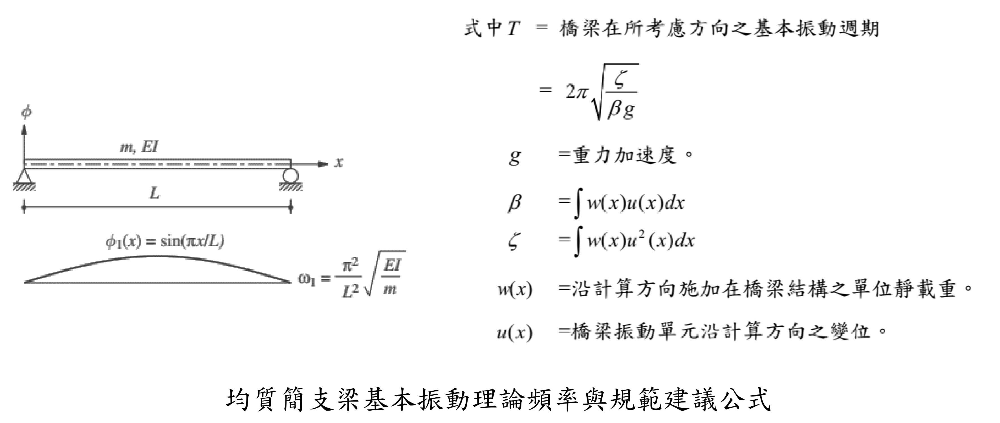

# SD-2024-4 題目正本

> 本檔只記錄考卷上寫了什麼、圖上畫了什麼，不含任何解法。解析見同資料夾 `SD-2024-4.md`。
> 判讀清單經使用者確認前，狀態為「待確認」；確認後本檔原則上不再修改（改動須回考卷原圖並記 log）。

| 項目 | 內容 |
|---|---|
| 考卷 | `raw/exams/SD-2024_結構動力分析與耐震設計.pdf`，第 2 頁（頁次 2－2），第四題 |
| 考年 | 2024（民國113年）專技高考結構工程技師「結構動力分析與耐震設計」 |
| 配分 | 25 分（推導 10、週期與比較 15） |
| 附圖 | `SD-2024-4-fig-1.png`（舊擷取，只有左半簡支梁圖、缺右半規範公式，左上有游標）、`SD-2024-4-fig-2.png`（2026-11-16 由考卷 500 dpi 重擷取，含左半圖、右半公式與圖說） |
| 判讀狀態 | **已確認**（2026-11-16，使用者授權依 Claude 建議；#1 題文「u(t)」定案為 u(x) 筆誤）。原轉錄：2026-11-16；PyMuPDF 110 dpi 整頁＋500 dpi 局部放大，題文以 PDF 文字層核對，附圖與公式為嵌入影像、目視判讀；盲讀於開啟解析前完成 |

## 1. 考卷原文（逐字）

四、根據公路橋梁耐震設計規範，橋梁設計總橫力之地震力計算，提供規範（2-6）式橋梁所考慮方向之基本振動週期計算公式，請根據該公式先推導下圖均質簡支梁沿垂直方向之變位函數 $u(t)$。（10 分）再求得規範建議公式之基本振動週期，並與圖示之理論解比較，同時說明其合理性。（15 分）

（「$u(t)$」照考卷原文，見判讀 #1）

## 2. 考卷給的公式、附表與參數

圖右半（影像，照錄）：

- 式中 $T$ ＝ 橋梁在所考慮方向之基本振動週期 $=2\pi\sqrt{\dfrac{\zeta}{\beta g}}$
- $g$ ＝重力加速度。
- $\beta=\int w(x)u(x)\,dx$
- $\zeta=\int w(x)u^2(x)\,dx$
- $w(x)$ ＝沿計算方向施加在橋梁結構之單位靜載重。
- $u(x)$ ＝橋梁振動單元沿計算方向之變位。

圖左半（影像，照錄）：$m,\ EI$；$L$；$\phi_1(x)=\sin(\pi x/L)$；$\omega_1=\dfrac{\pi^2}{L^2}\sqrt{\dfrac{EI}{m}}$。

圖說：均質簡支梁基本振動理論頻率與規範建議公式

- 考卷沒有給：$m$、$EI$、$L$ 的數值；$m$ 是否為單位長度質量的文字說明；$w(x)$ 與 $m$ 的關係。
- 卷首注意事項：㈠可以使用電子計算器。㈡不必抄題，作答時請將試題題號及答案依照順序寫在試卷上，於本試題上作答者，不予計分。㈢本科目除專門名詞或數理公式外，應使用本國文字作答。考試時間：2 小時。

## 3. 附圖

*證據圖 SD-2024-4-fig-2.png（500 dpi 重擷取；舊圖 SD-2024-4-fig-1.png 只有左半、有游標）*

圖面文字照錄：ϕ、m, EI、x、L、ϕ1(x) = sin(πx/L)、ω1 = π²/L² √(EI/m)；式中 T ＝ 橋梁在所考慮方向之基本振動週期 ＝ 2π√(ζ/βg)；g ＝重力加速度。β ＝∫w(x)u(x)dx；ζ ＝∫w(x)u²(x)dx；w(x) ＝沿計算方向施加在橋梁結構之單位靜載重。u(x) ＝橋梁振動單元沿計算方向之變位。均質簡支梁基本振動理論頻率與規範建議公式

## 4. 判讀清單

| # | 項目 | 判讀 | 圖上／題文依據 | 把握 |
|---|---|---|---|---|
| 1 | 題文「變位函數 $u(t)$」 | 筆誤，應為 $u(x)$（沿垂直方向施加 $w(x)$ 時梁的靜變位函數）。定案理由：同頁公式只定義 $u(x)$，且是靜載重下的變位，與時間無關 | 題文文字層「u(t)」；圖右半 $u(x)$ 定義 | 不確定（解讀）；使用者授權依建議確認 |
| 2 | 公式記號 $\zeta$ | 是規範式中的積分 $\int w u^2 dx$（2002、2010 年考卷記為 $\gamma$），不是阻尼比 | 圖右半定義 | 確定 |
| 3 | 支承 | 左端鉸支承、右端滾支承（簡支） | 500 dpi：左三角、右圓 | 確定 |
| 4 | 梁 | 均質，$m$、$EI$ 為常數，跨長 $L$（尺寸線量兩支承點間） | 圖上 m, EI、L；題文「均質簡支梁」 | 確定 |
| 5 | $m$ | 單位長度質量 | 「均質」＋ $\omega_1$ 式的量綱需 $m$ 為質量/長度 | 確定（解讀） |
| 6 | 座標 | $x$ 沿梁軸向右、原點在左支承；$\phi$ 軸向上（垂直方向） | 圖上箭頭 | 確定 |
| 7 | 圖示理論解 | $\phi_1(x)=\sin(\pi x/L)$、$\omega_1=\dfrac{\pi^2}{L^2}\sqrt{EI/m}$，考卷直接給 | 圖左半 | 確定 |
| 8 | 計算方向 | 垂直方向（$w(x)$ 沿垂直施加） | 題文「沿垂直方向之變位函數」 | 確定 |
| 9 | 所求 | 推導 $u(x)$；以規範式求 $T$；與 $\omega_1$ 對應的理論週期比較並說明合理性 | 題文 | 確定 |
| 10 | 考卷沒有給 | 數值；$w(x)$ 與 $m$ 的關係；規範版本年份 | 題文 | 確定 |

---
*轉錄：2026-11-16（X-G1 題目正本推廣：SD-U2-3／SD-U1-1）*
*確認：2026-11-16 使用者授權依 Claude 建議確認（X-G1，關卡一）*
