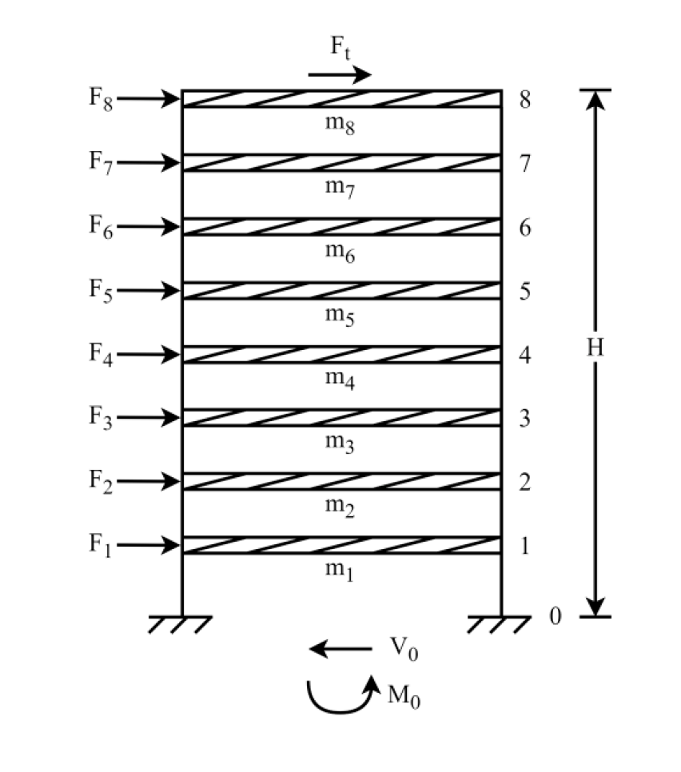

# SD-2025-1 題目正本

> 本檔只記錄考卷上寫了什麼、圖上畫了什麼，不含任何解法。解析見同資料夾 `SD-2025-1.md`。
> 判讀清單經使用者確認前，狀態為「待確認」；確認後本檔原則上不再修改（改動須回考卷原圖並記 log）。

| 項目 | 內容 |
|---|---|
| 考卷 | `raw/exams/SD-2025_結構動力分析與耐震設計.pdf`，第 1 頁（頁次 2－1），第一題 |
| 考年 | 2025（民國114年）專技高考結構工程技師「結構動力分析與耐震設計」（代號 00320） |
| 配分 | 25 分（㈠5 分、㈡15 分、㈢5 分） |
| 附圖 | `SD-2025-1-fig-1.png`（既有擷取，完整、無游標；考卷附圖本身是 477×614 px 的點陣嵌入圖，既有擷取已達原生解析度，未重擷取） |
| 判讀狀態 | **已確認**（2026-11-16，使用者授權依 Claude 建議；#1 定案為依現行規範計入 $F_t$。原轉錄：2026-11-16；PyMuPDF 110 dpi 整頁＋400–500 dpi 局部放大，PDF 文字層核對原文；盲讀於開啟解析前完成） |

## 1. 考卷原文（逐字）

一、設計地震水平總橫力：$\mathrm{V}=\dfrac{\mathrm{IS_{aD}}}{1.4\alpha_y\mathrm{Fu}}\mathrm{W}$

一棟 8 層樓平面構架如下圖，假設各樓層高 3.5 m，總樓高 H＝28 m，各樓層重 20 kN，總重 W＝160 kN。已知 T＝0.8 sec，I＝1.25，$\mathrm{S_{aD}}$＝0.6，Fu＝2，$\alpha_y$＝1.4，試計算：

㈠基底總剪力 $\mathrm{V_0}$＝？（5 分）

㈡各樓層設計水平力 $\mathrm{F_i}$＝？（15 分）

㈢基底總彎矩 $\mathrm{M_0}$＝？（5 分）

## 2. 考卷給的公式、附表與參數

- 考卷給的公式：$V=\dfrac{IS_{aD}}{1.4\alpha_y F_u}W$（照錄；**沒有**現行規範的修正係數 $(\cdot)_m$ 括號）。
- 給定：8 層、各層高 3.5 m、$H=28$ m、各樓層重 20 kN、$W=160$ kN、$T=0.8$ s、$I=1.25$、$S_{aD}=0.6$、$F_u=2$、$\alpha_y=1.4$。
- 考卷沒有給：頂層集中力 $F_t$ 的計算式（圖上畫了 $F_t$ 箭頭）；豎向分配公式；$S_{aM}$、$F_{uM}$、工址分類等最小總橫力檢核所需資料；$F_u$ 由 $R_a$ 的推算（直接給 $F_u=2$）。
- 卷首注意事項：可以使用電子計算器；不必抄題，作答時請將試題題號及答案依照順序寫在試卷上，於本試題上作答者，不予計分；本科目除專門名詞或數理公式外，應使用本國文字作答。考試時間：2 小時。

## 3. 附圖

*證據圖 SD-2025-1-fig-1.png（既有擷取；考卷原生點陣 477×614 px，分上下兩張嵌入圖拼接，接縫在第 4 層附近，無內容缺漏）*

圖面文字照錄：Ft、F8、F7、F6、F5、F4、F3、F2、F1、m8、m7、m6、m5、m4、m3、m2、m1、8、7、6、5、4、3、2、1、0、H、V0、M0

## 4. 判讀清單

| # | 項目 | 判讀 | 圖上／題文依據 | 把握 |
|---|---|---|---|---|
| 1 | 頂層集中力 $F_t$ | 圖上屋頂另畫 $F_t$（與 $F_8$ 分開），考卷未給計算式。定案：依現行規範計入，$T=0.8\ \mathrm{s}>0.7\ \mathrm{s}$ 時 $F_t=0.07TV$（且 $\le 0.25V$），其餘 $V-F_t$ 依 $w_ih_i$ 比例分配 | 500 dpi：屋頂上方中央向右箭頭標 Ft，位置獨立於左側 F8 | 不確定（影響答案；定案如左） |
| 2 | 考卷公式沒有 $(\cdot)_m$ | 現行規範為 $V=\dfrac{I}{1.4\alpha_y}\left(\dfrac{S_{aD}}{F_u}\right)_m W$；本題 $S_{aD}/F_u=0.3$，落在修正係數不改值的範圍，兩式結果相同（解析 §5 註明） | 400 dpi 公式放大：分母 $1.4\alpha_y\mathrm{Fu}$，無括號與下標 m | 確定（解讀；不影響答案） |
| 3 | 最小總橫力檢核 | 考卷沒有給 $S_{aM}$、$F_{uM}$、工址資料，無法做 $V^*$、$V_M$ 檢核；只依所給公式求 $V$ | 題文 | 確定（解讀） |
| 4 | 樓層質量位置 | $m_i$ 集中在第 $i$ 層樓版（標籤畫在樓版 $i$ 正下方），樓層重 $w_i=20$ kN、$i=1\ldots8$ | 500 dpi：m1 在樓版 1 下、m8 在樓版 8 下；題文「各樓層重 20 kN」、$8\times20=160$ | 確定（解讀） |
| 5 | 樓層高度 | 第 $i$ 層樓版離地 $h_i=3.5i$ m，頂層 $h_8=H=28$ m | 題文 3.5 m、28 m；圖上 H 由 0 量到 8 | 確定 |
| 6 | 側力 $F_1$–$F_8$ | 作用於各樓版高度，向右 | 圖上左側箭頭對齊各樓版 | 確定 |
| 7 | 柱底 | 兩柱固定 | 圖上兩處斜線 | 確定 |
| 8 | $V_0$、$M_0$ | 基底（0 點）的總剪力與總彎矩（傾覆彎矩）；圖上 $V_0$ 向左、$M_0$ 逆時針，是基底反力方向 | 圖上柱底下方箭頭 | 確定（解讀） |
| 9 | 週期 $T$ | 直接給 $T=0.8$ s，不需由規範經驗式求 | 題文 | 確定 |
| 10 | 單位 | 力 kN、長度 m；$S_{aD}$ 無因次（g 的倍數） | 題文 | 確定 |
| 11 | 考卷沒有給 | $F_t$ 公式、豎向分配式、$S_{aM}$／$F_{uM}$、$R_a$ | 全題 | 確定 |

---
*轉錄：2026-11-16（SD-U2-2 題目正本推廣・組 U2-2-G4）*
*確認：2026-11-16 使用者授權依 Claude 建議確認（SD-U2-2 題目正本推廣・組 U2-2-G4，關卡一）*
