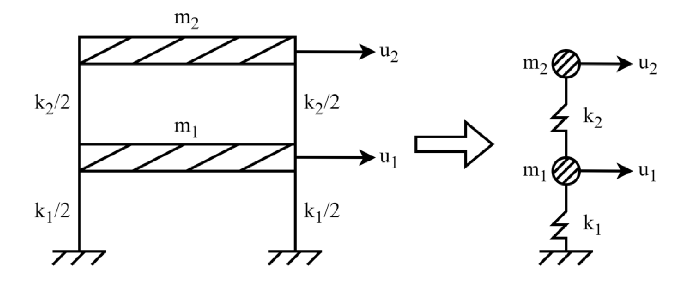

# SD-2025-2 題目正本

> 本檔只記錄考卷上寫了什麼、圖上畫了什麼，不含任何解法。解析見同資料夾 `SD-2025-2.md`。
> 判讀清單經使用者確認前，狀態為「待確認」；確認後本檔原則上不再修改（改動須回考卷原圖並記 log）。

| 項目 | 內容 |
|---|---|
| 考卷 | `raw/exams/SD-2025_結構動力分析與耐震設計.pdf`，第 2 頁（背面），第二題 |
| 考年 | 2025（民國114年）專技高考結構工程技師「結構動力分析與耐震設計」 |
| 配分 | 25 分（㈠10 分、㈡10 分、㈢5 分） |
| 附圖 | `SD-2025-2-fig-1.png`（舊擷取，右柱 k2/2 旁有游標）、`SD-2025-2-fig-2.png`（2026-11-15 由考卷 500 dpi 重擷取） |
| 判讀狀態 | **已確認**（2026-11-15 使用者授權依 Claude 建議確認；定案：#1 振態正規化採下層分量 φ1 取 1，參與係數依此寫出，並註明有效質量 Γ²M* 與正規化無關。原轉錄：2026-11-15 轉錄；PyMuPDF 110 dpi 整頁＋500 dpi 局部放大，PDF 文字層核對原文；盲讀於開啟解析前完成） |

## 1. 考卷原文（逐字）

二、一 2 層樓平面構架簡化為一 2-DOF 結構系統，如下圖所示。

其質量矩陣 $[M]=\begin{bmatrix}m_1,0\\ 0,m_2\end{bmatrix}(\mathrm{KN\text{-}sec^2/m})$，勁度矩陣 $[K]=\begin{bmatrix}k_{11},k_{12}\\ k_{21},k_{22}\end{bmatrix}(\mathrm{KN/m})$

假設：$m_1=m_2=100(\mathrm{KN\text{-}sec^2/m})$，$k_1=k_2=1500(\mathrm{KN/m})$，求此結構之：

㈠各模態週期（period）$(T_i)$ 和頻率（frequency）$(\omega_i)$。（10 分）

㈡各模態形狀係數（mode shape）$(\phi_i)$。（10 分）

㈢各模態之貢獻參與係數（modal participation factor）$(\Gamma_i)$。（5 分）

## 2. 考卷給的公式、附表與參數

- 考卷給的式子：質量矩陣、勁度矩陣的型式（矩陣元素以逗號分隔，照考卷原文）。
- 給定：$m_1=m_2=100$ kN·s²/m；$k_1=k_2=1500$ kN/m。
- 考卷沒有給：$k_{11}$ 等勁度矩陣元素的數值（須由 $k_1$、$k_2$ 組成）、振態正規化方式（參與係數 $\Gamma_i$ 的數值隨正規化而變）、阻尼、樓高。
- 卷首注意事項：㈠可以使用電子計算器。㈡不必抄題，作答時請將試題題號及答案依照順序寫在試卷上，於本試題上作答者，不予計分。㈢本科目除專門名詞或數理公式外，應使用本國文字作答。考試時間：2 小時。

## 3. 附圖

*證據圖 SD-2025-2-fig-2.png（500 dpi 重擷取；舊圖 SD-2025-2-fig-1.png 內容相同，右柱 k2/2 旁有游標）*

圖面文字照錄：m2、u2、k2/2、k2/2、m1、u1、k1/2、k1/2、m2、u2、k2、m1、u1、k1

## 4. 判讀清單

| # | 項目 | 判讀 | 圖上／題文依據 | 把握 |
|---|---|---|---|---|
| 1 | 振態正規化 | 考卷未指定；$\Gamma_i$ 數值須寫明所用正規化 | 題文只說「各模態形狀係數」「貢獻參與係數」 | 不確定（解讀）；使用者授權依建議確認 |
| 2 | 層勁度 | 每根柱 $k/2$、兩根合計，第 1 層層勁度 $k_1$、第 2 層 $k_2$（右圖串聯彈簧 $k_1$、$k_2$） | 左圖柱旁 k1/2、k2/2；右圖彈簧 k1、k2 | 確定 |
| 3 | 自由度 | $u_1$ 下層樓版（$m_1$）、$u_2$ 上層樓版（$m_2$），水平向右 | 圖上箭頭與標字 | 確定 |
| 4 | 樓版 | 斜線厚板，剪力構架（樓版只平移） | 圖上斜線厚板；右圖簡化為集中質量串聯彈簧 | 確定（解讀） |
| 5 | 柱底 | 固定 | 圖上斜線 | 確定 |
| 6 | 單位 | 質量 kN·s²/m（＝公噸）、勁度 kN/m | 題文 | 確定 |
| 7 | 參與係數的激振 | 對應水平地表運動（影響向量全為 1） | 慣例；題文未明寫 | 確定（解讀） |
| 8 | 所求 | ㈠週期與頻率（題文 $\omega_i$ 為 rad/s 的圓頻率）；㈡振態；㈢參與係數 | 題文 | 確定（解讀） |
| 9 | 考卷沒有給 | $k_{ij}$ 數值、正規化方式、阻尼、樓高 | 題文 | 確定 |

---
*轉錄：2026-11-15（SD-U1-3 題目正本推廣・批 3）*
*確認：2026-11-15 使用者授權依 Claude 建議確認（SD-U1-3 題目正本推廣・批 3，關卡一）*
