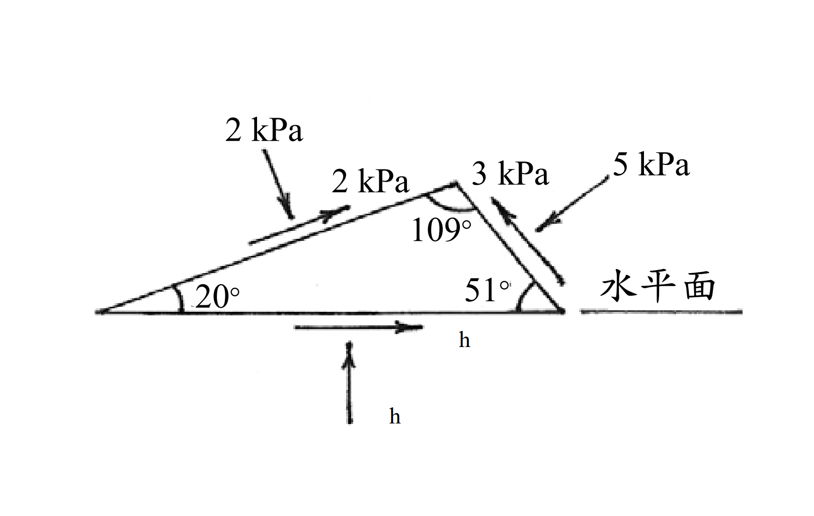

# SM-2004-2 題目正本

> 本檔只記錄**考卷上寫了什麼、圖上畫了什麼**，不含任何解法。解析見同資料夾 `SM-2004-2.md`。
> 判讀清單已確認（凍結）；本檔原則上不再修改（改動須回考卷原圖並記 log）。

| 項目 | 內容 |
|------|------|
| 考卷 | `raw/exams/SM-2004_土壤力學與基礎設計.pdf` 第 1 頁（全一頁），第二題 |
| 考年 | 民國 93 年（2004） |
| 配分 | 25 分（㈠ 9 分、㈡ 8 分、㈢ 8 分） |
| 附圖 | `SM-2004-2-fig-1.png`（三角形土壤單元與應力；既有證據圖完整、無雜訊，沿用） |
| 判讀狀態 | **已確認**（2026-11-15 關卡一：使用者授權依建議判讀確認；轉錄 2026-11-15；PyMuPDF 110 dpi 全頁目視，附圖為向量圖、500 dpi 局部放大；PDF 文字層核對逐字原文；盲讀後才比對既有解析） |

## 1. 考卷原文（逐字）

> 二、某土壤單元承受之應力狀況如右圖所示：
> ㈠試求此土壤單元水平面承受之正應力 $\sigma_h$ 及剪應力 $\tau_h$ 的大小。（9 分）
> ㈡試求最大主應力 $\sigma_1$ 及最小主應力 $\sigma_3$ 的大小。（8 分）
> ㈢試求最大剪應力 $\tau_{max}$ 及最小剪應力 $\tau_{min}$ 的方向（與水平面的夾角）。（8 分）

## 2. 考卷給的公式、附表與參數

- 全部數據都在附圖上（見 §3、§4）：兩個斜面上的正應力與剪應力、兩斜面與水平面的夾角。
- **沒有給**：應力符號約定（壓為正或拉為正、剪應力正負）、Mohr 圓作法要求。
- 卷首注意事項：㈠不必抄題，作答時請將試題題號及答案依照順序寫在試卷上，於本試題上作答者，不予計分。㈡可以使用電子計算器。

## 3. 附圖

圖面文字照錄：`2 kPa`（左斜面正應力）、`2 kPa`（左斜面剪應力）、`3 kPa`、`5 kPa`、`109°`、`20°`、`51°`、`水平面`、`h`、`h`。
（底邊兩個箭頭旁只印出下標 `h`，$\sigma$、$\tau$ 字形在 PDF 中缺字，對照題文即 $\tau_h$（水平箭頭）與 $\sigma_h$（垂直箭頭）。）

## 4. 判讀清單

| # | 項目 | 判讀 | 圖上／題文依據 | 把握 |
|---|------|------|---------------|------|
| 1 | 單元形狀 | 三角形：底邊水平（「水平面」）、左斜面自左下角向右上升、右斜面自頂點向右下降到右下角 | 附圖 500 dpi | 確定 |
| 2 | 左斜面角度 | 與水平面夾 20°（角弧在左下角） | 附圖 `20°` | 確定 |
| 3 | 右斜面角度 | 與水平面夾 51°（角弧在右下角，面向右下降）；頂角 109° = 180° − 20° − 51° | 附圖 `51°`、`109°` | 確定 |
| 4 | 左斜面正應力 | 2 kPa，箭頭由外指向面內（壓應力） | 附圖左上方斜向箭頭指向斜面 | 確定 |
| 5 | 左斜面剪應力 | 2 kPa，箭頭平行斜面、指向右上（朝頂點） | 附圖貼斜面的箭頭 | 確定 |
| 6 | 右斜面正應力 | 5 kPa，箭頭由右上方指向面內（壓應力） | 附圖右上方斜向箭頭 | 確定 |
| 7 | 右斜面剪應力 | 3 kPa，箭頭平行斜面、指向左上（朝頂點） | 附圖貼右斜面的箭頭 | 確定 |
| 8 | 水平面上的應力 | 未知量：向上箭頭為 $\sigma_h$（由下指向底面，壓）、向右箭頭為 $\tau_h$；圖上只印下標 h | 附圖底邊下方兩箭頭；題文 ㈠ | 確定（解讀） |
| 9 | 資料是否自相容 | 兩斜面共 4 個應力分量、應力狀態只有 3 個未知數；題給角度為整數度，屬近似值，兩面資料在四捨五入範圍內相容 | 題文與附圖 | 確定（解讀） |
| 10 | 所求 ㈢ | 最大、最小剪應力**面的方向**，以與水平面的夾角表示 | 題文 | 確定 |
| 11 | 考卷沒有給 | 符號約定、作圖或解析法的指定 | 全題 | 確定 |

---

*轉錄：2026-11-15（SM-U1-4 題目正本推廣・批 1）*

*確認：2026-11-15 使用者授權依建議判讀確認（SM-U1-4 題目正本推廣・批 1，關卡一；使用者指示「要我確認的請依你建議」）*
