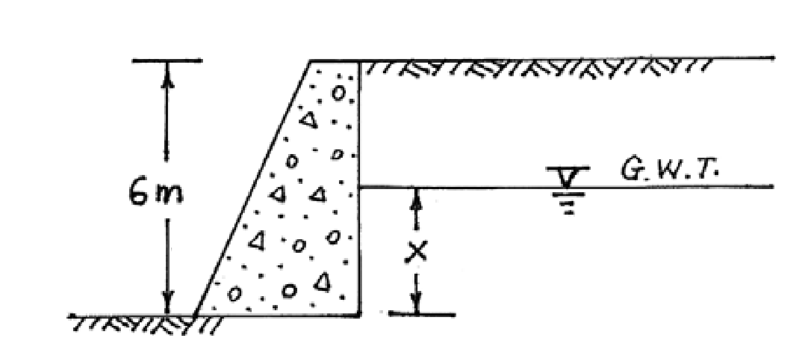

# SM-2004-3 題目正本

> 本檔只記錄**考卷上寫了什麼、圖上畫了什麼**，不含任何解法。解析見同資料夾 `SM-2004-3.md`。
> 判讀清單已確認（凍結）；本檔原則上不再修改（改動須回考卷原圖並記 log）。

| 項目 | 內容 |
|------|------|
| 考卷 | `raw/exams/SM-2004_土壤力學與基礎設計.pdf` 第 1 頁（全一頁），第三題 |
| 考年 | 民國 93 年（2004） |
| 配分 | 25 分 |
| 附圖 | `SM-2004-3-fig-2.png`（重力式擋土牆；2026-11-15 由考卷重新擷取 500 dpi）；既有 `SM-2004-3-fig-1.png` 為同一圖，「6m」左側有滑鼠游標，保留不刪 |
| 判讀狀態 | **已確認**（2026-11-15 關卡一：使用者授權依建議判讀確認；轉錄 2026-11-15；PyMuPDF 110 dpi 全頁目視，附圖 400 dpi 局部放大（內嵌點陣影像）；PDF 文字層核對；盲讀後才比對既有解析） |

## 1. 考卷原文（逐字）

> 三、右圖所示 6.0 m 高之重力式擋土牆被設計為可以抵抗 146 kN/m 之水平推力。牆後非凝聚性回填土之飽和單位重及濕土單位重皆為 19.2 kN/m³，而內摩擦角為 35°。假設忽略牆摩擦角及毛細現象，試求地下水位（G.W.T.）上升至何高度 x 時？此擋土牆將發生滑移（sliding）現象。（25 分）

## 2. 考卷給的公式、附表與參數

- 牆高 6.0 m；設計可抵抗水平推力 146 kN/m。
- 回填土：非凝聚性，$\gamma_{sat}=\gamma_t$ = 19.2 kN/m³，$\phi$ = 35°。
- 假設：忽略牆摩擦角（$\delta$ = 0）、忽略毛細現象。
- **沒有給**：$\gamma_w$；牆體尺寸與單位重；基底摩擦；牆前被動土壓。
- 卷首注意事項：㈠不必抄題，作答時請將試題題號及答案依照順序寫在試卷上，於本試題上作答者，不予計分。㈡可以使用電子計算器。

## 3. 附圖

圖面文字照錄：`6m`、`G.W.T.`、`x`。

## 4. 判讀清單

| # | 項目 | 判讀 | 圖上／題文依據 | 把握 |
|---|------|------|---------------|------|
| 1 | 牆高 | 6 m，由牆頂（＝回填土面）量到牆底 | 附圖 400 dpi 左側尺寸線上下端對齊牆頂與牆底 | 確定 |
| 2 | 水位高度 x | 由**牆底**往上量到地下水位線 | 附圖尺寸線 x 下端在牆底高程、上端在水位線 | 確定 |
| 3 | 牆背 | 鉛直、平滑（忽略牆摩擦），可用 Rankine | 附圖牆背為鉛直線；題文「忽略牆摩擦角」 | 確定 |
| 4 | 回填土面 | 水平，與牆頂齊 | 附圖 | 確定 |
| 5 | 牆前 | 地面在牆底高程，牆前無埋入土 | 附圖左下地面線與牆底齊 | 確定 |
| 6 | 滑移條件 | 牆後總水平推力（土壓＋水壓）達 146 kN/m 時滑移 | 題文 | 確定（解讀） |
| 7 | 單位重 | 水位上、下回填土單位重同為 19.2 | 題文 | 確定 |
| 8 | 所求 | 地下水位上升至高度 x 時擋土牆發生滑移 | 題文 | 確定 |
| 9 | 考卷沒有給 | $\gamma_w$、牆體尺寸、基底摩擦 | 全題 | 確定 |

---

*轉錄：2026-11-15（SM-U3-1 題目正本推廣・批 1）*

*確認：2026-11-15 使用者授權依建議判讀確認（SM-U3-1 題目正本推廣・批 1，關卡一；使用者指示「要確認的依你建議」）*
