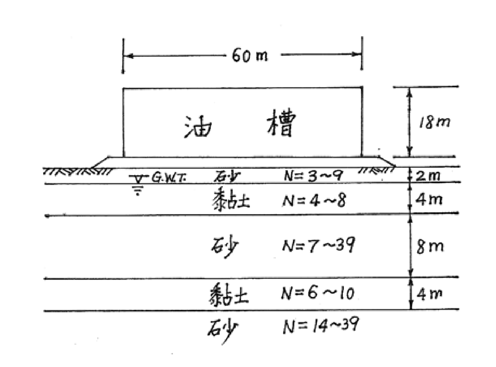

# SM-2004-4 題目正本

> 本檔只記錄**考卷上寫了什麼、圖上畫了什麼**，不含任何解法。解析見同資料夾 `SM-2004-4.md`。
> 判讀清單已確認（凍結）；本檔原則上不再修改（改動須回考卷原圖並記 log）。

| 項目 | 內容 |
|------|------|
| 考卷 | `raw/exams/SM-2004_土壤力學與基礎設計.pdf` 第 1 頁（全一頁），第四題 |
| 考年 | 民國 93 年（2004） |
| 配分 | 25 分（㈠ 9、㈡ 8、㈢ 8） |
| 附圖 | `SM-2004-4-fig-2.png`（儲油槽與地層剖面；2026-11-15 由考卷重新擷取 500 dpi）；既有 `SM-2004-4-fig-1.png` 為同一圖，滑鼠游標壓在 G.W.T. 符號旁，保留不刪 |
| 判讀狀態 | **已確認**（2026-11-15 關卡一：使用者授權依建議判讀確認；轉錄 2026-11-15；PyMuPDF 110 dpi 全頁目視，附圖 400 dpi 局部放大（內嵌點陣影像，手繪）；PDF 文字層核對；盲讀後才比對既有解析） |

## 1. 考卷原文（逐字）

> 四、於台灣某處建造如下圖之大型儲油槽，油槽下方為軟弱且具壓縮性之軟弱黏土及砂土層。
> ㈠試詳細說明油槽設計者必須考慮之各項大地工程問題。（9 分）
> ㈡工址調查應進行那些現地調查及實驗室試驗項目？為甚麼需要這些項目？（8 分）
> ㈢若採用預壓（preloading）工法改良地盤，為確保施工安全及瞭解改良成效，在現地應進行那些監測項目？（8 分）

（「那些」「為甚麼」照考卷原文。）

## 2. 考卷給的公式、附表與參數

- 油槽：寬（直徑）60 m，高 18 m，置於地表的墊層上。
- 地層（由上而下）：砂 2 m（N = 3～9）、黏土 4 m（N = 4～8）、砂 8 m（N = 7～39）、黏土 4 m（N = 6～10）、砂（N = 14～39，厚度未標）。
- 地下水位：在最上層砂內（圖上未標深度）。
- **沒有給**：油槽荷重（液體單位重、液位）、土壤單位重與壓縮參數、地震條件。
- 卷首注意事項：㈠不必抄題，作答時請將試題題號及答案依照順序寫在試卷上，於本試題上作答者，不予計分。㈡可以使用電子計算器。

## 3. 附圖

圖面文字照錄：`60 m`、`油槽`、`18m`、`G.W.T.`、`砂 N=3~9`、`2m`、`黏土 N=4~8`、`4m`、`砂 N=7~39`、`8m`、`黏土 N=6~10`、`4m`、`砂 N=14~39`。

## 4. 判讀清單

| # | 項目 | 判讀 | 圖上／題文依據 | 把握 |
|---|------|------|---------------|------|
| 1 | 地層 | 0～2 m 砂（N 3～9）、2～6 m 黏土（N 4～8）、6～14 m 砂（N 7～39）、14～18 m 黏土（N 6～10）、18 m 以下砂（N 14～39） | 附圖右側尺寸線 2／4／8／4 m | 確定 |
| 2 | 地下水位 | 在最上層砂內，約地表下 1 m（圖上未標，量圖約 0.5～1.3 m） | 附圖 G.W.T. 符號在地表線與第一分層線之間 | 確定（解讀） |
| 3 | 油槽尺寸 | 寬 60 m（直徑）、高 18 m；18 m 由槽底（墊層頂）量到槽頂 | 附圖尺寸線 | 確定 |
| 4 | 墊層 | 槽底下有略寬於槽的梯形墊層，坐在地表，厚度未標 | 附圖 | 確定 |
| 5 | 淺層砂液化 | 題文稱「軟弱黏土及砂土層」；上層砂 N = 3～9、水位淺，題目雖未問液化，作答可納入大地問題 | 附圖 N 值、水位 | 確定（解讀） |
| 6 | 所求 | ㈠設計須考慮的大地工程問題；㈡現地調查與室內試驗項目及理由；㈢預壓工法的現地監測項目 | 題文 | 確定 |
| 7 | 題型 | 說明題，無數值計算 | 全題 | 確定 |
| 8 | 考卷沒有給 | 油槽荷重、土壤參數、地震條件、最下層砂厚度 | 全題 | 確定 |

---

*轉錄：2026-11-15（SM-U2-4 題目正本推廣・批 1）*

*確認：2026-11-15 使用者授權依建議判讀確認（SM-U2-4 題目正本推廣・批 1，關卡一；使用者指示「要確認的依你建議」）*
