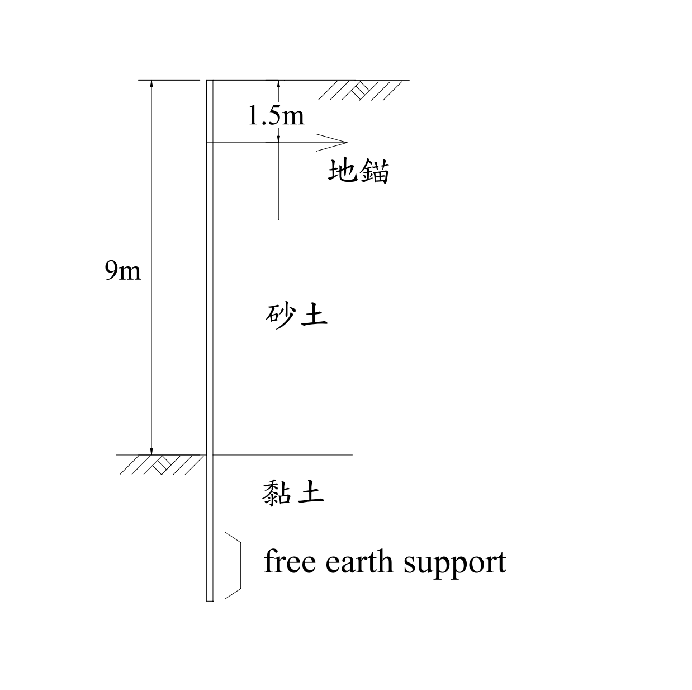

# SM-2005-1 題目正本

> 本檔只記錄**考卷上寫了什麼、圖上畫了什麼**，不含任何解法。解析見同資料夾 `SM-2005-1.md`。
> 判讀清單已確認（凍結）；本檔原則上不再修改（改動須回考卷原圖並記 log）。

| 項目 | 內容 |
|------|------|
| 考卷 | `raw/exams/SM-2005_土壤力學與基礎設計.pdf` 第 1 頁（正面），第一題 |
| 考年 | 民國 94 年（2005） |
| 配分 | 25 分（㈠10＋㈡15） |
| 附圖 | `SM-2005-1-fig-1.png`（版樁剖面，無圖號） |
| 判讀狀態 | **已確認**（2026-11-15 關卡一：使用者授權依建議判讀確認；轉錄 2026-11-15；PyMuPDF 110 dpi 全頁目視，附圖 300 dpi 局部放大（向量圖）；PDF 文字層核對逐字原文；盲讀後才比對既有解析） |

## 1. 考卷原文（逐字）

> 一、有一版樁(sheet pile)使用於地下水位以上之開挖支撐，開挖面高 9m，其背後為砂性土壤，單位重 $\gamma_s$=18 kN/m³，摩擦角 $\phi_s$=32°，凝聚力 $c_s$=0，開挖面以下為黏土層，單位重 $\gamma_c$=20 kN/m³，摩擦角 $\phi_c$=0°，凝聚力 $c_c$=45kPa。若版樁自頂部下 1.5m 設置有一排水平地錨，且版樁深入黏土層底部為自由土壤支撐（free earth support）形式：
> ㈠試繪出作用於版樁之土壓力分佈情形。（10 分）
> ㈡版樁深入黏土層之最少入土深度及地錨預力為何？（15 分）

## 2. 考卷給的公式、附表與參數

- 砂土（開挖面以上、版樁背側）：$\gamma_s$ = 18 kN/m³、$\phi_s$ = 32°、$c_s$ = 0。
- 黏土（開挖面以下）：$\gamma_c$ = 20 kN/m³、$\phi_c$ = 0°、$c_c$ = 45 kPa。
- 開挖面高 9 m；水平地錨在版樁頂下 1.5 m；黏土內為自由土壤支撐。
- **沒有給**：安全係數（入土深度或被動土壓折減）、地錨水平間距、牆面摩擦角、地表超載、黏土層厚度。
- 卷首注意事項：㈠不必抄題，作答時請將試題題號及答案依照順序寫在試卷上，於本試題紙上作答者，不予計分。㈡可以使用電子計算器，但需詳列解答過程。

## 3. 附圖

圖面文字照錄：`1.5m`、`地錨`、`9m`、`砂土`、`黏土`、`free earth support`。

## 4. 判讀清單

| # | 項目 | 判讀 | 圖上／題文依據 | 把握 |
|---|------|------|---------------|------|
| 1 | 安全係數 | 考卷沒有給 → 求「最少」入土深度取 FS = 1（不折減被動土壓、不加長） | 題文「最少入土深度」 | 不確定（解讀；影響答案，請確認）；使用者授權依建議確認 |
| 2 | 開挖深度 | 9 m，由版樁頂（＝背側地表）量到左側開挖面；尺寸線上端對齊版樁頂水平線、下端對齊開挖面剖線 | 附圖 300 dpi，左側尺寸線 | 確定 |
| 3 | 背填側與開挖側 | 背填砂土在**右側**（右上地表剖線），開挖側在左側（左下開挖面剖線） | 附圖地表剖線位置 | 確定 |
| 4 | 地錨 | 版樁頂下 1.5 m，水平，箭頭指向背填側 | 附圖右上尺寸線與箭頭；題文「水平地錨」 | 確定 |
| 5 | 黏土層頂 | 開挖面高程（地表下 9 m），水平線由開挖側延伸到背填側 → 背側 9 m 以下也是黏土 | 附圖水平線跨越版樁；題文「開挖面以下為黏土層」 | 確定 |
| 6 | 黏土層厚／下邊界 | 未給；版樁下端畫在黏土內 | 附圖 | 確定 |
| 7 | 地下水 | 題文「使用於地下水位以上」→ 不計水壓 | 題文 | 確定 |
| 8 | 支承型式 | 自由土壤支撐：版樁貫入段視為簡支，以對地錨點力矩平衡求入土深度 | 題文、附圖括號 | 確定 |
| 9 | 所求㈡地錨預力 | 單位寬度（每公尺牆長）的地錨水平力；地錨間距未給 | 題文 | 確定（解讀） |
| 10 | 考卷沒有給 | 安全係數、地錨水平間距、牆面摩擦角（採 Rankine）、地表超載、黏土層厚 | 全題 | 確定 |

---

*轉錄：2026-11-15（SM-U2-3 題目正本推廣・批 1）*

*確認：2026-11-15 使用者授權依建議判讀確認（SM-U2-3 題目正本推廣・批 1，關卡一；使用者指示「要我確認的請依你建議」）*
