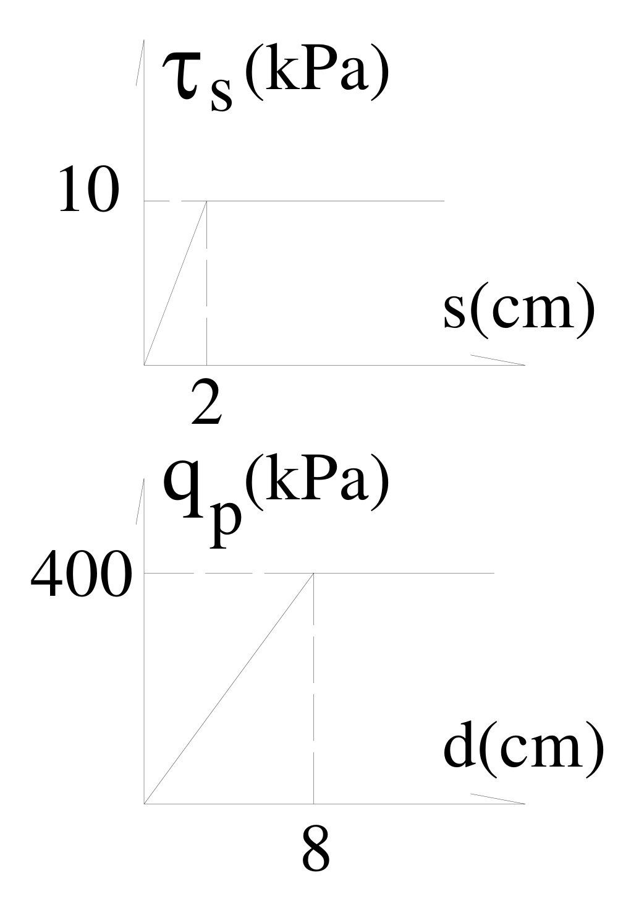

# SM-2005-4 題目正本

> 本檔只記錄**考卷上寫了什麼、圖上畫了什麼**，不含任何解法。解析見同資料夾 `SM-2005-4.md`。
> 判讀清單已確認（凍結）；本檔原則上不再修改（改動須回考卷原圖並記 log）。

| 項目 | 內容 |
|------|------|
| 考卷 | `raw/exams/SM-2005_土壤力學與基礎設計.pdf` 第 2 頁（背面），第四題 |
| 考年 | 民國 94 年（2005） |
| 配分 | 25 分（㈠5、㈡10、㈢10） |
| 附圖 | `SM-2005-4-fig-2.png`（τs–s 與 qp–d 兩張關係圖；2026-11-15 由考卷重新擷取 500 dpi）；既有 `SM-2005-4-fig-1.png` 為同一圖，左上角有滑鼠游標，保留不刪 |
| 判讀狀態 | **已確認**（2026-11-15 關卡一：使用者授權依建議判讀確認；轉錄 2026-11-15；PyMuPDF 110 dpi 全頁目視，附圖 500 dpi 局部放大，附圖為向量線條、以 PDF drawings 座標核對；盲讀後才比對既有解析） |

## 1. 考卷原文（逐字）

> 四、有一墩基(pier)直徑為 1.2m，長度為 12m，平均側向摩擦剪應力 $\tau_s$ 與剪位移 s 關係、底部承載應力 $q_p$ 與位移 d 關係分別如右圖所示：
> ㈠利用極限載重支承力（ultimate load bearing capacity）求工作荷重（working load）。（5 分）
> ㈡利用位移限制為 1cm 與 1.5cm 分別求工作荷重。（10 分）
> ㈢試檢討前述兩種方法之適當性。（10 分）

## 2. 考卷給的公式、附表與參數

- 墩基：直徑 1.2 m、長度 12 m。
- 側向摩擦：**平均**側向摩擦剪應力 $\tau_s$ 與剪位移 $s$ 的關係（附圖上圖）。
- 底部承載：底部承載應力 $q_p$ 與位移 $d$ 的關係（附圖下圖）。
- 考卷沒有給公式。
- **沒有給**：安全係數、墩身彈性模數（墩身是否視為剛體）、墩身自重、地層種類與單位重、地下水位、「工作荷重」在㈡是否還要再除安全係數。
- 卷首注意事項：不必抄題，作答時請將試題題號及答案依照順序寫在試卷上，於本試題紙上作答者，不予計分。可以使用電子計算器，但需詳列解答過程。

## 3. 附圖

圖面文字照錄：`τs (kPa)`、`10`、`s(cm)`、`2`、`qp(kPa)`、`400`、`d(cm)`、`8`。

## 4. 判讀清單

| # | 項目 | 判讀 | 圖上／題文依據 | 把握 |
|---|------|------|---------------|------|
| 1 | ㈡「工作荷重」是否再除安全係數 | 判讀為：墩頂位移達限制值（1 cm、1.5 cm）時對應的載重**即為**工作荷重，不再除安全係數 | 題文「利用位移限制…分別求工作荷重」；考卷未給安全係數 | 不確定（影響答案）；使用者授權依建議確認 |
| 2 | ㈠安全係數 | 考卷沒有給；須自行假設（一般取 FS = 2.5～3） | 全題無 FS | 確定（考卷沒有給） |
| 3 | 墩身剛性 | 考卷未給墩身彈性模數；判讀為剛性墩，墩身各處剪位移 $s$ 等於墩底位移 $d$ 等於墩頂沉陷 | 題文只給土壤–墩介面關係 | 確定（解讀） |
| 4 | τs–s 關係 | 由原點直線增至 $s$ = 2 cm、$\tau_s$ = 10 kPa，之後水平（完全塑性）；轉折點以虛線引到兩軸 | 附圖 500 dpi；PDF 座標：原點 (498.5, 267.9) → 轉折 (513.1, 229.7) → 水平至 568.6 | 確定 |
| 5 | qp–d 關係 | 由原點直線增至 $d$ = 8 cm、$q_p$ = 400 kPa，之後水平 | 附圖；PDF 座標：原點 (498.5, 370.0) → 轉折 (538.1, 316.3) → 水平至 580.1 | 確定 |
| 6 | 兩圖橫軸比例 | 圖上刻度未按比例（2 與 8 的位置非 1：4），數值以標註為準 | PDF 座標 2 在 +14.6 pt、8 在 +39.6 pt | 確定 |
| 7 | 摩擦作用範圍 | 「平均」側向摩擦剪應力 → 沿墩身全長 12 m 均勻作用 | 題文「平均」 | 確定（解讀） |
| 8 | 底部承載面積 | $q_p$ 作用於墩底全斷面（直徑 1.2 m 圓） | 題文 | 確定（解讀） |
| 9 | 所求 | ㈠依極限支承力求工作荷重；㈡位移限制 1 cm 與 1.5 cm 各求一個工作荷重；㈢比較兩法適當性（說明） | 題文 | 確定 |
| 10 | 考卷沒有給 | 安全係數、墩身 $E$、墩身自重、土層種類、地下水位 | 全題 | 確定 |

---

*轉錄：2026-11-15（SM-U2-2 題目正本推廣・批 1）*

*確認：2026-11-15 使用者授權依建議判讀確認（SM-U2-2 題目正本推廣・批 1，關卡一；使用者指示「要我確認的請依你建議」）*
