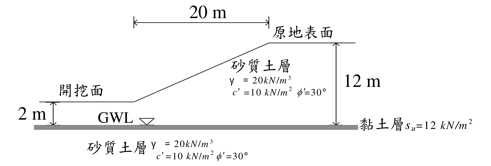

# SM-2006-3 題目正本

> 本檔只記錄**考卷上寫了什麼、圖上畫了什麼**，不含任何解法。解析見同資料夾 `SM-2006-3.md`。
> 判讀清單已確認（凍結）；本檔原則上不再修改（改動須回考卷原圖並記 log）。

| 項目 | 內容 |
|------|------|
| 考卷 | `raw/exams/SM-2006_土壤力學與基礎設計.pdf` 第 1 頁（全一頁），第三題 |
| 考年 | 民國 95 年（2006） |
| 配分 | 25 分（㈠15 分、㈡10 分） |
| 附圖 | `SM-2006-3-fig-2.png`（島式開挖邊坡剖面；2026-11-15 由考卷重新擷取 500 dpi）；既有 `SM-2006-3-fig-1.png` 為同一圖，左上空白處有滑鼠游標（I 形），保留不刪 |
| 判讀狀態 | **已確認**（2026-11-15 關卡一：使用者授權依建議判讀確認；#1 依建議採一個情況；轉錄 2026-11-15；PyMuPDF 110 dpi 全頁目視，附圖 500 dpi 局部放大（向量圖，以 PDF 線段座標核對尺寸線端點）；盲讀後才比對既有解析） |

## 1. 考卷原文（逐字）

> 三、有一地下室工程擬採島式開挖施工，其邊坡採 V：H=1：2 之邊坡開挖如下圖所示，邊坡主要為砂質土層，其單位體積總重在常時與飽和狀態時均為 $\gamma$＝20 kN/m³，且 $c'$=10 kN/m²，$\phi'$=30°。今假設開挖面下夾有一薄層軟弱黏土（如圖中之斜線區所示），厚度約 10 cm，其不排水剪力強度為 $s_u$=12 kN/m²：
> ㈠假設常時地下水位位於軟弱黏土層表面，當邊坡開挖深度達 10m 時（即下圖所示情況），試以合理方法估計其產生側向滑動之安全係數。（15 分）
> ㈡若遇豪雨使地下水位分別上升至沿原地表面、沿邊坡面以及沿開挖面分布時，其產生側向滑動之安全係數變為如何？（10 分）

## 2. 考卷給的公式、附表與參數

- 邊坡：V：H = 1：2；開挖深度 10 m。
- 砂質土層（黏土層上、下皆同）：$\gamma$ = 20 kN/m³（常時與飽和皆同）、$c'$ = 10 kN/m²、$\phi'$ = 30°。
- 軟弱黏土薄層：厚約 10 cm、$s_u$ = 12 kN/m²。
- ㈠常時地下水位：軟弱黏土層表面。
- **沒有給**：公式、$\gamma_w$、滑動面（滑動塊體）的形狀與位置、是否考慮張力裂縫、主／被動土壓力採用何種理論、黏土層在圖外的延伸範圍。
- 卷首注意事項：㈠可以使用電子計算器。㈡不必抄題，作答時請將試題題號及答案依照順序寫在試卷上，於本試題上作答者，不予計分。

## 3. 附圖

圖面文字照錄：`20 m`、`原地表面`、`砂質土層`、`γ = 20kN/m³`、`c′ =10 kN/m²  φ′=30°`、`12 m`、`開挖面`、`2 m`、`GWL`、`黏土層 su=12 kN/m²`、`砂質土層 γ = 20kN/m³ c′=10 kN/m² φ′=30°`。

## 4. 判讀清單

| # | 項目 | 判讀 | 圖上／題文依據 | 把握 |
|---|------|------|---------------|------|
| 1 | ㈡三種水位的意思 | 建議讀法：**一個情況**——豪雨後地下水位與地表輪廓重合（坡肩後沿原地表面、坡面上沿邊坡面、坡趾前沿開挖面），即整個地表都在水位上。另一讀法：「分別」指三個情況（水位水平位於原地表面高程／沿坡面／水平位於開挖面高程）各算一個安全係數 | 題文「分別上升至沿原地表面、沿邊坡面以及沿開挖面分布時，其…安全係數變為如何」只問一個安全係數 | 不確定（影響答案，請確認）；依建議確認：採一個情況（水位與地表輪廓重合） |
| 2 | 坡面水平投影 | 20 m，由坡趾量到坡肩（尺寸線兩端 x = 261.7、374.5 pt，分別對齊坡趾 (261.8, 778.5) 與坡肩 (374.5, 729.2) 兩個轉折點） | PDF 線段座標 | 確定 |
| 3 | 原地表面到黏土層 | 12 m，上端對齊原地表面（729.2 pt），下端對齊黏土斜線帶上緣（797.9 pt） | PDF 線段座標 | 確定 |
| 4 | 開挖面到黏土層 | 2 m，上端對齊開挖面（778.8 pt），下端對齊黏土斜線帶上緣（797.9 pt） | PDF 線段座標 | 確定 |
| 5 | 坡高 | 12 − 2 = 10 m，與題文「開挖深度達 10m」及 1：2、水平 20 m 三者一致 | #2–#4＋題文 | 確定 |
| 6 | 圖面比例 | 不按比例（12 m 與 2 m 的圖面長度比、坡面畫成約 1：2.3），一律以標註數值為準 | PDF 座標 | 確定 |
| 7 | 黏土薄層 | 厚約 10 cm、水平，位於開挖面下 2 m；斜線帶由開挖面左端外側延伸到坡肩右側 12 m 尺寸線之外，判讀為水平連續、貫穿整個邊坡下方 | 附圖斜線帶＋題文 | 確定（解讀） |
| 8 | ㈠常時水位 | 在黏土層表面（GWL 符號尖端在 797.8 pt，與斜線帶上緣同高）；黏土層以上砂土無水壓 | 題文＋附圖 | 確定 |
| 9 | 砂土參數 | 黏土層上、下的砂質土層相同：$\gamma$ = 20（常時、飽和相同）、$c'$ = 10、$\phi'$ = 30° | 題文＋附圖兩處標註 | 確定 |
| 10 | 地表 | 坡肩右側原地表面水平、坡趾左側開挖面水平（向圖外延伸） | 附圖 | 確定 |
| 11 | 黏土強度 | 只給不排水剪力強度 $s_u$ = 12 kN/m²（$\phi$ = 0 的總應力強度） | 題文、附圖 | 確定 |
| 12 | 所求 | ㈠常時水位下「側向滑動」安全係數，方法自選（「合理方法」）；㈡豪雨水位上升後的安全係數 | 題文 | 確定 |
| 13 | 考卷沒有給 | 滑動塊體邊界（後緣位置、是否有張力裂縫）、土壓力理論、$\gamma_w$、黏土層在圖外的長度 | 全題 | 確定 |

---

*轉錄：2026-11-15（SM-U3-3 題目正本推廣・批 1）*

*確認：2026-11-15 使用者授權依建議判讀確認（SM-U3-3 題目正本推廣・批 1，關卡一；使用者指示「要確認的依你建議」）*
