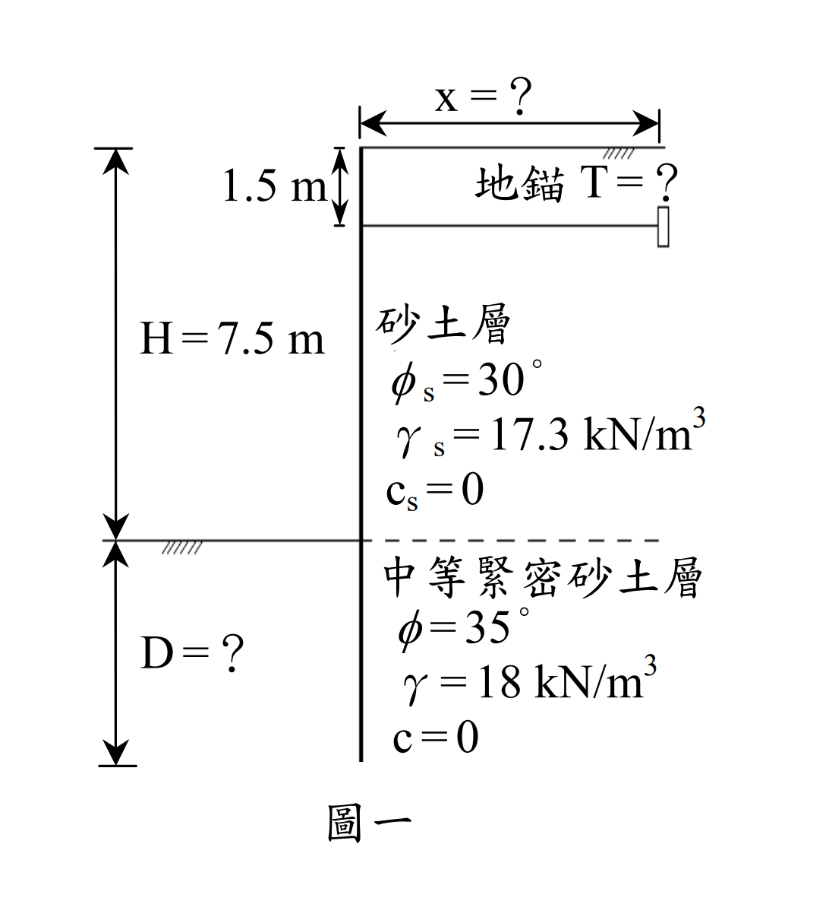

# SM-2007-4 題目正本

> 本檔只記錄**考卷上寫了什麼、圖上畫了什麼**，不含任何解法。解析見同資料夾 `SM-2007-4.md`。
> 判讀清單已確認（凍結）；本檔原則上不再修改（改動須回考卷原圖並記 log）。

| 項目 | 內容 |
|------|------|
| 考卷 | `raw/exams/SM-2007_土壤力學與基礎設計.pdf` 第 1 頁（全一頁），第四題 |
| 考年 | 民國 96 年（2007） |
| 配分 | 25 分（㈠15＋㈡10） |
| 附圖 | `SM-2007-4-fig-1.png`（圖一） |
| 判讀狀態 | **已確認**（2026-11-15 關卡一：使用者授權依建議判讀確認；轉錄 2026-11-15；PyMuPDF 110 dpi 全頁目視，附圖 400 dpi 局部放大（向量圖）；PDF 文字層核對逐字原文；盲讀後才比對既有解析） |

## 1. 考卷原文（逐字）

> 四、如圖一所示，為錨定式版樁（sheet pile），使用於地下水位以上開挖支撐，開挖面深度 H = 7.5m，其背後為砂性土壤，單位重 $\gamma_s$ = 17.3 kN/m³，內摩擦角 $\phi_s$ = 30°，凝聚力 $c_s$ = 0，開挖面以下為中等緊密砂土層，單位重 $\gamma$= 18 kN/m³，內摩擦角 $\phi$= 35°，凝聚力 c = 0。若版樁深入中等緊密砂土層，底部為固定土壤支撐法（fixed-earth support）型式：
> ㈠試計算地錨拉力 T 與板樁需要埋入地下之長度 D。（假設安全係數採用 1.5）。（15 分）
> ㈡又地錨應錨定在板樁後多少距離 x 以外方為有效且安全？（10 分）

## 2. 考卷給的公式、附表與參數

- 上層砂土（開挖面以上）：$\gamma_s$ = 17.3 kN/m³、$\phi_s$ = 30°、$c_s$ = 0。
- 中等緊密砂土（開挖面以下）：$\gamma$ = 18 kN/m³、$\phi$ = 35°、$c$ = 0。
- $H$ = 7.5 m；地錨在版樁頂下 1.5 m；固定土壤支撐法；安全係數 1.5。
- 題文「版樁」「板樁」混用（照考卷原文）。
- **沒有給**：安全係數 1.5 用在哪裡（折減 $K_p$、或入土深度加長）、地錨水平間距、牆面摩擦角、錨碇板尺寸與深度。
- 卷首注意事項：㈠可以使用電子計算器。㈡不必抄題，作答時請將試題題號及答案依照順序寫在試卷上，於本試題上作答者，不予計分。※若條件不足，請自行作合理假設！

## 3. 附圖

圖面文字照錄：`x =？`、`1.5 m`、`地錨 T =？`、`H = 7.5 m`、`砂土層`、`φs = 30°`、`γs = 17.3 kN/m3`、`cs = 0`、`中等緊密砂土層`、`φ = 35°`、`γ = 18 kN/m3`、`c = 0`、`D =？`、`圖一`。

## 4. 判讀清單

| # | 項目 | 判讀 | 圖上／題文依據 | 把握 |
|---|------|------|---------------|------|
| 1 | 安全係數 1.5 用法 | 考卷只寫「假設安全係數採用 1.5」，未說明用於被動土壓（$K_p/1.5$）或入土深度 | 題文㈠括號 | 不確定（解讀；影響答案，請確認）；使用者授權依建議確認 |
| 2 | 開挖深度 | $H$ = 7.5 m，由版樁頂（＝背側地表）到開挖面 | 圖一 400 dpi，左側尺寸線 | 確定 |
| 3 | 入土深度 | $D$ = 開挖面到版樁底（所求） | 圖一左側下段尺寸線 | 確定 |
| 4 | 地錨位置 | 版樁頂下 1.5 m，水平拉桿向背填側（右），端部畫錨碇板 | 圖一 1.5 m 尺寸線、拉桿與小矩形 | 確定 |
| 5 | x 的量測 | 由版樁到錨碇板的水平距離（上方尺寸線左端對齊版樁、右端對齊錨碇板） | 圖一上方尺寸線 | 確定 |
| 6 | 層界 | 開挖面高程：開挖側為地面剖線，背填側為虛線 → 兩側 7.5 m 以下都是中等緊密砂土 | 圖一水平線／虛線 | 確定 |
| 7 | 地下水 | 題文「使用於地下水位以上」→ 不計水壓 | 題文 | 確定 |
| 8 | 支承型式 | 固定土壤支撐法（版樁底端視為固定，等值梁法） | 題文 | 確定 |
| 9 | 所求㈠ | 單位寬度地錨拉力 $T$ 與入土深度 $D$ | 題文 | 確定（解讀） |
| 10 | 所求㈡ | 錨碇板須在主動破壞楔之外、且其被動楔不與主動楔重疊的最小距離 $x$ | 題文「有效且安全」 | 確定（解讀） |
| 11 | 考卷沒有給 | 安全係數的套用方式、地錨間距、牆面摩擦角（採 Rankine）、錨碇板高度與埋深 | 全題 | 確定 |

---

*轉錄：2026-11-15（SM-U2-3 題目正本推廣・批 1）*

*確認：2026-11-15 使用者授權依建議判讀確認（SM-U2-3 題目正本推廣・批 1，關卡一；使用者指示「要我確認的請依你建議」）*
