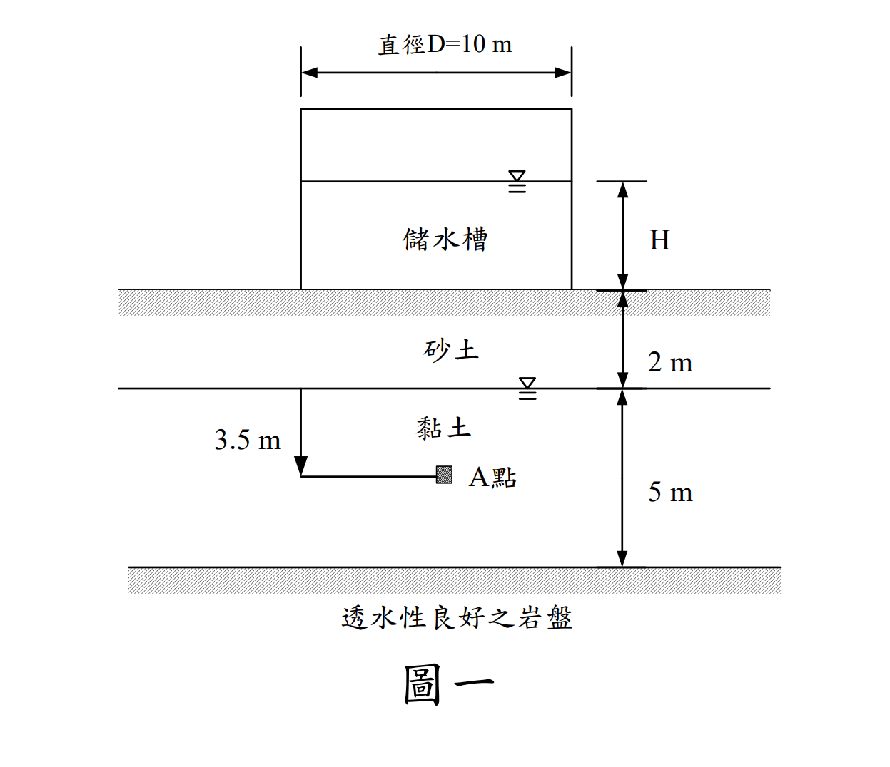

# SM-2008-2 題目正本

> 本檔只記錄**考卷上寫了什麼、圖上畫了什麼**，不含任何解法。解析見同資料夾 `SM-2008-2.md`。
> 判讀清單已確認（凍結）；本檔原則上不再修改（改動須回考卷原圖並記 log）。

| 項目 | 內容 |
|------|------|
| 考卷 | `raw/exams/SM-2008_土壤力學與基礎設計.pdf` 第 1 頁（正面），第二題 |
| 考年 | 民國 97 年（2008） |
| 配分 | 25 分 |
| 附圖 | `SM-2008-2-fig-1.png`（圖一，儲水槽與地層剖面；既有證據圖，完整無雜訊，沿用） |
| 判讀狀態 | **已確認**（2026-11-15 關卡一：使用者授權依建議判讀確認；轉錄 2026-11-15；PyMuPDF 110 dpi 全頁目視，圖一 450 dpi 局部放大（向量圖，PDF drawings 座標核對）；盲讀後才比對既有解析） |

## 1. 考卷原文（逐字）

> 二、有一工廠為解決用水問題，擬興建一內徑 D=10 m 之儲水槽，如圖一所示。由試驗得知砂土層之飽和度 $S$=50%，孔隙比 $e$=0.7，比重 $G_s$=2.66；黏土層之飽和單位重 $\gamma_{sat}$=19 kN/m³。已知蓄水的荷重增量 $\Delta q$ 造成圖中 A 點垂直應力增量 $\Delta\sigma_v$ 和水平應力增量 $\Delta\sigma_h$ 分別為 $1.5\Delta\sigma_v=3\Delta\sigma_h=\Delta q$。已知黏土層有效凝聚力 $c'$=0，有效摩擦角 $\phi'$=30°，靜止土壓力係數 $K_0$=0.5，破壞時之孔隙水壓力參數 $A_f$=0.7，地下水位於地表下 2 m。試問水槽中的水位 H 上升至多高時黏土中的 A 點產生破壞？（25 分）
> （註：假設水槽自重不計，且水位快速上升）

## 2. 考卷給的公式、附表與參數

- 儲水槽內徑 $D$ = 10 m；水槽自重不計；水位快速上升。
- 砂土：$S$ = 50%、$e$ = 0.7、$G_s$ = 2.66。
- 黏土：$\gamma_{sat}$ = 19 kN/m³、$c'$ = 0、$\phi'$ = 30°、$K_0$ = 0.5、$A_f$ = 0.7。
- A 點應力增量：$1.5\Delta\sigma_v = 3\Delta\sigma_h = \Delta q$（即 $\Delta\sigma_v = \Delta q/1.5$、$\Delta\sigma_h = \Delta q/3$）。
- 地下水位：地表下 2 m。
- **沒有給**：$\gamma_w$、$\Delta q$ 與 $H$ 的關係式（須由水壓自行寫出）、砂土是否有毛細飽和。
- 卷首注意事項：㈠不必抄題，作答時請將試題題號及答案依照順序寫在試卷上，於本試題上作答者，不予計分。㈡可以使用電子計算器，但需詳列解答過程。㈢倘若條件不足，請自行合理假設。

## 3. 附圖

圖面文字照錄：`直徑D=10 m`、`儲水槽`、`H`、`砂土`、`2 m`、`黏土`、`3.5 m`、`A點`、`5 m`、`透水性良好之岩盤`、`圖一`。

## 4. 判讀清單

| # | 項目 | 判讀 | 圖上／題文依據 | 把握 |
|---|------|------|---------------|------|
| 1 | A 點深度 | 黏土頂下 3.5 m → 地表下 5.5 m（3.5 m 尺寸線上端在砂／黏土界面 y=784.2，下端箭頭到 A 點高程 y=811.7） | 圖一 450 dpi；PDF 座標 | 確定 |
| 2 | A 點平面位置 | 在水槽中心線下方（A 點方塊 x≈360，槽壁 x=318.0 與 402.4 的中點 360.2）；3.5 m 引線由槽左壁投影線往下再水平拉到 A | PDF 座標 | 確定（解讀） |
| 3 | H 的量測 | 由地表（槽底）量到槽內水面（右側尺寸線上端對齊槽內水面線 y=719.7、下端對齊地表 y=753.6） | PDF 座標 | 確定 |
| 4 | 砂土層 | 地表到地下 2 m（右側 2 m 尺寸線 y=753.6→784.2） | 圖一 | 確定 |
| 5 | 地下水位 | 地表下 2 m，即砂／黏土界面（界面線旁畫水位符號，與題文一致）；砂土全在水位以上，用 $S$ = 50% 換算單位重 | 圖一、題文 | 確定 |
| 6 | 黏土層 | 厚 5 m（y=784.2→840.0），下方為「透水性良好之岩盤」 | 圖一 | 確定 |
| 7 | 圖比例 | 圖未依比例：3.5 m 畫 27.5 pt，而 5 m 畫 55.8 pt；以標註數字為準 | PDF 座標 | 確定 |
| 8 | 槽底高程 | 水槽直接置於地表（槽底與地表線同為 y=753.6），無埋深 | PDF 座標 | 確定 |
| 9 | 荷重 | $\Delta q$ 為槽內水重造成的地表荷重增量，A 點增量依 $1.5\Delta\sigma_v = 3\Delta\sigma_h = \Delta q$；水槽自重不計 | 題文 | 確定 |
| 10 | 排水條件 | 「水位快速上升」→ 黏土不排水加載，用 $A_f$ 求超額孔隙水壓 | 題文註 | 確定（解讀） |
| 11 | 初始應力 | 初始水平有效應力以 $K_0$ = 0.5 由垂直有效應力求得；$c'$ = 0、$\phi'$ = 30° 為破壞準則 | 題文 | 確定 |
| 12 | 所求 | A 點破壞時槽內水位 $H$ | 題文 | 確定 |
| 13 | 考卷沒有給 | $\gamma_w$、砂土毛細飽和與否 | 全題 | 確定 |

---

*轉錄：2026-11-15（SM-U1-5 題目正本推廣・批 1）*

*確認：2026-11-15 使用者授權依建議判讀確認（SM-U1-5 題目正本推廣・批 1，關卡一；使用者指示「要我確認的請依你建議」）*
