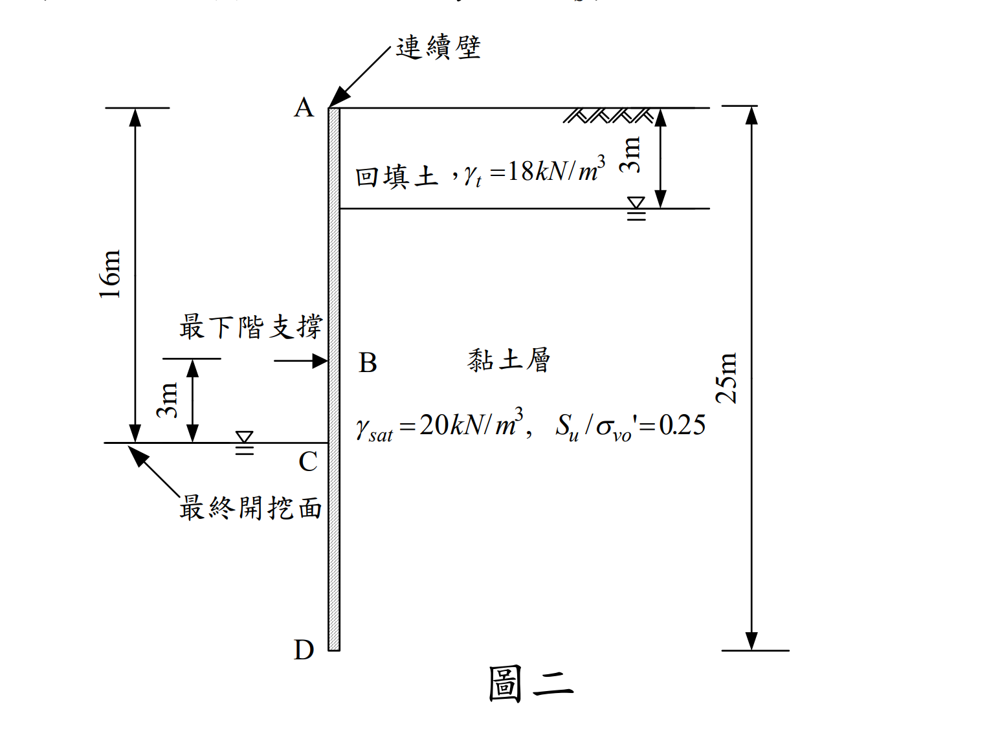

# SM-2008-3 題目正本

> 本檔只記錄**考卷上寫了什麼、圖上畫了什麼**，不含任何解法。解析見同資料夾 `SM-2008-3.md`。
> 判讀清單已確認（凍結）；本檔原則上不再修改（改動須回考卷原圖並記 log）。

| 項目 | 內容 |
|------|------|
| 考卷 | `raw/exams/SM-2008_土壤力學與基礎設計.pdf` 第 2 頁（背面），第三題 |
| 考年 | 民國 97 年（2008） |
| 配分 | 25 分 |
| 附圖 | `SM-2008-3-fig-1.png`（圖二） |
| 判讀狀態 | **已確認**（2026-11-15 關卡一：使用者授權依建議判讀確認；轉錄 2026-11-15；PyMuPDF 110 dpi 全頁目視，附圖 450 dpi 局部放大（向量圖）；PDF 文字層核對逐字原文；盲讀後才比對既有解析） |

## 1. 考卷原文（逐字）

> 三、某開挖工程於土層中進行，如圖二所示。地表為一厚 3 m 之回填土，單位重 $\gamma_t$=18 kN/m³。其下方為一黏土層，飽和單位重 $\gamma_{sat}$=20 kN/m³，正規化不排水剪力強度 $S_u/\sigma_{v0}'$=0.25，且不排水剪力強度不受開挖解壓之影響。連續壁總深度為 25 m，開挖深度 16 m，最下階支撐位於最終開挖面上方 3 m 處。（25 分）
> ㈠試利用側土壓力平衡式計算其貫入深度安全係數 FS。
> ㈡為提高其安全係數，擬於被動土壓力側（開挖面內側）進行地盤改良，若改良區土體之平均單位重為 $\gamma_m$= 21.5 kN/m³，試問改良後之平均單壓強度 $q_u$ 應為多少才能使貫入深度的安全係數 FS≥1.5。
> （註：計算時忽略連續壁之工作彎矩 $M_s$）

## 2. 考卷給的公式、附表與參數

- 回填土：厚 3 m、$\gamma_t$ = 18 kN/m³。
- 黏土：$\gamma_{sat}$ = 20 kN/m³、$S_u/\sigma'_{v0}$ = 0.25（不受開挖解壓影響）。
- 連續壁總深 25 m、開挖 16 m、最下階支撐在開挖面上 3 m（地表下 13 m）。
- 改良區：$\gamma_m$ = 21.5 kN/m³；目標 FS ≥ 1.5；忽略連續壁工作彎矩 $M_s$。
- **沒有給**：$\gamma_w$、地表超載、改良區的範圍（深度、寬度）、黏土層底深度。
- 卷首注意事項（第 1 頁）：㈠不必抄題，作答時請將試題題號及答案依照順序寫在試卷上，於本試題上作答者，不予計分。㈡可以使用電子計算器，但需詳列解答過程。㈢倘若條件不足，請自行合理假設。

## 3. 附圖

圖面文字照錄：`連續壁`、`A`、`回填土，γt =18kN/m3`、`3m`、`16m`、`最下階支撐`、`B`、`黏土層`、`γsat =20kN/m3,  Su /σvo'=0.25`、`3m`、`C`、`最終開挖面`、`25m`、`D`、`圖二`。

## 4. 判讀清單

| # | 項目 | 判讀 | 圖上／題文依據 | 把握 |
|---|------|------|---------------|------|
| 1 | 改良區範圍 | 考卷未給；解讀為開挖面以下到壁底（C～D）的被動側全區 | 題文㈡ | 不確定（解讀；影響答案，請確認）；使用者授權依建議確認 |
| 2 | 開挖深度 | 16 m，由 A（壁頂＝地表）到 C（最終開挖面） | 圖二左側尺寸線 | 確定 |
| 3 | 壁長 | 25 m，由地表（A 高程）到 D（壁底）→ 貫入深度 9 m | 圖二右側尺寸線 | 確定 |
| 4 | 最下階支撐 | B 點，在 C 上方 3 m（地表下 13 m）；箭頭由開挖側指向壁 | 圖二 3m 尺寸線 | 確定 |
| 5 | 回填土 | 背側地表下 0～3 m | 圖二右上 3m 尺寸線 | 確定 |
| 6 | 背側地下水位 | 地表下 3 m（回填土底） | 圖二回填土底水位符號 | 確定 |
| 7 | 開挖側地下水位 | 最終開挖面高程（C） | 圖二 C 高程水位符號 | 確定 |
| 8 | 黏土強度 | $S_u = 0.25\,\sigma'_{v0}$，$\sigma'_{v0}$ 取開挖前的現地有效覆土壓，開挖後不變（題文「不受開挖解壓之影響」）→ 開挖側與背側同深度 $S_u$ 相同 | 題文 | 確定（解讀） |
| 9 | 所求㈠ | 以對最下階支撐 B 的力矩平衡（側土壓力平衡）求貫入深度安全係數 | 題文「側土壓力平衡式」 | 確定（解讀） |
| 10 | 所求㈡ | 改良土的平均單壓強度 $q_u$（$S_u = q_u/2$）使 FS ≥ 1.5 | 題文 | 確定 |
| 11 | 考卷沒有給 | $\gamma_w$、地表超載、改良區深度與寬度、黏土層底 | 全題 | 確定 |

---

*轉錄：2026-11-15（SM-U2-3 題目正本推廣・批 1）*

*確認：2026-11-15 使用者授權依建議判讀確認（SM-U2-3 題目正本推廣・批 1，關卡一；使用者指示「要我確認的請依你建議」）*
