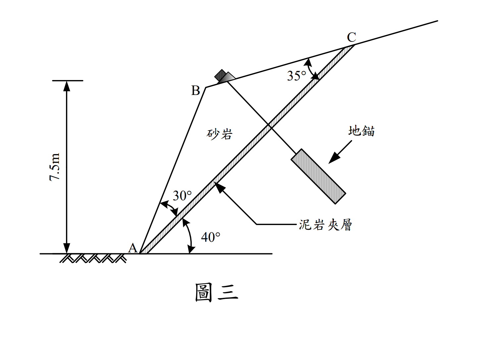

# SM-2008-4 題目正本

> 本檔只記錄**考卷上寫了什麼、圖上畫了什麼**，不含任何解法。解析見同資料夾 `SM-2008-4.md`。
> 判讀清單已確認（凍結）；本檔原則上不再修改（改動須回考卷原圖並記 log）。

| 項目 | 內容 |
|------|------|
| 考卷 | `raw/exams/SM-2008_土壤力學與基礎設計.pdf` 第 2 頁（背面），第四題，圖三 |
| 考年 | 民國 97 年（2008） |
| 配分 | 25 分（兩小題未分列配分） |
| 附圖 | `SM-2008-4-fig-1.png`（圖三，岩石邊坡剖面；既有截圖完整、無游標等雜訊，沿用） |
| 判讀狀態 | **已確認**（2026-11-15 關卡一：使用者授權依建議判讀確認；轉錄 2026-11-15；PyMuPDF 110 dpi 全頁目視，圖三 500 dpi 局部放大（向量圖，以 PDF 線段座標核對頂點與尺寸線）；盲讀後才比對既有解析） |

## 1. 考卷原文（逐字）

> 四、一岩石邊坡為砂岩含有一泥岩夾層，如圖三所示。已知砂岩之單位重 $\gamma$=20 kN/m³，泥岩夾層之凝聚力 $c$=10 kN/m²，摩擦角 $\phi$=28°，若水平地震力係數 $K_h$=0.2。（25 分）
> ㈠試問於水平地震力 $K_hW$ 與滑動塊體 ABC 自重 $W$ 的作用下，此邊坡之安全係數 $FS$＝？（註：此時不考慮有地錨之情形）
> ㈡同上題，若欲採用一排地錨，地錨垂直於滑動面 AC，地錨間距（指垂直紙面之間距）2 m，試問每支地錨荷重 T 應為多大才能滿足於地震力作用下安全係數 $FS\ge1.2$ 的規定。（註：假設地錨只增加正向力）

## 2. 考卷給的公式、附表與參數

- 砂岩 $\gamma$ = 20 kN/m³；泥岩夾層 $c$ = 10 kN/m²、$\phi$ = 28°；水平地震力係數 $K_h$ = 0.2。
- 滑動塊體 ABC；滑動面 AC（泥岩夾層）。
- ㈡地錨一排、垂直滑動面 AC、垂直紙面間距 2 m、只增加正向力；目標 $FS\ge1.2$（地震力作用下）。
- **沒有給**：公式、垂直地震力係數、地下水或孔隙水壓、張力裂縫、AC／AB／BC 的長度（須由 7.5 m 與角度推得）。
- 卷首注意事項：不必抄題，作答時請將試題題號及答案依照順序寫在試卷上，於本試題上作答者，不予計分。可以使用電子計算器，但需詳列解答過程。倘若條件不足，請自行合理假設。

## 3. 附圖

圖面文字照錄：`C`、`35°`、`B`、`7.5m`、`砂岩`、`地錨`、`30°`、`泥岩夾層`、`A`、`40°`、`圖三`。

## 4. 判讀清單

| # | 項目 | 判讀 | 圖上／題文依據 | 把握 |
|---|------|------|---------------|------|
| 1 | 7.5 m 的量測對象 | 坡肩 B 相對坡趾 A（地面）的鉛直高度。尺寸線下端在地面（954.4 pt），上端 838.5 pt，比 B 點（843.0 pt）高 4.5 pt，附近只有 B 一個特徵點，判讀為量到 B | PDF 線段座標 | 確定（解讀） |
| 2 | 滑動面 AC 傾角 | 40°（A 處角弧在水平地面與 AC 之間） | 圖三角弧 | 確定 |
| 3 | 坡面 AB 傾角 | AB 與 AC 夾 30°（A 處上方角弧在 AB 與 AC 之間）→ AB 與水平夾 70° | 圖三角弧 | 確定（解讀） |
| 4 | 坡頂面 BC 傾角 | BC 與 AC 在 C 點夾 35° → BC 向右上傾、與水平夾 40° − 35° = 5° | 圖三 C 處角弧 | 確定（解讀） |
| 5 | 圖面比例 | 不按比例：圖上 AB 約 68°、AC 約 45°、BC 約 16°，一律以標註角度為準 | PDF 座標 A (312.7, 954.4)、B (357.2, 843.0)、C (450.6, 816.2) | 確定 |
| 6 | C 點以外地表 | BC 直線延伸過 C 到圖外（同一條線段至 (512.8, 798.4) pt），坡度與 BC 相同 | PDF 線段 | 確定 |
| 7 | A 點以左地面 | 水平，畫地盤符號 | 圖三 | 確定 |
| 8 | 滑動塊體 | 三角形 ABC（砂岩），沿泥岩夾層 AC 滑動；夾層畫成沿 AC 的薄斜線帶，厚度不計 | 題文＋圖三 | 確定 |
| 9 | 強度參數 | 只有泥岩夾層 $c$ = 10、$\phi$ = 28°；砂岩強度不需要 | 題文 | 確定 |
| 10 | 地震力 | 水平 $K_hW$，$K_h$ = 0.2，作用方向題目未明寫；取向坡外（不利方向） | 題文 | 確定（解讀） |
| 11 | 地錨 | ㈡才有：一排、垂直 AC、間距 2 m、只增加正向力；圖上錨頭在 BC 面上靠近 B，錨桿穿過 AC，錨碇段在夾層下方 | 題文＋圖三 | 確定 |
| 12 | 所求 | ㈠無地錨時、地震作用下的 $FS$；㈡ $FS\ge1.2$ 所需每支地錨荷重 $T$（kN／支） | 題文 | 確定 |
| 13 | 考卷沒有給 | 地下水／孔隙水壓（圖上沒有水位）、垂直地震力、張力裂縫、各邊長度 | 全題 | 確定 |

---

*轉錄：2026-11-15（SM-U3-3 題目正本推廣・批 1）*

*確認：2026-11-15 使用者授權依建議判讀確認（SM-U3-3 題目正本推廣・批 1，關卡一；使用者指示「要確認的依你建議」）*
