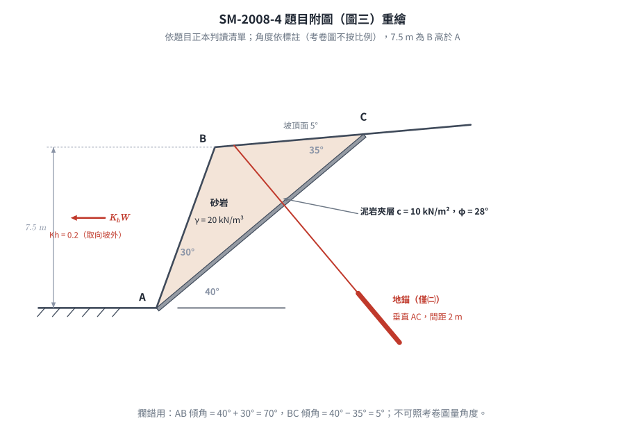
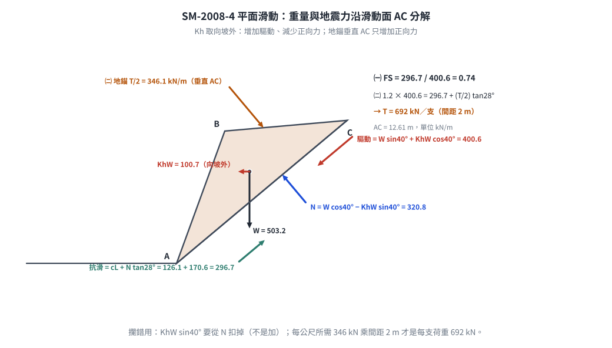

# 考題編號：SM-2008-4

**主分類：** `SM-U3-3` 坡地工程
**副分類：** 無
**分析法：** 混合
**標籤：** `平面滑動分析` `岩石邊坡` `水平地震力` `地錨` `Mohr-Coulomb破壞準則` `安全係數`
---

## 1. 題目（考卷原文見題目正本）

> 考卷原文、公式／附表、附圖與判讀清單（已確認）見 [`SM-2008-4-problem.md`](SM-2008-4-problem.md)。本節只列解題時最容易讀錯的地方與本解使用的記號；題意以題目正本為準。

*重繪自考卷圖三，依題目正本判讀清單 #1–#11；考卷圖不按比例，攔下的判讀錯誤：照圖量角度、把 7.5 m 當成 C 的高度。*

### 常見誤讀

| 項目 | 正確判讀 | 常見誤讀 |
|---|---|---|
| 角度 | 依標註：AC 40°、AB 與 AC 夾 30°（AB 傾角 70°）、BC 與 AC 在 C 夾 35°（BC 傾角 5°）（題目正本 #2–#5） | 照考卷圖量角度（圖上 AB 約 68°、AC 約 45°、BC 約 16°） |
| 7.5 m | B 相對 A 的鉛直高度（#1） | 當成 C 的高度或 AC 長 |
| 地震力方向 | 題目未明寫；取向坡外的不利方向（#10） | 取向坡內，使 $FS$ 偏高 |
| 地錨 | 只在㈡；間距 2 m，只增加正向力，所求 $T$ 為每支荷重（#11、#12） | 把每公尺所需力當成每支荷重 |

**本解記號：** $W$ 滑動塊體 ABC 每公尺重；$\alpha$ = 40° 滑動面傾角；$k_h$ 水平地震力係數；$P$ 每公尺所需地錨力；$T$ 每支地錨荷重。

---

## 2. 考題核心精神與出題者意圖 (Core Concepts & Examiner's Intent)
本題測驗工程師對於**岩坡平面滑動（Planar Failure）**的剛體力學分析能力。出題者刻意給定各邊夾角與單一垂直高度，測驗考生利用正弦定理（Sine Rule）解構幾何並求取滑動塊體面積與重量的能力。同時，加入了水平地震力，測驗考生是否能正確將地震力分解至平行與垂直滑動面的方向（特別是地震力會**減少正向力**的陷阱）。最後，引入地錨設計，測驗考生將所需額外抗滑力反推為地錨荷重，並注意單位長度轉換至單支地錨間距的計算。

## 3. 解題戰略地圖與陷阱分析 (Strategic Roadmap & Trap Analysis)
1. **解構幾何（最容易出錯的一步）**：
   - 觀察 $\triangle ABC$。滑動面 AC 傾角為 $40^\circ$。坡面 AB 傾角為 $40^\circ + 30^\circ = 70^\circ$。
   - 利用點 B 垂直高度 7.5m，求出 AB 長度。
   - 根據三角形內角和求出 $\angle B = 180^\circ - 30^\circ - 35^\circ = 115^\circ$。
   - 運用正弦定理求出滑動面 AC 長度，接著計算 $\triangle ABC$ 面積及每公尺寬度的重量 $W$。
2. **分析作用力與安全係數（無地錨時）**：
   - 地震力 $F_h = k_h W$ 必須施加於**最不利方向**（水平向左外推）。
   - 將 $W$ 與 $F_h$ 投影至平行滑動面（驅動力）與垂直滑動面（正向力）。
   - **陷阱**：向左的地震力會產生遠離滑動面的垂直分力，因此會**減小**有效正向力，不可加錯符號。
   - 帶入 Mohr-Coulomb 準則計算抗滑力，求出初始 FS。
3. **地錨設計**：
   - 根據目標 $FS = 1.2$ 反推所需的總抗滑力。
   - 計算現有抗滑力與目標抗滑力之差額，此差額必須由地錨提供。
   - 因為地錨**垂直**於滑動面，其張力完全轉換為滑動面上的正向力增量 $\Delta N$。
   - 求出每公尺所需地錨張力 $P$，再乘上間距 2m，即為單支地錨荷重 $T$。

## 3.5 變數層次分析 (Variable Hierarchy Analysis)

### 最終目標
`求出滑動塊體自重、地震力作用下之抗滑安全係數，以及為達 FS=1.2 所需之單支地錨荷重 T。`

### 本題關鍵公式（依計算順序）
- **幾何解算**：$$L_{AB} = \frac{H}{\sin\beta}$$
- **滑動面長度**：$$L_{AC} = \boxed{L_{AB}} \frac{\sin B}{\sin C}$$
- **塊體重量**：$$W = \gamma \left( \frac{1}{2} \boxed{L_{AB}} \cdot \boxed{L_{AC}} \sin A \right)$$
- **滑動力與正向力**：
  $$T_d = \boxed{W} \sin\alpha + k_h\boxed{W} \cos\alpha$$
  $$N = \boxed{W} \cos\alpha - k_h\boxed{W} \sin\alpha$$
- **初始安全係數**：$$FS = \frac{c L_{AC} + \boxed{N} \tan\phi}{\boxed{T_d}}$$
- **地錨荷重需求**：$$T = s \cdot \frac{FS_{req} \boxed{T_d} - \boxed{T_r}}{\tan\phi}$$

### L1：題目直接給定
| 符號 | 數值 | 說明 |
|---|---|---|
| $H$ | $7.5 \text{ m}$ | 點 B 相對點 A 的垂直高度 |
| $\gamma$ | $20 \text{ kN/m}^3$ | 砂岩單位重 |
| $c$ | $10 \text{ kN/m}^2$ | 泥岩夾層凝聚力 |
| $\phi$ | $28^\circ$ | 泥岩夾層摩擦角 |
| $k_h$ | $0.2$ | 水平地震力係數 |
| $FS_{req}$ | $1.2$ | 目標安全係數 |
| $s$ | $2 \text{ m}$ | 地錨間距 |
| $\alpha$ | $40^\circ$ | 滑動面 AC 傾角 |
| $\angle A$ | $30^\circ$ | $\triangle ABC$ 中，AB 與 AC 夾角 |
| $\angle C$ | $35^\circ$ | $\triangle ABC$ 中，BC 與 AC 夾角 |

### L2：需知識點推導
**幾何參數計算**
| 符號 | 公式／來源 | 卡關? |
|---|---|---|
| $\beta$ | $\alpha + \angle A = 40^\circ + 30^\circ = 70^\circ$ (AB 傾角) | |
| $\angle B$ | $180^\circ - \angle A - \angle C = 115^\circ$ | |
| $L_{AB}$ | $H / \sin\beta$ | |
| $L_{AC}$ | $L_{AB} \cdot \sin B / \sin C$ (正弦定理) | |
| $A$ | $\frac{1}{2} L_{AB} L_{AC} \sin A$ (三角形面積) | |
| $W$ | $\gamma \times A$ | |

**受力與穩定性分析**
| 符號 | 公式／來源 | 卡關? |
|---|---|---|
| $F_h$ | $k_h \cdot W$ (水平地震力) | |
| $T_d$ | $W \sin\alpha + F_h \cos\alpha$ | |
| $N$ | $W \cos\alpha - F_h \sin\alpha$ | |
| $T_r$ | $c L_{AC} + N \tan\phi$ | |
| $FS$ | $T_r / T_d$ | |
| $P$ | $(FS_{req} T_d - T_r) / \tan\phi$ (每公尺所需地錨力) | |
| $T$ | $P \times s$ | |

### L3：深層知識（不懂就卡住）
| 知識點 | 說明 | 卡關? |
|---|---|---|
| 水平地震力方向判定 | 地震力方向隨機，設計時取最危險方向（向左外推），此時會增加滑動力並**減少正向力**。 | |
| 地錨力與正向力關係 | 題目聲明「垂直滑動面 AC」，代表地錨張力只會產生垂直面的正向力 $\Delta N = P$，無平行滑動力分量。 | |

## 4. 步驟化詳細計算過程 (Step-by-Step Detailed Calculation)

### (一) 無地錨情形下之安全係數 FS

**Step 1：解算滑動塊體幾何**
觀察 $\triangle ABC$：
- 滑動面 AC 傾角 $\alpha = 40^\circ$。
- 坡面 AB 傾角 $\beta = 40^\circ + \angle BAC = 40^\circ + 30^\circ = 70^\circ$。
- $\triangle ABC$ 內角：$\angle A = 30^\circ$，$\angle C = 35^\circ$，推得 $\angle B = 180^\circ - 30^\circ - 35^\circ = 115^\circ$。

利用垂直高度 $H = 7.5 \text{ m}$，求 AB 邊長：
$$L_{AB} = \frac{H}{\sin 70^\circ} = \frac{7.5}{0.9397} = 7.981 \text{ m}$$

利用正弦定理求 AC 邊長（滑動面長度）：
$$\frac{L_{AC}}{\sin 115^\circ} = \frac{L_{AB}}{\sin 35^\circ}$$
$$L_{AC} = 7.981 \times \frac{\sin 115^\circ}{\sin 35^\circ} = 7.981 \times \frac{0.9063}{0.5736} = 12.610 \text{ m}$$

計算 $\triangle ABC$ 面積：
$$Area = \frac{1}{2} L_{AB} \cdot L_{AC} \cdot \sin(\angle A) = \frac{1}{2} \times 7.981 \times 12.610 \times \sin 30^\circ = 25.162 \text{ m}^2$$

**Step 2：計算單位寬度（每公尺）之作用力**
滑動塊體重量 $W$：
$$W = \gamma \times Area = 20 \times 25.162 = 503.24 \text{ kN/m}$$

水平地震力 $F_h$（向左外推方向最為臨界）：
$$F_h = k_h \times W = 0.2 \times 503.24 = 100.65 \text{ kN/m}$$

**Step 3：將力分解至平行與垂直滑動面 AC 方向**
- **驅動力 $T_d$**（平行滑動面向下）：
  $$T_d = W \sin 40^\circ + F_h \cos 40^\circ = 503.24 \times 0.6428 + 100.65 \times 0.7660$$
  $$T_d = 323.48 + 77.10 = 400.58 \text{ kN/m}$$

- **正向力 $N$**（垂直滑動面壓緊）：
  *(注意：向左之水平地震力會產生離開滑動面的分力，故為負號)*
  $$N = W \cos 40^\circ - F_h \sin 40^\circ = 503.24 \times 0.7660 - 100.65 \times 0.6428$$
  $$N = 385.50 - 64.69 = 320.81 \text{ kN/m}$$

**Step 4：計算抗滑力與安全係數**
抗滑力 $T_r$：
$$T_r = c \cdot L_{AC} + N \tan \phi = 10 \times 12.610 + 320.81 \times \tan 28^\circ$$
$$T_r = 126.10 + 320.81 \times 0.5317 = 126.10 + 170.58 = 296.68 \text{ kN/m}$$

初始安全係數 $FS$：
$$FS = \frac{T_r}{T_d} = \frac{296.68}{400.58} = 0.7406$$
$$\boxed{FS = 0.74}$$

*圖 2　重量與水平地震力沿滑動面分解。地震力向坡外時同時增加驅動、減少正向力；攔下「$K_hW\sin40^\circ$ 加到 $N$」與「把每公尺地錨力當每支荷重」兩種錯誤。*

---

### (二) 滿足 FS ≥ 1.2 之地錨荷重 T

**Step 5：計算所需之額外正向力**
設每公尺寬度需施加之地錨張力為 $P$ (kN/m)。因地錨垂直於滑動面，其張力全數轉換為正向力增加量。
新的抗滑力 $T_r'$ 為：
$$T_r' = c \cdot L_{AC} + (N + P) \tan \phi = T_r + P \tan 28^\circ = 296.68 + 0.5317 P$$

根據目標安全係數 $FS \ge 1.2$：
$$FS = \frac{T_r'}{T_d} = 1.2$$
$$296.68 + 0.5317 P = 1.2 \times 400.58 = 480.70 \text{ kN/m}$$
$$0.5317 P = 480.70 - 296.68 = 184.02 \text{ kN/m}$$
$$P = \frac{184.02}{0.5317} = 346.09 \text{ kN/m}$$

**Step 6：計算單支地錨荷重**
由於地錨間距 $s = 2 \text{ m}$，每支地錨需負擔 2 公尺寬度之拉力：
$$T = P \times s = 346.09 \times 2 = 692.18 \text{ kN}$$
$$\boxed{T \ge 692.18 \text{ kN}}$$

## 5. 關鍵爭議點與進階探討 (Critical Issues & Advanced Discussion)
- **地震力方向的雙面刃**：地震力既增加了向下滑動的驅動力（$k_h W \cos\alpha$），也減小了將滑動塊體壓緊於滑動面的正向力（$k_h W \sin\alpha$）。在邊坡穩定分析中，這往往是決定破壞的關鍵，計算時正負號絕對不能弄錯。
- **地錨傾角的最佳化**：本題為了簡化計算，設定地錨「垂直於滑動面」。然而在實務設計中，最佳的地錨傾角通常會稍微偏向下傾（即與滑動面法線有一夾角 $\theta$），使得地錨張力同時能提供直接的抗滑分力（平行於滑動面）。當 $\theta = \phi$ 時，地錨效率最高。

*修正日期：2026-11-15（§1 改為指向題目正本 `SM-2008-4-problem.md`，重繪附圖 figs/SM-2008-4-fig-1-problem.svg；§4（一）Step 4 補解題圖解 figs/SM-2008-4-fig-2-forces.svg；非勘誤）*
