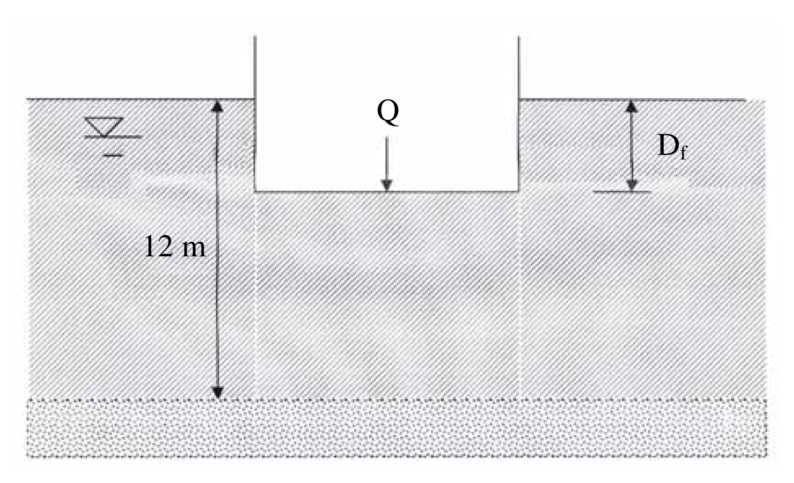

# SM-2009-2 題目正本

> 本檔只記錄**考卷上寫了什麼、圖上畫了什麼**，不含任何解法。解析見同資料夾 `SM-2009-2.md`。
> 判讀清單已確認（凍結）；本檔原則上不再修改（改動須回考卷原圖並記 log）。

| 項目 | 內容 |
|------|------|
| 考卷 | `raw/exams/SM-2009_土壤力學與基礎設計.pdf` 第 1 頁（正面），第二題 |
| 考年 | 民國 98 年（2009） |
| 配分 | 25 分 |
| 附圖 | `SM-2009-2-fig-2.png`（筏式基礎剖面；2026-11-15 由考卷重新擷取 500 dpi）；既有 `SM-2009-2-fig-1.png` 為同一圖，左上角有滑鼠游標（未壓在圖面元素上），保留不刪 |
| 判讀狀態 | **已確認**（2026-11-15 關卡一：使用者授權依建議判讀確認；轉錄 2026-11-15；PyMuPDF 110 dpi 全頁目視，附圖 400 dpi 局部放大（內嵌點陣影像）；PDF 文字層核對逐字原文；盲讀後才比對既有解析） |

## 1. 考卷原文（逐字）

> 二、有一筏式基礎如下圖所示，基礎之設計尺寸為：B = 8 m，L = 12 m，承載荷重 Q = 18 MN。該處地層為正常壓密黏土，$\gamma_{sat}$ = 17 kN/m³，$C_u$ = 35 kN/m²，黏土下方為砂土層，地下水位於地表下 3 m 處。㈠如採用部分代償式（partially compensated）基礎，且安全係數為 3，則基礎埋置深度 $D_f$ 為何？㈡其在開挖時將開挖面內之水位抽降至與開挖底面等高，此時下方土層之抗隆起安全係數為何？（25 分）

## 2. 考卷給的公式、附表與參數

- 基礎：筏式，$B$ = 8 m、$L$ = 12 m；荷重 $Q$ = 18 MN。
- 地層：正常壓密黏土，$\gamma_{sat}$ = 17 kN/m³、$C_u$ = 35 kN/m²；黏土下方為砂土層；附圖標黏土厚 12 m（地表到砂土頂）。
- 地下水位：地表下 3 m。
- 安全係數 3（㈠）。
- **沒有給**：$\gamma_w$；水位以上黏土的單位重（只給 $\gamma_{sat}$）；砂土層的單位重、強度與水頭（是否受壓）；承載力公式與形狀、深度因數；㈡隆起安全係數採用的公式；開挖擋土壁型式與貫入深度。
- 卷首注意事項：㈠可以使用電子計算器，但需詳列解答過程。㈡不必抄題，作答時請將試題題號及答案依照順序寫在試卷上，於本試題上作答者，不予計分。㈢下列問題之相關公式、物理常數、符號意義及設計參數未提及時，請自行依規範作合理之推斷與假設。

## 3. 附圖

圖面文字照錄：`Q`、`Df`、`12 m`。（水位符號無數字；地層名稱未標在圖上，由題文知上為黏土、下為砂土。）

## 4. 判讀清單

| # | 項目 | 判讀 | 圖上／題文依據 | 把握 |
|---|------|------|---------------|------|
| 1 | ㈡「抗隆起安全係數」所指 | 判讀為開挖底面黏土的**剪力型隆起**（basal heave，以 $C_u$ 抵抗），坑內水位抽至開挖底面；砂土層水頭未給，不作為上舉（uplift）檢核的主線 | 題文用「隆起」一詞、只給 $C_u$；砂土層未給水頭、單位重 | 不確定（影響答案，請確認）；使用者授權依建議確認（定案：㈡以剪力型隆起（Cu 抵抗）為主線，砂土層水頭未給，上舉檢核僅作補充） |
| 2 | 黏土層厚 | 12 m，由地表量到砂土層頂（尺寸線上端在地表線，下端在點狀地層頂線） | 附圖 400 dpi，左側尺寸線 | 確定 |
| 3 | $D_f$ 量測基準 | 由地表量到開挖底面（＝基礎底面） | 附圖右側尺寸線上端對齊地表、下端對齊坑底延長線 | 確定 |
| 4 | 地下水位 | 地表下 3 m；附圖水位符號只是示意位置，未按比例 | 題文；附圖符號無數字 | 確定 |
| 5 | 水位以上黏土單位重 | 只給 $\gamma_{sat}$ = 17，全層用 17（未另給濕單位重） | 題文 | 確定（解讀） |
| 6 | 所求㈠ | 部分代償式基礎、FS = 3 時的埋置深度 $D_f$ | 題文 | 確定 |
| 7 | 所求㈡ | 坑內水位抽降至開挖底面時，開挖底面下方土層的抗隆起安全係數 | 題文 | 確定 |
| 8 | 基礎尺寸 | $B$ = 8 m、$L$ = 12 m 為基礎（筏）平面尺寸；附圖只畫剖面 | 題文 | 確定 |
| 9 | 考卷沒有給 | $\gamma_w$、砂土參數與水頭、承載力因數、隆起公式、擋土壁資料 | 全題 | 確定 |

---

*轉錄：2026-11-15（SM-U2-1 題目正本推廣・批 1）*

*確認：2026-11-15 使用者授權依建議判讀確認（SM-U2-1 題目正本推廣・批 1，關卡一；使用者指示「要確認的依你建議」）*
