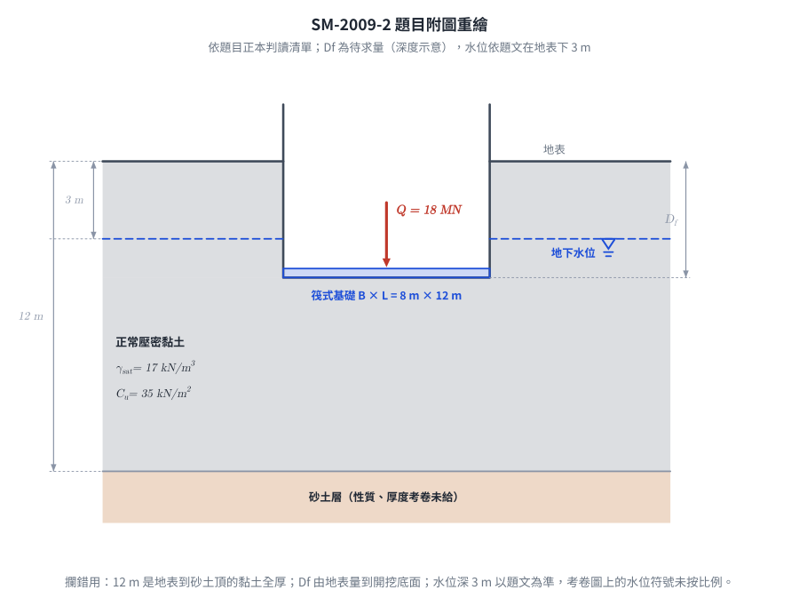
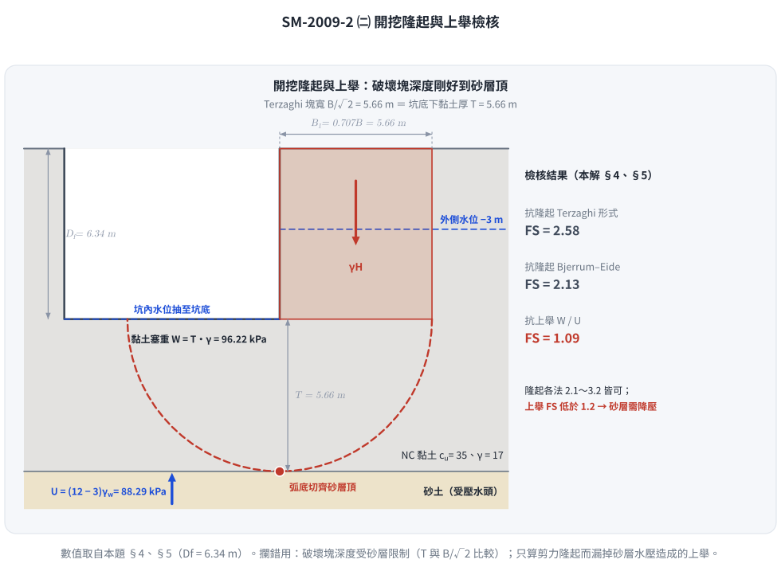

# 考題編號：SM-2009-2

**主分類：** `SM-U2-1` 淺基礎之支承力與沉陷量
**副分類：** `SM-U2-3` 開挖之穩定性分析
**分析法：** 總應力法
**標籤：** `筏式基礎` `代償式基礎` `Terzaghi承載力公式` `容許承載力` `基盤隆起` `不排水剪力強度`
---

## 1. 題目（考卷原文見題目正本）

> 考卷原文、公式／附表、附圖與判讀清單（已確認）見 [`SM-2009-2-problem.md`](SM-2009-2-problem.md)。本節只列解題時最容易讀錯的地方與本解使用的記號；題意以題目正本為準。

*重繪自考卷附圖，依題目正本判讀清單 #2–#4、#8；攔下的判讀錯誤：12 m 是黏土全厚（地表到砂土頂），水位深 3 m 以題文為準（考卷圖上的水位符號未按比例）。*

### 常見誤讀

| 項目 | 正確判讀 | 常見誤讀 |
|---|---|---|
| ㈡「抗隆起」 | 開挖底面黏土的剪力型隆起（以 $c_u$ 抵抗），坑內水位抽至開挖底面（題目正本 #1，已確認） | 只做砂土水壓上舉檢核，或混用兩種破壞模式 |
| 黏土層厚 | 12 m 由地表量到砂土頂；開挖後底面下剩餘黏土厚 $12-D_f$（#2、#3） | 把 12 m 當成基底以下的厚度 |
| 水位以上黏土 | 只給 $\gamma_{sat}$ = 17，全層用 17（#5） | 水位以上另設濕單位重 |

**本解記號：** $D_f$ 埋置深度；$q_{u,net}$ 淨極限承載力；$T$ 開挖底面下剩餘黏土厚；$FS_{heave}$ 抗隆起安全係數。

## 2. 考題核心精神與出題者意圖 (Core Concepts & Examiner's Intent)
1. **部分代償式基礎的淨承載力概念**：測驗考生是否了解「代償式基礎」是利用挖除土壤的重量來抵消部分結構物載重，進而減少淨載重（Net pressure），因此安全係數應定義在「淨極限承載力」與「淨施加壓力」的比值。
2. **淺基礎承載力（總應力分析）**：飽和黏土層短期的承載力行為，適用 $\phi=0$ 條件，利用 Terzaghi 或 Skempton 承載力公式求 $q_{u,net}$。
3. **開挖抗隆起分析（Basal Heave）**：測驗開挖面下方黏土層的穩定性。題目特別給定「黏土下方為砂土層」，且可算出剩餘厚度 $T \approx B/\sqrt{2}$，強烈暗示應採用 Terzaghi 的隆起公式，以檢驗破壞面是否受到下方硬土層的限制。
4. **水位的影響**：測驗考生是否清楚在黏土層的短期（不排水）開挖分析中，總應力法下孔隙水壓不直接影響抗剪強度，但會影響底部上舉（Uplift / Blowout）風險。

## 3. 解題戰略地圖與陷阱分析 (Strategic Roadmap & Trap Analysis)
**戰略地圖：**
- **第一階段（求 $D_f$）**：
  1. 計算筏基施加之總接觸壓力 $q = Q/A$。
  2. 計算淨極限承載力 $q_{u,net} = c_u N_c F_c$（本題採 Terzaghi 矩形公式）。
  3. 建立安全係數方程式 $FS = q_{u,net} / q_{net}$，其中 $q_{net} = q - \gamma D_f$，解出 $D_f$。
- **第二階段（求隆起 FS）**：
  1. 確認開挖深度 $H = D_f$，計算黏土層剩餘厚度 $T = 12 - D_f$。
  2. 計算 Terzaghi 破壞區寬度 $B' = B/\sqrt{2}$，判斷破壞面是否碰到砂土層（比較 $T$ 與 $B'$）。
  3. 代入 Terzaghi 隆起公式（或 Bjerrum & Eide 公式）求出抗隆起安全係數。
  4. （進階檢核）檢核砂土層水壓造成的上舉（Uplift）安全係數。

**陷阱分析：**
- **陷阱 1：安全係數的定義**。對於代償式基礎，FS 必須是「淨承載力 / 淨載重」，若用「總承載力 / 總載重」會完全失去代償的物理意義。
- **陷阱 2：水位的處理**。總應力分析中，開挖移除的土壤重量直接以總單位重 $\gamma_{sat}$ 計算，不需要去扣除水壓或使用有效單位重 $\gamma'$。
- **陷阱 3：隆起公式的選用**。若忽略下方為砂土層的條件，直接代入公式，可能會錯失破壞面深度的幾何檢核（$B' \le T$）。

## 3.5 變數層次分析 (Variable Hierarchy Analysis)

### 最終目標
求出基礎的埋置深度 $D_f$，以及開挖期間的抗隆起安全係數 $FS_{heave}$。

### 本題關鍵公式（依計算順序）
- 淨極限承載力：$q_{u,net} = c_u N_c \left(1 + 0.3 \frac{B}{L}\right)$
- 淨施加壓力與 $D_f$ 關係：$q_{net} = \frac{Q}{A} - \gamma_{sat} D_f$
- 承載力安全係數：$FS = \frac{\boxed{q_{u,net}}}{\boxed{q_{net}}}$ 
- 剩餘黏土層厚度：$T = 12 - \boxed{D_f}$
- Terzaghi 隆起安全係數：$FS_{heave} = \frac{c_u N_c \left(1 + 0.3 \frac{B}{L}\right) + c_u \frac{\boxed{D_f}}{B'}}{\gamma_{sat} \boxed{D_f}}$

### L1：題目直接給定
| 符號 | 數值 | 說明 |
|---|---|---|
| $B$ | 8 m | 基礎寬度 |
| $L$ | 12 m | 基礎長度 |
| $Q$ | 18000 kN | 承載荷重 |
| $c_u$ | 35 kN/m² | 黏土不排水抗剪強度 |
| $\gamma_{sat}$ | 17 kN/m³ | 黏土飽和單位重 |
| $H_{clay}$ | 12 m | 黏土層總厚度 |
| $D_{water}$ | 3 m | 地下水位深度 |

### L2：需知識點推導
**基礎埋置深度計算**

| 符號 | 公式／來源 | 卡關? |
|---|---|---|
| $q$ | $Q / (B \times L)$ | |
| $q_{u,net}$ | $c_u N_c (1 + 0.3 \frac{B}{L})$ | |
| $D_f$ | $FS = q_{u,net} / (q - \gamma_{sat} D_f)$ | |

**抗隆起與上舉分析**

| 符號 | 公式／來源 | 卡關? |
|---|---|---|
| $T$ | $H_{clay} - D_f$ | |
| $B'$ | $\min(B/\sqrt{2}, T)$ | |
| $FS_{heave}$ | $\frac{c_u N_c (1 + 0.3 \frac{B}{L}) + c_u \frac{D_f}{B'}}{\gamma_{sat} D_f}$ | |
| $FS_{uplift}$ | $\frac{T \cdot \gamma_{sat}}{(H_{clay} - D_{water}) \gamma_w}$ | |

### L3：深層知識（不懂就卡住）
| 知識點 | 說明 | 卡關? |
|---|---|---|
| 淨承載力定義 | 必須扣除開挖土壤重量 $q_{net} = q - \gamma D_f$，才符合代償式基礎的設計精神 | |
| 隆起破壞面深度 | 必須檢核 $B/\sqrt{2}$ 是否大於剩餘黏土層厚度 $T$，以確定破壞面是否受下方硬土層限制 | |
| 短期抗剪與水壓 | 不排水分析中，總應力法下孔隙水壓不直接影響抗剪強度，但深開挖需檢核底部上舉破壞 | |

## 4. 步驟化詳細計算過程 (Step-by-Step Detailed Calculation)

### (一) 基礎埋置深度 $D_f$
**Step 1: 計算基礎施加之總接觸壓力**
$$ q = \frac{Q}{A} = \frac{18 \times 10^3 \text{ kN}}{8 \text{ m} \times 12 \text{ m}} = 187.5 \text{ kN/m}^2 $$

**Step 2: 計算淨極限承載力 ($q_{u,net}$)**
對於飽和黏土層，採短期不排水分析（$\phi_u = 0$ 總應力分析）。使用 Terzaghi 矩形基礎承載力公式：
$$ q_u = c_u N_c \left(1 + 0.3 \frac{B}{L}\right) + q_0 $$
其中，$\phi=0$ 時 $N_c = 5.7$。
淨極限承載力為：
$$ q_{u,net} = q_u - q_0 = c_u N_c \left(1 + 0.3 \frac{B}{L}\right) $$
代入數值：
$$ q_{u,net} = 35 \times 5.7 \times \left(1 + 0.3 \times \frac{8}{12}\right) = 199.5 \times 1.2 = \boxed{239.4 \text{ kN/m}^2} $$
*(註：若採用 Skempton 公式 $q_{u,net} = 5 c_u (1+0.2 B/L)(1+0.2 D_f/B)$ 亦為合理做法，此處以 Terzaghi 配合後續之隆起破壞面為例。)*

**Step 3: 利用安全係數求 $D_f$**
部分代償式基礎之安全係數定義為「淨承載力」與「淨施加壓力」之比值：
$$ FS = \frac{q_{u,net}}{q_{net}} = \frac{q_{u,net}}{q - \gamma_{sat} D_f} $$
$$ 3 = \frac{239.4}{187.5 - 17 \times D_f} $$
$$ 187.5 - 17 D_f = 79.8 $$
$$ 17 D_f = 107.7 \implies \boxed{D_f = 6.34 \text{ m}} $$

---

### (二) 下方土層之抗隆起安全係數
開挖深度 $H = D_f = 6.34 \text{ m}$。題目言明抽水至開挖底面，故坑內無水重，外部驅動力為 $\gamma_{sat} H$。

**Step 1: 幾何條件與破壞面檢核**
開挖面下方剩餘黏土層厚度：
$$ T = 12 - H = 12 - 6.34 = 5.66 \text{ m} $$
依 Terzaghi 隆起理論，潛在破壞塊體之寬度為 $B/\sqrt{2}$：
$$ \frac{B}{\sqrt{2}} = \frac{8}{1.414} = 5.66 \text{ m} $$
由於 $T \approx B/\sqrt{2}$，破壞面剛好切齊下方砂土層。此一巧合證明選用 Terzaghi 隆起公式為出題者之原意，取 $B' = \min(T, B/\sqrt{2}) = 5.66 \text{ m}$。

**Step 2: 計算抗隆起安全係數 (Terzaghi 方法)**
Terzaghi 矩形開挖抗隆起安全係數公式：
$$ FS_{heave} = \frac{c_u N_c \left(1 + 0.3 \frac{B}{L}\right) + c_u \frac{H}{B'}}{\gamma_{sat} H} $$
（註：分母為驅動力，即開挖側土體總重量 $\gamma_{sat} H$；分子為抵抗力，含底面承載力與垂直面抗剪力）
$$ FS_{heave} = \frac{239.4 + 35 \times \frac{6.34}{5.66}}{17 \times 6.34} = \frac{239.4 + 39.2}{107.78} = \frac{278.6}{107.78} = \boxed{2.58} $$

*(補充：若依據台灣建築法規常用之 Bjerrum & Eide 方法)*
$$ N_c = 5 \left(1 + 0.2 \frac{B}{L}\right)\left(1 + 0.2 \frac{H}{B}\right) = 5(1.133)(1.1585) = 6.56 $$
$$ FS_{heave} = \frac{c_u N_c}{\gamma_{sat} H} = \frac{35 \times 6.56}{17 \times 6.34} = \boxed{2.13} $$
兩者皆為合理之工程解答，唯 Terzaghi 法更能體現題目「下方為砂土層」之深度限制。

*圖 2　㈡ 的兩種破壞機制（數值取自本節與 §5）。攔下兩種錯誤：不檢查破壞塊寬 $B/\sqrt{2}$ 是否超過坑底下黏土厚 $T$；只算剪力隆起而漏掉砂層水壓造成的整塊上舉（FS 僅 1.09）。*

## 5. 關鍵爭議點與進階探討 (Critical Issues & Advanced Discussion)

1. **上舉 (Uplift / Blowout) 破壞的潛在危機**
   題目特別強調「將開挖面內之水位抽降至與開挖底面等高」與「下方土層為砂土層」，雖然考題詢問廣義的「抗隆起」，但在實務上，這種深開挖加上外部高水位的地質條件，極易發生因下方受壓水層造成的「整個黏土塊體上舉」破壞。
   - 開挖底面下方黏土層總重（抵抗力）：$W = T \times \gamma_{sat} = 5.66 \times 17 = 96.22 \text{ kPa}$
   - 砂土層頂部水壓力（驅動力）：$U = (H_{clay} - D_{water}) \times \gamma_w = (12 - 3) \times 9.81 = 88.29 \text{ kPa}$
   - 抗上舉安全係數：$FS_{uplift} = \frac{W}{U} = \frac{96.22}{88.29} = 1.09$
   **探討**：抗上舉安全係數僅 1.09，極度逼近臨界值 1.0。實務上要求 $FS_{uplift} \ge 1.2$，因此施工時除注意隆起外，強烈建議需在砂土層打設洩壓井降低水壓。若考生在考卷上補述此點，必能獲得閱卷老師極高評價。
2. **承載力公式的選擇**
   本題使用 Terzaghi 公式計算時，恰好使得 $T = 5.66 \text{ m}$ 完美吻合 $B/\sqrt{2}$ 的幾何限制，這通常是命題教授設計數字時的巧思。若考生使用 Skempton 公式，算得的 $D_f = 6.51 \text{ m}$ 亦符合學理規範，國家考試通常均會給予滿分，但後續的隆起破壞塊體深度就會略小於 $B/\sqrt{2}$。

3. **承載力與隆起公式的敏感度（2026-11-15 盲解比對補註）**：考卷沒有指定公式，答案隨方法變動，作答時寫明所採公式即可。㈠ $D_f$：Terzaghi（$N_c$ = 5.7、形狀 $1+0.3B/L$，本解）6.34 m；Skempton 6.51 m；Meyerhof／Hansen 型（$N_c$ = 5.14、$s_c=1+0.195B/L$、$d_c=1+0.4D_f/B$）5.87 m。㈡ 抗隆起 FS：本解 Terzaghi 形式 2.58、Bjerrum–Eide 2.13；獨立盲解取 $D_f$ = 5.87 m 時 Bjerrum–Eide 2.28、Terzaghi 標準式 $FS=\frac{5.7c_u}{H(\gamma-c_u/0.7B)}$ 3.16。各法 FS 2.1～3.2，皆高於一般要求 1.5～2.0，結論相同；上舉 FS 對 $D_f$ 敏感（$D_f$ = 5.87 m 時 1.18、6.34 m 時 1.09、6.51 m 時 1.06），都低於 1.2，降壓建議不變。

*修正日期：2026-11-15（§1 改為指向題目正本 `SM-2009-2-problem.md`，重繪附圖 figs/SM-2009-2-fig-1-problem.svg；§5 補註承載力與隆起公式敏感度（盲解比對後補充，答案未變）；§4（二） 補解題圖解 figs/SM-2009-2-fig-2-heave.svg（圖解補繪）；非勘誤）*
