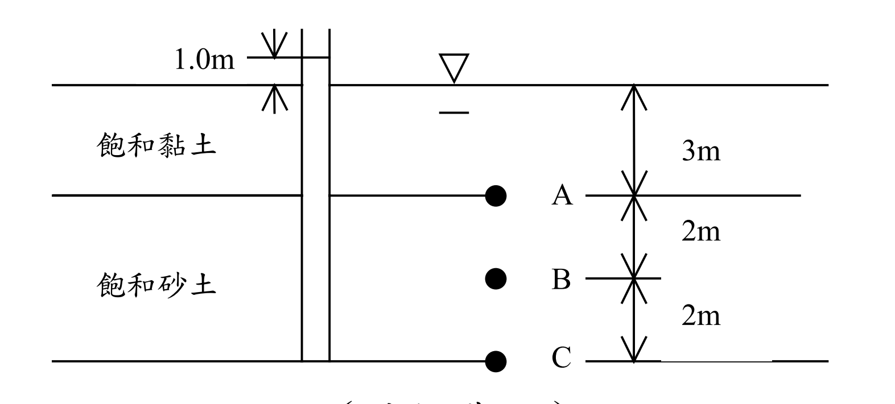

# SM-2009-3 題目正本

> 本檔只記錄**考卷上寫了什麼、圖上畫了什麼**，不含任何解法。解析見同資料夾 `SM-2009-3.md`。
> 判讀清單已確認（凍結）；本檔原則上不再修改（改動須回考卷原圖並記 log）。

| 項目 | 內容 |
|------|------|
| 考卷 | `raw/exams/SM-2009_土壤力學與基礎設計.pdf` 第 1 頁（正面），第三題 |
| 考年 | 民國 98 年（2009） |
| 配分 | 25 分 |
| 附圖 | `SM-2009-3-fig-1.png`（地層剖面與水壓計；既有證據圖完整，底緣帶到一點「請接背面」字樣殘邊，不影響判讀，沿用） |
| 判讀狀態 | **已確認**（2026-11-15 關卡一：使用者授權依建議判讀確認；轉錄 2026-11-15；PyMuPDF 110 dpi 全頁目視，附圖為向量圖、450 dpi 局部放大並讀 PDF 線段座標；PDF 文字層核對逐字原文；盲讀後才比對既有解析） |

## 1. 考卷原文（逐字）

> 三、某地層由飽和黏土層及下方之砂土層組成，地下水位於地表面。黏土之含水量 $\omega$ = 30%，孔隙比 $e$ = 0.8；砂土之土粒比重 $G_s$ = 2.65，含水量 $\omega$ = 18.5%。砂土層為一受壓水層，經由置於砂土層底部之水壓計測得該點之水頭高於地表面 1.0 m，如圖所示。試分別求砂土層之頂部、中間、底部，即 A、B、C 三點處之孔隙水壓力及垂直向總應力與有效應力。（25 分）

## 2. 考卷給的公式、附表與參數

- 黏土：$\omega$ = 30%、$e$ = 0.8（飽和）；**沒有給** $G_s$。
- 砂土：$G_s$ = 2.65、$\omega$ = 18.5%（圖上標「飽和砂土」）；**沒有給** $e$。
- 地下水位在地表面；水壓計（置於砂土層底部）水頭高於地表面 1.0 m。
- **沒有給**：$\gamma_w$、砂土層以下地層。
- 卷首注意事項：㈠可以使用電子計算器，但需詳列解答過程。㈡不必抄題，作答時請將試題題號及答案依照順序寫在試卷上，於本試題上作答者，不予計分。㈢下列問題之相關公式、物理常數、符號意義及設計參數未提及時，請自行依規範作合理之推斷與假設。

## 3. 附圖

圖面文字照錄：`1.0m`、`飽和黏土`、`飽和砂土`、`3m`、`2m`、`2m`、`A`、`B`、`C`。

## 4. 判讀清單

| # | 項目 | 判讀 | 圖上／題文依據 | 把握 |
|---|------|------|---------------|------|
| 1 | 地下水位 | 在地表面（▽ 畫在地表線上） | 題文；附圖 | 確定 |
| 2 | 黏土層厚 | 3 m，地表到 A（A 在黏土／砂土交界） | 附圖右側尺寸線（PDF 座標 y = 857.5 → 900.7） | 確定 |
| 3 | 砂土層厚 | 4 m：A→B 2 m、B→C 2 m；B 在砂土層中點、C 在砂土層底 | 附圖右側尺寸線（y = 900.7 → 933.1 → 965.5） | 確定 |
| 4 | 水壓計 | 雙線管由地表以上一直畫到 C 點高程，量測點在砂土層底部（C） | 附圖管線下端止於 y = 965.5；題文「置於砂土層底部」 | 確定 |
| 5 | 水壓計水頭 | 管內水位高出地表面 1.0 m（尺寸線由地表線量到管頂短橫線） | 附圖左上 `1.0m` 尺寸線 | 確定 |
| 6 | 砂土層內水頭 | 「受壓水層」：題目只給底部一點讀數；砂土層內總水頭視為同一值（砂土透水性高、層內無明顯水頭損失） | 題文 | 確定（解讀） |
| 7 | 黏土單位重 | 沒給 $G_s$；飽和黏土由 $\omega$、$e$ 換算 | 題文「飽和黏土層」 | 確定 |
| 8 | 砂土單位重 | 沒給 $e$；圖標「飽和砂土」，由 $G_s$、$\omega$ 以 $S$ = 100% 換算 | 附圖文字；題文 | 確定（解讀） |
| 9 | 所求 | A、B、C 三點的孔隙水壓、垂直總應力、垂直有效應力 | 題文 | 確定 |
| 10 | 考卷沒有給 | $\gamma_w$、黏土 $G_s$、砂土 $e$、砂土以下地層 | 全題 | 確定 |

---

*轉錄：2026-11-15（SM-U1-4 題目正本推廣・批 1）*

*確認：2026-11-15 使用者授權依建議判讀確認（SM-U1-4 題目正本推廣・批 1，關卡一；使用者指示「要我確認的請依你建議」）*
