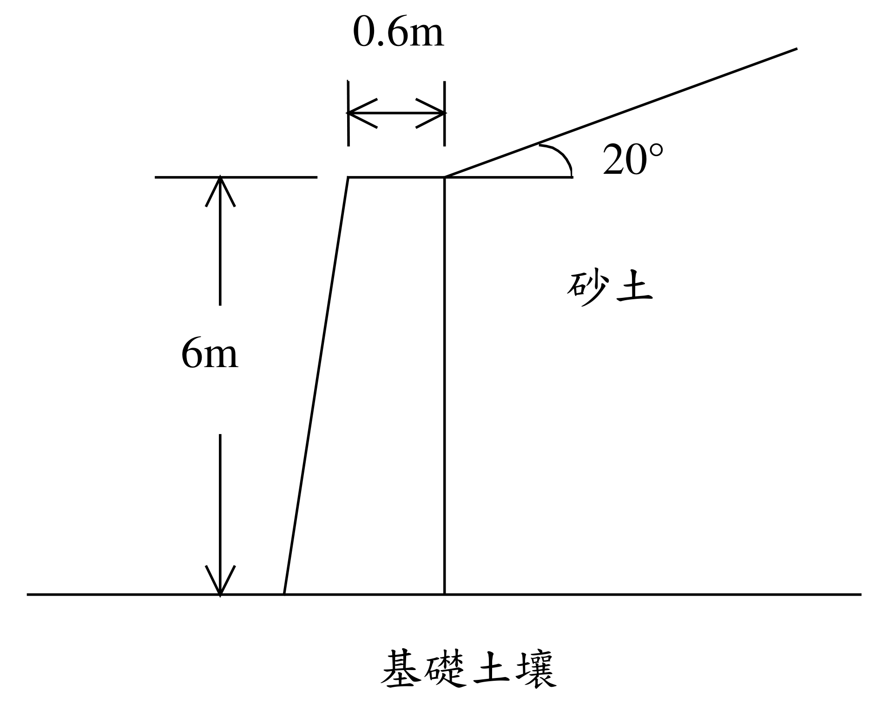

# SM-2009-4 題目正本

> 本檔只記錄**考卷上寫了什麼、圖上畫了什麼**，不含任何解法。解析見同資料夾 `SM-2009-4.md`。
> 判讀清單已確認（凍結）；本檔原則上不再修改（改動須回考卷原圖並記 log）。

| 項目 | 內容 |
|------|------|
| 考卷 | `raw/exams/SM-2009_土壤力學與基礎設計.pdf` 第 2 頁（背面），第四題 |
| 考年 | 民國 98 年（2009） |
| 配分 | 25 分 |
| 附圖 | `SM-2009-4-fig-2.png`（擋土牆剖面；2026-11-15 由考卷重新擷取 500 dpi）；既有 `SM-2009-4-fig-1.png` 為同一圖，「砂土」字旁有滑鼠游標，保留不刪 |
| 判讀狀態 | **已確認**（2026-11-15 關卡一：使用者授權依建議判讀確認；轉錄 2026-11-15；PyMuPDF 110 dpi 全頁目視，附圖 400–500 dpi 局部放大＋PDF 向量座標核對（附圖為向量線條）；盲讀後才比對既有解析） |

## 1. 考卷原文（逐字）

> 四、茲設計一重力式混凝土擋土牆高 6 m，牆頂寬度為 0.6 m，其背填土為砂土，與水平成 20°，如圖所示。背填土之單位重為 18 kN/m³，摩擦角為 30°；混凝土之單位重為 24 kN/m³；而牆底之基礎土壤單位重為 16 kN/m³，摩擦角為 33°。（25 分）
> ㈠若欲使所有作用力之合力通過牆底，且距牆趾為三分之一牆底寬度時，則牆底寬度須為多少？
> ㈡根據以上所得的結果，試分別檢核此擋土牆抵抗水平滑動及傾倒之安全係數。若安全係數不足時，在不改變牆底寬度的情況下，有何改善的方式？

## 2. 考卷給的公式、附表與參數

- 擋土牆：重力式混凝土，牆高 6 m，牆頂寬 0.6 m，混凝土單位重 24 kN/m³。
- 背填土：砂土，地表與水平成 20°，單位重 18 kN/m³，摩擦角 30°。
- 基礎土壤：單位重 16 kN/m³，摩擦角 33°。
- 題目條件：所有作用力之合力通過牆底、距牆趾 $B/3$（$B$ 為牆底寬，㈠所求）。
- **沒有給**：公式、土壓力理論（Rankine 或 Coulomb）、牆背與背填土的摩擦角 $\delta$、牆底與基礎土壤介面的摩擦角或黏著力、背填土與基礎土壤的凝聚力、安全係數要求值、地下水位、牆前埋入深度。
- 卷首注意事項：㈠可以使用電子計算器，但需詳列解答過程。㈡不必抄題，作答時請將試題題號及答案依照順序寫在試卷上，於本試題上作答者，不予計分。㈢下列問題之相關公式、物理常數、符號意義及設計參數未提及時，請自行依規範作合理之推斷與假設。

## 3. 附圖

圖面文字照錄：`0.6m`、`20°`、`6m`、`砂土`、`基礎土壤`。

## 4. 判讀清單

| # | 項目 | 判讀 | 圖上／題文依據 | 把握 |
|---|------|------|---------------|------|
| 1 | 土壓力理論 | 考卷未指定，也未給牆背摩擦角 $\delta$。建議：牆背鉛直、未給 $\delta$ → 用 Rankine 傾斜背填土（土壓力平行地表面，作用於牆背鉛直面） | 題文無理論名稱、無 $\delta$ | 不確定（影響答案）；使用者授權依建議確認 |
| 2 | 牆底摩擦 | 考卷只給基礎土壤摩擦角 33°，未給牆底介面摩擦角與黏著力。建議：介面摩擦角取 33°、黏著力 0，另以 $\tfrac{2}{3}\phi$ 對照 | 題文 | 不確定（影響答案）；使用者授權依建議確認 |
| 3 | 斷面形狀 | 梯形：牆背（右、背填側）鉛直，牆面（左）傾斜；牆頂水平 | PDF 向量座標：牆背線 x = 362.7 pt 由 y = 422.9 到 552.2 鉛直；牆面線 (332.8, 422.9) → (313.0, 552.2) | 確定 |
| 4 | 牆高 6 m | 由牆頂量到牆底（尺寸線上端對齊牆頂延長線 y = 422.9、下端對齊地面線 y = 552.2） | 附圖左側尺寸線 | 確定 |
| 5 | 牆頂寬 0.6 m | 牆頂左角到牆背（尺寸界線 x = 332.8、362.7 pt） | 附圖上方尺寸線 | 確定 |
| 6 | 牆底寬 $B$ | 未知，為㈠所求；牆底 = 0.6 m ＋ 牆面水平投影，牆面斜率隨 $B$ 而定 | 題文㈠；圖上未標底寬 | 確定 |
| 7 | 附圖比例 | 未按比例（圖上頂寬 29.9 pt、牆高 129.3 pt，以頂寬換算牆高只有約 2.6 m），幾何以標註為準 | PDF 向量座標 | 確定 |
| 8 | 牆趾、牆踵 | 牆趾 = 牆面（左、斜面）與牆底交點；牆踵 = 牆背底 | 題文「距牆趾」＋附圖 | 確定（解讀） |
| 9 | 背填土面 | 自牆背頂點起向背填側上傾 20°（圖上斜線 (362.7, 422.9) → (471.7, 383.1)，量得 20.1°） | 附圖 | 確定 |
| 10 | 背填土 | 砂土 $\gamma$ = 18 kN/m³、摩擦角 30°；凝聚力未給（砂土，視為 0） | 題文 | 確定（解讀） |
| 11 | 牆前地面 | 與牆底同高（地面線 y = 552.2 延伸到牆趾左側），牆前無覆土、無埋入 | 附圖 | 確定（解讀） |
| 12 | 基礎土壤 | $\gamma$ = 16 kN/m³、摩擦角 33°，凝聚力未給 | 題文 | 確定 |
| 13 | 合力條件 | 牆重與土壓力的合力與牆底交點距牆趾 $B/3$（即偏心距 $B/6$） | 題文㈠ | 確定 |
| 14 | 所求㈡ | 抗水平滑動、抗傾倒安全係數；不足時在不改變牆底寬下的改善方式 | 題文㈡ | 確定 |
| 15 | 考卷沒有給 | 土壓力理論、牆背 $\delta$、牆底介面參數、安全係數要求值、地下水位（未提及，視為無水） | 全題 | 確定 |

---

*轉錄：2026-11-15（SM-U3-2 題目正本推廣・批 1）*

*確認：2026-11-15 使用者授權依建議判讀確認（SM-U3-2 題目正本推廣・批 1，關卡一；使用者指示「要確認的依你建議」）*
