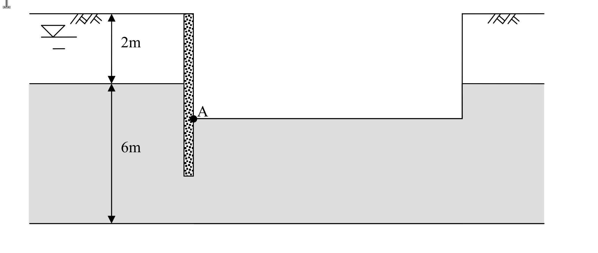

# SM-2010-3 題目正本

> 本檔只記錄**考卷上寫了什麼、圖上畫了什麼**，不含任何解法。解析見同資料夾 `SM-2010-3.md`。
> 判讀清單已確認（凍結）；本檔原則上不再修改（改動須回考卷原圖並記 log）。

| 項目 | 內容 |
|------|------|
| 考卷 | `raw/exams/SM-2010_土壤力學與基礎設計.pdf` 第 1 頁（全一頁），第三題 |
| 考年 | 民國 99 年（2010） |
| 配分 | 25 分 |
| 附圖 | `SM-2010-3-fig-1.png`（附圖，無圖號） |
| 判讀狀態 | **已確認**（2026-11-15 關卡一：使用者授權依建議判讀確認；轉錄 2026-11-15；PyMuPDF 110 dpi 全頁目視，附圖 400 dpi 局部放大（向量圖）；PDF 文字層核對逐字原文；盲讀後才比對既有解析） |

## 1. 考卷原文（逐字）

> 三、有一厚 2 m 之黏土層，其下方為厚 6 m 之砂土層，地下水面位於地表下 1 m 處。今如在該地層開挖至地表下 4 m 後進行建築結構，為便利施工構築，將開挖面內之水位抽降至與開挖面等高，開挖擋土壁貫入至深度 5 m 處。砂土之單位重為 $\gamma_{sat}$ = 18 kN/m³；黏土層飽和單位重為 $\gamma_{sat}$ = 17.5 kN/m³，請計算位於開挖擋土壁內側 A 點所受之滲流力；並檢核此時開挖底面是否有管湧問題？（25 分）

## 2. 考卷給的公式、附表與參數

- 黏土：厚 2 m、$\gamma_{sat}$ = 17.5 kN/m³。
- 砂土：厚 6 m、$\gamma_{sat}$ = 18 kN/m³。
- 地下水位：地表下 1 m；開挖 4 m，開挖面內水位抽降至開挖面；擋土壁貫入至地表下 5 m。
- **沒有給**：$\gamma_w$、透水係數、砂層以下地層、流網、管湧安全係數標準、開挖寬度。
- 卷首注意事項：㈠可以使用電子計算器。㈡不必抄題，作答時請將試題題號及答案依照順序寫在試卷上，於本試題上作答者，不予計分。㈢下列各題若有所需參數或公式不足時，請自行合理假設或推知。

## 3. 附圖

圖面文字照錄：`2m`、`6m`、`A`。

## 4. 判讀清單

| # | 項目 | 判讀 | 圖上／題文依據 | 把握 |
|---|------|------|---------------|------|
| 1 | 黏土層的滲流角色 | 考卷沒給透水係數；解讀為黏土飽和、砂層頂水頭維持外側水位（地表下 1 m），水頭損失只發生在砂層內沿壁的流徑 | 題文、附圖 | 不確定（解讀；影響答案，請確認）；使用者授權依建議確認 |
| 2 | 層序 | 地表下 0～2 m 黏土、2～8 m 砂土（灰色區） | 附圖尺寸線 2m、6m；題文 | 確定 |
| 3 | 地下水位 | 地表下 1 m（圖上水位符號約在 2 m 尺寸線中段） | 題文；附圖水位符號 | 確定 |
| 4 | 開挖深度 | 地表下 4 m（開挖底面在砂層內 2 m） | 題文 | 確定 |
| 5 | 擋土壁底 | 地表下 5 m（開挖面下 1 m） | 題文 | 確定 |
| 6 | 附圖比例 | 附圖未依比例：A 點畫在約地表下 3 m、壁底約 4.6 m；以題文數值為準 | 附圖 400 dpi 量測（2 m ≈ 130 px） | 確定 |
| 7 | A 點 | 壁內側、開挖底面上，緊貼擋土壁（滲流出口） | 附圖黑點 | 確定 |
| 8 | 開挖內水位 | 抽降至開挖面（地表下 4 m） | 題文 | 確定 |
| 9 | 砂層下邊界 | 地表下 8 m 以下考卷未給，解讀為不透水（影響流網形狀，不影響沿壁最短流徑的簡化算法） | 附圖灰色區止於 6m 尺寸線下端 | 確定（解讀） |
| 10 | 所求 | A 點滲流力（單位體積 $i\gamma_w$）與開挖底面管湧檢核 | 題文 | 確定（解讀） |
| 11 | 考卷沒有給 | $\gamma_w$、透水係數、流網、管湧安全係數標準、開挖寬度、8 m 以下地層 | 全題 | 確定 |

---

*轉錄：2026-11-15（SM-U2-3 題目正本推廣・批 1）*

*確認：2026-11-15 使用者授權依建議判讀確認（SM-U2-3 題目正本推廣・批 1，關卡一；使用者指示「要我確認的請依你建議」）*
