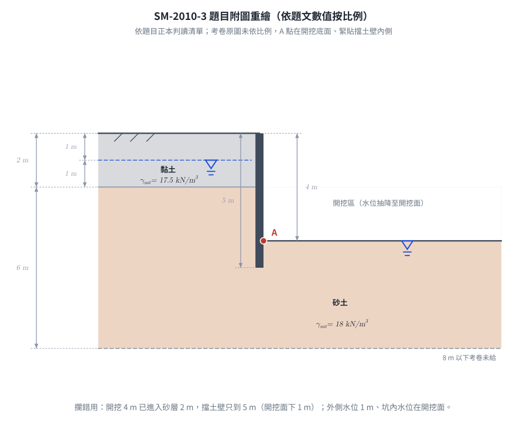
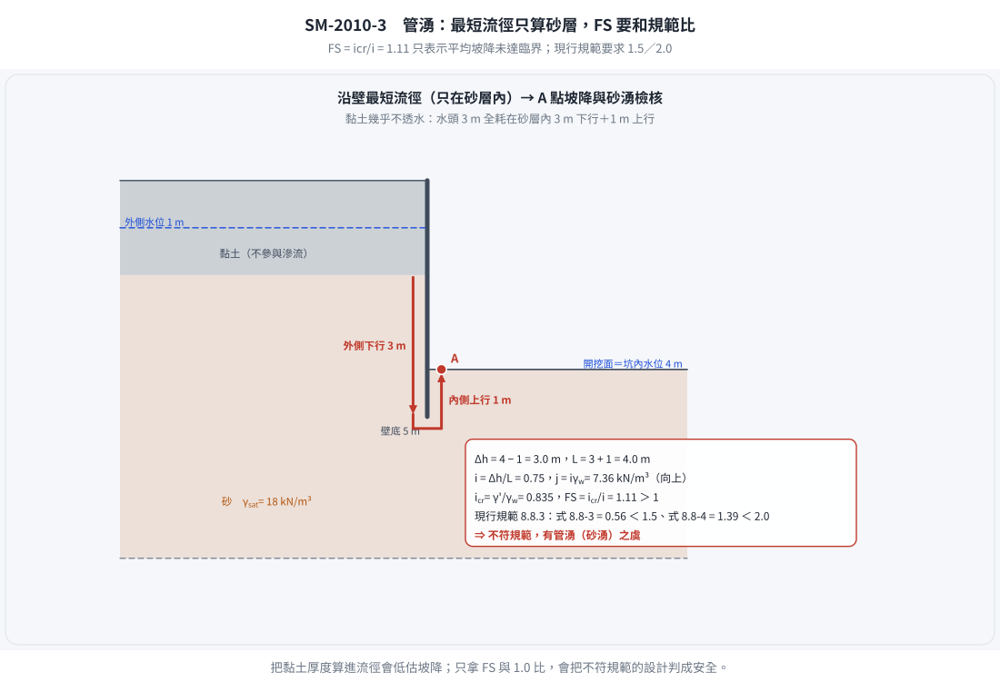

# 考題編號：SM-2010-3

**主分類：** `SM-U2-3` 開挖之穩定性分析
**副分類：** `SM-U1-2` 土壤滲透
**分析法：** 有效應力法
**標籤：** `滲流力` `臨界水力坡降` `管湧` `砂湧` `抽水降水` `開挖穩定性` `安全係數`
---

## 1. 題目（考卷原文見題目正本）

> 考卷原文、公式／附表、附圖與判讀清單（已確認）見 [`SM-2010-3-problem.md`](SM-2010-3-problem.md)。本節只列解題時最容易讀錯的地方與本解使用的記號；題意以題目正本為準。

*依題目正本判讀清單 #2–#9 按題文數值重繪（考卷原圖未依比例）；攔下的判讀錯誤：照原圖量 A 點約在 3 m、壁底約 4.6 m。*

### 常見誤讀

| 項目 | 正確判讀 | 常見誤讀 |
|---|---|---|
| 附圖比例 | 考卷附圖未依比例；開挖 4 m、壁底 5 m 以題文為準（題目正本 #6） | 照圖量 A 在 3 m |
| 滲流路徑 | 黏土未給透水係數，水頭損失只發生在砂層內沿壁流徑（#1，已確認） | 把黏土 2 m 計入流徑長 |
| 水頭差 | 外側水位地表下 1 m、坑內水位在開挖面 4 m（#3、#8） | 以砂層頂或地表為外側水頭 |

**本解記號：** $\Delta h$ 內外水頭差；$L$ 砂層內最短流徑長；$i$ 平均水力坡降；$j = i\gamma_w$ 單位體積滲流力；$i_{cr}$ 臨界水力坡降。

## 2. 考題核心精神與出題者意圖 (Core Concepts & Examiner's Intent)

1. **滲流路徑之判斷：** 測驗考生是否理解黏土層與砂土層之透水性差異（$k_{clay} \ll k_{sand}$），從而判斷水流主要沿著透水性佳之砂土層進行滲流，並能合理推估無流網圖時的最短流徑長度。
2. **滲流力計算：** 測驗滲流力 $j = i \cdot \gamma_w$ 之基本概念，及其作為單位體積受力之物理意義。
3. **管湧破壞檢核：** 測驗管湧（或砂湧）之臨界水力坡降 $i_{cr}$ 之計算方式，以及如何比較實際坡降 $i$ 與臨界坡降 $i_{cr}$ 以判別整體穩定性。

## 3. 解題戰略地圖與陷阱分析 (Strategic Roadmap & Trap Analysis)

- **步驟一：建立幾何與水頭模型**
  - 確定外側水頭高程（-1 m）、內側水頭高程（-4 m），計算驅動滲流之全水頭差 $\Delta h$。
- **步驟二：計算平均水力坡降 $i$**
  - 考量黏土層極難透水，假設水流僅於砂土層內發生。計算砂土層中沿擋土壁外側至內側之最短流徑長度 $L$。
  - 求得平均水力坡降 $i = \Delta h / L$。
- **步驟三：計算 A 點滲流力**
  - 利用 $j = i \cdot \gamma_w$ 求得滲流力。
- **步驟四：檢核管湧穩定性**
  - 計算砂土之臨界水力坡降 $i_{cr} = \gamma' / \gamma_w$。
  - 求安全係數 $FS = i_{cr} / i$，並依現行建築物基礎構造設計規範 8.8.3 的砂湧安全係數要求（1.5／2.0）判定，不是只看是否大於 1.0。

**⚠ 關鍵陷阱：**
- **流徑長度的計算區間：** 擋土壁總長為 5 m，但外側 0~2 m 為黏土層。因黏土透水性極低，滲流路徑應僅計算砂土層區間（外側 2~5 m，內側 5~4 m），若將黏土層厚度計入流徑將導致坡降被低估。
- **管湧破壞土層之選用：** 開挖底面（-4 m）位於砂土層中，故臨界坡降計算必須使用「砂土」之參數，而非黏土。

## 3.5 變數層次分析 (Variable Hierarchy Analysis)

### 最終目標
`計算擋土壁內側 A 點之單位體積滲流力，並檢核開挖底面是否會發生管湧破壞。`

### 本題關鍵公式（依計算順序）
- 全水頭差：$\Delta h = h_{out} - h_{in}$
- 砂土層內最短流徑長度：$L = D_{out} + D_{in}$
- 平均水力坡降：$i = \frac{\boxed{\Delta h}}{\boxed{L}}$
- 滲流力：$j = \boxed{i} \cdot \gamma_w$
- 臨界水力坡降：$i_{cr} = \frac{\gamma_{sat,s} - \gamma_w}{\gamma_w}$
- 管湧安全係數：$FS = \frac{\boxed{i_{cr}}}{\boxed{i}}$
- 現行規範砂湧檢核：式 8.8-3 $FS = \frac{2\gamma' D}{\gamma_w H_w} \ge 1.5$；式 8.8-4 $FS = \frac{\gamma'(H_w + 2D)}{\gamma_w H_w} \ge 2.0$

### L1：題目直接給定
| 符號 | 數值 | 說明 |
|---|---|---|
| $\gamma_{sat,s}$ | 18 kN/m³ | 砂土飽和單位重 |
| $\gamma_{sat,c}$ | 17.5 kN/m³ | 黏土飽和單位重 |
| $GL_{wt,out}$ | -1.0 m | 擋土壁外側地下水面高程 |
| $GL_{wt,in}$ | -4.0 m | 擋土壁內側（開挖面）水面高程 |

### L2：需知識點推導
**幾何與滲流參數**
| 符號 | 公式／來源 | 卡關? |
|---|---|---|
| $\Delta h$ | $h_{out} - h_{in}$ | |
| $L$ | $D_{out} + D_{in}$ (沿擋土壁於砂層之長度) | |
| $i$ | $\Delta h / L$ | |
| $j$ | $i \cdot \gamma_w$ | |

**管湧檢核**
| 符號 | 公式／來源 | 卡關? |
|---|---|---|
| $i_{cr}$ | $(\gamma_{sat,s} - \gamma_w) / \gamma_w$ | |
| $FS$ | $i_{cr} / i$ | |

### L3：深層知識（不懂就卡住）
| 知識點 | 說明 | 卡關? |
|---|---|---|
| 簡化一維流徑法 | 在無流網之情況下，假設水流沿擋土壁表面做最短距離流動。因黏土透水性極低，水流幾乎皆於砂土層中流動。 | |
| 滲流力 (Seepage Force) | 單位體積土體所承受由水流摩擦產生之推力，方向與水流方向一致。 | |

## 4. 步驟化詳細計算過程 (Step-by-Step Detailed Calculation)

**Step 1：建立高程與水頭模型**
設定地表高程為 $GL \pm 0.0 \text{ m}$，則各界線高程如下：
- 外側地下水位：$GL -1.0 \text{ m}$
- 黏土層底 / 砂土層頂：$GL -2.0 \text{ m}$
- 開挖面（內側水位）：$GL -4.0 \text{ m}$
- 擋土壁底（貫入深度）：$GL -5.0 \text{ m}$
- 砂土層底：$GL -8.0 \text{ m}$

決定驅動水流之總水頭差 $\Delta h$：
$$
\Delta h = (\text{外側水頭}) - (\text{內側水頭}) = (-1.0) - (-4.0) = 3.0 \text{ m}
$$
*(註：因黏土層滲透係數極低，可將外側砂土層視為受壓水層，其總水頭由上方地下水位控制。)*

**Step 2：計算最短流徑長度與平均水力坡降**
假設水流沿擋土壁表面流動，且僅考慮透水性較佳之砂土層。
- 擋土壁外側在砂土層之流徑長度：$D_{out} = |-5.0| - |-2.0| = 3.0 \text{ m}$
- 擋土壁內側在砂土層之流徑長度：$D_{in} = |-5.0| - |-4.0| = 1.0 \text{ m}$
- 總流徑長度 $L$：
$$
L = D_{out} + D_{in} = 3.0 + 1.0 = 4.0 \text{ m}
$$
平均水力坡降 $i$：
$$
i = \frac{\Delta h}{L} = \frac{3.0}{4.0} = 0.75
$$

**Step 3：計算 A 點所受之滲流力**
A 點位於擋土壁內側，承受由下往上的滲流作用，其單位體積滲流力 $j$ 為：
$$
j = i \cdot \gamma_w = 0.75 \times 9.81 = 7.3575 \text{ kN/m}^3
$$
> **策略註解**：滲流力屬於「體積力」(Body Force)，故單位為 $\text{kN/m}^3$。方向與水流一致，即「向上」。

$$
\boxed{ j = 7.36 \text{ kN/m}^3 \text{ (方向向上)} }
$$

**Step 4：檢核開挖底面管湧問題**
開挖底面位於砂土層中，已知砂土飽和單位重 $\gamma_{sat,s} = 18 \text{ kN/m}^3$。
計算砂土之臨界水力坡降 $i_{cr}$：
$$
i_{cr} = \frac{\gamma_{sat,s} - \gamma_w}{\gamma_w} = \frac{18.0 - 9.81}{9.81} = \frac{8.19}{9.81} \approx 0.835
$$
計算管湧安全係數 $FS$：
$$
FS = \frac{i_{cr}}{i} = \frac{0.835}{0.75} = 1.113
$$

$FS = 1.11 > 1.0$ 只表示「平均坡降尚未達臨界」，安全餘裕僅 11%，須再依現行規範判定。

**Step 5：依現行規範（建築物基礎構造設計規範 8.8.3 砂湧）檢核**
$H_w$ = 兩側水位差 $= 3.0 \text{ m}$，$D$ = 開挖面以下擋土壁貫入深度 $= 1.0 \text{ m}$，$\gamma' = 8.19 \text{ kN/m}^3$：
$$ FS_{8.8\text{-}3} = \frac{2\gamma' D}{\gamma_w H_w} = \frac{2(8.19)(1.0)}{9.81(3.0)} = 0.56 < 1.5 $$
$$ FS_{8.8\text{-}4} = \frac{\gamma'(H_w + 2D)}{\gamma_w H_w} = \frac{8.19(3.0 + 2.0)}{9.81(3.0)} = 1.39 < 2.0 $$
（式 8.8-4 的流徑 $H_w+2D$ 由外側水位起算、含 1 m 黏土段，比本解只算砂層的 $L = 4$ m 長，故 $FS$ 較大；本解沿砂層的 $i_{cr}/i = 1.11$ 也小於 1.5。條文式子取自內政部國土管理署公開之規範 PDF 文字擷取、依符號重組，未逐字核對。）

$$
\boxed{ FS = 1.11 \text{（理論值 > 1）但不符現行規範之砂湧安全係數要求} \Rightarrow \text{有管湧（砂湧）之虞} }
$$
對策：加深擋土壁貫入深度（使式 8.8-3 ≥ 1.5 需 $D \ge 1.5\gamma_w H_w/(2\gamma') = 2.70$ m）、或於外側／砂層降水降低水頭差。

*圖 2　流徑只算砂層，FS 要和規範比。攔的是「把黏土厚度算進流徑而低估坡降」與「$FS > 1$ 就判安全」：$i_{cr}/i = 1.11$ 只表示平均坡降未達臨界，現行規範 8.8.3 要求 1.5／2.0，本題不足。*

## 5. 關鍵爭議點與進階探討 (Critical Issues & Advanced Discussion)

1. **理論 FS 與規範要求（2026-11-15 勘誤）：**
   $FS = 1.11 > 1.0$ 只代表平均坡降未達臨界；考量土壤參數變異與二維流網出口坡降（Exit Gradient）往往大於平均坡降，現行規範 8.8.3 要求式 8.8-3 $\ge 1.5$、式 8.8-4 $\ge 2.0$，本題 0.56、1.39 都不足，結論是**有管湧（砂湧）之虞**（勘誤前本解主答「理論上無管湧發生」，只把規範要求放在討論）。對策為加深擋土壁貫入深度，或於擋土壁外側進行點井降水以降低水頭差。
2. **一維流徑假設的侷限性：**
   本解析採用「沿壁面最短流徑法」估算平均水力坡降，這是國家考試在未提供流網圖時的標準簡化解法。若實際繪製流網，擋土壁底端（即繞流點附近）之水力坡降會發生集中而大於 0.75，而開挖面出口之水力坡降可能會略小於或接近平均值。若嚴格要求特定點位之準確受力，必須依賴二維滲流分析軟體或流網圖。
3. **$\gamma_w$ 數值選用：**
   若考場上為了計算方便選用 $\gamma_w = 10 \text{ kN/m}^3$，則 $i_{cr} = (18 - 10) / 10 = 0.80$，$FS = 0.80 / 0.75 = 1.07$，規範式 8.8-3／8.8-4 為 0.53／1.33，結論同樣是不符規範、有管湧之虞。本解析依據一般工程慣例採用精確值 $9.81 \text{ kN/m}^3$ 進行計算。

---
*修正日期：2026-11-15（主副分類對調為 SM-U2-3 主／SM-U1-2 副；分類稽核 `wiki/queries/分類稽核-SM-2026-11-15.md`，（非勘誤））*

*修正日期：2026-11-15（§1 改為指向題目正本 `SM-2010-3-problem.md`，重繪附圖 figs/SM-2010-3-fig-1-problem.svg；非勘誤）*

*修正日期：2026-11-15（FIX：管湧依現行規範判定：結論由「FS = 1.11 > 1，理論上無管湧」改為依現行台灣規範（建築物基礎構造設計規範，內政部 112 年修正、113 年 1 月 1 日生效）8.8.3 砂湧檢核 0.56／1.39 不足 → 有管湧之虞；§3、§3.5、§4 Step 5、§5 更新；滲流力 7.36 kN/m³ 不變；依 `wiki/queries/盲解比對-SM-U2-3-B1-2026-11-15.md`；腳本 `scripts/fixes/2026-11-15_fix_SM-2010-3_piping_code.py`）*

*修正日期：2026-11-15（補解題圖解 `figs/SM-2010-3-fig-2-flowpath.svg`，腳本 `gen_SM-2010-3.py` 可重跑；非勘誤）*
