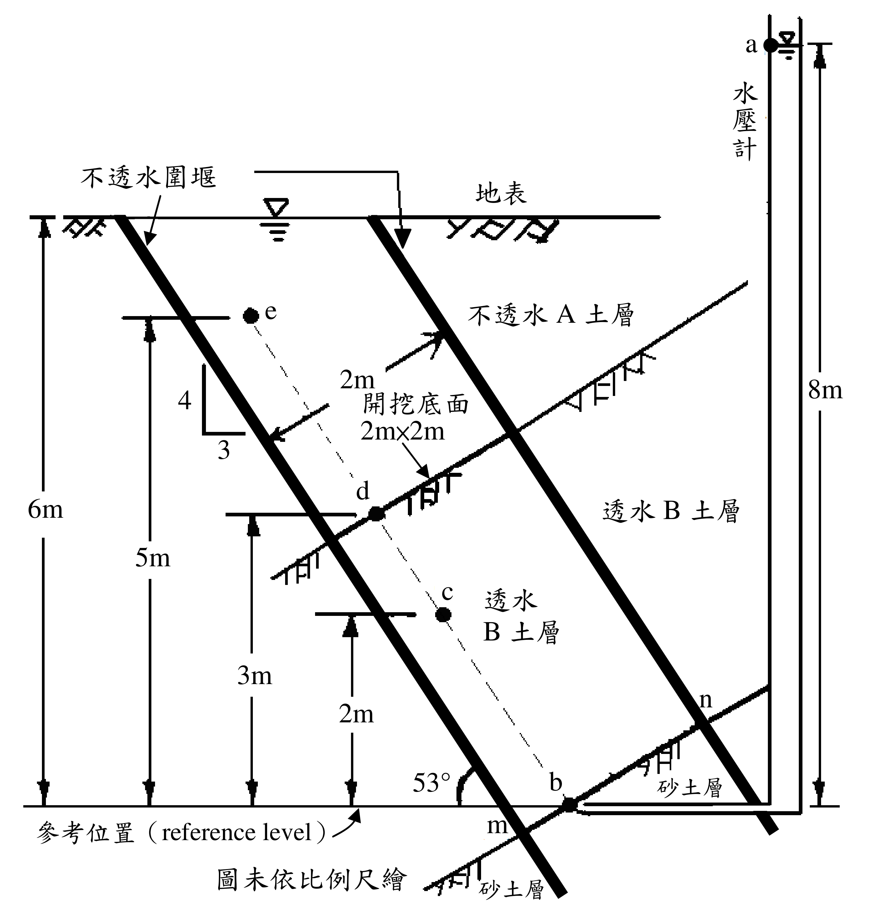

# SM-2011-2 題目正本

> 本檔只記錄**考卷上寫了什麼、圖上畫了什麼**，不含任何解法。解析見同資料夾 `SM-2011-2.md`。
> 判讀清單已確認（凍結）；本檔原則上不再修改（改動須回考卷原圖並記 log）。

| 項目 | 內容 |
|------|------|
| 考卷 | `raw/exams/SM-2011_土壤力學與基礎設計.pdf` 第 1 頁（正面），第二題 |
| 考年 | 民國 100 年（2011） |
| 配分 | 25 分 |
| 附圖 | `SM-2011-2-fig-2.png`（傾斜圍堰、土層與水壓計；2026-11-15 由考卷重新擷取 500 dpi）；既有 `SM-2011-2-fig-1.png` 為同一圖，「不透水圍堰」標籤上方帶滑鼠游標，保留不刪 |
| 判讀狀態 | **已確認**（2026-11-15 關卡一：使用者授權依建議判讀確認；#1–#3 影響答案，依建議定案；轉錄 2026-11-15；PyMuPDF 110 dpi 全頁目視，附圖 260–500 dpi 局部放大（內嵌點陣影像）；PDF 文字層核對逐字原文；盲讀後才比對既有解析） |

## 1. 考卷原文（逐字）

> 二、某工地因施工需要在複雜土層進行傾斜向開挖底面為 2 m×2 m 正方形之圍堰開挖，如下圖所示，開挖後水在圍堰內土層 B 之土壤中產生滲流，試求㈠a、b、c、d、e 各點之總水頭、高度水頭及壓力水頭各為若干（m）？㈡試繪流經此土壤之流網及計算流經此土壤之平均水力坡降 $i_{bd}$ 為若干？㈢若此土層 B 之土壤透水係數 k＝0.005 cm/sec，試計算其滲流量為若干（m³/day）？（25 分）

## 2. 考卷給的公式、附表與參數

- 開挖底面 2 m × 2 m 正方形；土層 B 透水係數 $k$ = 0.005 cm/sec。
- 圖上尺寸（由參考位置起算的高度）：地表 6 m、e 點 5 m、d 點 3 m、c 點 2 m、b 點 0（參考位置）、水壓計水位 a 點 8 m；圍堰壁斜率 4：3（與水平夾 53°）；兩壁垂直間距 2 m。
- 圖註：「圖未依比例尺繪」。
- **沒有給**：$\gamma_w$、圍堰壁厚、B 層頂底面的傾角數值。
- 卷首注意事項：㈠可以使用電子計算器。㈡不必抄題，作答時請將試題題號及答案依照順序寫在試卷上，於本試題上作答者，不予計分。㈢本試題之相關符號、公式、物理常數及設計參數未提及時，請依規範自行合理推斷或假設。

## 3. 附圖

圖面文字照錄：`a`、`水壓計`、`不透水圍堰`、`地表`、`e`、`不透水 A 土層`、`2m`、`開挖底面 2m×2m`、`4`、`3`、`d`、`6m`、`5m`、`透水 B 土層`、`c`、`透水 B 土層`、`3m`、`2m`、`n`、`53°`、`b`、`砂土層`、`8m`、`參考位置（reference level）`、`m`、`圖未依比例尺繪`、`砂土層`。

## 4. 判讀清單

| # | 項目 | 判讀 | 圖上／題文依據 | 把握 |
|---|------|------|---------------|------|
| 1 | 圍堰內水位 | 圍堰內積水到**地表**（高程 6 m）：▽ 畫在兩道圍堰之間的地表線上；e 點（5 m）在水中 | 附圖 ▽ 位置；題文「開挖後水在圍堰內土層 B 之土壤中產生滲流」 | 不確定（影響答案）；依建議定案 |
| 2 | 開挖底面位置 | 開挖底面＝B 層頂＝過 **d 點**（高程 3 m）的斜線，不是 e 點高程；「開挖底面 2m×2m」的箭頭指向過 d 的那條線 | 附圖 260 dpi：標籤箭頭尖端落在 d 線上 | 確定（解讀；影響答案） |
| 3 | B 層頂、底面方向 | 過 d 的 B 層頂與過 b 的 B 層底（砂土層頂）在圖上近乎平行，且近乎**垂直於圍堰壁**（量得與壁夾角約 84°–96°；圖未依比例尺）；兩者都不是水平線。故 2 m × 2 m 開挖底面即垂直於圍堰軸向的斷面 | 附圖量測：d 線約上升 32°、b 線約上升 30°，壁方向 127° | 確定（解讀；影響答案） |
| 4 | 圍堰幾何 | 兩道平行不透水圍堰，斜率 4（垂直）：3（水平），與水平夾 53°（標在左壁與參考線交角）；壁間垂直距離 2 m | 附圖 `4`、`3`、`53°`、`2m`（箭頭垂直於壁） | 確定 |
| 5 | 各點高程 | 參考位置（b 點高程）為 0；c = 2 m、d = 3 m、e = 5 m、地表 = 6 m、a = 8 m；b、c、d、e 都在圍堰中心線（虛線）上 | 附圖左側各尺寸線皆由參考位置量起 | 確定 |
| 6 | a 點與水壓計 | b 點接管線水平往右至直立水壓計管，a 為管內水位（高程 8 m） | 附圖管線、`水壓計`、`8m` | 確定 |
| 7 | 土層 | 不透水 A 土層在 d 線以上（圍堰外）；透水 B 土層在 d 線與 b 線之間（圍堰內外皆標）；b 線以下為砂土層；m、n 為左、右壁與 b 線交點 | 附圖文字與線條 | 確定 |
| 8 | 圍堰內 d 線以上 | 已開挖，只有水（無土） | 題文「圍堰開挖」；#1、#2 | 確定（解讀） |
| 9 | 所求 ㈡ | 繪 B 層內流網並求 b→d 平均水力坡降 $i_{bd}$ | 題文 | 確定 |
| 10 | 所求 ㈢ | B 層滲流量，單位 m³/day | 題文 | 確定 |
| 11 | 考卷沒有給 | $\gamma_w$、壁厚、B 層頂底面傾角；圖未依比例尺 | 全題 | 確定 |

---

*轉錄：2026-11-15（SM-U1-2 題目正本推廣・批 1）*

*確認：2026-11-15 使用者授權依建議判讀確認（SM-U1-2 題目正本推廣・批 1，關卡一；使用者指示「要我確認的請依你建議」）；⚠ #1–#3 與舊解讀法不同、影響答案，待使用者複核*
