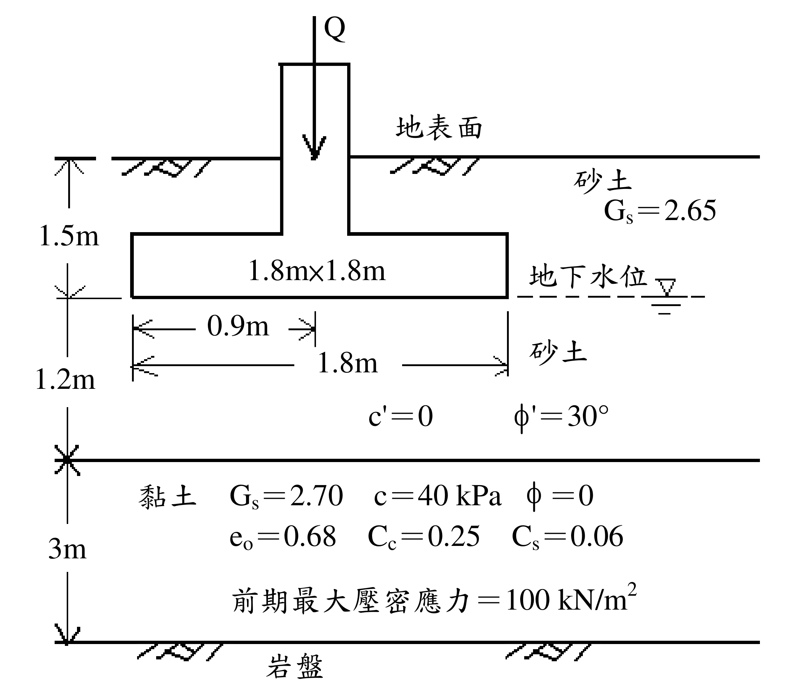

# SM-2011-3 題目正本

> 本檔只記錄**考卷上寫了什麼、圖上畫了什麼**，不含任何解法。解析見同資料夾 `SM-2011-3.md`。
> 判讀清單已確認（凍結）；本檔原則上不再修改（改動須回考卷原圖並記 log）。

| 項目 | 內容 |
|------|------|
| 考卷 | `raw/exams/SM-2011_土壤力學與基礎設計.pdf` 第 2 頁（背面），第三題 |
| 考年 | 民國 100 年（2011） |
| 配分 | 25 分 |
| 附圖 | `SM-2011-3-fig-2.png`（基礎與地層剖面；2026-11-15 由考卷重新擷取 500 dpi）；既有 `SM-2011-3-fig-1.png` 為同一圖，柱頂 Q 箭頭旁有滑鼠游標，保留不刪 |
| 判讀狀態 | **已確認**（2026-11-15 關卡一：使用者授權依建議判讀確認；轉錄 2026-11-15；PyMuPDF 110 dpi 全頁目視，附圖 400 dpi 局部放大（內嵌點陣影像）；盲讀後才比對既有解析） |

## 1. 考卷原文（逐字）

> 三、如下圖所示之 1.8m×1.8m 正方基礎承受 Q 為 1 MN 之鉛垂向之正方柱載重，假設砂土層之孔隙比 e 為 0.65，比重 $G_s$ 為 2.65，地下水位以上砂土之飽和度為 50%；黏土層之比重 $G_s$ 為 2.70，壓縮性指數 $C_c$ 為 0.25，回脹性指數 $C_s$ 為 0.06，最初孔隙比 $e_o$ 為 0.68。其他參數如圖中所標示。㈠假設壓力以 2：1（V：H）分布方式向下傳遞，試計算基礎中心下方黏土層之平均新增鉛垂向應力為若干（kPa）？㈡試計算黏土層之壓密沉陷量為若干（mm）？（25 分）

## 2. 考卷給的公式、附表與參數

- 基礎：1.8 m × 1.8 m 正方基礎；柱載重 $Q$ = 1 MN（鉛垂）。
- 砂土：$e$ = 0.65、$G_s$ = 2.65、水位以上飽和度 50%；圖上 $c'$ = 0、$\phi'$ = 30°。
- 黏土：$G_s$ = 2.70、$C_c$ = 0.25、$C_s$ = 0.06、$e_o$ = 0.68；圖上 $c$ = 40 kPa、$\phi$ = 0、前期最大壓密應力 = 100 kN/m²。
- 題目指定：2：1（V：H）應力分布。
- **沒有給**：$\gamma_w$、基礎混凝土與基礎上回填土自重、$Q$ 是否含基礎自重。
- 卷首注意事項：㈠可以使用電子計算器。㈡不必抄題，作答時請將試題題號及答案依照順序寫在試卷上，於本試題上作答者，不予計分。㈢本試題之相關符號、公式、物理常數及設計參數未提及時，請依規範自行合理推斷或假設。

## 3. 附圖

圖面文字照錄：`Q`、`地表面`、`砂土 Gs＝2.65`、`1.5m`、`1.8m×1.8m`、`地下水位`、`0.9m`、`1.8m`、`砂土`、`1.2m`、`c'＝0　φ'＝30°`、`黏土　Gs＝2.70　c＝40 kPa　φ＝0`、`eo＝0.68　Cc＝0.25　Cs＝0.06`、`3m`、`前期最大壓密應力＝100 kN/m²`、`岩盤`。

## 4. 判讀清單

| # | 項目 | 判讀 | 圖上／題文依據 | 把握 |
|---|------|------|---------------|------|
| 1 | 基礎埋深 | 1.5 m，由地表量到基底（尺寸線上端對齊地表線，下端對齊基底延長線） | 附圖 400 dpi，左側尺寸線 | 確定 |
| 2 | 地下水位 | 在基底高程（地表下 1.5 m）；虛線與基底底線同高 | 附圖虛線與基底對齊 | 確定 |
| 3 | 基底下砂土厚 | 1.2 m（基底到黏土頂；尺寸線上端在基底延長線、下端在黏土頂線的 × 記號） | 附圖左側尺寸線 | 確定 |
| 4 | 黏土層厚 | 3 m，黏土頂到岩盤頂 | 附圖左側尺寸線 | 確定 |
| 5 | 黏土下方 | 岩盤（附圖畫地層符號） | 附圖 | 確定 |
| 6 | 基礎尺寸 | 1.8 m × 1.8 m；圖上 0.9 m 為基底左緣到柱中心線（半寬） | 附圖尺寸線 | 確定 |
| 7 | 砂土單位重 | 未直接給，須由 $e$、$G_s$、$S$ 換算：水位以上 $S$ = 50%，水位以下飽和 | 題文 | 確定 |
| 8 | 黏土單位重 | 未直接給，由 $G_s$ = 2.70、$e_o$ = 0.68（飽和）換算 | 題文 | 確定（解讀） |
| 9 | 黏土強度參數 | 圖上 $c$ = 40 kPa、$\phi$ = 0、砂土 $c'$、$\phi'$ 與本題兩小題無直接關係 | 附圖 | 確定 |
| 10 | 荷重 | $Q$ = 1 MN 為柱載重；基礎與回填土自重未給 | 題文 | 確定（解讀） |
| 11 | 所求㈠ | 基礎中心下方黏土層的**平均**新增鉛垂應力（2：1 法） | 題文 | 確定 |
| 12 | 所求㈡ | 黏土層壓密沉陷量（mm） | 題文 | 確定 |
| 13 | 考卷沒有給 | $\gamma_w$、基礎自重、回填土重 | 全題 | 確定 |

---

*轉錄：2026-11-15（SM-U1-3 題目正本推廣・批 1）*

*確認：2026-11-15 使用者授權依建議判讀確認（SM-U1-3 題目正本推廣・批 1，關卡一；使用者指示「要我確認的請依你建議」）*
