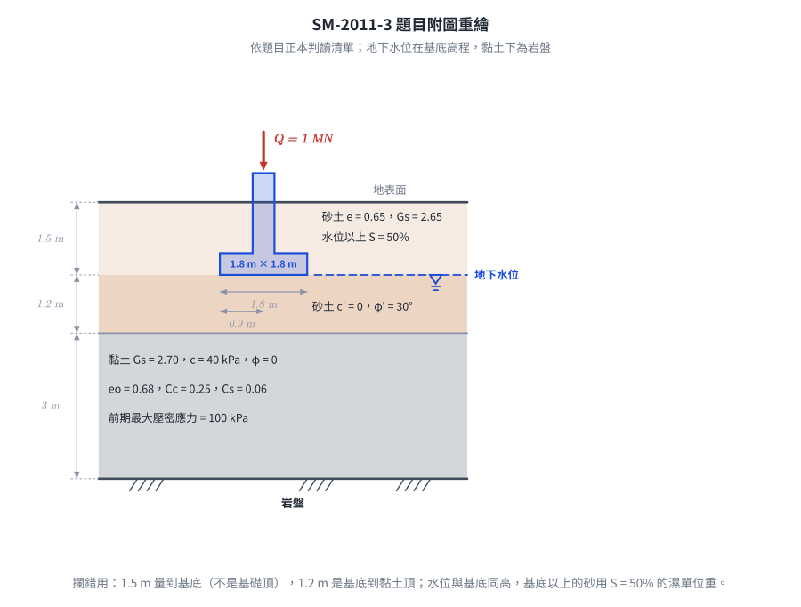
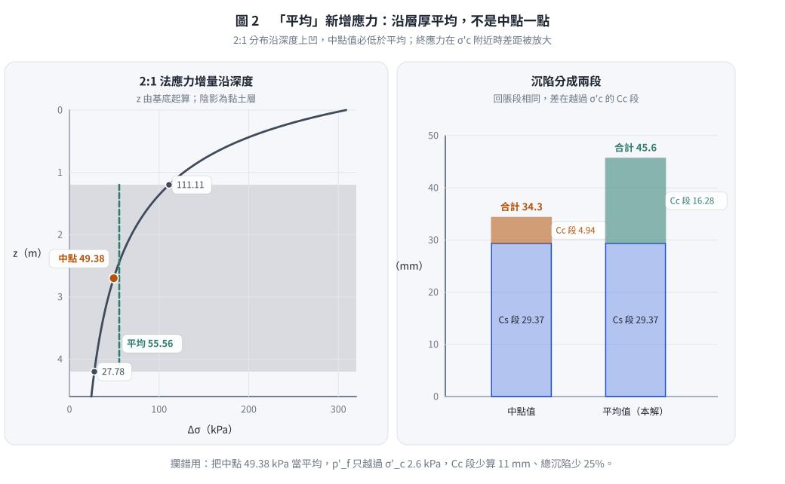

# 考題編號：SM-2011-3

**主分類：** `SM-U1-3` 土壤夯實及壓密
**副分類：** `SM-U1-4` 土體內應力、`SM-U2-1` 淺基礎之支承力與沉陷量
**分析法：** 有效應力法
**標籤：** `壓密沉陷` `2:1應力分布` `應力增量` `過壓密` `OCR` `e-log p'曲線` `回脹指數Cs` `飽和度`
---

## 1. 題目（考卷原文見題目正本）

> 考卷原文、公式／附表、附圖與判讀清單（已確認）見 [`SM-2011-3-problem.md`](SM-2011-3-problem.md)。本節只列解題時最容易讀錯的地方與本解使用的記號；題意以題目正本為準。

*重繪自考卷附圖，依題目正本判讀清單 #1–#6；攔下的判讀錯誤：1.5 m 量到基底而非基礎頂、地下水位與基底同高。*

### 常見誤讀

| 項目 | 正確判讀 | 常見誤讀 |
|---|---|---|
| 埋深與水位 | 1.5 m 由地表量到**基底**，地下水位在基底高程（題目正本 #1、#2） | 水位畫在地表或基礎頂 |
| 黏土頂深度 | 基底下砂土 1.2 m → 黏土頂在地表下 2.7 m、厚 3 m（#3、#4） | 把 1.2 m 當成由地表起算 |
| 單位重 | 砂土、黏土都沒給單位重，須由 $e$、$G_s$、$S$ 換算（#7、#8） | 直接假設 $\gamma=18$ |
| 所求「平均」應力 | ㈠問黏土層的**平均**新增應力（#11）：2:1 公式沿層厚取平均，$\Delta\sigma_{av}=55.56$ kPa | 只取黏土中點一點的 49.38 kPa 當平均（本解 2026-11-15 前即如此，沉陷因而少算 25%） |

**本解記號：** $\Delta\sigma_{av}$ 黏土層平均應力增量；$\sigma'_0$ 黏土中點初始有效應力；$\sigma'_c$ 前期最大壓密應力；$S_c$ 壓密沉陷量。

## 2. 考題核心精神與出題者意圖 (Core Concepts & Examiner's Intent)

本題測驗考生對於淺基礎沉陷量計算之完整流程掌握度，主要核心意圖包含：
1. **部分飽和土壤之單位重計算**：水位以上的砂土層給定 $S=50\%$，需正確代入三相圖公式求取濕單位重 $\gamma_t$。
2. **2:1 應力分布法之應用**：測驗是否能正確計算深度 $z$ 處之新增應力，並依題意求整個黏土層的「平均」新增應力——沿層厚平均，不是中點一點的值。
3. **過壓密狀態 (OCR) 的判別與沉陷量計算**：給定前期最大壓密應力 $p_c'=100 \text{ kPa}$，考生必須先計算初始有效覆土應力 $p_0'$ 並與 $p_c'$ 比較。本題設計 $p_0' + \Delta\sigma$ 剛好跨越 $p_c'$，因此必須分段使用回脹指數 $C_s$ 與壓縮指數 $C_c$ 計算沉陷量。

## 3. 解題戰略地圖與陷阱分析 (Strategic Roadmap & Trap Analysis)

**解題步驟：**
1. **求取各層單位重**：分別計算水位上砂土 ($\gamma_t$)、水位下砂土 ($\gamma_{sat}$、$\gamma'$)、黏土 ($\gamma_{sat}$、$\gamma'$) 之單位重。
2. **計算初始有效應力 $p_0'$**：計算基礎中心下方、黏土層中央處之初始有效覆土應力。
3. **計算平均新增應力 $\Delta\sigma_{avg}$**：採用 2:1 應力分布法，沿黏土層厚度（基底下 $z_t$ = 1.2 m 到 $z_b$ = 4.2 m）積分取平均，再以辛普森法則交叉驗算。
4. **判斷應力歷史並計算沉陷量 $S_c$**：比較 $p_0'$、$p_c'$ 與 $p_0' + \Delta\sigma_{avg}$，代入過壓密雙段沉陷公式求解。

**陷阱分析：**
- **陷阱一：忽略水位以上的飽和度**。若直接將水位上砂土視為乾燥 ($S=0$) 或忽略不計，將導致 $p_0'$ 計算錯誤。
- **陷阱二：計算 $\Delta\sigma$ 的深度 $z$ 定義**。2:1 應力分布法的深度 $z$ 必須由「基礎底面」起算，而非地表面。至黏土層中央之深度 $z = 1.2 + 3.0/2 = 2.7 \text{ m}$。
- **陷阱四：把中點值當平均**。題目明問「平均」新增應力；黏土頂、中、底的增量為 111.11、49.38、27.78 kPa，分布上凹，中點值比層厚平均低約 11%。
- **陷阱三：沉陷量公式錯用**。若未檢查 $p_0' + \Delta\sigma_{avg}$ 是否大於 $p_c'$，可能只套用 $C_s$ 計算，忽略了跨越 $p_c'$ 後進入正常壓密線的 $C_c$ 貢獻段。

## 3.5 變數層次分析 (Variable Hierarchy Analysis)

### 最終目標
求出黏土層之平均新增應力 $\Delta\sigma_{avg}$ 與最終壓密沉陷量 $S_c$。

### 本題關鍵公式（依計算順序）
- 土壤單位重推導：
  $$ \gamma = \frac{G_s + S \cdot e}{1+e}\gamma_w $$
- 初始有效應力（黏土層中央）：
  $$ p_0' = \Sigma (\gamma_i \cdot H_i) - u $$
- 2:1 應力分布（沿黏土層厚取平均，$B=L$）：
  $$ \Delta\sigma_{avg} = \frac{1}{H}\int_{z_t}^{z_b}\frac{Q}{(B+z)^2}\,dz = \frac{Q}{H}\left(\frac{1}{B+z_t}-\frac{1}{B+z_b}\right) $$
- 過壓密土壤沉陷量（當 $\boxed{p_0'} < p_c' < \boxed{p_0'} + \boxed{\Delta\sigma_{avg}}$）：
  $$ S_c = \frac{C_s H}{1+e_0}\log\left(\frac{p_c'}{\boxed{p_0'}}\right) + \frac{C_c H}{1+e_0}\log\left(\frac{\boxed{p_0'} + \boxed{\Delta\sigma_{avg}}}{p_c'}\right) $$

### L1：題目直接給定
| 符號 | 數值 | 說明 |
|---|---|---|
| $B \times L$ | $1.8 \text{ m} \times 1.8 \text{ m}$ | 基礎尺寸 |
| $Q$ | $1000 \text{ kN}$ | 柱載重 ($1 \text{ MN}$) |
| $e_{sand}$ | $0.65$ | 砂土孔隙比 |
| $G_{s,sand}$ | $2.65$ | 砂土比重 |
| $S_{top}$ | $50\%$ | 水位以上砂土飽和度 |
| $e_0$ | $0.68$ | 黏土初始孔隙比 |
| $G_{s,clay}$ | $2.70$ | 黏土比重 |
| $C_c$ | $0.25$ | 黏土壓縮指數 |
| $C_s$ | $0.06$ | 黏土回脹指數 |
| $p_c'$ | $100 \text{ kPa}$ | 黏土前期最大壓密應力 |
| $H_{clay}$ | $3.0 \text{ m}$ | 黏土層厚度 |

### L2：需知識點推導
**土壤單位重**
| 符號 | 公式／來源 | 卡關? |
|---|---|---|
| $\gamma_{t,sand}$ | $\frac{G_s + S \cdot e}{1+e}\gamma_w$ | |
| $\gamma_{sat,sand}$ | $\frac{G_s + e}{1+e}\gamma_w$ | |
| $\gamma_{sat,clay}$ | $\frac{G_s + e_0}{1+e_0}\gamma_w$ | |

**應力與沉陷計算**
| 符號 | 公式／來源 | 卡關? |
|---|---|---|
| $p_0'$ | $\gamma_{t} H_1 + \gamma_{sand}' H_2 + \gamma_{clay}' (H_3/2)$ | |
| $\Delta\sigma_{avg}$ | $\frac{Q}{H}\left(\frac{1}{B+z_t}-\frac{1}{B+z_b}\right)$（2:1 積分平均） | |
| $S_c$ | 雙段沉陷量公式加總 | |

### L3：深層知識（不懂就卡住）
| 知識點 | 說明 | 卡關? |
|---|---|---|
| **平均應力選取法** | 題目問「平均」時要沿層厚平均（積分或辛普森法則）；中點值只是近似。本題 $p_0'+\Delta\sigma$ 恰在 $p_c'$ 附近，平均值差 11% 就讓沉陷差約 33%。 | |
| **OCR 沉陷段落判定** | 需清晰比較 $p_0'$、$p_c'$、$p_f'$ 才能決定公式，勿盲目套用單一公式。 | |

## 4. 步驟化詳細計算過程 (Step-by-Step Detailed Calculation)

### Step 1. 土壤各層單位重計算
假設水的單位重 $\gamma_w = 9.81 \text{ kN/m}^3$。

1. **地下水位以上砂土 ($1.5 \text{ m}$)**：
   $$ \gamma_{t} = \frac{G_s + S \cdot e}{1+e}\gamma_w = \frac{2.65 + 0.5 \times 0.65}{1+0.65} \times 9.81 = \frac{2.975}{1.65} \times 9.81 = 17.69 \text{ kN/m}^3 $$

2. **地下水位以下砂土 ($1.2 \text{ m}$)**：
   $$ \gamma_{sat,sand} = \frac{G_s + e}{1+e}\gamma_w = \frac{2.65 + 1.0 \times 0.65}{1+0.65} \times 9.81 = \frac{3.30}{1.65} \times 9.81 = 19.62 \text{ kN/m}^3 $$
   有效單位重：$\gamma_{sand}' = 19.62 - 9.81 = 9.81 \text{ kN/m}^3$

3. **黏土層 ($3.0 \text{ m}$)**：
   $$ \gamma_{sat,clay} = \frac{G_s + e_0}{1+e_0}\gamma_w = \frac{2.70 + 0.68}{1+0.68} \times 9.81 = \frac{3.38}{1.68} \times 9.81 = 19.74 \text{ kN/m}^3 $$
   有效單位重：$\gamma_{clay}' = 19.74 - 9.81 = 9.93 \text{ kN/m}^3$

### Step 2. 黏土層中央之初始有效應力 ($p_0'$)
取黏土層中央深度，即基礎底面下方 $1.2 \text{ m} + \frac{3.0}{2} \text{ m} = 2.7 \text{ m}$，距離地表為 $1.5 + 2.7 = 4.2 \text{ m}$。
$$ p_0' = \Sigma (\gamma \cdot H) - u $$
$$ p_0' = 17.69 \times 1.5 + 9.81 \times 1.2 + 9.93 \times 1.5 $$
$$ p_0' = 26.54 + 11.77 + 14.90 = \mathbf{53.21 \text{ kPa}} $$

*(註：若精確計算，$26.535 + 11.772 + 14.895 = 53.20 \text{ kPa}$)*

### Step 3. 基礎中心下方黏土層之平均新增鉛垂向應力 ($\Delta\sigma_{avg}$)
> 💡 策略註解：題目問的是黏土層的「平均」新增應力，所以把 2:1 公式沿黏土層厚度取平均，而不是只取中點一點。

載重 $Q = 1 \text{ MN} = 1000 \text{ kN}$，基礎尺寸 $B \times L = 1.8 \text{ m} \times 1.8 \text{ m}$。深度 $z$ 由基礎底面起算：黏土頂 $z_t = 1.2 \text{ m}$、黏土底 $z_b = 1.2 + 3.0 = 4.2 \text{ m}$。

2:1 法任一深度的新增應力：
$$ \Delta\sigma_z = \frac{Q}{(B+z)(L+z)} $$
黏土頂、中、底分別為 $\Delta\sigma_t = \frac{1000}{3.0^2} = 111.11 \text{ kPa}$、$\Delta\sigma_m = \frac{1000}{4.5^2} = 49.38 \text{ kPa}$、$\Delta\sigma_b = \frac{1000}{6.0^2} = 27.78 \text{ kPa}$。

沿層厚積分取平均（$B = L$）：
$$ \Delta\sigma_{avg} = \frac{1}{H}\int_{z_t}^{z_b}\frac{Q}{(B+z)^2}\,dz = \frac{Q}{H}\left(\frac{1}{B+z_t}-\frac{1}{B+z_b}\right) = \frac{1000}{3.0}\left(\frac{1}{3.0}-\frac{1}{6.0}\right) = \mathbf{55.56 \text{ kPa}} $$

交叉驗算（辛普森法則）：$\Delta\sigma_{avg} \approx \frac{1}{6}(\Delta\sigma_t + 4\Delta\sigma_m + \Delta\sigma_b) = \frac{1}{6}(111.11 + 4 \times 49.38 + 27.78) = 56.07 \text{ kPa}$，與積分值差 0.9%。

**(一) 基礎中心下方黏土層之平均新增鉛垂向應力解答：**
$$ \boxed{\Delta\sigma_{avg} = 55.56 \text{ kPa}} $$

*圖 2　「平均」新增應力要沿層厚平均。2:1 分布上凹，中點值必低於平均；本題終應力在 $p_c'$ 附近，攔下「把中點值當平均、沉陷少算 25%」的錯誤。*

### Step 4. 黏土層之壓密沉陷量計算 ($S_c$)
判斷應力歷史：
- 初始有效應力：$p_0' = 53.20 \text{ kPa}$
- 前期最大壓密應力：$p_c' = 100 \text{ kPa}$
由於 $p_0' < p_c'$，此黏土層處於**過壓密狀態 (Overconsolidated)**。

計算最終有效應力 $p_f'$：
$$ p_f' = p_0' + \Delta\sigma_{avg} = 53.20 + 55.56 = \mathbf{108.76 \text{ kPa}} $$

因為 $p_0' < p_c' < p_f'$，沉陷量將分為兩段（回脹段 + 正常壓密段）：
$$ S_c = S_{c1} + S_{c2} = \frac{C_s H}{1+e_0}\log\left(\frac{p_c'}{p_0'}\right) + \frac{C_c H}{1+e_0}\log\left(\frac{p_f'}{p_c'}\right) $$

- **第一段 (回脹段, $p_0' \to p_c'$)**：
  $$ S_{c1} = \frac{0.06 \times 3000 \text{ mm}}{1 + 0.68} \log\left(\frac{100}{53.20}\right) = 107.14 \times \log(1.8797) = 107.14 \times 0.2741 \approx 29.37 \text{ mm} $$
- **第二段 (正常壓密段, $p_c' \to p_f'$)**：
  $$ S_{c2} = \frac{0.25 \times 3000 \text{ mm}}{1 + 0.68} \log\left(\frac{108.76}{100}\right) = 446.43 \times \log(1.0876) = 446.43 \times 0.03647 \approx 16.28 \text{ mm} $$

總壓密沉陷量：
$$ S_c = 29.37 + 16.28 = \mathbf{45.65 \text{ mm}} $$

**(二) 黏土層之壓密沉陷量解答：**
$$ \boxed{S_c \approx 45.6 \text{ mm}} $$

交叉驗算：把黏土層切成薄層，各層用該深度的 $p_0'(z)$ 與 $\Delta\sigma_z$ 分別判斷 OC／NC 段後積分，得 $S_c = 46.5 \text{ mm}$，與上式差 2%。

## 5. 關鍵爭議點與進階探討 (Critical Issues & Advanced Discussion)

1. **2:1 法「平均應力」的三種算法與差異**：
   - **積分平均（本解主線）**：$\Delta\sigma_{avg} = \frac{Q}{H}\left(\frac{1}{B+z_t}-\frac{1}{B+z_b}\right) = 55.56 \text{ kPa}$，是 2:1 分布沿層厚的精確平均，$S_c = 45.6 \text{ mm}$。
   - **辛普森法則**：$\frac{1}{6}(\Delta\sigma_t + 4\Delta\sigma_m + \Delta\sigma_b) = 56.07 \text{ kPa}$，與積分值幾乎相同，$S_c = 46.6 \text{ mm}$；手算時較快。
   - **中點值（對照，不是平均）**：只取黏土中點 $\Delta\sigma_m = 49.38 \text{ kPa}$，$p_f' = 102.58 \text{ kPa}$ 僅略超過 $p_c'$，$S_c = 34.3 \text{ mm}$。本解 2026-11-15 前以此為答案；題目明問「平均」新增應力，且 2:1 分布上凹，中點值必然低於層厚平均。
   - 為什麼差這麼多：$p_0' = 53.2 \text{ kPa}$ 到 $p_c' = 100 \text{ kPa}$ 的回脹段兩法相同（29.37 mm），差別全在越過 $p_c'$ 後的 $C_c$ 段：$\log(108.76/100)$ 與 $\log(102.58/100)$ 相差 3.3 倍。終應力落在 $p_c'$ 附近時，平均應力的取法對答案非常敏感。

2. **基礎自重與開挖解壓的考量**：
   本題敘述「基礎承受 Q 為 1 MN 之鉛垂向之正方柱載重」，並未提供基礎本身的厚度或混凝土單位重，故計算中將 $Q$ 視為淨載重 $\Delta P$。若實務題給定基礎版厚，則須計算**淨外加載重 (Net applied load)**：$\Delta P = Q + W_{foundation} - W_{soil\_excavated}$。

*修正日期：2026-11-15（§1 改為指向題目正本 `SM-2011-3-problem.md`，重繪附圖 figs/SM-2011-3-fig-1-problem.svg；§4 Step 3 補解題圖解 figs/SM-2011-3-fig-2-avg-stress.svg；非勘誤）*

*修正日期：2026-11-15（FIX：平均應力改積分平均——㈠ 平均新增應力 49.38 → 55.56 kPa（原為黏土中點值，非平均）、㈡ 沉陷 34.31 → 45.6 mm；§1 常見誤讀、§2、§3、§3.5、§4 Step 3–4、§5 同步。驗證：腳本重算 14 個數值 MISMATCHES: 0，辛普森法則 56.07 kPa 與分層積分 46.5 mm 交叉驗算；依 2026-11-15 獨立盲解比對）*
