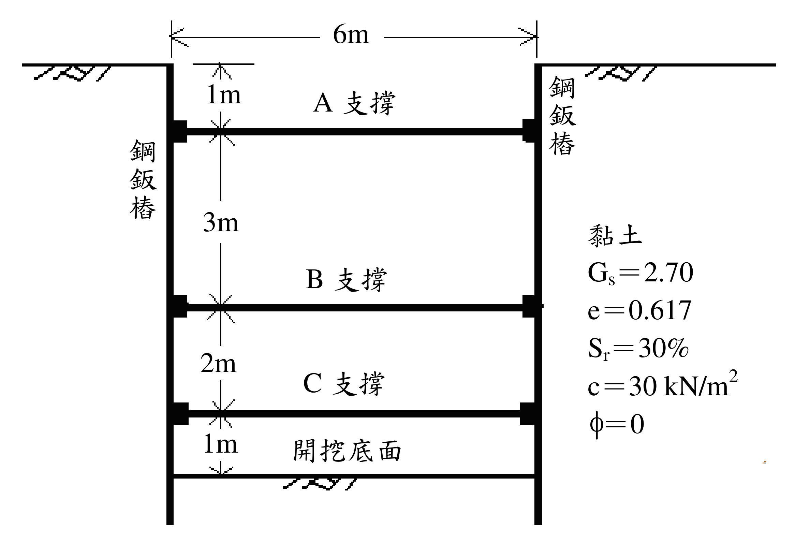

# SM-2011-4 題目正本

> 本檔只記錄**考卷上寫了什麼、圖上畫了什麼**，不含任何解法。解析見同資料夾 `SM-2011-4.md`。
> 判讀清單已確認（凍結）；本檔原則上不再修改（改動須回考卷原圖並記 log）。

| 項目 | 內容 |
|------|------|
| 考卷 | `raw/exams/SM-2011_土壤力學與基礎設計.pdf` 第 2 頁（背面），第四題 |
| 考年 | 民國 100 年（2011） |
| 配分 | 25 分 |
| 附圖 | `SM-2011-4-fig-2.png`（支撐開挖剖面；2026-11-15 由考卷重新擷取 500 dpi）；既有 `SM-2011-4-fig-1.png` 為同一圖，B 支撐上方 3m 尺寸線旁有滑鼠游標，保留不刪 |
| 判讀狀態 | **已確認**（2026-11-15 關卡一：使用者授權依建議判讀確認；轉錄 2026-11-15；PyMuPDF 110 dpi 全頁目視，附圖 400–500 dpi 局部放大（內嵌點陣影像 520×356）；PDF 文字層核對逐字原文；盲讀後才比對既有解析） |

## 1. 考卷原文（逐字）

> 四、某工地在中等堅硬（medium stiff）之黏土層作鋼鈑樁支撐開挖，此黏土之孔隙比 e 為 0.617，比重 $G_s$ 為 2.70，飽和度 $S_r$ 為 30 %，各尺寸如圖所標示，支撐（struts）之水平間距為 5 m。㈠試繪出作用於擋土鋼鈑樁之土壓力。㈡計算作用於 A、B、C 支撐之作用力各為若干（kN）？㈢若鋼鈑樁之允許應力 $\sigma_{all}$ 為 170 MN/m²，試計算鋼鈑樁所需之截面模數（section modulus）為若干（m³/m）？（25 分）

## 2. 考卷給的公式、附表與參數

- 黏土：$e$ = 0.617、$G_s$ = 2.70、$S_r$ = 30 %、$c$ = 30 kN/m²、$\phi$ = 0（後兩者在圖上）。
- 支撐水平間距 5 m；鋼鈑樁允許應力 $\sigma_{all}$ = 170 MN/m²。
- **沒有給**：$\gamma_w$、黏土單位重（須由 $e$、$G_s$、$S_r$ 換算）、地下水位、地表超載、使用哪一種視土壓力包絡線。
- 卷首注意事項（第 1 頁）：㈠可以使用電子計算器。㈡不必抄題，作答時請將試題題號及答案依照順序寫在試卷上，於本試題上作答者，不予計分。㈢本試題之相關符號、公式、物理常數及設計參數未提及時，請依規範自行合理推斷或假設。

## 3. 附圖

圖面文字照錄：`6m`、`1m`、`A 支撐`、`鋼鈑樁`、`3m`、`B 支撐`、`2m`、`C 支撐`、`1m`、`開挖底面`、`黏土`、`Gs＝2.70`、`e＝0.617`、`Sr＝30%`、`c＝30 kN/m2`、`φ＝0`。

## 4. 判讀清單

| # | 項目 | 判讀 | 圖上／題文依據 | 把握 |
|---|------|------|---------------|------|
| 1 | 視土壓力包絡線 | 題文稱「中等堅硬（medium stiff）」黏土；考卷未指定用軟—中等黏土或硬黏土包絡線（Peck 以 $\gamma H/c$ 區分，本題 $\gamma H/c$ 接近 4 的分界） | 題文 | 不確定（解讀；影響答案，請確認）；使用者授權依建議確認 |
| 2 | 支撐深度 | A 在地表下 1 m、B 在 4 m（A 下 3 m）、C 在 6 m（B 下 2 m） | 附圖 500 dpi 左側連續尺寸線，端點在支撐中心線的 × 記號 | 確定 |
| 3 | 開挖深度 | $H$ = 7 m（C 下 1 m 到開挖底面） | 附圖最下段 1m 尺寸線 | 確定 |
| 4 | 開挖寬度 | 6 m（兩鋼鈑樁間） | 附圖上方尺寸線 | 確定 |
| 5 | 鋼鈑樁 | 兩側對稱，延伸至開挖底面以下（貫入長度未標） | 附圖 | 確定 |
| 6 | 黏土單位重 | 未直接給，由 $e$、$G_s$、$S_r$ = 30 % 換算（非飽和） | 題文 | 確定 |
| 7 | 地下水 | 考卷未給；$S_r$ = 30 % 解讀為無地下水、不計水壓 | 題文 | 確定（解讀） |
| 8 | 支撐力單位 | 每支支撐的力（kN）＝單位寬度反力 × 水平間距 5 m | 題文 | 確定 |
| 9 | 所求㈢ | 每公尺牆寬所需截面模數（m³/m），由支撐間最大彎矩 ÷ $\sigma_{all}$ | 題文 | 確定 |
| 10 | 考卷沒有給 | $\gamma_w$、地下水位、地表超載、鋼鈑樁貫入深度、包絡線種類 | 全題 | 確定 |

---

*轉錄：2026-11-15（SM-U2-3 題目正本推廣・批 1）*

*確認：2026-11-15 使用者授權依建議判讀確認（SM-U2-3 題目正本推廣・批 1，關卡一；使用者指示「要我確認的請依你建議」）*
