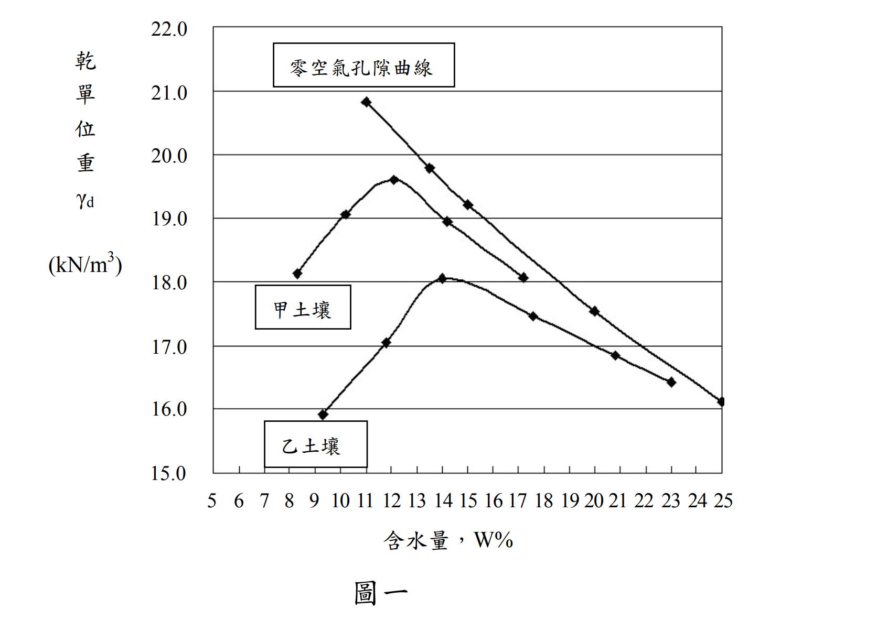

# SM-2013-2 題目正本

> 本檔只記錄**考卷上寫了什麼、圖上畫了什麼**，不含任何解法。解析見同資料夾 `SM-2013-2.md`。
> 判讀清單已確認（凍結）；本檔原則上不再修改（改動須回考卷原圖並記 log）。

| 項目 | 內容 |
|------|------|
| 考卷 | `raw/exams/SM-2013_土壤力學與基礎設計.pdf` 第 1 頁（正面），第二題 |
| 考年 | 民國 102 年（2013） |
| 配分 | 25 分（㈠8 分、㈡8 分、㈢9 分） |
| 附圖 | `SM-2013-2-fig-1.png`（圖一，甲、乙兩種土壤之標準夯實曲線與零空氣孔隙曲線；既有證據圖，完整無雜訊，沿用） |
| 判讀狀態 | **已確認**（2026-11-15 關卡一：使用者授權依建議判讀確認；轉錄 2026-11-15；PyMuPDF 110 dpi 全頁目視，圖一 300 dpi 放大（內嵌點陣影像）以格線換算讀點；盲讀後才比對既有解析） |

## 1. 考卷原文（逐字）

> 二、甲乙兩種土壤之標準夯實曲線如圖一所示。一填方工程之回填土係取自某借土區中甲、乙兩種土壤之混合物，吾人取其代表性混合物土樣測得標準夯實試驗之濕單位重為 19.9 kN/m³，含水量為 11%：
> ㈠試估計此混合物之最大乾單位重。（8 分）
> ㈡若此混合土在滾壓後之現地乾單位重為 15.8 kN/m³，試求其相對夯實度為何？（8 分）
> ㈢在以此方法決定相對夯實度時，應注意那兩項重點？（9 分）

## 2. 考卷給的公式、附表與參數

- 混合物（甲＋乙）代表性土樣：標準夯實試驗的濕單位重 19.9 kN/m³、含水量 11%（單一試驗點）。
- 滾壓後現地乾單位重 15.8 kN/m³。
- 圖一：甲、乙標準夯實曲線與零空氣孔隙曲線（讀值見 §4）。
- **沒有給**：混合比例、$G_s$、甲乙各自的最佳含水量數值（只能由圖讀）。
- 卷首注意事項：㈠可以使用電子計算器。㈡不必抄題，作答時請將試題題號及答案依照順序寫在試卷上，於本試題上作答者，不予計分。㈢本試題之相關公式、物理常數及設計參數未提及時，請自行合理推斷與假設。

## 3. 附圖

圖面文字照錄：`零空氣孔隙曲線`、`甲土壤`、`乙土壤`、`乾單位重 γd (kN/m3)`、`含水量，W%`、`圖一`；縱軸刻度 15.0～22.0（間距 1.0），橫軸刻度 5～25（間距 1）。

## 4. 判讀清單

圖一為點陣曲線圖，讀值以 300 dpi 放大後格線線性內插（縱軸 1 kN/m³ ≈ 140 px、橫軸 1% ≈ 56 px），精度約 ±0.1 kN/m³、±0.2%。曲線圖**不重繪**。

| # | 項目 | 判讀 | 圖上／題文依據 | 把握 |
|---|------|------|---------------|------|
| 1 | 甲土壤資料點 | 約 (8.3, 18.1)、(10.2, 19.1)、(12.1, 19.6)、(14.2, 18.95)、(17.2, 18.05)；峰值 $\gamma_{d,max}$ ≈ 19.6 kN/m³、OMC ≈ 12% | 圖一 300 dpi | 確定（解讀） |
| 2 | 乙土壤資料點 | 約 (9.3, 15.9)、(11.8, 17.05)、(13.9, 18.05)、(17.5, 17.45)、(20.8, 16.85)、(22.9, 16.4)；峰值 ≈ 18.05 kN/m³、OMC ≈ 14% | 圖一 300 dpi | 確定（解讀） |
| 3 | 零空氣孔隙曲線 | 約 (11.0, 20.85)、(13.5, 19.8)、(15.0, 19.2)、(19.9, 17.55)、(24.9, 16.1) | 圖一 300 dpi | 確定（解讀） |
| 4 | 混合物試驗點 | 題給濕單位重 19.9、$w$ = 11% 為**單一點**的標準夯實試驗結果（非最大值）；乾單位重須自行換算 | 題文 | 確定 |
| 5 | 估計方法 | 題目要求由單點與甲乙兩條曲線「估計」混合物最大乾單位重（單點夯實法／內插曲線族概念），方法題目未指定 | 題文「試估計」 | 確定（解讀） |
| 6 | 所求㈡ | 相對夯實度 = 現地乾單位重 15.8 ÷ ㈠所得最大乾單位重 | 題文 | 確定 |
| 7 | 所求㈢ | 以此（單點估計）方法決定相對夯實度時應注意的兩項重點 | 題文 | 確定 |
| 8 | 考卷沒有給 | 混合比例、$G_s$ | 全題 | 確定 |

---

*轉錄：2026-11-15（SM-U1-3 題目正本推廣・批 1）*

*確認：2026-11-15 使用者授權依建議判讀確認（SM-U1-3 題目正本推廣・批 1，關卡一；使用者指示「要我確認的請依你建議」）*
