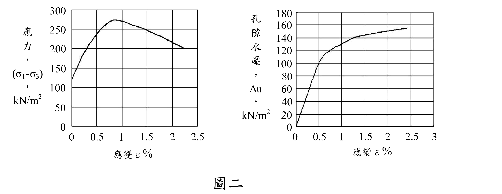

# SM-2013-3 題目正本

> 本檔只記錄**考卷上寫了什麼、圖上畫了什麼**，不含任何解法。解析見同資料夾 `SM-2013-3.md`。
> 判讀清單已確認（凍結）；本檔原則上不再修改（改動須回考卷原圖並記 log）。

| 項目 | 內容 |
|------|------|
| 考卷 | `raw/exams/SM-2013_土壤力學與基礎設計.pdf` 第 2 頁（背面），第三題 |
| 考年 | 民國 102 年（2013） |
| 配分 | 25 分（㈠8 分、㈡8 分、㈢9 分） |
| 附圖 | `SM-2013-3-fig-2.png`（圖二，AC 試驗應力–應變與孔隙水壓–應變曲線；2026-11-15 由考卷重新擷取 500 dpi）；既有 `SM-2013-3-fig-1.png` 為同一圖，縱軸標籤「(σ1-σ3)」旁有文字游標（I 形），保留不刪 |
| 判讀狀態 | **已確認**（2026-11-15 關卡一：使用者授權依建議判讀確認；轉錄 2026-11-15；PyMuPDF 110 dpi 全頁目視，圖二 300／500 dpi 放大（內嵌點陣影像＋向量刻度文字），以格線換算讀點；盲讀後才比對既有解析） |

## 1. 考卷原文（逐字）

> 三、有一不擾動之黏土樣品，若進行 $K_0$ 不等向壓密不排水軸向壓縮（axial compression，AC）試驗，靜止土壓力係數 $K_0$=0.7，即初始條件為水平壓密應力 $\sigma_{(cell)}$=280 kN/m²，垂直軸向壓密應力為 400 kN/m²，假設初始孔隙水壓為零。此 $K_0$ 不等向壓密不排水軸向壓縮（AC）試驗之應力對應變以及孔隙水壓（$\Delta u$）對應變之結果，如圖二所示。茲再準備一完全相同之黏土樣品（即孔隙比、含水量…等皆保持相同），進行側向伸張試驗（LE），即垂直軸向應力保持一定，而側向壓力減少至試體破壞為止。
> ㈠試繪出 AC 與 LE 試驗之總應力與有效應力路徑？（8 分）
> ㈡試繪出 LE 試驗中，孔隙水壓對應變圖？（8 分）
> ㈢試決定 AC 與 LE 試驗中之破壞時孔隙水壓參數 $A_f$，有效應力抗剪角 $\phi'$，總應力抗剪角 $\phi$ 與破壞面角度？（9 分）

## 2. 考卷給的公式、附表與參數

- $K_0$ = 0.7；壓密應力：水平 $\sigma_{(cell)}$ = 280 kN/m²、垂直 400 kN/m²；初始孔隙水壓為零。
- 圖二：AC 試驗的 $(\sigma_1-\sigma_3)$–$\varepsilon$ 曲線與 $\Delta u$–$\varepsilon$ 曲線。
- LE 試驗：同一黏土、同一初始狀態；垂直軸向應力保持一定、側向壓力減少至破壞。
- **沒有給**：$c'$、LE 試驗的任何量測數據、「破壞」的判定準則（尖峰或其他）。
- 卷首注意事項：㈠可以使用電子計算器。㈡不必抄題，作答時請將試題題號及答案依照順序寫在試卷上，於本試題上作答者，不予計分。㈢本試題之相關公式、物理常數及設計參數未提及時，請自行合理推斷與假設。

## 3. 附圖

圖面文字照錄：`應力，(σ1-σ3)，kN/m2`、`應變ε%`、`孔隙水壓，Δu，kN/m2`、`圖二`；左圖縱軸刻度 0～300（間距 50）、橫軸 0～2.5（間距 0.5）；右圖縱軸 0～180（間距 20）、橫軸 0～3（間距 0.5）。

## 4. 判讀清單

| # | 項目 | 判讀 | 圖上／題文依據 | 把握 |
|---|------|------|---------------|------|
| 1 | 「破壞」取點 | 考卷沒定義；取軸差應力**尖峰**（ε ≈ 0.85～0.9%）為破壞點；另一讀法是取曲線終點（ε ≈ 2.25%，$\sigma_1-\sigma_3$ ≈ 200、$\Delta u$ ≈ 152） | 圖二 | 不確定（影響答案）；使用者授權依建議確認：取軸差應力尖峰（ε ≈ 0.85～0.9%）為破壞點，兩圖在同一應變讀值（舊解同，ε = 0.9%） |
| 2 | 尖峰讀值 | $(\sigma_1-\sigma_3)_f$ ≈ 275 kN/m²，ε ≈ 0.85～0.9%（讀圖精度 ±5 kN/m²、±0.05%） | 圖二左 300 dpi 格線換算 | 確定（解讀） |
| 3 | 尖峰處孔隙水壓 | ε ≈ 0.85～0.9% 時 $\Delta u$ ≈ 125 kN/m²（右圖橫軸到 3，與左圖不同尺度；讀圖精度 ±5） | 圖二右 300 dpi 格線換算 | 確定（解讀） |
| 4 | 曲線起點 | 左圖 ε = 0 時約 120 = 400 − 280，即初始 $K_0$ 狀態的軸差應力；右圖由 0 起（初始孔隙水壓為零） | 圖二、題文 | 確定 |
| 5 | AC 試驗應力變化 | 圍壓 280 不變、軸向應力增加 | 題文「軸向壓縮」 | 確定 |
| 6 | LE 試驗應力變化 | 垂直應力 400 不變、側向壓力減少至破壞；垂直應力仍為最大主應力 | 題文 | 確定 |
| 7 | LE 量測 | 考卷沒給 LE 的試驗曲線，㈡要由 AC 結果推估繪出 | 題文 | 確定 |
| 8 | 破壞面角度的基準 | 量自最大主應力作用面（兩試驗皆為水平面） | 題文 | 確定（解讀） |
| 9 | $c'$ | 考卷沒給；不擾動黏土、只問 $\phi'$ → 視為 $c'$ = 0 | 題文 | 確定（解讀） |
| 10 | 所求 | ㈠AC、LE 總／有效應力路徑；㈡LE 的 $\Delta u$–ε 圖；㈢兩試驗的 $A_f$、$\phi'$、$\phi$、破壞面角度 | 題文 | 確定 |
| 11 | 考卷沒有給 | $c'$、LE 數據、破壞準則 | 全題 | 確定 |

---

*轉錄：2026-11-15（SM-U1-5 題目正本推廣・批 1）*

*確認：2026-11-15 使用者授權依建議判讀確認（SM-U1-5 題目正本推廣・批 1，關卡一；使用者指示「要我確認的請依你建議」）*
