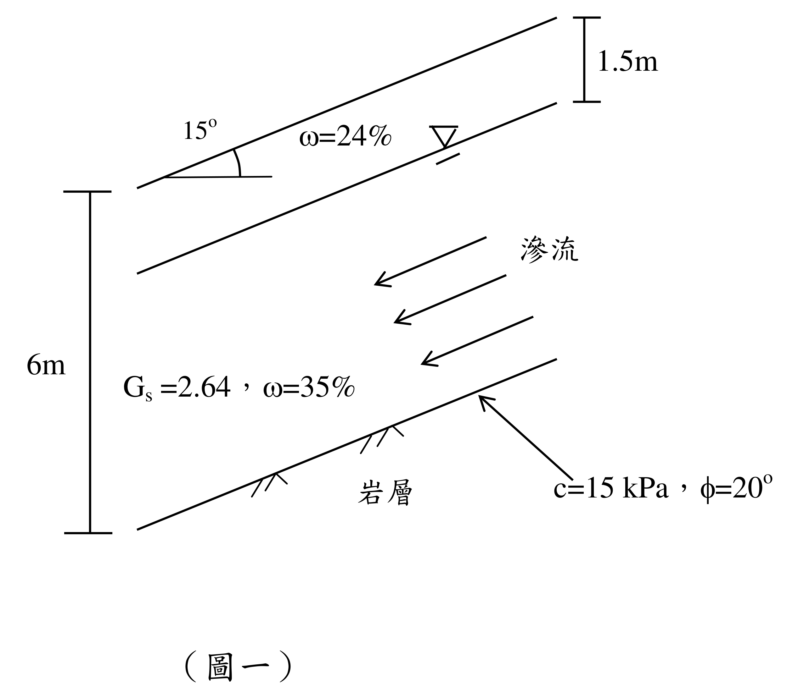

# SM-2014-1 題目正本

> 本檔只記錄**考卷上寫了什麼、圖上畫了什麼**，不含任何解法。解析見同資料夾 `SM-2014-1.md`。
> 判讀清單已確認（凍結）；本檔原則上不再修改（改動須回考卷原圖並記 log）。

| 項目 | 內容 |
|------|------|
| 考卷 | `raw/exams/SM-2014_土壤力學與基礎設計.pdf` 第 1 頁（頁次 4－1），第一題，圖一 |
| 考年 | 民國 103 年（2014） |
| 配分 | 25 分 |
| 附圖 | `SM-2014-1-fig-2.png`（圖一，無限邊坡剖面；2026-11-15 由考卷重新擷取 500 dpi）；既有 `SM-2014-1-fig-1.png` 為同一圖，左上有滑鼠游標，且右側「φ=20°」被裁掉，保留不刪 |
| 判讀狀態 | **已確認**（2026-11-15 關卡一：使用者授權依建議判讀確認；#1 依建議採鉛直 6 m；轉錄 2026-11-15；PyMuPDF 110 dpi 全頁目視，圖一 500 dpi 局部放大（向量圖，以 PDF 線段座標核對尺寸線端點）；盲讀後才比對既有解析） |

## 1. 考卷原文（逐字）

> 一、二維度無限邊坡如圖一所示，崩積土層厚 6 m，地下水位於地表下方 1.5 m，其滲流平行於坡面，地下水位上下方崩積土有相同空隙比（void ratio, e）與比重 $G_s$=2.64，地下水位以下與上方崩積土之含水量 $\omega$ 分別為 35% 與 24%，崩積土與下方岩層之介面摩擦角 $\phi$ 為 20°、凝聚力 c 為 15 kPa，試求該無限邊坡之安全係數。（25 分）

（「空隙比」照考卷原文。）

## 2. 考卷給的公式、附表與參數

- 坡角 15°（圖一）；崩積土層厚 6 m；地下水位在地表下 1.5 m；滲流平行坡面。
- 崩積土：水位上下 $e$ 相同、$G_s$ = 2.64；含水量水位以下 35%、水位以上 24%。
- 崩積土／岩層介面：$\phi$ = 20°、$c$ = 15 kPa。
- **沒有給**：公式、$\gamma_w$、$e$ 的數值、水位以下是否飽和（須推斷）、崩積土本身的強度。
- 卷首注意事項：㈠可以使用電子計算器。㈡不必抄題，作答時請將試題題號及答案依照順序寫在試卷上，於本試題上作答者，不予計分。

## 3. 附圖

圖面文字照錄：`15°`、`ω=24%`、`1.5m`、`滲流`、`6m`、`Gs =2.64，ω=35%`、`岩層`、`c=15 kPa，φ=20°`、`（圖一）`。

## 4. 判讀清單

| # | 項目 | 判讀 | 圖上／題文依據 | 把握 |
|---|------|------|---------------|------|
| 1 | 6 m 的量法 | **鉛直**量測：尺寸線為鉛直線，兩端橫線 482.8／639.3 pt 分別對齊地表（左端 481.2 pt）與岩層介面（左端 637.8 pt）；題文稱「層厚 6 m」，若改讀為垂直坡面厚度，鉛直深度為 6/cos 15° = 6.21 m | PDF 線段座標＋題文 | 不確定（影響答案，請確認）；依建議確認：鉛直 6 m |
| 2 | 1.5 m 的量法 | **鉛直**量測：右側鉛直尺寸線兩端 403.0／441.6 pt 對齊地表右端（403.0 pt）與水位線右端（442.1 pt）；圖上 6 m 與 1.5 m 的鉛直間距比 156.6／39.2 = 4.00，與 6／1.5 相符 | PDF 線段座標 | 確定（解讀） |
| 3 | 坡角 | 15°（地表左端角弧在水平線與地表之間）；圖上實際畫約 22°，不按比例 | 圖一角弧、PDF 座標 | 確定 |
| 4 | 層面關係 | 地表、地下水位、岩層介面三線平行（同斜率），無限邊坡 | PDF 線段 | 確定 |
| 5 | 滲流 | 平行坡面、向下坡方向（箭頭向左下）；地下水位線即自由水面 | 題文＋圖一 | 確定 |
| 6 | 水位以下飽和度 | 題文未明寫；判讀水位以下飽和（$S$ = 100%），故 $e = \omega G_s$ 由 35% 求得，水位以上 $S$ 再由 24% 與同一 $e$ 求得 | 題文「相同空隙比」 | 確定（解讀） |
| 7 | 破壞面 | 崩積土與岩層介面，$c$ = 15 kPa、$\phi$ = 20° | 題文、圖一箭頭 | 確定 |
| 8 | 水位以上崩積土 | 含水量 24%，非飽和 | 題文、圖一 | 確定 |
| 9 | 考卷沒有給 | $\gamma_w$、$e$ 數值、崩積土內部強度、單位寬度以外的邊坡長度 | 全題 | 確定 |

---

*轉錄：2026-11-15（SM-U3-3 題目正本推廣・批 1）*

*確認：2026-11-15 使用者授權依建議判讀確認（SM-U3-3 題目正本推廣・批 1，關卡一；使用者指示「要確認的依你建議」）*
