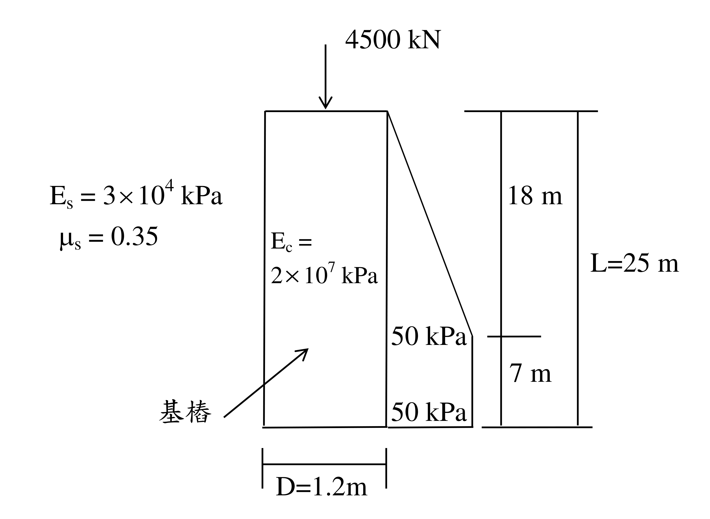

# SM-2014-2 題目正本

> 本檔只記錄**考卷上寫了什麼、圖上畫了什麼**，不含任何解法。解析見同資料夾 `SM-2014-2.md`。
> 判讀清單已確認（凍結）；本檔原則上不再修改（改動須回考卷原圖並記 log）。

| 項目 | 內容 |
|------|------|
| 考卷 | `raw/exams/SM-2014_土壤力學與基礎設計.pdf` 第 2 頁（頁次 4－2），第二題 |
| 考年 | 民國 103 年（2014） |
| 配分 | 25 分 |
| 附圖 | `SM-2014-2-fig-2.png`（圖二；2026-11-15 由考卷重新擷取 500 dpi）；既有 `SM-2014-2-fig-1.png` 為同一圖，樁身內有滑鼠游標，保留不刪 |
| 判讀狀態 | **已確認**（2026-11-15 關卡一：使用者授權依建議判讀確認；轉錄 2026-11-15；PyMuPDF 110 dpi 全頁目視，題文公式 300 dpi、附圖 500 dpi 局部放大；附圖為向量線條，以 PDF drawings 座標核對；盲讀後才比對既有解析） |

## 1. 考卷原文（逐字）

> 二、有一直徑 D=1.2 m、長 L=25 m 基樁，埋設於砂質土壤內部，其頂部承受 4500 kN 軸重，隨樁深之側向摩擦應力分佈情形如圖二所示，由頂端為零以線性增加至 18 m 深之 50 kPa，保持 50 kPa 至樁底部，試求該樁之總沉陷量。基樁之楊氏模數（Young's Modulus）$E_c$ 為 2.0×10⁷ kPa，基樁之底部彈性沉陷 $s_{e2}=\dfrac{q_{wp}D}{E_s}\left(1-\mu_s^2\right)I_{wp}$，$I_{wp}$=0.85，基樁之側向摩擦彈性沉陷 $s_{e3}=\left(\dfrac{Q_{ws}}{PL}\right)\dfrac{D}{E_s}\left(1-\mu_s^2\right)I_{ws}$，$I_{ws}=2+0.35\sqrt{\dfrac{L}{D}}$，$E_s$ 為砂質土楊氏模數，$\mu_s$ 為砂質土柏松比，$E_s$ 與 $\mu_s$ 分別為 3×10⁴ kPa 與 0.35。（25 分）

## 2. 考卷給的公式、附表與參數

- 基樁：$D$ = 1.2 m、$L$ = 25 m、$E_c$ = 2.0×10⁷ kPa；樁頂軸重 4500 kN。
- 側向摩擦應力分布：樁頂 0 → 線性增至深 18 m 處 50 kPa → 50 kPa 定值至樁底（18～25 m，7 m）。
- 底部彈性沉陷：$s_{e2}=\dfrac{q_{wp}D}{E_s}(1-\mu_s^2)I_{wp}$，$I_{wp}$ = 0.85。
- 側向摩擦彈性沉陷：$s_{e3}=\left(\dfrac{Q_{ws}}{PL}\right)\dfrac{D}{E_s}(1-\mu_s^2)I_{ws}$，$I_{ws}=2+0.35\sqrt{L/D}$。
- 砂質土：$E_s$ = 3×10⁴ kPa、$\mu_s$ = 0.35。
- **沒有給**：樁身彈性壓縮 $s_{e1}$ 的公式與摩擦分布係數 ξ、$q_{wp}$／$Q_{ws}$／$P$ 的定義文字、樁自重、地下水位。
- 卷首注意事項：可以使用電子計算器。不必抄題，作答時請將試題題號及答案依照順序寫在試卷上，於本試題上作答者，不予計分。

## 3. 附圖

圖面文字照錄：`4500 kN`、`Es = 3×10⁴ kPa`、`μs = 0.35`、`Ec =`、`2×10⁷ kPa`、`基樁`、`50 kPa`（兩處）、`18 m`、`7 m`、`L=25 m`、`D=1.2m`、`（圖二）`。

## 4. 判讀清單

| # | 項目 | 判讀 | 圖上／題文依據 | 把握 |
|---|------|------|---------------|------|
| 1 | 樁底荷重 $Q_{wp}$ | 考卷沒寫；判讀為由力平衡 $Q_{wp} = 4500 - Q_{ws}$（樁自重不計），$q_{wp}=Q_{wp}/A_p$ | 題文只給樁頂 4500 kN 與摩擦分布 | 確定（解讀） |
| 2 | 樁身彈性壓縮 $s_{e1}$ | 考卷沒給公式與 ξ；「總沉陷量」須自行補 $s_{e1}$，由摩擦分布直接積分軸力或用 ξ 公式 | 題文只給 $s_{e2}$、$s_{e3}$ 與 $E_c$ | 確定（解讀） |
| 3 | 摩擦分布 | 樁頂 0，線性增到深 18 m 的 50 kPa，18～25 m 維持 50 kPa | 題文；圖二 PDF 座標：斜線 (318.6, 332.2) → (367.8, 462.4)，再垂直到 515.0；轉折在全長 0.71 處（18/25 = 0.72） | 確定 |
| 4 | 尺寸線 | 18 m 由樁頂量到轉折點，7 m 由轉折點量到樁底，總長 L = 25 m 由樁頂到樁底 | 圖二右側兩條尺寸線，上端對齊樁頂水平線 (y 332.3)、下端對齊樁底 (y 515) | 確定 |
| 5 | 樁頂與地表 | 圖上沒畫地表；判讀為樁頂齊地表（摩擦由樁頂 0 起算） | 圖二摩擦分布由樁頂開始 | 確定（解讀） |
| 6 | $P$ 的意義 | $s_{e3}$ 式中 $P$ 為樁周長 $\pi D$ | 公式慣用記號；題文未定義 | 確定（解讀） |
| 7 | 樁斷面 | 直徑 1.2 m 實心圓（圖二畫成矩形為立面） | 題文「直徑 D=1.2 m」 | 確定（解讀） |
| 8 | 圖面比例 | 樁寬與樁長不按比例（寬 70 pt、長 183 pt） | PDF 座標 | 確定 |
| 9 | 所求 | 樁之總沉陷量（$s_{e1}+s_{e2}+s_{e3}$） | 題文 | 確定（解讀） |
| 10 | 考卷沒有給 | ξ、$s_{e1}$ 公式、樁自重、地下水位、$q_{wp}$ 定義 | 全題 | 確定 |

---

*轉錄：2026-11-15（SM-U2-2 題目正本推廣・批 1）*

*確認：2026-11-15 使用者授權依建議判讀確認（SM-U2-2 題目正本推廣・批 1，關卡一；使用者指示「要我確認的請依你建議」）*
