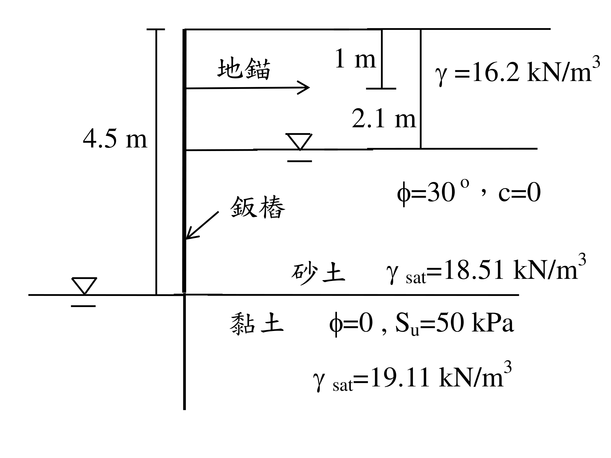

# SM-2014-3 題目正本

> 本檔只記錄**考卷上寫了什麼、圖上畫了什麼**，不含任何解法。解析見同資料夾 `SM-2014-3.md`。
> 判讀清單已確認（凍結）；本檔原則上不再修改（改動須回考卷原圖並記 log）。

| 項目 | 內容 |
|------|------|
| 考卷 | `raw/exams/SM-2014_土壤力學與基礎設計.pdf` 第 3 頁（頁次 4－3），第三題 |
| 考年 | 民國 103 年（2014） |
| 配分 | 25 分 |
| 附圖 | `SM-2014-3-fig-2.png`（圖三；2026-11-15 由考卷重新擷取 500 dpi）；既有 `SM-2014-3-fig-1.png` 為同一圖，「鈑樁」指標箭頭下方有滑鼠游標，保留不刪 |
| 判讀狀態 | **已確認**（2026-11-15 關卡一：使用者授權依建議判讀確認；轉錄 2026-11-15；PyMuPDF 110 dpi 全頁目視，附圖 400–500 dpi 局部放大（向量圖）；PDF 文字層核對逐字原文；盲讀後才比對既有解析） |

## 1. 考卷原文（逐字）

> 三、有一 4.5 m 深基地開挖如圖三所示，地表至開挖面為砂土，$\phi$=30°、c=0，地下水位於地表下方 2.1 m，地下水位以下與上方之砂土單位重分別為 18.51 kN/m³ 與 16.2 kN/m³，地錨施設於開挖面頂部下方 1 m 處，開挖面底部為黏土，$\phi$=0、不排水剪力強度 $S_u$=50 kPa，單位重為 19.11 kN/m³，另外為施工考量，開挖面內部水位降至開挖面位置，為穩定該開挖面，試求鈑樁理論貫入深度與地錨預力。（25 分）

## 2. 考卷給的公式、附表與參數

- 砂土（地表至開挖面）：$\phi$ = 30°、$c$ = 0；水位上 $\gamma$ = 16.2 kN/m³、水位下 $\gamma_{sat}$ = 18.51 kN/m³。
- 黏土（開挖面以下）：$\phi$ = 0、$S_u$ = 50 kPa、$\gamma_{sat}$ = 19.11 kN/m³。
- 開挖 4.5 m；背側地下水位地表下 2.1 m；開挖面內水位降至開挖面；地錨在頂下 1 m。
- **沒有給**：$\gamma_w$、安全係數（題文「理論貫入深度」）、支承型式（自由或固定土壤支撐）、地錨間距與傾角、黏土內水壓的處理方式。
- 卷首注意事項（第 1 頁）：㈠可以使用電子計算器。㈡不必抄題，作答時請將試題題號及答案依照順序寫在試卷上，於本試題上作答者，不予計分。

## 3. 附圖

圖面文字照錄：`地錨`、`1 m`、`γ =16.2 kN/m3`、`2.1 m`、`4.5 m`、`鈑樁`、`φ=30°，c=0`、`砂土　γsat=18.51 kN/m3`、`黏土　φ=0 , Su=50 kPa`、`γsat=19.11 kN/m3`、`（圖三）`。

## 4. 判讀清單

| # | 項目 | 判讀 | 圖上／題文依據 | 把握 |
|---|------|------|---------------|------|
| 1 | 支承型式 | 考卷未指定；單一地錨解讀為自由土壤支撐（對地錨點取力矩） | 題文、圖三 | 不確定（解讀；影響答案，請確認）；使用者授權依建議確認 |
| 2 | 黏土段水壓 | 背側水位 2.1 m、開挖側 4.5 m，兩側水位差 2.4 m；考卷未說明黏土內的水壓分布（黏土以總應力分析） | 題文、圖三 | 不確定（解讀；影響答案，請確認）；使用者授權依建議確認 |
| 3 | 開挖深度 | 4.5 m，由鈑樁頂（＝地表）到開挖面 | 圖三 500 dpi 左側尺寸線 | 確定 |
| 4 | 地錨 | 頂下 1 m，水平，指向背填側 | 圖三 1 m 尺寸線與箭頭 | 確定 |
| 5 | 背側地下水位 | 地表下 2.1 m（尺寸線由地表量到水位線） | 圖三 2.1 m 尺寸線與水位符號 | 確定 |
| 6 | 開挖側水位 | 開挖面高程（地表下 4.5 m） | 圖三左側水位符號；題文 | 確定 |
| 7 | 層界 | 砂土 0～4.5 m，開挖面以下（兩側）為黏土 | 圖三水平線；題文 | 確定 |
| 8 | 單位重 | 砂：水位上 16.2、水位下 18.51；黏土 19.11（kN/m³） | 題文「地下水位以下與上方…分別為 18.51 與 16.2」 | 確定 |
| 9 | 安全係數 | 「理論貫入深度」→ FS = 1 | 題文 | 確定（解讀） |
| 10 | 所求 | 鈑樁理論貫入深度（黏土內）與單位寬度地錨力 | 題文 | 確定（解讀） |
| 11 | 考卷沒有給 | $\gamma_w$、支承型式、地錨間距與傾角、黏土層厚、牆面摩擦角 | 全題 | 確定 |

---

*轉錄：2026-11-15（SM-U2-3 題目正本推廣・批 1）*

*確認：2026-11-15 使用者授權依建議判讀確認（SM-U2-3 題目正本推廣・批 1，關卡一；使用者指示「要我確認的請依你建議」）*
