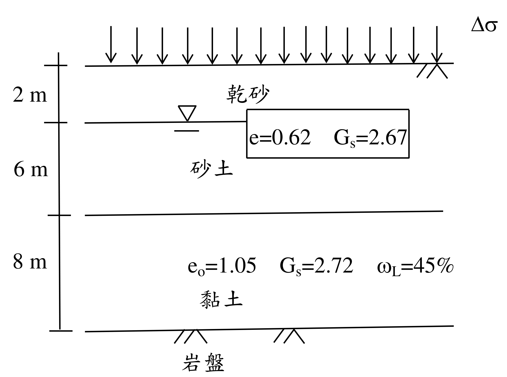

# SM-2014-4 題目正本

> 本檔只記錄**考卷上寫了什麼、圖上畫了什麼**，不含任何解法。解析見同資料夾 `SM-2014-4.md`。
> 判讀清單已確認（凍結）；本檔原則上不再修改（改動須回考卷原圖並記 log）。

| 項目 | 內容 |
|------|------|
| 考卷 | `raw/exams/SM-2014_土壤力學與基礎設計.pdf` 第 4 頁（頁次 4－4），第四題 |
| 考年 | 民國 103 年（2014） |
| 配分 | 25 分 |
| 附圖 | `SM-2014-4-fig-2.png`（圖四，地層剖面；2026-11-15 由考卷重新擷取 500 dpi）；既有 `SM-2014-4-fig-1.png` 為同一圖，黏土層左側有滑鼠游標，保留不刪 |
| 判讀狀態 | **已確認**（2026-11-15 關卡一：使用者授權依建議判讀確認；轉錄 2026-11-15；PyMuPDF 110 dpi 全頁目視，題內公式 450 dpi 放大（向量文字）；盲讀後才比對既有解析） |

## 1. 考卷原文（逐字）

> 四、有一基地土層剖面如圖四所示，地下水位於地表下方 2 m，若黏土為正常壓密，於地表施加均佈載重 $\Delta\sigma$ 後，黏土空隙比（void ratio） e 變為 0.96，試估算現地黏土層主要壓密之沉陷量為何？均佈載重 $\Delta\sigma$ 數值為何？當沉陷量為 20 cm 時，該黏土層之平均壓密度為何？若黏土層之壓密係數 $C_v$ 於壓密過程為定值 0.005 cm²/sec，則前述 20 cm 沉陷量，需多久（以天為單位）才能達成？（25 分）
> （壓縮指數 $C_c$ = 0.009（LL-10）；壓密度 U > 60%，$T_v$ =1.781-0.933log（100-U%），U = 0~60%，$T_v$= $\frac{\pi}{4}$（$\frac{U\%}{100}$））

註：考卷印出的 $U$ = 0～60% 公式為 $T_v=\frac{\pi}{4}\left(\frac{U\%}{100}\right)$，**括號外沒有平方**（450 dpi 放大確認）；Terzaghi 理論解為 $T_v=\frac{\pi}{4}\left(\frac{U}{100}\right)^2$，屬考卷漏印。

## 2. 考卷給的公式、附表與參數

- 題內公式（照錄）：$C_c = 0.009(LL-10)$；$U>60\%$：$T_v = 1.781-0.933\log(100-U\%)$；$U = 0\sim60\%$：$T_v=\frac{\pi}{4}\left(\frac{U\%}{100}\right)$（照考卷，缺平方）。
- 圖四：乾砂 2 m（地表到水位）、砂土 6 m（水位以下）——砂 $e$ = 0.62、$G_s$ = 2.67；黏土 8 m——$e_o$ = 1.05、$G_s$ = 2.72、$\omega_L$ = 45%；黏土下方為岩盤。
- 題文：地下水位地表下 2 m；黏土正常壓密；加載後黏土孔隙比變為 0.96；$C_v$ = 0.005 cm²/sec（定值）。
- **沒有給**：$\gamma_w$、岩盤是否透水（排水邊界）、$\Delta\sigma$（為所求）。
- 卷首注意事項：可以使用電子計算器。不必抄題，作答時請將試題題號及答案依照順序寫在試卷上，於本試題上作答者，不予計分。

## 3. 附圖

圖面文字照錄：`Δσ`、`2 m`、`乾砂`、`e=0.62　Gs=2.67`、`6 m`、`砂土`、`8 m`、`eo=1.05　Gs=2.72　ωL=45%`、`黏土`、`岩盤`、`（圖四）`。

## 4. 判讀清單

| # | 項目 | 判讀 | 圖上／題文依據 | 把握 |
|---|------|------|---------------|------|
| 1 | 地層厚度 | 乾砂 0～2 m、飽和砂土 2～8 m、黏土 8～16 m、16 m 以下岩盤；尺寸線刻度對齊各層界線 | 圖四左側尺寸線 | 確定 |
| 2 | 砂土參數 | 方框 $e$ = 0.62、$G_s$ = 2.67 跨在水位線上，適用乾砂與水位下砂土兩層 | 圖四方框位置 | 確定（解讀） |
| 3 | 地下水位 | 地表下 2 m（題文與圖上水位符號一致） | 題文、圖四 | 確定 |
| 4 | 載重 | $\Delta\sigma$ 為地表大範圍均佈載重（一維），數值為所求 | 題文、圖四箭頭 | 確定 |
| 5 | 加載後孔隙比 | 黏土 $e$ 由 1.05 變為 0.96（$\Delta e$ = 0.09），代表主壓密完成後的平均孔隙比 | 題文 | 確定（解讀） |
| 6 | 壓縮指數 | 由題給 $C_c = 0.009(LL-10)$ 與 $\omega_L$ = 45% 求 | 題文、圖四 | 確定 |
| 7 | 排水邊界 | 黏土上為砂土（排水）；下為岩盤，考卷未說明透水與否，常規視為不透水 → 單向排水，$H_{dr}$ = 8 m | 圖四「岩盤」 | 不確定（影響答案）；使用者授權依本判讀確認 |
| 8 | $T_v$ 公式缺平方 | 考卷 $U\le 60\%$ 式漏印平方（見 §1 註）；解題依規範版本規定改用正確理論式，§5 對照考卷式 | 題內公式 450 dpi | 確定（解讀） |
| 9 | 所求 | (a) 主壓密沉陷量；(b) $\Delta\sigma$；(c) 沉陷 20 cm 時平均壓密度；(d) 20 cm 所需天數 | 題文 | 確定 |
| 10 | 考卷沒有給 | $\gamma_w$、岩盤排水性 | 全題 | 確定 |

---

*轉錄：2026-11-15（SM-U1-3 題目正本推廣・批 1）*

*確認：2026-11-15 使用者授權依建議判讀確認（SM-U1-3 題目正本推廣・批 1，關卡一；使用者指示「要我確認的請依你建議」）*
