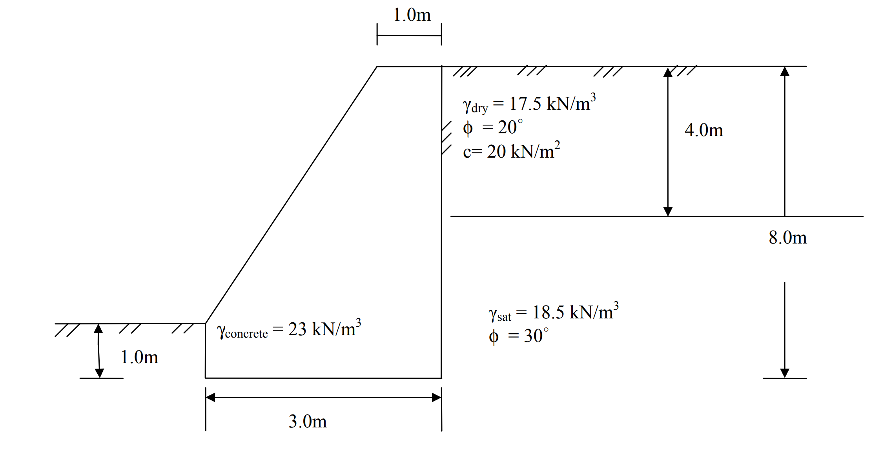

# SM-2015-2 題目正本

> 本檔只記錄**考卷上寫了什麼、圖上畫了什麼**，不含任何解法。解析見同資料夾 `SM-2015-2.md`。
> 判讀清單已確認（凍結）；本檔原則上不再修改（改動須回考卷原圖並記 log）。

| 項目 | 內容 |
|------|------|
| 考卷 | `raw/exams/SM-2015_土壤力學與基礎設計.pdf` 第 1 頁（正面），第二題 |
| 考年 | 民國 104 年（2015） |
| 配分 | 25 分（㈠ 15、㈡ 10） |
| 附圖 | `SM-2015-2-fig-1.png`（重力式擋土牆剖面；無雜訊，沿用） |
| 判讀狀態 | **已確認**（2026-11-15 關卡一：使用者授權依建議判讀確認；轉錄 2026-11-15；PyMuPDF 110 dpi 全頁目視，附圖 300 dpi 放大並讀 PDF 向量座標；PDF 文字層核對；盲讀後才比對既有解析） |

## 1. 考卷原文（逐字）

> 二、有一正常壓密黏土厚 4.0 m，其 $\gamma_{dry}$ = 17.5 kN/m³，摩擦角 $\phi$ = 20°，凝聚力 c = 20 kN/m²，下方為砂土層 $\gamma_{sat}$ = 18.5 kN/m³，摩擦角 $\phi$ = 30°，該土層之地下水位面位於地表以下 4.0 m。現擬建一 8.0 m 高之擋土牆，其牆背為垂直。
> ㈠利用倫金理論（Rankine）計算並繪出牆背所受土壓力分布，並計算其合力及合力作用位置。（15 分）
> ㈡檢核擋土牆之抗滑動安全係數是否恰當。（10 分）

## 2. 考卷給的公式、附表與參數

- 上層：正常壓密黏土，厚 4.0 m，$\gamma_{dry}$ = 17.5 kN/m³，$\phi$ = 20°，$c$ = 20 kN/m²。
- 下層：砂土，$\gamma_{sat}$ = 18.5 kN/m³，$\phi$ = 30°。
- 地下水位：地表下 4.0 m（黏土與砂土交界）。
- 擋土牆：高 8.0 m，牆背垂直；附圖：牆頂寬 1.0 m、牆底寬 3.0 m、$\gamma_{concrete}$ = 23 kN/m³，牆前地面高於牆底 1.0 m。
- **沒有給**：牆底與地盤間的摩擦係數或摩擦角、黏著力；牆前土壤的性質；是否計入牆前被動土壓；$\gamma_w$；抗滑動安全係數的要求值；牆背摩擦角。
- 卷首注意事項：㈠可以使用電子計算器。㈡不必抄題，作答時請將試題題號及答案依照順序寫在試卷上，於本試題上作答者，不予計分。

## 3. 附圖

圖面文字照錄：`1.0m`（牆頂寬）、`γdry = 17.5 kN/m³`、`φ = 20°`、`c= 20 kN/m²`、`4.0m`、`8.0m`、`γsat = 18.5 kN/m³`、`φ = 30°`、`γconcrete = 23 kN/m³`、`1.0m`（牆前埋入）、`3.0m`（牆底寬）。

> 附圖未按比例：PDF 向量座標牆高 196.4 pt（8.0 m）時牆頂寬 40.5 pt、牆底寬 148.5 pt、牆前埋入 34.4 pt，與標註 1.0／3.0／1.0 m 的比例不一致；一律以標註數字為準。

## 4. 判讀清單

| # | 項目 | 判讀 | 圖上／題文依據 | 把握 |
|---|------|------|---------------|------|
| 1 | 抗滑阻力的條件 | 考卷未給牆底摩擦與牆前土壤參數：牆底摩擦採牆底下砂土 $\phi$ = 30°（$\tan\delta$ 取 $\tan\frac{2}{3}\phi$ 或 $\tan\phi$ 須自設），牆前 1.0 m 被動土壓保守不計（或另列計入的對照）；要求值依現行建築物基礎構造設計規範（常時 FS ≥ 1.5） | 題文；附圖牆前只標 1.0 m，無土性 | 不確定（影響答案，請確認）；使用者授權依建議確認（定案：牆底 δ = 2φ/3 = 20°（自設）、計入牆前 1.0 m 被動土壓並列不計的對照、FS 要求 1.5；結論不受這些假設影響） |
| 2 | 黏土層用 $\gamma_{dry}$ | 黏土在水位以上，只給 $\gamma_{dry}$ = 17.5，照用 | 題文 | 確定（解讀） |
| 3 | 地層與水位 | 0～4.0 m 黏土（水位以上）；4.0～8.0 m 砂土（水位以下，用 $\gamma_{sat}$）；水位在交界 | 題文、附圖 4.0 m 尺寸線 | 確定 |
| 4 | 牆高 | 8.0 m，由牆頂（＝地表）量到牆底 | 附圖右側尺寸線上端在地表、下端箭頭在牆底高程（PDF 座標 y = 545.3 → 741.7） | 確定 |
| 5 | 牆斷面 | 牆背鉛直；牆頂寬 1.0 m；牆底寬 3.0 m；牆面由牆頂斜到牆前地面，地面以下 1.0 m 為鉛直段 | 附圖向量座標：斜線 (332.8, 545.3)→(224.8, 707.3)，鉛直段 (224.8, 707.3)→(224.7, 741.7) | 確定 |
| 6 | 牆前埋入 | 牆前地面高於牆底 1.0 m | 附圖左下尺寸線 1.0 m | 確定 |
| 7 | 牆體單位重 | 23 kN/m³ | 附圖 | 確定 |
| 8 | 黏土拉力區 | 上層黏土 $c$ = 20、$\phi$ = 20° 主動壓力頂部為負值（張力），合力計算時拉力區的處理須自行說明 | 題文參數 | 確定（解讀） |
| 9 | 所求 | ㈠ Rankine 土壓力分布、合力與作用位置；㈡ 抗滑動安全係數是否恰當 | 題文 | 確定 |
| 10 | 考卷沒有給 | 牆底摩擦、牆前土性、$\gamma_w$、FS 要求值、牆背摩擦角 | 全題 | 確定 |

---

*轉錄：2026-11-15（SM-U3-1 題目正本推廣・批 1）*

*確認：2026-11-15 使用者授權依建議判讀確認（SM-U3-1 題目正本推廣・批 1，關卡一；使用者指示「要確認的依你建議」）*
