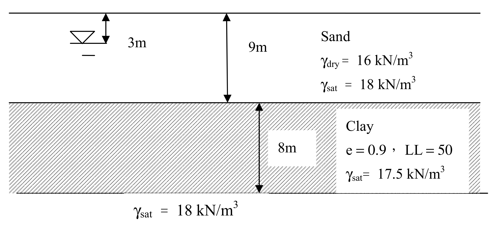

# SM-2015-4 題目正本

> 本檔只記錄**考卷上寫了什麼、圖上畫了什麼**，不含任何解法。解析見同資料夾 `SM-2015-4.md`。
> 判讀清單已確認（凍結）；本檔原則上不再修改（改動須回考卷原圖並記 log）。

| 項目 | 內容 |
|------|------|
| 考卷 | `raw/exams/SM-2015_土壤力學與基礎設計.pdf` 第 2 頁（背面），第四題 |
| 考年 | 民國 104 年（2015） |
| 配分 | 25 分 |
| 附圖 | `SM-2015-4-fig-2.png`（地層剖面；2026-11-15 由考卷重新擷取 500 dpi）；既有 `SM-2015-4-fig-1.png` 為同一圖，黏土層剖線內有滑鼠游標，保留不刪 |
| 判讀狀態 | **已確認**（2026-11-15 關卡一：使用者授權依建議判讀確認；轉錄 2026-11-15；PyMuPDF 110 dpi 全頁目視，附圖 500 dpi 擷取（向量線條＋點陣剖線）；盲讀後才比對既有解析） |

## 1. 考卷原文（逐字）

> 四、一地層如下圖所示，該處地層之孔隙水壓呈靜水壓分布，地下水位面位於地表下 3 m 處。該正常壓密黏土，$\gamma_{sat}$ = 17.5 kN/m³，LL = 50，e =0.9，k = $10^{-7}$ m/sec，如因長期使用需求將黏土層上方砂土層之水頭抽降 5 m，則對該黏土層之滲流及壓密狀況將造成何種影響？分別計算黏土層單位面積最大滲流量及壓密沉陷量。（25 分）

## 2. 考卷給的公式、附表與參數

- 砂（上層）：厚 9 m、$\gamma_{dry}$ = 16 kN/m³、$\gamma_{sat}$ = 18 kN/m³；地下水位地表下 3 m。
- 黏土：厚 8 m、正常壓密、$\gamma_{sat}$ = 17.5 kN/m³、LL = 50、$e$ = 0.9、$k$ = $10^{-7}$ m/sec。
- 黏土下方地層：圖上只標 $\gamma_{sat}$ = 18 kN/m³（未標土名）。
- 初始孔隙水壓：靜水壓分布。
- 擾動：黏土上方砂土層水頭抽降 5 m。
- **沒有給**：$C_c$（只給 LL）、$\gamma_w$、黏土下方地層的名稱與透水性、抽降後下方地層水頭是否改變。
- 卷首注意事項：㈠可以使用電子計算器。㈡不必抄題，作答時請將試題題號及答案依照順序寫在試卷上，於本試題上作答者，不予計分。

## 3. 附圖

圖面文字照錄：`3m`、`9m`、`Sand`、`γdry = 16 kN/m3`、`γsat = 18 kN/m3`、`8m`、`Clay`、`e = 0.9，LL = 50`、`γsat= 17.5 kN/m3`、`γsat = 18 kN/m3`。

## 4. 判讀清單

| # | 項目 | 判讀 | 圖上／題文依據 | 把握 |
|---|------|------|---------------|------|
| 1 | 地層 | 砂 0～9 m、黏土 9～17 m、17 m 以下為 $\gamma_{sat}$ = 18 的土層 | 附圖尺寸線 3 m、9 m、8 m | 確定 |
| 2 | 地下水位 | 地表下 3 m（尺寸線上端地表、下端水位符號） | 附圖、題文 | 確定 |
| 3 | 下方地層 | 未標名稱；以 $\gamma_{sat}$ = 18 與上砂同值推斷為透水層（砂），抽水後其水頭維持原靜水壓 → 黏土內產生向上穩態滲流 | 附圖只標 $\gamma_{sat}$ | 不確定（影響答案）；使用者授權依本判讀確認 |
| 4 | 抽降 5 m | 上方砂土層水頭降 5 m：地下水位由地表下 3 m 降至 8 m（仍在砂層內，高於黏土頂 9 m） | 題文 | 確定（解讀） |
| 5 | 抽降區砂土單位重 | 3～8 m 砂由 $\gamma_{sat}$ = 18 變為 $\gamma_{dry}$ = 16（排水後視為乾） | 題給 $\gamma_{dry}$ | 確定（解讀） |
| 6 | 壓縮指數 | 未給 $C_c$；須由 LL = 50 以經驗式估算（考卷未指定哪一式） | 題文 | 確定（解讀） |
| 7 | 所求 | (a) 對黏土滲流與壓密的影響（說明）；(b) 黏土層單位面積最大滲流量；(c) 壓密沉陷量 | 題文 | 確定 |
| 8 | 考卷沒有給 | $C_c$、$\gamma_w$、下方地層透水性 | 全題 | 確定 |

---

*轉錄：2026-11-15（SM-U1-3 題目正本推廣・批 1）*

*確認：2026-11-15 使用者授權依建議判讀確認（SM-U1-3 題目正本推廣・批 1，關卡一；使用者指示「要我確認的請依你建議」）*
