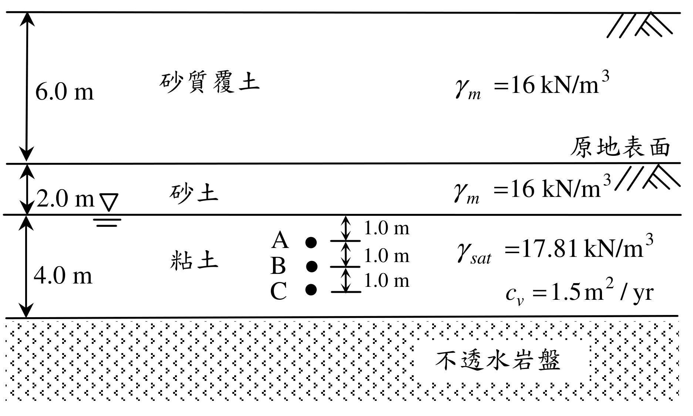
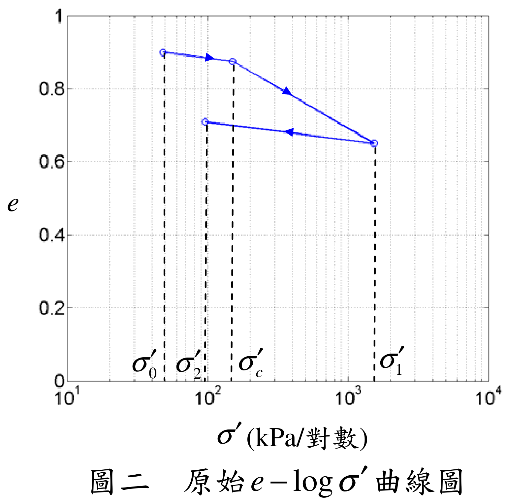
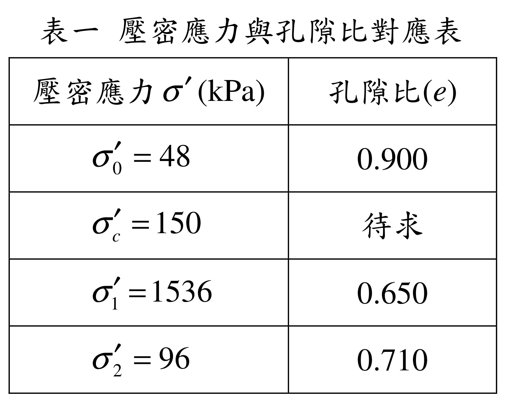
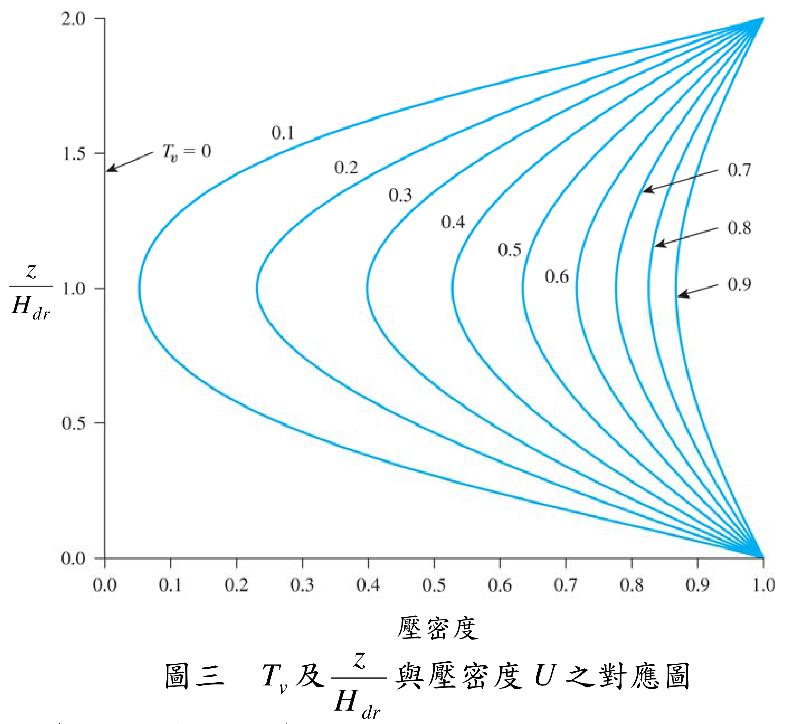

# SM-2016-1 題目正本

> 本檔只記錄**考卷上寫了什麼、圖上畫了什麼**，不含任何解法。解析見同資料夾 `SM-2016-1.md`。
> 判讀清單已確認（凍結）；本檔原則上不再修改（改動須回考卷原圖並記 log）。

| 項目 | 內容 |
|------|------|
| 考卷 | `raw/exams/SM-2016_土壤力學與基礎設計.pdf` 第 1 頁，第一題 |
| 考年 | 民國 105 年（2016） |
| 配分 | 25 分（㈠8、㈡5、㈢12） |
| 附圖 | `SM-2016-1-fig-5.png`（圖一 覆土施工剖面圖）、`SM-2016-1-fig-6.png`（圖二 原始 e–log σ′ 曲線圖）、`SM-2016-1-fig-7.png`（表一）、`SM-2016-1-fig-8.png`（圖三 Tv 及 z/Hdr 與壓密度 U 之對應圖）；皆 2026-11-15 由考卷重新擷取 500 dpi。既有 `SM-2016-1-fig-1.png`、`SM-2016-1-fig-2.png`、`SM-2016-1-fig-3.png`、`SM-2016-1-fig-4.png` 為同四張圖，帶滑鼠游標（fig-2 游標壓在曲線 σ′c 附近），保留不刪 |
| 判讀狀態 | **已確認**（2026-11-15 關卡一：使用者授權依建議判讀確認；轉錄 2026-11-15；PyMuPDF 110 dpi 全頁目視，圖一 400 dpi、圖二 500 dpi 局部放大並以像素量測；盲讀後才比對既有解析） |

## 1. 考卷原文（逐字）

> 一、圖一為某覆土加載施工剖面圖，施工前於地下 4.0 m（點 B 處）取回粘土執行壓密試驗；圖二為壓密試驗結果推算之原始 $e-\log\sigma'$ 曲線，圖三為 $T_v$ 及 $z/H_{dr}$ 與壓密度 $U$ 之對應圖，表一表列原始 $e-\log\sigma'$ 曲線主要加壓與解壓應力對應之孔隙比。
> ㈠請分析此粘土試樣於 $\sigma'_c$ 時對應之孔隙比 $e$ 及其過壓密比值（OCR）。（8 分）
> ㈡請分析於此粘土層上加載 6.0 m 砂質覆土 3 年後壓密沉陷量為何？（5 分）
> ㈢請分析此粘土層上加載 6.0 m 砂質覆土 3 年後，點 A、B 及 C 點之超額孔隙水壓為何？（12 分）

## 2. 考卷給的公式、附表與參數

- 表一 壓密應力與孔隙比對應表（照錄）：

| 壓密應力 $\sigma'$（kPa） | 孔隙比（$e$） |
|---|---|
| $\sigma'_0=48$ | 0.900 |
| $\sigma'_c=150$ | 待求 |
| $\sigma'_1=1536$ | 0.650 |
| $\sigma'_2=96$ | 0.710 |

- 圖一：砂質覆土 6.0 m、$\gamma_m$ = 16 kN/m³；砂土 2.0 m、$\gamma_m$ = 16 kN/m³；粘土 4.0 m、$\gamma_{sat}$ = 17.81 kN/m³、$c_v$ = 1.5 m²/yr；其下不透水岩盤。
- 圖二：原始 $e-\log\sigma'$ 曲線（橫軸 $\sigma'$（kPa／對數）10¹～10⁴，縱軸 $e$ 0～1），標 $\sigma'_0$、$\sigma'_2$、$\sigma'_c$、$\sigma'_1$ 四點。
- 圖三：$T_v$ 及 $z/H_{dr}$ 與壓密度之對應圖（等時線圖；縱軸 $z/H_{dr}$ 0～2.0，橫軸「壓密度」0～1.0，曲線 $T_v$ = 0、0.1、0.2、…、0.9）。
- **沒有給**：$\gamma_w$；$C_c$、$C_s$ 數值（須由表一推算）；平均壓密度 $U$ 與 $T_v$ 的關係式或表（只給圖三的等時線）；$T_v$ = 0.1 間隔以外的等時線。
- 卷首注意事項：㈠可以使用電子計算器。㈡不必抄題，作答時請將試題題號及答案依照順序寫在試卷上，於本試題上作答者，不予計分。

## 3. 附圖

圖面文字照錄：`6.0 m`、`砂質覆土`、`γm =16 kN/m³`、`原地表面`、`2.0 m`、`砂土`、`γm =16 kN/m³`、`4.0 m`、`粘土`、`A`、`B`、`C`、`1.0 m`（三處）、`γsat =17.81 kN/m³`、`cv =1.5 m²/yr`、`不透水岩盤`、`圖一 覆土施工剖面圖`。

圖面文字照錄：`e`、`σ′0`、`σ′2`、`σ′c`、`σ′1`、`σ′ (kPa/對數)`、`圖二 原始 e−log σ′ 曲線圖`；縱軸刻度 0、0.2、0.4、0.6、0.8、1；橫軸 10¹、10²、10³、10⁴。

圖面文字照錄：`Tv = 0`、`0.1`、`0.2`、`0.3`、`0.4`、`0.5`、`0.6`、`0.7`、`0.8`、`0.9`、`z/Hdr`、`壓密度`、`圖三 Tv 及 z/Hdr 與壓密度 U 之對應圖`。

## 4. 判讀清單

| # | 項目 | 判讀 | 圖上／題文依據 | 把握 |
|---|------|------|---------------|------|
| 1 | $\sigma'_c$ 對應的孔隙比 | 表一寫「待求」；圖二 σ′c 點像素量測 $e\approx0.875$（以 $\sigma'_0$、$\sigma'_1$ 兩已知點校正約 ±0.01）。由 $\sigma'_0\to\sigma'_c$ 段斜率取解壓段斜率（$\sigma'_1\to\sigma'_2$：$0.06/\log16$）推得的值也是 0.875，兩法一致 | 圖二 500 dpi 像素量測；表一 | 不確定（解讀；影響答案極小，使用者授權依建議定案：採「再壓段斜率＝解壓段斜率」推算，圖讀值作核對） |
| 2 | 3 年的等時線 | $T_v$ 不是圖三畫出的 0.1 倍數，圖上無對應曲線；須在相鄰兩條間內插，或用 Terzaghi 級數解（圖三即其圖形） | 圖三只畫 0～0.9 每 0.1 | 不確定（解讀；影響答案讀值精度，使用者授權依建議定案：建議以級數解計算，圖三內插作核對） |
| 3 | 地層與厚度 | 砂質覆土 6.0 m（在原地表面上）、砂土 2.0 m、粘土 4.0 m、其下不透水岩盤 | 圖一左側三條尺寸線，端點對齊各層界線 | 確定 |
| 4 | 地下水位 | 在砂土底＝粘土頂（原地表面下 2.0 m）；▽ 畫在 2.0 m 尺寸線旁，其下雙橫線與粘土頂線同高 | 圖一 400 dpi；且 $2\times16+2\times(17.81-9.81)=48$ 與表一 $\sigma'_0$ = 48 吻合 | 確定（解讀） |
| 5 | A、B、C 位置 | 粘土頂下 1.0 m、2.0 m、3.0 m（三段 1.0 m 尺寸線由粘土頂線往下連續標註） | 圖一 400 dpi | 確定 |
| 6 | 取樣點 | B 點＝原地表面下 4.0 m（砂土 2.0 m＋粘土 2.0 m），與題文「地下 4.0 m（點 B 處）」一致 | 題文、圖一 | 確定 |
| 7 | 排水邊界 | 上為砂土（排水）、下為不透水岩盤 → 單向排水，$H_{dr}$ = 4.0 m | 圖一「不透水岩盤」 | 確定 |
| 8 | 圖三的用法 | 圖三為雙向排水（厚 $2H_{dr}$）的等時線，縱軸 0～2；單向排水層對應其上半 $z/H_{dr}$ = 0～1，$z$ 由排水面（粘土頂）往下量；橫軸「壓密度」為該深度的壓密度 $U_z$（非平均壓密度） | 圖三曲線在 $z/H_{dr}$ = 0、2 處 $U_z$ = 1、對 1 對稱 | 確定（解讀） |
| 9 | 覆土荷重 | 6.0 m 砂質覆土 $\gamma_m$ = 16，大面積加載（一維） | 圖一層線左右延伸；題文 | 確定（解讀） |
| 10 | 圖二加壓路徑 | $\sigma'_0\to\sigma'_c\to\sigma'_1$ 加壓、$\sigma'_1\to\sigma'_2$ 解壓（箭頭方向） | 圖二箭頭 | 確定 |
| 11 | OCR 定義用的應力 | 現地有效覆土壓取表一 $\sigma'_0$ = 48 kPa（B 點） | 表一、#4 驗算 | 確定 |
| 12 | 超額孔隙水壓 | 所求為 3 年時 A、B、C 三點的超額孔隙水壓（不含靜水壓） | 題文 | 確定 |
| 13 | 考卷沒有給 | $\gamma_w$（由 #4 反推為 9.81）；$C_c$、$C_s$ 數值；平均壓密度 $U$–$T_v$ 關係；$T_v$ 非 0.1 倍數的等時線 | 全題 | 確定 |

---

*轉錄：2026-11-15（SM-U1-3 題目正本推廣・批 2）*

*確認：2026-11-15 使用者授權依建議判讀確認（SM-U1-3 題目正本推廣・批 2，關卡一；使用者指示「要確認的依你建議」）*
