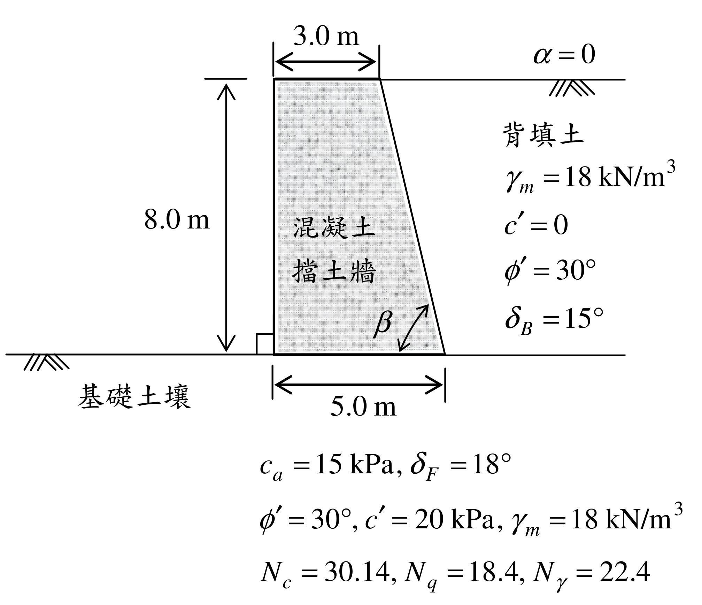

# SM-2016-4 題目正本

> 本檔只記錄**考卷上寫了什麼、圖上畫了什麼**，不含任何解法。解析見同資料夾 `SM-2016-4.md`。
> 判讀清單已確認（凍結）；本檔原則上不再修改（改動須回考卷原圖並記 log）。

| 項目 | 內容 |
|------|------|
| 考卷 | `raw/exams/SM-2016_土壤力學與基礎設計.pdf` 第 3 頁，第四題；第 4 頁「參考資料」與「註」 |
| 考年 | 民國 105 年（2016） |
| 配分 | 25 分（㈠10、㈡10、㈢5） |
| 附圖 | `SM-2016-4-fig-2.png`（重力式擋土牆剖面＋參數；2026-11-15 由考卷重新擷取 500 dpi）；既有 `SM-2016-4-fig-1.png` 為同一圖，右側空白處有滑鼠游標，保留不刪 |
| 判讀狀態 | **已確認**（2026-11-15 關卡一：使用者授權依建議判讀確認；轉錄 2026-11-15；PyMuPDF 110 dpi 全頁目視，附圖 400–500 dpi 局部放大；盲讀後才比對既有解析） |

## 1. 考卷原文（逐字）

> 四、下圖所示為 8.0 m 垂直高混凝土重力式擋土牆，水平背填土壤（$\alpha = 0$）為砂質土壤，其單位重為 18 kN/m³，排水剪力強度參數 $\phi' = 30^\circ$、$c' = 0$，背填土與混凝土擋土牆界面摩擦角 $\delta_B = 15^\circ$，此擋土牆座落於某粘土質沉泥基礎土壤上，基礎土壤與混凝土擋土牆界面的剪力強度參數 $c_a = 15$ kPa、$\delta_F = 18^\circ$，基礎土壤之剪力強度參數 $\phi' = 30^\circ$、$c' = 20$ kPa，單位重 $\gamma_m = 18$ kN/m³，混凝土單位重 $\gamma_c = 23.5$ kN/m³：
> ㈠試以庫倫主動土壓力係數分析此重力擋土牆之抗傾倒、抗滑安全係數是否適宜？如不適宜，建議補救措施為何？（10 分）
> ㈡請分析此擋土牆基礎承載力的安全係數是否適宜？如不適宜，建議補救措施為何？（10 分）
> ㈢請以 Mononobe–Okabe 動態土壓力理論，分析此擋土牆承受水平及垂直方向的地震加速度分別為 0.15 g 及 0.05 g 的狀態下（$K_h = 0.15$ 及 $K_v = 0.05$），主動土壓力 $P_{ae}$ 的大小、方向與位置為何？（5 分）

（「粘土質沉泥」照考卷原文。）

## 2. 考卷給的公式、附表與參數

- 擋土牆：混凝土重力式，垂直高 8.0 m，牆頂寬 3.0 m、牆底寬 5.0 m（圖），$\gamma_c$ = 23.5 kN/m³。
- 背填土：砂質土壤，水平（$\alpha$ = 0），$\gamma_m$ = 18 kN/m³，$\phi'$ = 30°，$c'$ = 0，牆背界面摩擦角 $\delta_B$ = 15°。
- 牆底與基礎土壤界面：$c_a$ = 15 kPa，$\delta_F$ = 18°。
- 基礎土壤（粘土質沉泥）：$\phi'$ = 30°，$c'$ = 20 kPa，$\gamma_m$ = 18 kN/m³；圖下另給 $N_c$ = 30.14、$N_q$ = 18.4、$N_\gamma$ = 22.4。
- 地震係數：$K_h$ = 0.15、$K_v$ = 0.05。

第 4 頁「參考資料：形狀、深度與傾斜修正因數關係式」（考卷未標屬於哪一題；第三、四題都問基礎承載力）：

| 項目 | 凝聚力 ($c$) | 超載 ($q$) | 土重 ($\gamma$) |
|---|---|---|---|
| 形狀 ($s$) | $1+\left(\dfrac{B}{L}\right)\left(\dfrac{N_q}{N_c}\right)$ | $1+\left(\dfrac{B}{L}\right)\tan\phi'$ | $1-0.4\left(\dfrac{B}{L}\right)$ |
| 深度 ($d$) | $1+0.4\left(\dfrac{D_f}{B}\right)$ | $1+2\tan\phi'(1-\sin\phi')^2\dfrac{D_f}{B}$ | 1.0 |
| 傾斜 ($i$) | $\left(1-\dfrac{\theta}{90^\circ}\right)^2$ | $\left(1-\dfrac{\theta}{90^\circ}\right)^2$ | $\left(1-\dfrac{\theta}{\phi'}\right)^2$ |

備註：$\theta$ = 基礎荷載對垂直面之傾斜角。

第 4 頁「註」：

庫倫主動土壓力係數：

$$K_a=\frac{\sin^2(\beta+\phi')}{\sin^2\beta\cdot\sin(\beta-\delta_B)\left[1+\sqrt{\dfrac{\sin(\phi'+\delta_B)\cdot\sin(\phi'-\alpha)}{\sin(\beta-\delta_B)\cdot\sin(\alpha+\beta)}}\right]^2}$$

Mononobe–Okabe 主動土壓力係數：

$$K_{ae}=\frac{\sin^2(\phi'+\beta-\theta')}{\cos\theta'\cdot\sin^2\beta\cdot\sin(\beta-\delta_B-\theta')\left[1+\sqrt{\dfrac{\sin(\phi'+\delta_B)\cdot\sin(\phi'-\alpha-\theta')}{\sin(\beta-\delta_B-\theta')\cdot\sin(\alpha+\beta)}}\right]^2}$$

$$\theta'=\tan^{-1}\frac{K_h}{1-K_v}$$

- **沒有給**：$\beta$ 的數值（圖上只標符號）、$P_{ae}$ 作用位置的公式或比例、$P_{ae}$ 的計算式（$K_{ae}$ 以外）、承載力公式本體、安全係數要求值、地下水位、牆前埋入深度。
- 卷首注意事項：㈠可以使用電子計算器。㈡不必抄題，作答時請將試題題號及答案依照順序寫在試卷上，於本試題上作答者，不予計分。（本年卷首只有這兩項。）

## 3. 附圖

圖面文字照錄：`3.0 m`、`α = 0`、`背填土`、`γm = 18 kN/m³`、`c' = 0`、`φ' = 30°`、`δB = 15°`、`8.0 m`、`混凝土 擋土牆`、`β`、`基礎土壤`、`5.0 m`、`ca = 15 kPa, δF = 18°`、`φ' = 30°, c' = 20 kPa, γm = 18 kN/m³`、`Nc = 30.14, Nq = 18.4, Nγ = 22.4`。

## 4. 判讀清單

| # | 項目 | 判讀 | 圖上／題文依據 | 把握 |
|---|------|------|---------------|------|
| 1 | $\beta$ 的定義 | 牆背面與水平面（牆底）的夾角，標在牆踵混凝土側；考卷未印數值，由幾何 $\tan\beta$ = 8.0／(5.0 − 3.0) 定出（$\beta$ < 90°，牆背向背填側外斜，背填土壓在斜牆背上方）。**不是**背填土面傾角（背填土面為 $\alpha$ = 0） | 附圖 400 dpi：β 與雙向箭頭位於牆背與牆底之間、混凝土內側；庫倫式中 $\beta$ = 90° 即鉛直牆背 | 確定（解讀） |
| 2 | 斷面形狀 | 梯形：牆面（左）鉛直，左下角有直角符號；牆背（右）傾斜 | 附圖 | 確定 |
| 3 | 牆高 8.0 m | 牆頂到牆底（尺寸線上端對齊牆頂延長線、下端對齊地面線） | 附圖左側尺寸線 | 確定 |
| 4 | 頂寬 3.0 m、底寬 5.0 m | 尺寸界線對齊牆面左緣與牆背頂角／牆踵；牆背水平投影 2.0 m | 附圖上、下尺寸線 | 確定 |
| 5 | 背填土 | 水平地表（$\alpha$ = 0）與牆頂同高；$\gamma_m$ = 18、$\phi'$ = 30°、$c'$ = 0、$\delta_B$ = 15° | 題文＋附圖 | 確定 |
| 6 | 牆前地面 | 與牆底同高，埋入深度 $D_f$ = 0、無被動土 | 附圖地面線與剖線 | 確定 |
| 7 | 牆底界面 | $c_a$ = 15 kPa、$\delta_F$ = 18° | 題文＋圖下參數 | 確定 |
| 8 | 基礎土壤 | $\phi'$ = 30°、$c'$ = 20 kPa、$\gamma_m$ = 18；$N_c$、$N_q$、$N_\gamma$ 已給 | 題文＋圖下參數 | 確定 |
| 9 | 指定理論 | ㈠用庫倫主動土壓力係數（第 4 頁註式）；㈢用 Mononobe–Okabe（第 4 頁註式＋$\theta'$ 式） | 題文＋第 4 頁 | 確定 |
| 10 | $K_v$ 方向 | 考卷給的 $\theta' = \tan^{-1}[K_h/(1-K_v)]$ 對應垂直地震力向上（$1-K_v$） | 第 4 頁 | 確定（解讀） |
| 11 | 參考資料表 | 形狀、深度、傾斜修正因數表未標題號，適用於本題㈡ | 第 4 頁 | 確定（解讀） |
| 12 | 基礎長度 | 沿牆長方向連續（條狀，按每延米分析） | 剖面圖 | 確定（解讀） |
| 13 | ㈢所求 | $P_{ae}$ 的大小、方向與位置；作用位置考卷未給公式 | 題文㈢ | 確定 |
| 14 | 考卷沒有給 | $\beta$ 數值、$P_{ae}$ 作用位置、安全係數要求值、地下水位（未提及，視為無水） | 全題 | 確定 |

---

*轉錄：2026-11-15（SM-U3-2 題目正本推廣・批 1）*

*確認：2026-11-15 使用者授權依建議判讀確認（SM-U3-2 題目正本推廣・批 1，關卡一；使用者指示「要確認的依你建議」）*
