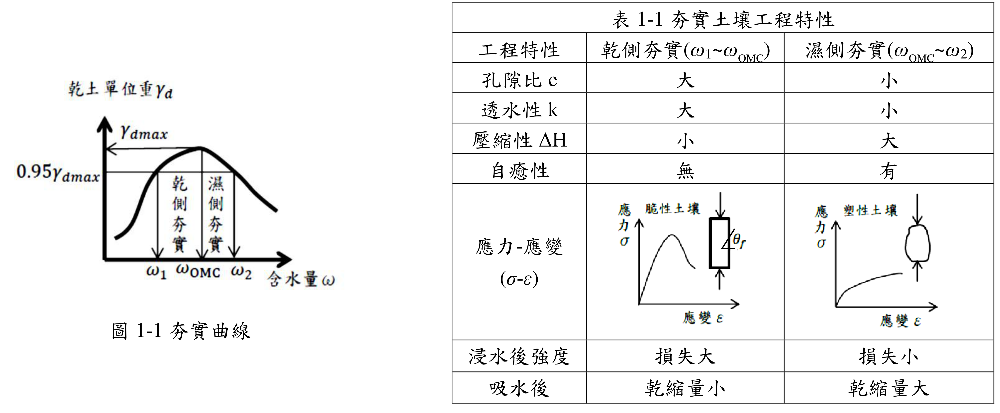
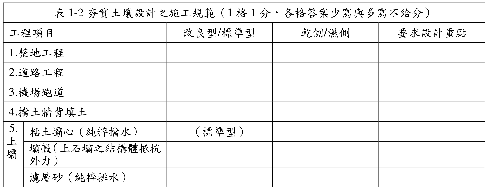

# SM-2017-1 題目正本

> 本檔只記錄**考卷上寫了什麼、圖上畫了什麼**，不含任何解法。解析見同資料夾 `SM-2017-1.md`。
> 判讀清單已確認（凍結）；本檔原則上不再修改（改動須回考卷原圖並記 log）。

| 項目 | 內容 |
|------|------|
| 考卷 | `raw/exams/SM-2017_土壤力學與基礎設計.pdf` 第 1 頁，第一題 |
| 考年 | 民國 106 年（2017） |
| 配分 | 20 分 |
| 附圖 | `SM-2017-1-fig-2.png`（圖 1-1 夯實曲線＋表 1-1 夯實土壤工程特性）、`SM-2017-1-fig-3.png`（表 1-2 作答表）；皆 2026-11-15 由考卷重新擷取 500 dpi。既有 `SM-2017-1-fig-1.png` 為圖 1-1＋表 1-1，表 1-1 標題上有文字游標、上緣帶前一行殘字，保留不刪 |
| 判讀狀態 | **已確認**（2026-11-15 關卡一：使用者授權依建議判讀確認；轉錄 2026-11-15；PyMuPDF 110 dpi 全頁目視，附圖 500 dpi；文字層核對逐字原文；盲讀後才比對既有解析） |

## 1. 考卷原文（逐字）

> 一、現場夯實土壤因日曬、風吹蒸發，土壤很難控制 $\omega_{OMC}$ 之含水量，故填土工程設計之工地密度為 0.95 或 $0.98\gamma_{dmax}$，試依夯實土壤工程特性（乾側、濕側夯實）如圖 1-1 及表 1-1 所示，請定出表 1-2 各工程夯實規範（需標準夯實或改良夯實、乾側含水量或濕側含水量及設計要求重點，如要求承載力、要求排水性、要求自癒性…）。（請繪表 1-2 作答）（20 分）
> 註 1：施工規範設計原則為依據下面特性而定：
> 1.要求強度：則設計採改良型（高能量）夯實、乾側含水量。
> 2.要求排水：則設計採乾側含水量。
> 3.要求承載力：則設計採改良型（高能量）夯實、乾側含水量。
> 4.怕過度夯實，土壤失去粘著力：則設計採標準型（低能量）夯實。
> 5.要求粘土自癒性（Self healing）則設計採標準型（低能量）夯實規範、濕側含水量。
> 註 2：粘土自癒性（Self healing）為粘土在外力作用下產生微裂縫，可依粘土的粘著性而自行癒合的特性。但粘土必須存在塑性狀態，故含水量應在塑性限度與液性限度之間，即 LL≧ω≧PL，而只有在濕側夯實粘土才有自癒性，其在粘土壩心為非常重要的工程特性。

## 2. 考卷給的公式、附表與參數

- 表 1-1 夯實土壤工程特性（照錄）：

| 工程特性 | 乾側夯實（$\omega_1\sim\omega_{OMC}$） | 濕側夯實（$\omega_{OMC}\sim\omega_2$） |
|---|---|---|
| 孔隙比 e | 大 | 小 |
| 透水性 k | 大 | 小 |
| 壓縮性 ΔH | 小 | 大 |
| 自癒性 | 無 | 有 |
| 應力-應變（σ-ε） | 示意圖：脆性土壤，應力–應變曲線有峰值後下降；試體剪裂面標 $\theta_f$ | 示意圖：塑性土壤，應力–應變曲線持續緩升；試體鼓脹 |
| 浸水後強度 | 損失大 | 損失小 |
| 吸水後 | 乾縮量小 | 乾縮量大 |

- 表 1-2 夯實土壤設計之施工規範（1 格 1 分，各格答案少寫與多寫不給分）（照錄；空白為作答格）：

| 工程項目 | | 改良型/標準型 | 乾側/濕側 | 要求設計重點 |
|---|---|---|---|---|
| 1.整地工程 | | | | |
| 2.道路工程 | | | | |
| 3.機場跑道 | | | | |
| 4.擋土牆背填土 | | | | |
| 5.土壩 | 粘土壩心（純粹擋水） | （標準型） | | |
| | 壩殼（土石壩之結構體抵抗外力） | | | |
| | 濾層砂（純粹排水） | | | |

- 圖 1-1 夯實曲線：示意圖，無數值。
- **沒有給**：任何數值資料（本題為判斷填表題）。
- 卷首注意事項：㈠可以使用電子計算器。㈡不必抄題，作答時請將試題題號及答案依照順序寫在試卷上，於本試題上作答者，不予計分。㈢本科目除專門名詞或數理公式外，應使用本國文字作答。

## 3. 附圖

圖面文字照錄：`乾土單位重 γd`、`γdmax`、`0.95γdmax`、`乾側夯實`、`濕側夯實`、`ω1`、`ωOMC`、`ω2`、`含水量 ω`、`圖 1-1 夯實曲線`；表 1-1 應力-應變欄示意圖文字：`應力 σ`、`脆性土壤`、`θf`、`應變 ε`、`塑性土壤`。

## 4. 判讀清單

| # | 項目 | 判讀 | 圖上／題文依據 | 把握 |
|---|------|------|---------------|------|
| 1 | 作答格數 | 7 列 × 3 欄 = 21 格，粘土壩心「改良型/標準型」已給（標準型），其餘 20 格各 1 分，合計 20 分 | 表 1-2、配分 | 確定 |
| 2 | 判定依據 | 每格須依註 1 的五條原則（強度、排水、承載力、怕過度夯實、自癒性）對應；各工程的「要求設計重點」由考生依工程性質判斷，考卷未逐項指定 | 註 1、表 1-2 標題 | 確定（解讀） |
| 3 | 「各格答案少寫與多寫不給分」 | 每格只填一個選項或一組重點（例如擋土牆背填土要排水時，乾側／濕側格只寫「乾側」） | 表 1-2 標題 | 確定 |
| 4 | 註 1 第 2 條 | 要求排水只規定「乾側含水量」，沒有規定改良型／標準型 | 註 1 原文 | 確定 |
| 5 | 工地密度 | 題文「0.95 或 $0.98\gamma_{dmax}$」為設計工地密度（相對夯實度）背景說明，表 1-2 不要求填數值 | 題文 | 確定（解讀） |
| 6 | 圖 1-1 | 示意圖：$0.95\gamma_{dmax}$ 與曲線交點 $\omega_1$（乾側）、$\omega_2$（濕側），乾側區間 $\omega_1\sim\omega_{OMC}$、濕側區間 $\omega_{OMC}\sim\omega_2$ | 圖 1-1 | 確定 |
| 7 | 考卷沒有給 | 數值資料；各工程的土壤種類 | 全題 | 確定 |

---

*轉錄：2026-11-15（SM-U1-3 題目正本推廣・批 2）*

*確認：2026-11-15 使用者授權依建議判讀確認（SM-U1-3 題目正本推廣・批 2，關卡一；使用者指示「要確認的依你建議」）*
