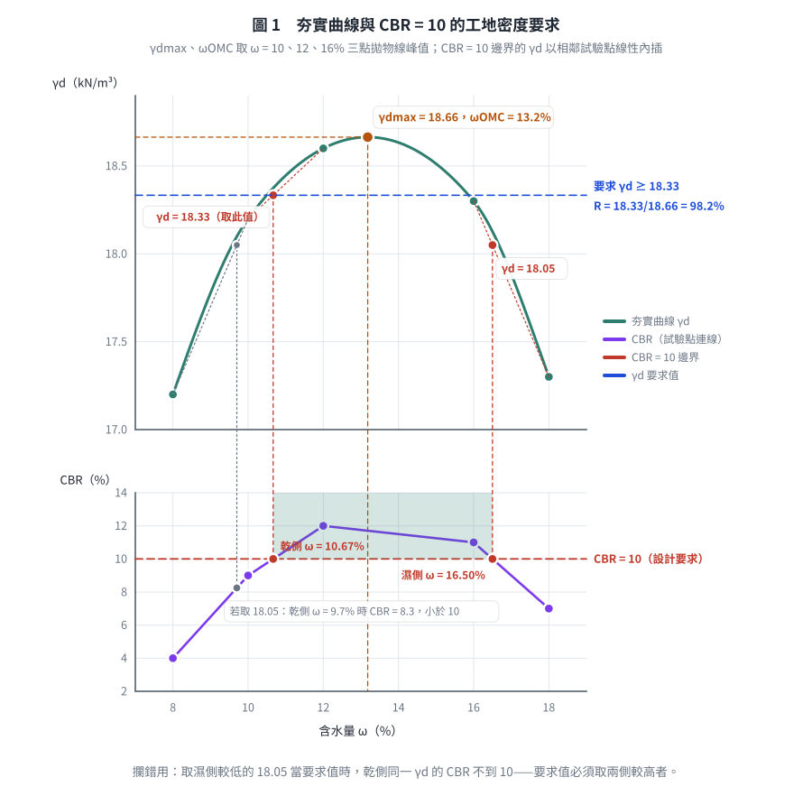

# 考題編號：SM-2017-2

**主分類：** `SM-U1-3` 土壤夯實及壓密
**副分類：** 無
**分析法：** 混合
**標籤：** `夯實曲線` `最佳含水量` `最大乾土單位重` `相對夯實度` `CBR承載比` `內插法`
---

## 1. 題目（考卷原文見題目正本）

> 考卷原文、公式／附表、附圖與判讀清單（已確認）見 [`SM-2017-2-problem.md`](SM-2017-2-problem.md)。本節只列解題時最容易讀錯的地方與本解使用的記號；題意以題目正本為準。

### 常見誤讀

| 項目 | 正確判讀 | 常見誤讀 |
|---|---|---|
| 工地密度百分比 | 相對夯實度要求：取乾側、濕側 CBR = 10 邊界點中**較高**的 $\gamma_d$ 除以 $\gamma_{dmax}$（題目正本 #1，已確認） | 只取單側，或取較低者（乾側同一 $\gamma_d$ 的 CBR 會低於 10） |
| 數據 | $\gamma_d$ 已是乾單位重；12% 與 16% 之間沒有試驗點，峰值靠曲線內插（#3、#4） | 把 $\gamma_d$ 再除以 $(1+\omega)$ |

**本解記號：** $\gamma_{dmax}$ 最大乾單位重；$\omega_{OMC}$ 最佳含水量；$\gamma_{d,req}$ 滿足 CBR ≥ 10 的最低乾單位重；RC 相對夯實度（工地密度百分比）。

## 2. 考題核心精神與出題者意圖 (Core Concepts & Examiner's Intent)
本題測驗考生對於**夯實試驗數據處理**以及**CBR與乾密度的關聯性**之理解。
1. **繪製夯實曲線：** 需根據乾密度與含水量的對應數據，繪製出平滑的夯實曲線，並由此估算最大乾密度 ($\gamma_{dmax}$) 與最佳含水量 ($\omega_{OMC}$)。
2. **設計要求之工地密度：** 理解到在相同含水量下，工地所需的 CBR 值必須滿足大於等於 10 的要求。利用給定的 CBR 曲線或數據內插，求出在乾側 (dry side) 與濕側 (wet side) 滿足 CBR $\ge$ 10 的最低乾密度，取其大者作為工地密度要求，再除以最大乾密度得到相對壓實度 (Relative Compaction, RC)。

## 3. 解題戰略地圖與陷阱分析 (Strategic Roadmap & Trap Analysis)
1. **繪製夯實曲線並求極值：**
   - 以含水量 $\omega$ 為橫軸，乾密度 $\gamma_d$ 為縱軸。
   - 繪製平滑曲線，找尋頂點。可透過二次拋物線內插法或直接觀圖取值求得 $\gamma_{dmax}$ 及 $\omega_{OMC}$。
2. **決定設計要求的最低乾密度 $\gamma_{d,req}$：**
   - 觀察 CBR 與 $\gamma_d$ 的關係。為了保證 CBR $\ge 10$，必須分別針對最佳含水量兩側 (乾側與濕側) 進行內插。
   - 乾側：在 $\omega = 10\%$ ($\gamma_d=18.2$, CBR=9) 與 $\omega=12\%$ ($\gamma_d=18.6$, CBR=12) 之間內插 CBR=10 的乾密度。
   - 濕側：在 $\omega = 16\%$ ($\gamma_d=18.3$, CBR=11) 與 $\omega=18\%$ ($\gamma_d=17.3$, CBR=7) 之間內插 CBR=10 的乾密度。
   - 為確保各含水量狀況下 CBR 均不小於 10，需取兩側內插乾密度之**大值**作為要求之乾密度。
3. **計算工地密度百分比 (RC)：**
   - $RC = \frac{\gamma_{d,req}}{\gamma_{dmax}} \times 100\%$

**陷阱分析：**
- **僅檢查單側內插：** 考生可能只在其中一側尋找 CBR=10 對應的乾密度，而忽略夯實曲線中同一乾密度可能對應兩種不同 CBR。為了確保在任何可能的含水量偏差下，現場承載力皆能達標，必須取要求較嚴格（即較高）的乾密度作為壓實標準。

## 3.5 變數層次分析 (Variable Hierarchy Analysis)

### 最終目標
求出該土壤之最大乾密度 $\gamma_{dmax}$、最佳含水量 $\omega_{OMC}$，並推算滿足 CBR $\ge 10$ 之工地密度百分比 (RC)。

### 本題關鍵公式（依計算順序）
- 乾側內插乾密度：
  $$ \gamma_{d,req(dry)} = \gamma_{d1} + (\gamma_{d2} - \gamma_{d1}) \frac{\text{CBR}_{req} - \text{CBR}_1}{\text{CBR}_2 - \text{CBR}_1} $$
- 工地密度百分比：
  $$ RC = \frac{\max(\boxed{\gamma_{d,req(dry)}}, \gamma_{d,req(wet)})}{\gamma_{dmax}} \times 100\% $$

### L1：題目直接給定
| 符號 | 數值 | 說明 |
|---|---|---|
| CBR$_{req}$ | 10 % | 設計要求之最低 CBR |
| $\gamma_{d1}$ | 18.2 kN/m³ | 乾側內插點下界乾密度 (對應 CBR=9.0%) |
| $\gamma_{d2}$ | 18.6 kN/m³ | 乾側內插點上界乾密度 (對應 CBR=12.0%) |

### L2：需知識點推導
**求工地密度百分比**
| 符號 | 公式／來源 | 卡關? |
|---|---|---|
| $\gamma_{d,req}$ | 由數據內插 CBR=10 所需之最高 $\gamma_d$ | |
| $RC$ | $\frac{\gamma_{d,req}}{\gamma_{dmax}} \times 100\%$ | |

### L3：深層知識（不懂就卡住）
| 知識點 | 說明 | 卡關? |
|---|---|---|
| 夯實土壤之 CBR 行為 | 同一乾密度在乾側與濕側的 CBR 值不同，為保證工地強度，必須以要求較高之乾密度作為品管標準。 | |

## 4. 步驟化詳細計算過程 (Step-by-Step Detailed Calculation)

**Step 1: 繪製夯實曲線並求 $\gamma_{dmax}$ 及 $\omega_{OMC}$**
根據題目給定數據，以含水量 $\omega$ 為橫軸，乾單位重 $\gamma_d$ 為縱軸：
- (8.0, 17.2)
- (10.0, 18.2)
- (12.0, 18.6)
- (16.0, 18.3)
- (18.0, 17.3)

將上述點位繪於圖上並連成平滑曲線。透過曲線峰值附近之二次拋物線內插（取 $\omega$=10, 12, 16 進行擬合）估算峰值：
設定 $\gamma_d = a\omega^2 + b\omega + c$，解得峰值約發生於 $\omega \approx 13.2\%$，對應之乾密度約為 $18.66$ kN/m³。
*(註：考試時由手繪平滑曲線之頂點直接判讀即可，一般可讀得 $\omega_{OMC} \approx 13.0\% \sim 13.5\%$，$\gamma_{dmax} \approx 18.65 \sim 18.7$ kN/m³。)*
此處取：
$$ \boxed{\gamma_{dmax} \approx 18.66 \text{ kN/m}^3} $$
$$ \boxed{\omega_{OMC} \approx 13.2 \%} $$

**Step 2: 評估滿足 CBR $\ge 10$ 所需之最低乾密度**
觀察數據，設計要求基底層填方 CBR=10。由試驗數據可知，需在乾側與濕側分別進行線性內插，找出對應 CBR=10 的 $\gamma_d$：

- **乾側 (Dry side) 內插：**
  介於試體 2 ($\gamma_d=18.2$, CBR=9.0) 與試體 3 ($\gamma_d=18.6$, CBR=12.0) 之間：
  $$ \gamma_{d,req(dry)} = 18.2 + (18.6 - 18.2) \times \frac{10.0 - 9.0}{12.0 - 9.0} = 18.2 + 0.4 \times \frac{1}{3} \approx 18.33 \text{ kN/m}^3 $$

- **濕側 (Wet side) 內插：**
  介於試體 4 ($\gamma_d=18.3$, CBR=11.0) 與試體 5 ($\gamma_d=17.3$, CBR=7.0) 之間：
  $$ \gamma_{d,req(wet)} = 17.3 + (18.3 - 17.3) \times \frac{10.0 - 7.0}{11.0 - 7.0} = 17.3 + 1.0 \times \frac{3}{4} = 18.05 \text{ kN/m}^3 $$

為確保無論土壤含水量偏乾或偏濕，均能達到 CBR $\ge 10$ 的要求，設計要求之乾密度應取兩者之大值：
$$ \gamma_{d,req} = \max(18.33, 18.05) = 18.33 \text{ kN/m}^3 $$

**Step 3: 計算工地密度百分比 (RC)**
$$ RC = \frac{\gamma_{d,req}}{\gamma_{dmax}} \times 100\% = \frac{18.33}{18.66} \times 100\% = 98.23\% $$
實務上規範通常取整數或小數第一位，理論計算值為：
$$ \boxed{\text{工地密度百分比應要求 } 98.2\%} $$

*圖 1　題目要求的夯實曲線，並把 CBR = 10 的乾、濕側邊界投影到夯實曲線上。攔下「取較低的 18.05 當要求值」：乾側同一 $\gamma_d$ 的 CBR 只有約 8.3，不到 10。*

## 5. 關鍵爭議點與進階探討 (Critical Issues & Advanced Discussion)
- **曲線極值的判讀誤差：** 手繪平滑曲線時，因各人繪圖習慣不同，讀取出來的 $\gamma_{dmax}$ 會在 18.6 ~ 18.7 kN/m³ 之間變動，而 $\omega_{OMC}$ 則約為 13%。這種些微誤差在工程考試中是可以接受的，重要的是展示出「如何透過曲線求極值」以及「如何用內插法找對應之 $\gamma_{d,req}$」的邏輯。
- **CBR 隨含水量的變化：** 土壤在夯實時，乾側土壤顆粒排列較為絮狀 (Flocculated)，濕側則較為分散狀 (Dispersed)。這會導致在相同的乾密度下，乾側與濕側的 CBR 通常會有些差異。為了達到足夠的安全與承載力，我們必須對乾側與濕側分別檢核 CBR 達標所需的最小密度，並取大值作為整體的施工標準，以避免含水量控制不佳時承載力不足。

*修正日期：2026-11-15（§1 改為指向題目正本 `SM-2017-2-problem.md`；§4 補解題圖解 figs/SM-2017-2-fig-1-compaction-cbr.svg（腳本 gen_SM-2017-2.py）；非勘誤）*
