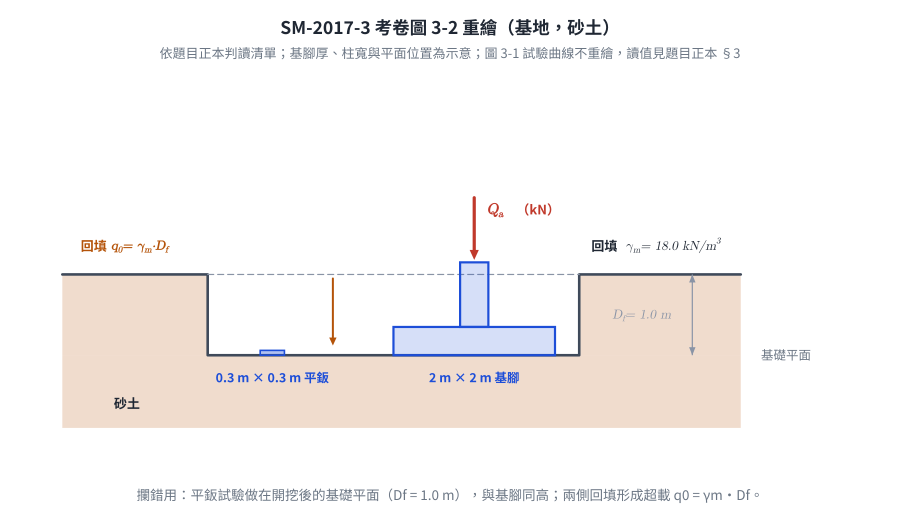
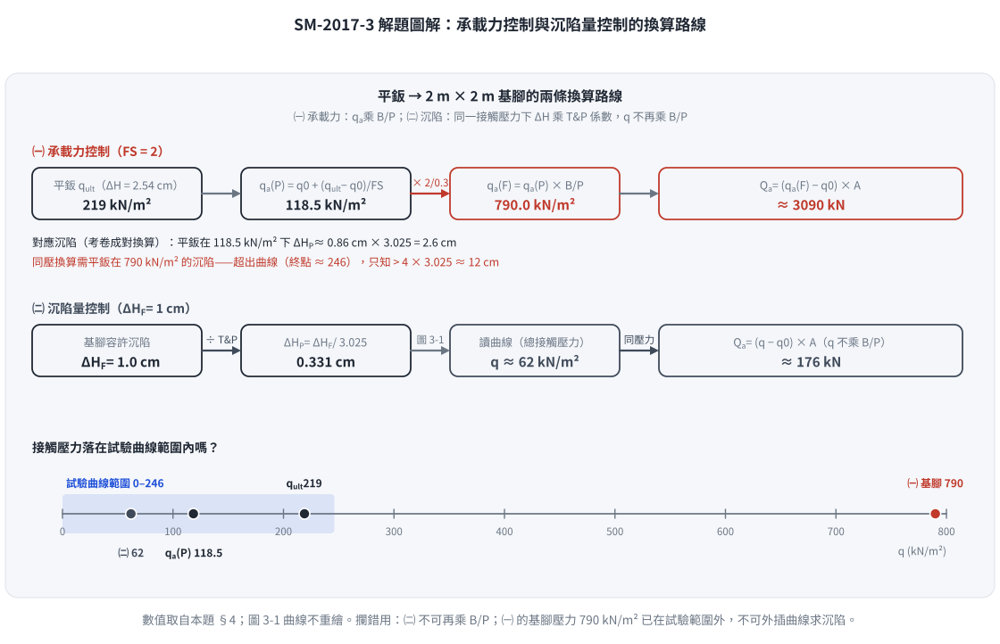

# 考題編號：SM-2017-3

**主分類：** `SM-U2-1` 淺基礎之支承力與沉陷量
**副分類：** 無
**分析法：** 混合
**標籤：** `平鈑載重試驗` `容許承載力` `沉陷量控制` `尺寸效應` `Terzaghi-Peck沉陷公式` `安全係數` `平鈑曲線讀值`
---

## 1. 題目（考卷原文見題目正本）

> 考卷原文、公式／附表、附圖與判讀清單（已確認）見 [`SM-2017-3-problem.md`](SM-2017-3-problem.md)。本節只列解題時最容易讀錯的地方與本解使用的記號；題意以題目正本為準。

*重繪自考卷圖 3-2，依題目正本判讀清單 #5–#7；攔下的判讀錯誤：平鈑試驗做在基礎平面、與基腳同高。圖 3-1 試驗曲線不重繪（重繪等於自編數據），讀值見題目正本 §3。*

### 常見誤讀

| 項目 | 正確判讀 | 常見誤讀 |
|---|---|---|
| 曲線讀值 | 依題目正本 §3 讀值表：ΔH = 1.0 cm → q ≈ 129、ΔH = 2.54 cm → q ≈ 218、曲線終點 (4.0 cm, ≈ 250) kN/m²（#3、#8） | 把曲線當成 $q=150\sqrt{\Delta H}$（經過 (1, 150)、(4, 300)）——考卷沒給曲線式，實際曲線在 1 cm 時只有 ≈ 130、到 4 cm 只到 ≈ 246（本解 2026-11-15 前即如此，$q_{ult}$ 高估 9%） |
| 曲線 q 是總壓還是淨壓 | 考卷 $FS=\frac{q_{ult}-q_0}{q_a-q_0}$ 從曲線讀值扣 $q_0$，曲線 q 為**總接觸壓力**；㈡ 讀出的 q 也是總壓，$Q_a=(q-q_0)A$ | ㈠ 扣 $q_0$、㈡ 又把同一條曲線的 q 當淨壓直接乘面積（本解 2026-11-15 前即如此） |
| ㈠ 對應沉陷 | 照考卷砂土式成對換算：平鈑在 $q_a$(平鈑) 下的沉陷 × T&P 係數；基腳在 790 kN/m² 的同壓沉陷超出曲線範圍，不外插 | 把曲線式外插到 788 kN/m² 得 83.5 cm（本解 2026-11-15 前即如此） |
| 砂土沉陷換算 | 考卷式 $\left(\frac{B}{B+P}\right)^2$ 少係數 2；採 Terzaghi & Peck $\left(\frac{2B}{B+P}\right)^2$（#1，已確認；⚠ 待使用者複核） | 照考卷式，得出基腳沉陷小於平鈑 |
| $q_{ult}$ 取法 | 曲線無貫入穿孔，依圖註取 ΔH = 2.54 cm 對應的 q（#3） | 取曲線終點或外插 |
| 柱容許承載力 | $Q_a=(q_a-q_0)\times A$，$q_0=\gamma_m D_f$ = 18 kN/m²（#2、#7，已確認；⚠ 待使用者複核） | 直接以 $q_a\times A$，把基腳與回填重算進柱載重 |

**本解記號：** P 平鈑寬 0.3 m；B 基腳寬 2 m；$q_{ult(P)}$、$q_{ult(F)}$ 平鈑／基腳極限承載力；$q_{net,a}$ 淨容許承載力；$\Delta H_P$、$\Delta H_F$ 平鈑／基腳沉陷。

## 2. 考題核心精神與出題者意圖 (Core Concepts & Examiner's Intent)
本題測驗能否把「平鈑載重試驗 (PLT)」的結果換算到實際尺寸的砂土基腳：承載力依考卷砂土式按寬度比放大，沉陷依 Terzaghi & Peck 經驗式換算。出題者把設計分為「承載力控制」與「沉陷量控制」，要考生自己發現：砂土中的大基腳通常受**沉陷量**控制，而不是剪力破壞。曲線沒有給方程式，數值要從圖 3-1 直接讀；讀圖精度約 ±5 kN/m²，作答時寫出讀值即可。

## 3. 解題戰略地圖與陷阱分析 (Strategic Roadmap & Trap Analysis)
**作戰計畫：**
1. **讀曲線：** 依圖註，曲線到 4 cm 都沒有陡降（無貫入穿孔），取 $\Delta H_P = 2.54\text{ cm}$ 對應的 q 為 $q_{ult}$；㈡要用的點（$\Delta H_P$ = 0.331 cm）也直接讀。
2. **承載力控制 (Part 1)：** 先在平鈑上用考卷的 FS 定義求 $q_a(\text{平鈑})=q_0+(q_{ult}-q_0)/FS$，再依考卷砂土式 $q_a(\text{基腳})=q_a(\text{平鈑})\cdot B/P$ 放大，柱載重 $Q_a=(q_a-q_0)A$。對應沉陷依考卷的成對換算：平鈑在 $q_a(\text{平鈑})$ 下的沉陷乘 T&P 係數。
3. **沉陷量控制 (Part 2)：** 基腳沉陷 1 cm → 以 T&P 係數反推平鈑沉陷 → 讀曲線得同一接觸壓力 q → $Q_a=(q-q_0)A$。

**關鍵陷阱：**
- **陷阱 1：自己造曲線式。** 曲線看起來像拋物線，但不經過 (1, 150)、(4, 300)；照自設式算，$q_{ult}$ 高估 9%、㈡ 的 q 高估 39%。
- **陷阱 2：砂土承載力尺寸效應。** 砂土 $q_a$ 要乘 $B/P$，不可令 $q_a(\text{基腳})=q_a(\text{平鈑})$（那是黏土式）。
- **陷阱 3：沉陷換算式。** 考卷印 $\left(\frac{B}{B+P}\right)^2$ 少了係數 2（判讀 #1，已確認）；照印的式子基腳沉陷會**小於**平鈑，與砂土經驗相反。本解採 Terzaghi & Peck $\left(\frac{2B}{B+P}\right)^2$，考卷式結果列 §5。
- **陷阱 4：總壓與淨壓混用。** 考卷 FS 定義扣 $q_0$，曲線 q 是總接觸壓力；㈡ 讀出的 q 也要先扣 $q_0$ 才是柱載重對應的淨壓。
- **陷阱 5：㈡ 又乘 $B/P$。** $B/P$ 是承載力（破壞）的尺寸效應；沉陷換算已由 T&P 係數處理，㈡ 不再乘。

## 3.5 變數層次分析 (Variable Hierarchy Analysis)

### 最終目標
`分別依承載力及沉陷量控制，求出廠房單柱容許承載力 Qa 及對應沉陷量 ΔH，並填表 3-1`

### 本題關鍵公式（依計算順序）
- 平鈑容許承載力（考卷 FS 定義）：$q_{a(P)} = q_0 + \frac{\boxed{q_{ult(P)}} - q_0}{FS}$
- 基腳容許承載力（考卷砂土式）：$q_{a(F)} = \boxed{q_{a(P)}}\cdot\frac{B}{P}$
- 柱容許承載力：$Q_a = (\boxed{q_{a(F)}} - q_0)\cdot A$
- 砂土沉陷換算（Terzaghi & Peck）：$\Delta H_F = \boxed{\Delta H_P}\left(\frac{2B}{B+P}\right)^2$
- ㈡ 柱容許承載力：$Q_a = (\boxed{q(\Delta H_P)} - q_0)\cdot A$

### L1：題目直接給定
| 符號 | 數值 | 說明 |
|---|---|---|
| $P$ | $0.3\text{ m}$ | 平鈑寬度 |
| $B$ | $2.0\text{ m}$ | 基腳寬度 |
| $D_f$ | $1.0\text{ m}$ | 埋置深度（平鈑與基腳都在基礎平面） |
| $\gamma_m$ | $18.0\text{ kN/m}^3$ | 回填土單位重 |
| $FS$ | $2$ | 安全係數，定義 $FS=\frac{q_{ult}-q_0}{q_a-q_0}$ |
| 圖 3-1 | 曲線讀值 | $q_{ult}$ 取 $\Delta H$ = 2.54 cm 對應之 q |

### L2：需知識點推導
**承載力控制推導**
| 符號 | 公式／來源 | 卡關? |
|---|---|---|
| $q_0$ | $\gamma_m D_f$ | |
| $q_{ult(P)}$ | 圖 3-1 讀 $\Delta H$ = 2.54 cm | |
| $q_{a(P)}$ | $q_0+(q_{ult(P)}-q_0)/FS$ | |
| $q_{a(F)}$ | $q_{a(P)}\cdot B/P$ | |
| $\Delta H_F$ | 圖 3-1 讀 $q_{a(P)}$ 的沉陷 × T&P 係數 | |

**沉陷量控制推導**
| 符號 | 公式／來源 | 卡關? |
|---|---|---|
| $\Delta H_P$ | $\Delta H_F / \left(\frac{2B}{B+P}\right)^2$ | |
| $q$ | 圖 3-1 讀 $\Delta H_P$ 對應之 q（總接觸壓力） | |

### L3：深層知識（不懂就卡住）
| 知識點 | 說明 | 卡關? |
|---|---|---|
| 砂土承載力尺寸效應 | 砂土 $c=0$，承載力主要來自 $0.5\gamma BN_\gamma$，與寬度成正比，故 $q_a$ 乘 $B/P$ | |
| 砂土沉陷尺寸效應 | Terzaghi & Peck：**同一接觸壓力**下 $\Delta H_F/\Delta H_P=\left(\frac{2B}{B+P}\right)^2$，上限 4 倍 | |
| 曲線 q 的基準 | 平鈑在坑底、四周有回填 $q_0$；考卷 FS 定義扣 $q_0$，表示曲線 q 為總壓 | |
| 讀圖而非造式 | 曲線無方程式，直接讀格線交點；讀值精度 ±5 kN/m² 對答案的影響要能估 | |

## 4. 步驟化詳細計算過程 (Step-by-Step Detailed Calculation)

### Step 1: 讀取平鈑載重曲線
圖 3-1 橫軸格線每 50 kN/m²、縱軸每 0.5 cm。逐點讀值（2026-11-15 由 500 dpi 附圖數位化，精度約 ±5 kN/m²）：

| $\Delta H_P$ (cm) | 0.331 | 0.5 | 0.86 | 1.0 | 1.32 | 2.0 | 2.54 | 3.0 | 3.95（終點） |
|---|---|---|---|---|---|---|---|---|---|
| $q$ (kN/m²) | ≈ 62 | ≈ 84 | ≈ 119 | ≈ 130 | ≈ 154 | ≈ 194 | ≈ 219 | ≈ 234 | ≈ 246 |

曲線到 4 cm 仍無陡降（無貫入穿孔），依圖註：
$$ q_{ult(P)} = q\big|_{\Delta H = 2.54\text{ cm}} \approx 219 \text{ kN/m}^2 $$

基腳底面之回填覆土壓力：
$$ q_0 = \gamma_m D_f = 18.0 \times 1.0 = 18.0 \text{ kN/m}^2 $$

砂土沉陷換算係數（Terzaghi & Peck）：
$$ \left(\frac{2B}{B+P}\right)^2 = \left(\frac{2\times2.0}{2.0+0.3}\right)^2 = \left(\frac{4}{2.3}\right)^2 = 3.025 $$

---

### Step 2: (一) 承載力控制設計
平鈑容許承載力（由考卷 $FS=\frac{q_{ult}-q_0}{q_a-q_0}$ 解出 $q_a$）：
$$ q_{a(P)} = q_0 + \frac{q_{ult(P)} - q_0}{FS} = 18.0 + \frac{219 - 18.0}{2} = 118.5 \text{ kN/m}^2 $$

依考卷砂土式放大到基腳：
$$ q_{a(F)} = q_{a(P)} \times \frac{B}{P} = 118.5 \times \frac{2.0}{0.3} = 790.0 \text{ kN/m}^2 $$

廠房單柱容許承載力（基腳與回填重視為與 $q_0$ 相當，判讀 #2）：
$$ Q_a = (q_{a(F)} - q_0) \times A = (790.0 - 18.0) \times (2.0 \times 2.0) = 3088 \text{ kN} $$
$$ \boxed{ Q_a \approx 3090 \text{ kN} } $$

對應之沉陷量：依考卷砂土式的成對換算，平鈑在 $q_{a(P)} = 118.5 \text{ kN/m}^2$ 下的沉陷由圖 3-1 讀得 $\Delta H_P \approx 0.86 \text{ cm}$，換算到基腳：
$$ \Delta H_F = \Delta H_P \left(\frac{2B}{B+P}\right)^2 = 0.86 \times 3.025 $$
$$ \boxed{ \Delta H_F \approx 2.6 \text{ cm} } $$

> **策略註解**：基腳的設計壓力 790 kN/m² 是平鈑試驗最大壓力（≈ 246 kN/m²）的 3 倍以上。若要嚴格「同一壓力」換算，需要平鈑在 790 kN/m² 的沉陷，已超出曲線；曲線只能告訴我們基腳壓力一超過 246 kN/m²，沉陷就已經超過 $4 \times 3.025 \approx 12$ cm（見 §5）。2.6 cm 是考卷換算框架下的答案，實際沉陷會更大。

---

### Step 3: (二) 沉陷量控制設計
基腳容許沉陷 $\Delta H_F = 1.0\text{ cm}$，以 T&P 係數反推同一接觸壓力下的平鈑沉陷：
$$ \Delta H_P = \frac{\Delta H_F}{3.025} = \frac{1.0}{3.025} = 0.331 \text{ cm} $$

由圖 3-1 讀得 $\Delta H_P = 0.331 \text{ cm}$ 對應之接觸壓力 $q \approx 62 \text{ kN/m}^2$（總壓）。基腳接觸壓力相同，扣除 $q_0$ 得柱載重：
$$ Q_a = (q - q_0) \times A = (62 - 18.0) \times 4.0 = 176 \text{ kN} $$
$$ \boxed{ Q_a \approx 176 \text{ kN} } $$

*圖 2　兩條換算路線與接觸壓力的位置（數值取自本節；圖 3-1 曲線不重繪）。攔下兩種錯誤：㈡ 把讀出的 q 再乘 $B/P$（沉陷換算已由 T&P 係數處理）；㈠ 基腳壓力 790 kN/m² 遠在試驗範圍外，卻外插曲線求沉陷。*

---

### Step 4: (三) 製作比較表 3-1

| 地盤種類 | 2m×2m 基腳 | 柱容許承載力 $Q_a$ (kN) | 對應之沉陷量 $\Delta H$ (cm) |
| :--- | :--- | :--- | :--- |
| 砂土地盤 | 承載力控制設計（$FS=2$） | $\boxed{\approx 3090}$ | $\boxed{\approx 2.6}$（考卷換算框架；實際同壓沉陷 > 12 cm） |
| | 沉陷量控制設計（$\Delta H$ = 1cm） | $\boxed{\approx 176}$ | $\boxed{1.0}$ |

**工程評估：** 承載力控制的 $Q_a$ 是沉陷控制的約 18 倍，但基腳壓力已遠超出試驗曲線範圍、沉陷無法保證；精密廠房對沉陷敏感，應採**沉陷量控制設計**（$Q_a \approx 176$ kN）。柱載重若大於此值，需加大基腳、改筏基或先做地盤改良。

## 5. 關鍵爭議點與進階探討 (Critical Issues & Advanced Discussion)
1. **讀值精度：** 三次獨立數位化（2026-11-15 題目正本 218、獨立盲解 219.8、勘誤 219）差 ≤ 1%；$\Delta H_P$ = 0.331 cm 對應 61～62 kN/m²。讀值差 ±5 kN/m² 時，㈠ $Q_a$ 約 3020～3150 kN、㈡ $Q_a$ 約 156～196 kN，結論不變。考場上把讀值寫在答案中即可。
2. **㈠ 的另一種算法（先放大 $q_{ult}$ 再除 FS）：** $q_{ult(F)} = 219 \times 2.0/0.3 = 1460 \text{ kN/m}^2$，$Q_a = \frac{1460 - 18}{2} \times 4 = 2884 \text{ kN}$。與考卷式差 $q_0(B/P-1)(1-1/FS) = 51 \text{ kN/m}^2$（約 204 kN），原因是 $q_0$ 被一起放大後才扣。本解照考卷表下的 $q_a(\text{基腳})=q_a(\text{平鈑})\cdot B/P$。
3. **照考卷印的沉陷式 $\left(\frac{B}{B+P}\right)^2 = 0.756$（對照）：** ㈠ $\Delta H_F = 0.86 \times 0.756 = 0.65 \text{ cm}$；㈡ $\Delta H_P = 1/0.756 = 1.32 \text{ cm}$ → $q \approx 154$ → $Q_a = (154 - 18) \times 4 \approx 544 \text{ kN}$。基腳沉陷小於平鈑，與砂土「基礎越大沉陷越大（同壓力下最多 4 倍）」的經驗相反，判為漏印係數 2（題目正本 #1，已確認；⚠ 待使用者複核）。
4. **㈡ 若把曲線 q 當淨壓：** $Q_a = 62 \times 4 \approx 248 \text{ kN}$。但考卷 FS 定義從曲線讀值扣 $q_0$，曲線 q 是總壓；㈠、㈡ 必須用同一個基準。本解 2026-11-15 前 ㈠ 扣 $q_0$、㈡ 不扣，前後矛盾。
5. **㈡ 不可再乘 $B/P$：** 若把讀出的 62 kN/m² 也乘 $B/P$，得 $Q_a = (413 - 18) \times 4 \approx 1581 \text{ kN}$——等於讓基腳在 6.7 倍壓力下只沉 3 倍，與 T&P「同壓力換算」的前提矛盾，不採用。
6. **㈠ 的同壓沉陷：** T&P 換算的前提是平鈑與基腳**同一接觸壓力**。基腳 790 kN/m² 下要用平鈑在 790 kN/m² 的沉陷，但曲線終點只到 ≈ 246 kN/m²（3.95 cm），只能確定同壓沉陷 > $4 \times 3.025 \approx 12$ cm，不外插求值。本解 2026-11-15 前把自設拋物線外插到 788 kN/m²，得 83.5 cm，沒有依據。考卷給的兩條砂土式把平鈑狀態（$q_a$、$\Delta H$）成對換到基腳，這是表 3-1「對應之沉陷量」的作答框架；這個數字偏低，比較表中應加註。
7. **$Q_a$ 是否扣 $q_0$：** 毛值 $q_aA$ ㈠ 3160 kN、㈡ 248 kN；本解依判讀 #2 取 $(q_a - q_0)A$（⚠ 待使用者複核）。
8. **砂土設計的本質：** 砂土淺基礎的設計幾乎總是被沉陷量控制，而不是承載力破壞。承載力控制的 $Q_a$ 雖大，但壓力遠超出試驗範圍，伴隨的沉陷無法保證。

*修正日期：2026-11-15（§1 改為指向題目正本 `SM-2017-3-problem.md`，重繪附圖 figs/SM-2017-3-fig-1-problem.svg；§1 常見誤讀註明曲線讀值與本解 §3.5–§4 的曲線方程式不符（待勘誤）；§4 Step 3 補解題圖解 figs/SM-2017-3-fig-2-conversion.svg（圖解補繪）；非勘誤）*

*修正日期：2026-11-15（FIX：平鈑曲線改用考卷讀值——圖 3-1 曲線改用考卷讀值（原自設 q = 150√ΔH）：q_ult 239.1 → 219 kN/m²；㈠ 改照考卷砂土式 qa(平鈑)·B/P，Qa 3152 → ≈ 3090 kN，對應沉陷 83.5 cm（拋物線外插）→ ≈ 2.6 cm（考卷換算框架，§5 註同壓沉陷 > 12 cm）；㈡ 曲線 q 為總壓、Qa = (q − q0)A，345 → ≈ 176 kN；§1 常見誤讀、§2–§5 重寫並移除「待勘誤」警示。驗證：曲線三次獨立數位化差 ≤ 1%，腳本重算 22 個數值 MISMATCHES: 0，㈠ 以代數等價式交叉驗算；依 2026-11-15 獨立盲解比對）*
