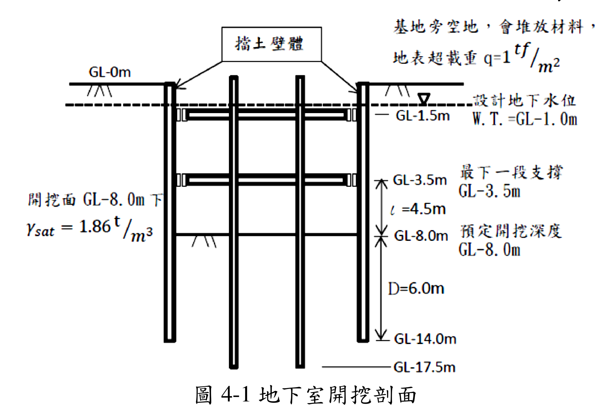
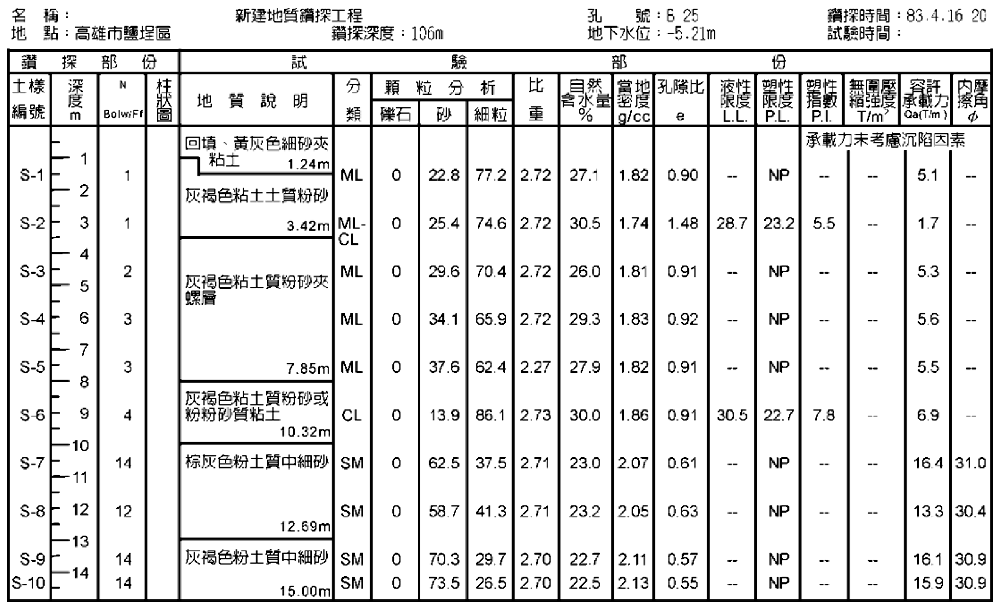

# SM-2017-4 題目正本

> 本檔只記錄**考卷上寫了什麼、圖上畫了什麼**，不含任何解法。解析見同資料夾 `SM-2017-4.md`。
> 判讀清單已確認（凍結）；本檔原則上不再修改（改動須回考卷原圖並記 log）。

| 項目 | 內容 |
|------|------|
| 考卷 | `raw/exams/SM-2017_土壤力學與基礎設計.pdf` 第 3 頁（第三頁），第四題 |
| 考年 | 民國 106 年（2017） |
| 配分 | 45 分（㈠5＋5、㈡10、㈢5＋10、㈣10） |
| 附圖 | `SM-2017-4-fig-3.png`（圖 4-1 地下室開挖剖面）、`SM-2017-4-fig-4.png`（表 4-1 鑽探報告）（2026-11-15 由考卷重新擷取 500 dpi）；既有 `SM-2017-4-fig-1.png`、`SM-2017-4-fig-2.png` 為同兩張圖，都帶滑鼠游標，保留不刪 |
| 判讀狀態 | **已確認**（2026-11-15 關卡一：使用者授權依建議判讀確認；⚠ 待使用者複核：判讀 #1 隆起公式 α 的定義；轉錄 2026-11-15；PyMuPDF 110 dpi 全頁目視，附圖與附表為內嵌點陣影像（1024 px 寬），500 dpi 放大目視；PDF 文字層核對逐字原文；盲讀後才比對既有解析） |

## 1. 考卷原文（逐字）

> 四、某地下室開挖剖面，如圖 4-1 所示，其鑽探報告如表 4-1 所示，開工前之施工計畫為研擬施工之安全，請分析以下問題：
> （註：1. 本案鑽探報告為公制，故請依公制計算，$\gamma_w = 1\ tf/m^2$
> 　　　2. 基地旁為空地，會堆放材料，地表超載重 $q = 1\ tf/m^2$）
> ㈠擋土壁使用打擊式 FSP IV 鋼版樁（15.0 m 長，打至 GL-14.0 m），打樁時是否會振動、液化損鄰，請說明打擊式鋼版樁與土壤 N 值特性與深度之關係。（5 分）若施工時為避免打樁振動、液化損鄰，應做那些應變措施？（5 分）
> ㈡設計地下水位在 GL-1.0 m，請以擋土壁最高流線分析管湧安全係數為多少？（10 分）（$FS = \dfrac{i_c}{i}$、$i_c = \dfrac{\gamma_{sub}}{\gamma_w}$）
> ㈢設計地下水位在 GL-1.0 m，請分析上舉破壞（土湧）安全係數為多少？（5 分）又在 FS=2 之下，為防止發生上舉破壞則基坑內地下水位應降至 GL-？m。（10 分）
> ㈣土壤短期不排水剪力強度 $S_u = \dfrac{10N}{16}$（Terzaghi & Peck 1959）（本案砂土、粘土皆可用），請分析隆起之安全係數為多少？（10 分）（$FS = \dfrac{S_u\times(\pi+2\alpha)}{\gamma\times H+q}$）

（$\gamma_w$ 的單位考卷印成 tf/m²，照考卷原文。）

## 2. 考卷給的公式、附表與參數

- 考卷給的公式：管湧 $FS = i_c/i$、$i_c = \gamma_{sub}/\gamma_w$；不排水強度 $S_u = 10N/16$（Terzaghi & Peck 1959；砂土、粘土皆可用）；隆起 $FS = S_u(\pi+2\alpha)/(\gamma H+q)$。
- 註：$\gamma_w$ = 1 tf/m²（照錄，應為 tf/m³）；地表超載 $q$ = 1 tf/m²。
- 圖 4-1：GL-0m 地表；設計地下水位 W.T. = GL-1.0 m；支撐在 GL-1.5 m、GL-3.5 m（最下一段支撐）；預定開挖深度 GL-8.0 m；$\ell$ = 4.5 m（GL-3.5～GL-8.0）；$D$ = 6.0 m（GL-8.0～GL-14.0，擋土壁底）；GL-17.5 m（中間兩支樁底）；開挖面 GL-8.0 m 下 $\gamma_{sat}$ = 1.86 t/m³；基地旁超載 $q$ = 1 tf/m²。
- 表 4-1 鑽探報告（照錄）：名稱：（空白）；地點：高雄市鹽埕區；新建地質鑽探工程；鑽探深度：106m（照錄）；孔號：B 25；地下水位：-5.21m；鑽探時間：83.4.16 20（照錄）。

| 土樣 | 深度 m | N | 地質說明（層底深度） | 分類 | 礫石 | 砂 | 細粒 | 比重 | 自然含水量 % | 當地密度 g/cc | 孔隙比 e | L.L. | P.L. | P.I. | 無圍壓縮強度 T/m² | 容許承載力 Qa (T/m²) | 內摩擦角 φ |
|---|---|---|---|---|---|---|---|---|---|---|---|---|---|---|---|---|---|
| S-1 | 1.5 | 1 | 回填、黃灰色細砂夾粘土（1.24m）／灰褐色粘土土質粉砂 | ML | 0 | 22.8 | 77.2 | 2.72 | 27.1 | 1.82 | 0.90 | -- | NP | -- | -- | 5.1 | -- |
| S-2 | 3 | 1 | 灰褐色粘土土質粉砂（3.42m） | ML-CL | 0 | 25.4 | 74.6 | 2.72 | 30.5 | 1.74 | 1.48 | 28.7 | 23.2 | 5.5 | -- | 1.7 | -- |
| S-3 | 4.5 | 2 | 灰褐色粘土質粉砂夾螺層 | ML | 0 | 29.6 | 70.4 | 2.72 | 26.0 | 1.81 | 0.91 | -- | NP | -- | -- | 5.3 | -- |
| S-4 | 6 | 3 | 同上 | ML | 0 | 34.1 | 65.9 | 2.72 | 29.3 | 1.83 | 0.92 | -- | NP | -- | -- | 5.6 | -- |
| S-5 | 7.5 | 3 | 同上（7.85m） | ML | 0 | 37.6 | 62.4 | 2.27 | 27.9 | 1.82 | 0.91 | -- | NP | -- | -- | 5.5 | -- |
| S-6 | 9 | 4 | 灰褐色粘土質粉砂或粉粉砂質粘土（10.32m） | CL | 0 | 13.9 | 86.1 | 2.73 | 30.0 | 1.86 | 0.91 | 30.5 | 22.7 | 7.8 | -- | 6.9 | -- |
| S-7 | 10.5 | 14 | 棕灰色粉土質中細砂 | SM | 0 | 62.5 | 37.5 | 2.71 | 23.0 | 2.07 | 0.61 | -- | NP | -- | -- | 16.4 | 31.0 |
| S-8 | 12 | 12 | 同上（12.69m） | SM | 0 | 58.7 | 41.3 | 2.71 | 23.2 | 2.05 | 0.63 | -- | NP | -- | -- | 13.3 | 30.4 |
| S-9 | 13.5 | 14 | 灰褐色粉土質中細砂 | SM | 0 | 70.3 | 29.7 | 2.70 | 22.7 | 2.11 | 0.57 | -- | NP | -- | -- | 16.1 | 30.9 |
| S-10 | 14.5 | 14 | 同上（15.00m） | SM | 0 | 73.5 | 26.5 | 2.70 | 22.5 | 2.13 | 0.55 | -- | NP | -- | -- | 15.9 | 30.9 |

（表上「承載力未考慮沉陷因素」；深度欄為取樣位置在刻度尺上的約略深度，由刻度目讀；S-5 比重 2.27、S-2 孔隙比 1.48 照錄；地質說明欄的「同上」為本轉錄的簡寫，原表為合併儲存格。）
- **沒有給**：隆起公式中 $\alpha$ 的定義、$H$ 的取法、用哪一個 N 值（或平均 N）、開挖寬度、最高流線的流徑長度定義、上舉檢核所指的不透水層。
- 卷首注意事項（第 1 頁）：㈠可以使用電子計算器。㈡不必抄題，作答時請將試題題號及答案依照順序寫在試卷上，於本試題上作答者，不予計分。㈢本科目除專門名詞或數理公式外，應使用本國文字作答。

## 3. 附圖

圖面文字照錄（圖 4-1）：`擋土壁體`、`GL-0m`、`基地旁空地，會堆放材料，`、`地表超載重 q=1 tf/m2`、`設計地下水位 W.T. =GL-1.0m`、`GL-1.5m`、`GL-3.5m`、`最下一段支撐 GL-3.5m`、`ℓ =4.5m`、`GL-8.0m`、`預定開挖深度 GL-8.0m`、`開挖面 GL-8.0m 下 γsat = 1.86 t/m3`、`D=6.0m`、`GL-14.0m`、`GL-17.5m`、`圖 4-1 地下室開挖剖面`。

## 4. 判讀清單

| # | 項目 | 判讀 | 圖上／題文依據 | 把握 |
|---|------|------|---------------|------|
| 1 | 隆起公式的 $\alpha$ | 考卷未定義；依公式形式 $S_u(\pi+2\alpha)$ 解讀為以最下一段支撐為圓心之滑動圓弧，開挖面以上弧段所對圓心角（rad），由 $\ell$ = 4.5 m 與圓弧半徑決定 | 題文㈣公式 | 不確定（解讀；影響答案，請確認）；使用者授權依建議確認；⚠ 待使用者複核 |
| 2 | 隆起用的 $S_u$ | $S_u = 10N/16$（tf/m²），考卷未說明用哪一深度的 N；解讀為滑動弧通過範圍（開挖面附近至擋土壁底）的 N 值 | 題文㈣、表 4-1 | 不確定（解讀；影響答案，請確認）；使用者授權依建議確認 |
| 3 | 上舉（土湧）檢核的不透水層 | 表 4-1 中 7.85～10.32 m 為 CL（S-6），其下 10.32 m 起為 SM 砂層；解讀為 CL 層底（GL-10.32 m）受下方砂層水壓上舉 | 表 4-1 地質說明與分類 | 不確定（解讀；影響答案，請確認）；使用者授權依建議確認 |
| 4 | 最高流線 | 沿擋土壁背側由設計水位 GL-1.0 m 向下到壁底 GL-14.0 m、再沿內側向上到開挖面 GL-8.0 m 的最短流徑 | 題文㈡「擋土壁最高流線」、圖 4-1 | 確定（解讀） |
| 5 | 開挖內水位（㈡） | 考卷未寫；解讀為開挖時抽降到開挖面 GL-8.0 m | 題文 | 確定（解讀） |
| 6 | 地下水位 | 設計 GL-1.0 m（鑽探記錄 -5.21 m 僅為鑽探時水位） | 題文㈡㈢、圖 4-1、表 4-1 | 確定 |
| 7 | 支撐 | GL-1.5 m、GL-3.5 m（最下一段）；$\ell$ = 4.5 m 為最下一段支撐到開挖面 | 圖 4-1 | 確定 |
| 8 | 擋土壁 | FSP IV 鋼版樁，長 15.0 m、打至 GL-14.0 m；貫入 $D$ = 6.0 m | 題文㈠、圖 4-1 | 確定 |
| 9 | 中間樁 | 圖上中間兩支樁打到 GL-17.5 m（題文未提） | 圖 4-1 | 確定 |
| 10 | 開挖面以下單位重 | $\gamma_{sat}$ = 1.86 t/m³（GL-8.0 m 以下） | 圖 4-1 左側註 | 確定 |
| 11 | 單位 | 依公制 tf、m 計算；$\gamma_w$ = 1（考卷單位印 tf/m²）、$q$ = 1 tf/m² | 題文註 | 確定 |
| 12 | N 值與深度 | S-1～S-5（GL-0～7.85 m）N = 1～3、S-6 N = 4、S-7～S-10（10.32 m 以下）N = 12～14 | 表 4-1 | 確定 |
| 13 | 考卷沒有給 | 開挖寬度、$\alpha$ 定義、$H$ 取值、N 值取法、上舉檢核的層位、開挖內水位 | 全題 | 確定 |

---

*轉錄：2026-11-15（SM-U2-3 題目正本推廣・批 1）*

*確認：2026-11-15 使用者授權依建議判讀確認（SM-U2-3 題目正本推廣・批 1，關卡一；使用者指示「要我確認的請依你建議」）*
