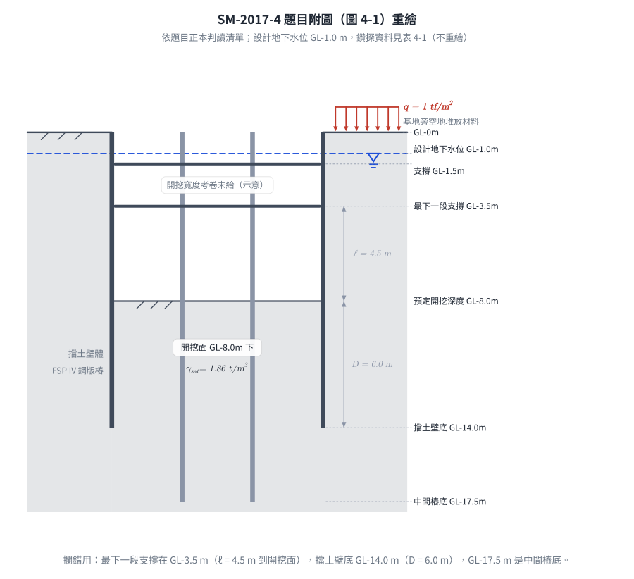
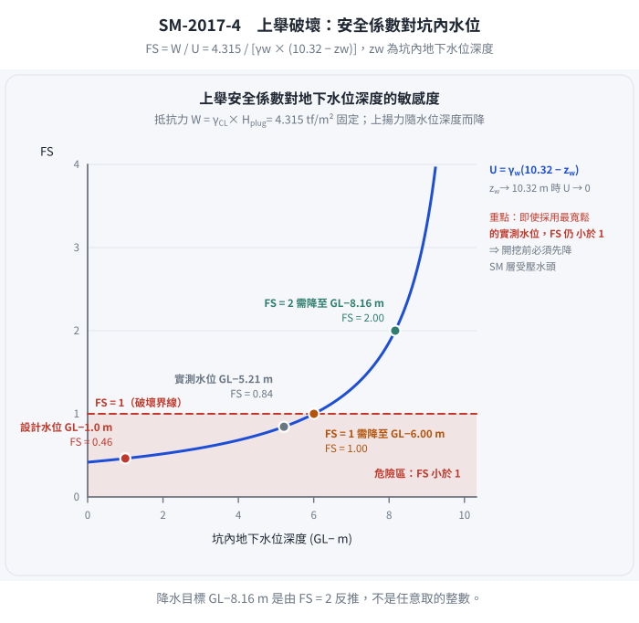
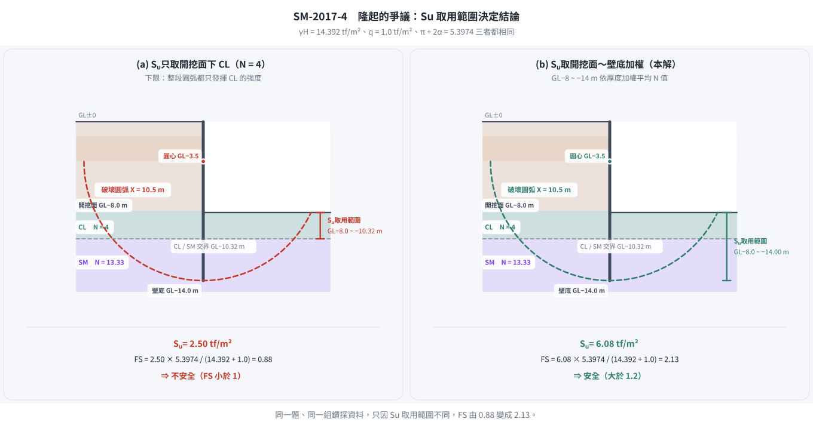

# 考題編號：SM-2017-4

**主分類：** `SM-U2-3` 開挖之穩定性分析
**副分類：** `SM-U1-2` 土壤滲透、`SM-U1-5` 土壤強度特性與變形性
**分析法：** 混合
**標籤：** `開挖穩定性` `管湧` `臨界水力坡降` `上舉破壞` `基盤隆起` `板樁` `不排水剪力強度` `安全係數`
---

## 1. 題目（考卷原文見題目正本）

> 考卷原文、公式／附表、附圖與判讀清單（已確認）見 [`SM-2017-4-problem.md`](SM-2017-4-problem.md)。本節只列解題時最容易讀錯的地方與本解使用的記號；題意以題目正本為準。

*重繪自考卷圖 4-1，依題目正本判讀清單 #6–#10；攔下的判讀錯誤：ℓ = 4.5 m 由最下一段支撐量到開挖面、GL-17.5 m 是中間樁底而非擋土壁底。表 4-1 為鑽探資料表，不重繪。*

### 常見誤讀

| 項目 | 正確判讀 | 常見誤讀 |
|---|---|---|
| 隆起公式 | 考卷印 $FS=\dfrac{S_u(\pi+2\alpha)}{\gamma H+q}$，**有 $\alpha$**（題目正本 §1、#1）；$\alpha$ 解讀為以最下一段支撐為圓心之滑動圓弧在開挖側的弧段角（rad）：$\alpha=\cos^{-1}(\ell/X)$，$X=\ell+D=10.5$ m（已確認；⚠ 待使用者複核） | 把 $2\alpha$ 當成「2）」的誤植而用 $\pi+2$（本解 §4㈣ 2026-11-15 勘誤前即如此，FS 誤為 2.03） |
| $\gamma_w$ 單位 | 考卷印 1 tf/m²（照錄），依公制 tf/m³ 計算（#11） | 不知考卷單位印錯 |
| N 值 | GL-10.32 m 以下 SM 層 N = 14、12、14、14，不是整層 14（#12） | 整層取 N = 14 |
| 上舉檢核層位 | CL 層（7.85～10.32 m）底受下方 SM 砂層水壓上舉（#3，已確認） | 以開挖面或擋土壁底為受壓面 |
| 最高流線 | 沿擋土壁背側由 GL-1.0 m 到壁底 GL-14.0 m、再沿內側到開挖面 GL-8.0 m（#4、#5） | 用直線距離或只算內側 |

**本解記號：** $i$、$i_c$ 平均／臨界水力坡降；$W$、$U$ 上舉檢核的覆土重與上揚水壓；$S_u=10N/16$（tf/m²）；$\alpha$ 隆起滑動圓弧角；$\ell$ 最下一段支撐到開挖面距離。

## 2. 考題核心精神與出題者意圖 (Core Concepts & Examiner's Intent)
本題綜合測驗開挖工程常見的各項穩定性與施工問題：
1. **施工影響評估**：測驗對土層特性（極軟弱、無塑性 ML 及高敏感 CL）與打擊式工法交互作用的理解。
2. **管湧 (Piping)**：測驗滲流路徑長度計算與臨界水力坡降的觀念。
3. **上舉破壞 (Uplift/Heave)**：測驗透水層上覆位不透水層時，自重與上揚水壓力的抗衡。
4. **隆起 (Basal Heave)**：測驗總應力法下，以 N 值推算 $S_u$ 並應用於底部隆起承載力公式的計算。

出題者刻意給定一個分層明顯的地質（淺層軟弱黏土/粉土，深層中等堅硬砂土），要求考生能根據破壞模式正確選取對應深度區間的土壤參數（如平均單位重、平均 N 值等）。

## 3. 解題戰略地圖與陷阱分析 (Strategic Roadmap & Trap Analysis)
- **(一) 振動與液化評估**：直接觀察 N 值與土壤分類。0~8m 的 ML 層 N=1~3 且 NP（無塑性），極易發生極大超孔隙水壓及液化現象。需提出低振動的替代工法（如靜壓植樁）。
- **(二) 管湧分析**：
  - **陷阱**：「最高流線」指的是緊貼擋土壁的最短滲流路徑。流徑長度 $L = D_{out} + D_{in} = (14-1) + (14-8) = 19 \text{ m}$。
  - $i_c$ 需使用出水處（GL-8.0m 附近）之有效單位重。
- **(三) 上舉破壞**：
  - **陷阱**：需找出不透水層（CL）與透水層（SM）的交界。從鑽探表可知交界在 GL-10.32m。
  - 抵抗力為 GL-8.0m 至 GL-10.32m 之 CL 覆土重；驅動力為 GL-10.32m 處之受壓水頭。
- **(四) 隆起分析**：
  - **公式照考卷**：$FS=S_u(\pi+2\alpha)/(\gamma H+q)$ 是以最下階支撐（GL-3.5 m）為圓心、半徑 $X$ 的圓弧力矩法，$\alpha=\cos^{-1}(\ell/X)$；$2\alpha$ 不是誤植。
  - 上覆壓力 $\gamma H$ 需精確計算 GL-0~8.0m 各層土壤自重之加總平均。
  - $S_u$ 需取擋土壁貫入深度（GL-8.0~14.0m）範圍內土層的加權平均 N 值來換算，因滑動面會經過此區域。

## 3.5 變數層次分析 (Variable Hierarchy Analysis)

### 最終目標
分別檢核打樁施工性、管湧安全係數、上舉破壞安全係數及所需降水深度、以及底部隆起安全係數。

### 本題關鍵公式（依計算順序）
- 管湧水力坡降：$i = \frac{\Delta H}{L}$
- 管湧安全係數：$FS = \frac{i_c}{\boxed{i}}$
- 上舉破壞抵抗力：$W = \Sigma (\gamma_t \times H_{plug})$
- 上舉破壞上揚力：$U = \gamma_w \times h_w$
- 隆起總覆土壓：$\sigma_v = \Sigma (\gamma_{t,i} \times h_i)$
- 隆起圓弧角：$\alpha = \cos^{-1}(\ell / X)$，$X = \ell + D$
- 隆起安全係數：$FS = \frac{\boxed{S_u} \times (\pi + 2\boxed{\alpha})}{\boxed{\sigma_v} + q}$

### L1：題目直接給定
| 符號 | 數值 | 說明 |
|---|---|---|
| $H$ | 8.0 m | 預定開挖深度 |
| $D_{tip}$ | 14.0 m | 鋼版樁打設深度 |
| $q$ | 1.0 tf/m² | 地表超載重 |
| $\ell$ | 4.5 m | 最下一段支撐（GL-3.5 m）到開挖面 |
| $D$ | 6.0 m | 開挖面到擋土壁底 |
| $\text{GL}_{WT}$ | -1.0 m | 設計地下水位 |

### L2：需知識點推導
**管湧分析**
| 符號 | 公式／來源 | 卡關? |
|---|---|---|
| $L$ | $L = (14.0 - 1.0) + (14.0 - 8.0)$ | |
| $\Delta H$ | $\Delta H = 8.0 - 1.0$ | |
| $i$ | $i = \Delta H / L$ | |
| $i_c$ | $i_c = (\gamma_{t} - \gamma_w) / \gamma_w$ (取底面土層) | |

**上舉破壞分析**
| 符號 | 公式／來源 | 卡關? |
|---|---|---|
| $H_{plug}$ | $H_{plug} = 10.32 - 8.0$ (CL層剩餘厚度) | |
| $W$ | $W = \gamma_{CL} \times H_{plug}$ | |
| $h_w$ | $h_w = 10.32 - 1.0$ (SM層頂部之水頭) | |
| $U$ | $U = \gamma_w \times h_w$ | |

**隆起分析**
| 符號 | 公式／來源 | 卡關? |
|---|---|---|
| $\gamma H$ | $\Sigma_{0}^{8.0} (\gamma_{t,i} \times h_i)$ | |
| $N_{avg}$ | 深度 8.0~14.0m 之 N 值加權平均 | |
| $S_u$ | $S_u = 10 \times N_{avg} / 16$ | |
| $\alpha$ | $X=\ell+D=10.5$ m，$\alpha=\cos^{-1}(\ell/X)$ | |

### L3：深層知識（不懂就卡住）
| 知識點 | 說明 | 卡關? |
|---|---|---|
| 擋土壁最高流線 | 指緊貼擋土壁兩側的最短滲流路徑，決定了平均最大水力坡降。 | |
| 上舉破壞地層判定 | 必須從鑽探報告判別何處為不透水層（CL）與透水層（SM）的交界，以此作為受壓面。 | |
| 隆起圓弧力矩法 | 考卷式 $S_u(\pi+2\alpha)$ 來自 $M_r=S_uX^2(\pi/2+\alpha)$、$M_d=(\gamma H+q)X^2/2$；不是 Prandtl 的 $N_c=\pi+2$。 | |
| 隆起區間平均參數 | 基礎隆起破壞面會向下延伸至版樁底部附近，故 $S_u$ 應取開挖面至樁底的加權平均。 | |

## 4. 步驟化詳細計算過程 (Step-by-Step Detailed Calculation)

### (一) 施工影響與應變措施
**1. 振動與液化損鄰評估：**
由鑽探報告（表 4-1）可知，GL-0m ~ GL-10.32m 地層主要為粉土（ML）及黏土（CL），且 N 值極低（N=1~4），含水量高（26~30.5%），屬於**極軟弱且具高敏感性之土壤**。
特別在深度 0~8m 的 ML 層，其塑性指數標示為 NP（無塑性），這類疏鬆且無塑性的粉土在打擊式鋼版樁的強烈動態振動下，**極易發生液化**或產生極大的超孔隙水壓，導致土壤承載力瞬間喪失；周邊軟弱黏土亦會因擠壓而產生側向變形及後續的壓密沉陷。
深度 GL-10.32m 以下雖為中等堅硬之 SM（N=14），但上部軟弱層的反應已足以造成嚴重的損鄰事件。
**結論：打擊式鋼版樁會產生嚴重振動，極可能導致液化與損鄰。**

**2. 應變措施：**
為避免損鄰，應採取以下措施：
- **工法變更**：將「打擊式」改為「靜壓植樁工法（Silent Piler）」，以無振動、無噪音方式壓入鋼版樁。若經費允許，可改用剛度更大、振動更小的地下連續壁或 SMW 工法。
- **輔助工法**：若堅持使用鋼版樁，應搭配「預鑽孔」或「水沖法」以降低打擊阻力與振動能量。
- **監測系統**：施工前落實鄰房現況鑑定，並密集配置沉陷觀測點、傾斜管、以及水壓計以嚴密監控施工影響。

---

### (二) 管湧安全係數

*圖 1　三個檢核用的是三個不同的面。攔的是「用同一個深度或同一組參數做完三題」：管湧沿壁面（$L = 13 + 6 = 19 \text{ m}$）、上舉在 CL/SM 交界（$\text{GL}-10.32 \text{ m}$，與開挖面差 $2.32 \text{ m}$）、隆起以最下階支撐為圓心、半徑 $10.5 \text{ m}$ 的圓弧繞過壁底（$S_u$ 取 $\text{GL}-8.0 \sim -14.0 \text{ m}$）；找錯面，三個安全係數就全錯。*

### (二) 管湧安全係數
依題意，使用「最高流線」（緊貼擋土壁之最短路徑）進行分析。
- 擋土壁外側水位：GL-1.0 m
- 開挖面水位：GL-8.0 m
- 擋土壁底端：GL-14.0 m

1. **計算滲流路徑長度 ($L$) 與水頭差 ($\Delta H$)**：
   外側下行路徑 $D_{out} = 14.0 - 1.0 = 13.0 \text{ m}$
   內側上行路徑 $D_{in} = 14.0 - 8.0 = 6.0 \text{ m}$
   總滲流路徑 $L = D_{out} + D_{in} = 13.0 + 6.0 = 19.0 \text{ m}$
   總水頭差 $\Delta H = 8.0 - 1.0 = 7.0 \text{ m}$
   平均水力坡降 $i = \frac{\Delta H}{L} = \frac{7.0}{19.0} = 0.3684$

2. **計算臨界水力坡降 ($i_c$)**：
   出水點（開挖面 GL-8.0m 附近）土壤為 CL（深度 7.85~10.32m），其 $\gamma_t = 1.86 \text{ tf/m}^3$。
   $\gamma_{sub} = \gamma_t - \gamma_w = 1.86 - 1.0 = 0.86 \text{ tf/m}^3$
   $i_c = \frac{\gamma_{sub}}{\gamma_w} = \frac{0.86}{1.0} = 0.86$

3. **計算安全係數 ($FS$)**：
   $$ FS = \frac{i_c}{i} = \frac{0.86}{0.3684} = 2.334 $$
   答：管湧安全係數為 $\boxed{2.33}$。

---

### (三) 上舉破壞（土湧）安全係數與降水設計
上舉破壞檢核面上方為不透水層，下方為受壓透水層。
查鑽探報告，GL-7.85~10.32m 為 CL（黏土，不透水），GL-10.32m 以下為 SM（砂土，透水）。因此上舉受壓面在 **GL-10.32 m** 處。

1. **分析上舉破壞安全係數**：
   - 抵抗力 (Downward weight $W$)：為開挖面 (GL-8.0m) 至受壓面 (GL-10.32m) 間之土重。
     $H_{plug} = 10.32 - 8.0 = 2.32 \text{ m}$
     $W = \gamma_{CL} \times H_{plug} = 1.86 \times 2.32 = 4.315 \text{ tf/m}^2$
   - 上揚力 (Uplift pressure $U$)：由 GL-1.0m 的設計地下水位連通至 SM 層產生。
     SM層頂部之水頭 $h_w = 10.32 - 1.0 = 9.32 \text{ m}$
     $U = \gamma_w \times h_w = 1.0 \times 9.32 = 9.32 \text{ tf/m}^2$
   - 安全係數 $FS$：
     $$ FS = \frac{W}{U} = \frac{4.315}{9.32} = 0.463 $$
     答：上舉破壞安全係數為 $\boxed{0.46}$（極不安全）。

2. **計算 FS=2 之降水深度**：
   - 目標 $FS = 2.0 = \frac{W}{U_{req}}$
   - 容許上揚力 $U_{req} = \frac{W}{2.0} = \frac{4.315}{2.0} = 2.1575 \text{ tf/m}^2$
   - 對應之受壓水頭 $h_{req} = \frac{U_{req}}{\gamma_w} = 2.1575 \text{ m}$
   - 水位高程應降至受壓面上方 $2.1575 \text{ m}$ 處：
     降水後地下水位深度 $= 10.32 - 2.1575 = 8.1625 \text{ m}$
     答：為防止發生上舉破壞，基坑內（抽水井）地下水位應降至 $\boxed{\text{GL}-8.16 \text{ m}}$。

*圖 2　降水高程是反推出來的，不是隨手取的整數。攔的是「用實測水位就沒事了」的僥倖：即使改用最寬鬆的 $\text{GL}-5.21 \text{ m}$，$FS$ 也只有 $0.84$，仍然小於 $1$；要達到 $FS = 2$ 必須降到 $\text{GL}-8.16 \text{ m}$——這正是題目把設計水位訂在 $\text{GL}-1.0 \text{ m}$ 的用意。*

---

### (四) 隆起之安全係數
公式（考卷給定）：$FS = \dfrac{S_u \times (\pi + 2\alpha)}{\gamma \times H + q}$

**0. 公式的來源與 $\alpha$**
考卷印的是 $2\alpha$（2026-11-15 回考卷 400 dpi 目視確認），不是誤植。此式是以**最下一段支撐（GL-3.5 m）為圓心、半徑 $X$ 的圓弧滑動面**力矩法（現行建築物基礎構造設計規範 8.8.2 的底面隆起檢核同型）：
- 抵抗力矩：背側由圓心水平線往下 $\pi/2$、開挖側由圓心正下方往上到開挖面 $\alpha$，$M_r = X\int S_u\,ds = S_u X^2\left(\tfrac{\pi}{2}+\alpha\right)$
- 傾覆力矩：背側寬 $X$ 的土重加超載 $(\gamma H+q)X$，力臂 $X/2$，$M_d = (\gamma H+q)X^2/2$
- 相除得 $FS = M_r/M_d = S_u(\pi+2\alpha)/(\gamma H+q)$

圓弧通過擋土壁底：$X = \ell + D = 4.5 + 6.0 = 10.5 \text{ m}$；開挖面在圓心下方 $\ell$ 處，$\cos\alpha = \ell/X$：
$$\alpha = \cos^{-1}\frac{4.5}{10.5} = 64.62^\circ = 1.1279 \text{ rad},\qquad \pi + 2\alpha = 5.3974$$
（$\alpha$ 的定義考卷未給，依題目正本 #1 已確認的讀法；⚠ 待使用者複核。）

1. **計算開挖面以上總平均覆土壓力 ($\gamma H$)**：
   根據各深度之 $\gamma_t$ 累加計算 (GL-0~8.0m)：
   - 0.00~1.24m (ML): $1.24 \times 1.82 = 2.257$
   - 1.24~3.42m (ML-CL): $2.18 \times 1.74 = 3.793$
   - 3.42~7.85m (ML): 取平均 $\gamma_t = (1.81+1.83+1.82)/3 = 1.82$
     $4.43 \times 1.82 = 8.063$
   - 7.85~8.00m (CL): $0.15 \times 1.86 = 0.279$
   總上覆壓力 $\gamma H = 2.257 + 3.793 + 8.063 + 0.279 = 14.392 \text{ tf/m}^2$

2. **計算開挖面以下之平均不排水剪力強度 ($S_u$)**：
   依題目正本 #2，取滑動弧通過的開挖面至擋土壁底端（GL-8.0~14.0m），依厚度計算加權平均 N 值。
   **N 值須逐個試驗值讀取，不可整層取同一個數**——鑽探報告在 10.32~14.00 m 之間有三個試驗值：
   S-7（$\approx$10.5 m）$N=14$、S-8（$\approx$12 m）$N=12$、S-9（$\approx$13.5 m）$N=14$，平均 $13.333$。
   - $8.00 \sim 10.32 \text{ m}$（CL，$2.32 \text{ m}$ 厚）：$N = 4$（S-6）
   - $10.32 \sim 14.00 \text{ m}$（SM，$3.68 \text{ m}$ 厚）：$N = (14+12+14)/3 = 13.333$

   $$N_{avg} = \frac{4 \times 2.32 + 13.333 \times 3.68}{6.0} = \frac{9.28 + 49.07}{6.0} = 9.724$$
   $$S_u = \frac{10 N_{avg}}{16} = \frac{10 \times 9.724}{16} = 6.078 \text{ tf/m}^2$$

3. **計算隆起安全係數 ($FS$)**：
   超載 $q = 1 \text{ tf/m}^2$
   $$ FS = \frac{S_u \times (\pi + 2\alpha)}{\gamma H + q} = \frac{6.078 \times 5.3974}{14.392 + 1} = \frac{32.805}{15.392} = 2.131 $$
   答：隆起之安全係數為 $\boxed{2.13}$（大於現行規範 8.8.2 要求的 1.2，安全）。
   （若把 SM 層一律當 $N = 14$，$S_u = 6.333$、$FS = 2.22$；差 $4\%$，不影響結論。
   但 $S_u$ 的**取用範圍**才是真正會翻盤的爭議，見 §5。）

## 5. 關鍵爭議點與進階探討 (Critical Issues & Advanced Discussion)
- **隆起公式的 $2\alpha$（2026-11-15 勘誤）**：考卷印的就是 $S_u(\pi+2\alpha)$，不是 $\pi+2$ 的誤植。它不是 Prandtl 承載力式（$N_c=\pi+2$），而是最下階支撐為圓心的圓弧力矩法（推導見 §4㈣ 第 0 步）。$\alpha$ 考卷未定義，本解依題目正本 #1 取 $\alpha=\cos^{-1}(\ell/X)$、$X=\ell+D=10.5$ m（⚠ 待使用者複核）。2026-11-15 前本解改用 $\pi+2$ 得 $FS=2.03$，比照考卷式低估約 5%，結論（安全）相同。現行規範 8.8.2 另要求在不同半徑 $X$ 中取最小 $FS$；本題 $X$ 取到壁底（$S_u$ 取用範圍與題目正本 #2 一致）。
- **⚠ 隆起 $S_u$ 的取用範圍：兩種取法差 2.5 倍，結論完全相反（本題最大的爭議點）**

  | 取法 | $S_u$ (tf/m²) | $FS$ | 結論 |
  |---|---|---|---|
  | 只取開挖面**正下方**的 CL（$N=4$，厚 $2.32$ m） | $2.50$ | $\mathbf{0.88}$ | **不安全** |
  | 開挖面至壁底（$8 \sim 14$ m）加權平均（本解） | $6.08$ | $\mathbf{2.13}$ | 安全 |
  | 沿整條圓弧（含背側開挖面以上 ML 段）依弧長加權，$\gamma$ 依密度分段（獨立盲解） | $6.18$ | $2.16$ | 安全 |

  （三列都用 $\pi+2\alpha=5.3974$。）

  兩者的差別在於**破壞面到底穿不穿過下方的 SM 層**。本解採後者，理由有二：
  ① 題目特別註明「本案砂土、粘土皆可用」這個 $S_u$ 相關式——若不打算把砂土納入平均，這句話沒有作用；
  ② 擋土壁貫入到 GL-14.0 m，隆起破壞面必須繞過壁底，勢必穿過 SM 層。
  但**軟弱的 CL 只有 $2.32$ m 厚**，若破壞面被局限在這一薄層內（例如壁體剛度不足、
  破壞先在坑底發生），$FS$ 就只剩 $0.88$。作答時應把兩個數字都列出來並說明取用理由，
  這比直接寫一個 $2.13$ 有價值得多。

*圖 3　同一組鑽探資料、兩個相反的結論。攔的是「只寫一個 $FS$ 就交卷」：分母完全相同，差別只在 $S_u$ 的取用範圍——若整段圓弧都只發揮 $2.32 \text{ m}$ 厚 CL 的強度，$FS$ 只剩 $0.88$。作答時應把兩個數字都列出並說明取用理由。*

- **⚠ 設計水位 GL-1.0 m 與鑽探實測水位 GL-5.21 m 的落差**：
  鑽探報告表頭載明「地下水位：$-5.21$ m」，但題目要求以**設計水位 GL-1.0 m** 分析——
  這是保守設計（考慮豐水期、鄰地補注、施工降水失效）的標準做法。若改以實測水位計算：

  | 項目 | 設計水位 GL-1.0 m | 實測水位 GL-5.21 m |
  |---|---|---|
  | 管湧 $\Delta H$ / $L$ / $i$ | $7.0$ / $19.0$ / $0.3684$ | $2.79$ / $14.79$ / $0.1886$ |
  | 管湧 $FS = i_c/i$ | $2.33$ | $4.56$ |
  | 上舉 $U$ (tf/m²) | $9.32$ | $5.11$ |
  | 上舉 $FS = W/U$ | $\mathbf{0.46}$ | $\mathbf{0.84}$ |

  值得注意的是：**即使用最寬鬆的實測水位，上舉安全係數仍然小於 1**。
  也就是說「開挖到 GL-8.0 m 前必須先降 SM 層的受壓水頭」這個結論，
  不因水位假設而改變——這正是本題把設計水位訂在 GL-1.0 m 的用意。

- **混合地層的隆起檢核**：傳統隆起（Basal Heave）多針對純軟弱黏土層。但本題特意聲明「砂土、粘土皆可用此 $S_u$ 轉換公式」，代表出題者希望考生突破單一土層的思維，計算破壞影響區（開挖底面至樁底）內的等效加權平均剪力強度來進行檢核。
- **上舉破壞的水位設定**：本題計算指出 $FS=0.46$ 極其危險。實務上，開挖至此深度前，必定需先在坑內施打「深井（Deep Well）」抽排 SM 層的受壓地下水，確保坑底 CL 層不被沖毀。這也是第(三)子題要求算出「降水高程」的實務意義。

---

*解析日期：見 `wiki/log.md`　｜　圖解補繪：2026-08-29（向量 SVG，程式繪製，腳本 `gen_SM-2017-4.py` 可重跑；同名 2× PNG 供簡報／影片管線使用）*

*修正日期：2026-11-15（§1 改為指向題目正本 `SM-2017-4-problem.md`，重繪附圖 figs/SM-2017-4-fig-1-problem.svg；刪除 §1 把考卷隆起公式 π+2α 改寫為 π+2 的重述（§4㈣ 依此計算的部分待勘誤）；非勘誤）*

*修正日期：2026-11-15（FIX：隆起式依考卷 π+2α：㈣ 改照考卷原式 $FS=S_u(\pi+2\alpha)/(\gamma H+q)$，$\alpha=\cos^{-1}(\ell/X)$、$X=10.5$ m，FS 2.03 → 2.13、只取 CL 下限 0.84 → 0.88；更新 §1、§3、§3.5、§4㈣、§5 與圖 1、圖 3（重跑 `gen_SM-2017-4.py`）；依 `wiki/queries/盲解比對-SM-U2-3-B1-2026-11-15.md`；腳本 `scripts/fixes/2026-11-15_fix_SM-2017-4_heave_alpha.py`）*
