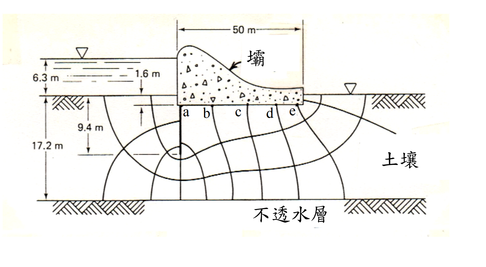

# SM-2018-3 題目正本

> 本檔只記錄**考卷上寫了什麼、圖上畫了什麼**，不含任何解法。解析見同資料夾 `SM-2018-3.md`。
> 判讀清單已確認（凍結）；本檔原則上不再修改（改動須回考卷原圖並記 log）。

| 項目 | 內容 |
|------|------|
| 考卷 | `raw/exams/SM-2018_土壤力學與基礎設計.pdf` 第 1 頁（頁次 2－1），第三題 |
| 考年 | 民國 107 年（2018） |
| 配分 | 25 分（㈠ 5 分、㈡ 20 分） |
| 附圖 | `SM-2018-3-fig-1.png`（混凝土壩、截水牆與流網；既有證據圖完整、無雜訊，沿用） |
| 判讀狀態 | **已確認**（2026-11-15 關卡一：使用者授權依建議判讀確認；#1–#4 影響答案，依建議定案；轉錄 2026-11-15；PyMuPDF 110 dpi 全頁目視，附圖 400–700 dpi 局部放大（內嵌點陣影像，原生約 150 dpi）；PDF 文字層核對逐字原文；盲讀後才比對既有解析） |

## 1. 考卷原文（逐字）

> 三、某混凝土壩，其下方垂直截水牆及流線網如下圖所示。圖中土壤的滲透係數 k = 3.5×10⁻⁶ m/s。請計算：
> ㈠壩底土層之滲流損失（seepage loss）。（5 分）
> ㈡於 a、b、c、d、e 點之上揚壓力。（20 分）

## 2. 考卷給的公式、附表與參數

- 土壤滲透係數 $k = 3.5\times10^{-6}$ m/s。
- 圖上尺寸：上游水深 6.3 m、壩底埋深 1.6 m、截水牆底深 9.4 m、不透水層深 17.2 m、壩底寬 50 m。
- 流網（流線與等勢線）畫在圖上，**沒有**直接給 $N_f$、$N_d$。
- **沒有給**：$\gamma_w$、壩長（滲流損失以單位寬度計）。
- 卷首注意事項：㈠可以使用電子計算器。㈡不必抄題，作答時請將試題題號及答案依照順序寫在試卷上，於本試題上作答者，不予計分。㈢本科目除專門名詞或數理公式外，應使用本國文字作答。

## 3. 附圖

圖面文字照錄：`50 m`、`壩`、`6.3 m`、`1.6 m`、`9.4 m`、`17.2 m`、`a`、`b`、`c`、`d`、`e`、`土壤`、`不透水層`。

本題附圖是流網，**不重繪**：流網的格線本身就是題目資料，重繪等於自己編流網（同曲線圖）。

## 4. 判讀清單

| # | 項目 | 判讀 | 圖上／題文依據 | 把握 |
|---|------|------|---------------|------|
| 1 | 下游地表與水位 | 下游地表與上游地表在**同一高程**（圖上同一條水平線延續到壩兩側），下游水位 ▽ 在地表；壩底比兩側地表低 1.6 m | 附圖 400 dpi：左右地表線同在像素 y = 345，壩底在 y = 385 | 確定（解讀；影響答案） |
| 2 | 總水頭差 | 上、下游水位差 = 上游水深 6.3 m（上游水面量到地表；下游水位在地表） | `6.3 m` 尺寸線兩端：上游水面、地表；#1 | 不確定（影響答案）；依建議定案 |
| 3 | 流槽數 $N_f$ | 3：流線依序為壩底＋截水牆面、兩條內部流線、不透水層面（共 4 條流線、3 個流槽） | 附圖 700 dpi 逐條追線：兩條內部流線自上游地表垂直入土、繞過牆底、自下游地表出土 | 不確定（影響答案）；依建議定案 |
| 4 | 等勢降數 $N_d$ 與各點位置 | 沿壩底＋牆面流線，自上游地表起依序：①交牆上游面（較高）②交牆上游面（近牆底）③牆底正下方的垂直線 ④交牆下游面 ⑤過 b ⑥過 c ⑦過 d ⑧過 e ⑨自壩下游角往右下延伸的短線（未畫到不透水層，仍依序與兩條內部流線正交）⑩下游地表 → $N_d$ = 10；b、c、d、e 分別在第 5–8 條等勢線上。a 在牆與壩底交角，不在等勢線上，介於第 4、5 條之間（沿接觸面距離約在中點，約 4.5 降） | 附圖 700 dpi；b、c、d、e 為等勢線與壩底交點的實心點 | 不確定（影響答案）；依建議定案 |
| 5 | 截水牆 | 自壩上游端壩底往下，牆底在地表下 9.4 m（壩底下 7.8 m）；`9.4 m` 尺寸線上端在地表、下端在牆底虛線 | 附圖：比例 17.2 m ↔ 728 px，9.4 m 下端落在牆底虛線 | 確定 |
| 6 | 不透水層 | 地表下 17.2 m（尺寸線由地表量起） | 附圖 `17.2 m` | 確定 |
| 7 | 壩底寬 | 50 m（水平方向未依比例） | 附圖 `50 m` | 確定 |
| 8 | 上揚壓力定義 | a–e 為壩底面上的點，所求為該處孔隙水壓 | 題文；附圖點位 | 確定 |
| 9 | 滲流損失 | 單位壩長的滲流量（考卷未給壩長） | 題文 | 確定（解讀） |
| 10 | 考卷沒有給 | $\gamma_w$、壩長、$N_f$、$N_d$ 數值 | 全題 | 確定 |

---

*轉錄：2026-11-15（SM-U1-2 題目正本推廣・批 1）*

*確認：2026-11-15 使用者授權依建議判讀確認（SM-U1-2 題目正本推廣・批 1，關卡一；使用者指示「要我確認的請依你建議」）；⚠ #1–#4 與舊解讀法不同、影響答案，待使用者複核*
