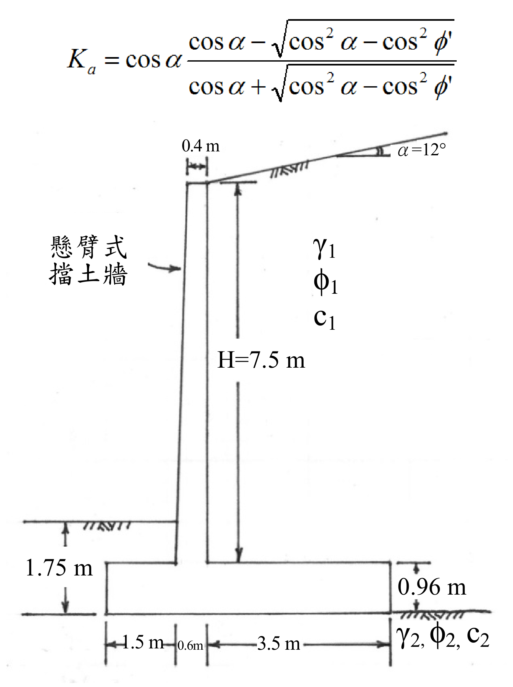

# SM-2018-4 題目正本

> 本檔只記錄**考卷上寫了什麼、圖上畫了什麼**，不含任何解法。解析見同資料夾 `SM-2018-4.md`。
> 判讀清單已確認（凍結）；本檔原則上不再修改（改動須回考卷原圖並記 log）。

| 項目 | 內容 |
|------|------|
| 考卷 | `raw/exams/SM-2018_土壤力學與基礎設計.pdf` 第 2 頁（頁次 2－2），第四題 |
| 考年 | 民國 107 年（2018） |
| 配分 | 25 分（㈠13、㈡12） |
| 附圖 | `SM-2018-4-fig-2.png`（$K_a$ 公式＋手繪懸臂式擋土牆剖面；2026-11-15 由考卷重新擷取 500 dpi）；既有 `SM-2018-4-fig-1.png` 為同一圖，滑鼠游標壓在 $K_a$ 的下標上，保留不刪 |
| 判讀狀態 | **已確認**（2026-11-15 關卡一：使用者授權依建議判讀確認；轉錄 2026-11-15；PyMuPDF 110 dpi 全頁目視；附圖為內嵌點陣影像 620×694 px，原解析度取出並 450 dpi 放大；盲讀後才比對既有解析） |

## 1. 考卷原文（逐字）

> 四、某一懸臂式擋土牆如下圖所示，牆高 H = 7.5 m，背填土傾角 α = 12°。土壤性質：單位重 γ1 = 17.8 kN/m³、有效內摩擦角 φ1 = 32°、有效凝聚力 c1 = 0 kN/m²、單位重 γ2 = 16.6 kN/m³、有效內摩擦角 φ2 = 28°、有效凝聚力 c2 = 30 kN/m²。假設混凝土單位重 γc = 23.55 kN/m³，被動土壓合力 Pp = 0 kN/m，基礎底面之介面有效內摩擦角及有效凝聚力折減係數 k1 = k2 = 2/3。依據藍金（Rankine）土壓力理論，請計算此擋土牆的：
> ㈠抗傾覆安全係數。（13 分）
> ㈡抗滑移安全係數。（12 分）

## 2. 考卷給的公式、附表與參數

- 題目印出的公式（附圖上方）：

$$K_a=\cos\alpha\,\frac{\cos\alpha-\sqrt{\cos^2\alpha-\cos^2\phi'}}{\cos\alpha+\sqrt{\cos^2\alpha-\cos^2\phi'}}$$

- 背填土（圖上標於牆後）：$\gamma_1$ = 17.8 kN/m³、$\phi_1$ = 32°、$c_1$ = 0。
- 基礎土壤（圖上標於底版底面右側）：$\gamma_2$ = 16.6 kN/m³、$\phi_2$ = 28°、$c_2$ = 30 kN/m²。
- 混凝土 $\gamma_c$ = 23.55 kN/m³；被動土壓合力 $P_p$ = 0；基礎底面介面摩擦角與凝聚力的折減係數 $k_1 = k_2 = 2/3$。
- 幾何（圖）：牆身頂寬 0.4 m、牆身底寬 0.6 m、$H$ = 7.5 m、底版厚 0.96 m、趾長 1.5 m、踵長 3.5 m、牆前地面至底版底 1.75 m、背填土傾角 $\alpha$ = 12°。
- **沒有給**：牆前（趾上）覆土的土性、安全係數要求值、地下水位、$k_1$／$k_2$ 是乘在角度上或乘在 $\tan$ 上的明文。
- 卷首注意事項：㈠可以使用電子計算器。㈡不必抄題，作答時請將試題題號及答案依照順序寫在試卷上，於本試題上作答者，不予計分。㈢本科目除專門名詞或數理公式外，應使用本國文字作答。

## 3. 附圖

圖面文字照錄：`Ka = cosα (cosα − √(cos²α − cos²φ'))/(cosα + √(cos²α − cos²φ'))`、`0.4 m`、`α=12°`、`懸臂式擋土牆`、`γ1`、`φ1`、`c1`、`H=7.5 m`、`1.75 m`、`0.96 m`、`1.5 m`、`0.6 m`、`3.5 m`、`γ2, φ2, c2`。

## 4. 判讀清單

| # | 項目 | 判讀 | 圖上／題文依據 | 把握 |
|---|------|------|---------------|------|
| 1 | 趾上覆土 | 牆前地面在底版底上方 1.75 m，趾上覆土厚 1.75 − 0.96 = 0.79 m；圖上未標此土的土性。$P_p$ = 0 只排除被動土壓，未說覆土重。建議：主線**計入**趾上覆土重（題目在 $P_p$ = 0 下仍標 1.75 m，此尺寸唯一用途即覆土重），單位重取 $\gamma_1$（回填土；改用 $\gamma_2$ 差不到 0.2%），另以不計覆土對照 | 附圖 1.75 m 尺寸線上端對齊牆前地面線、下端對齊底版底 | 不確定（影響答案）；使用者授權依建議確認 |
| 2 | $H$ = 7.5 m 量到哪裡 | **牆身高**：由牆身頂量到**底版頂面**，不含底版厚 0.96 m（牆全高 8.46 m） | 原影像：尺寸線上端在牆身頂橫向引線（y ≈ 78 px），下端箭頭 y ≈ 545 px，底版頂線 y ≈ 547 px、底版底 y ≈ 607 px | 確定（解讀） |
| 3 | 牆身 | 頂寬 0.4 m、底寬 0.6 m；牆背（右）鉛直、牆面（左）傾斜 | 原影像：牆背線 x ≈ 247 px 上下一致；牆面線 x ≈ 222 → 210 px（比例約 62 px/m，與 0.4、0.6 m 相符） | 確定 |
| 4 | 底版 | 厚 0.96 m（右側尺寸線上端在底版頂、下端在底版底）；趾長 1.5 m、踵長 3.5 m，底版全寬 1.5 + 0.6 + 3.5 = 5.6 m | 附圖下方與右側尺寸線 | 確定 |
| 5 | 背填土面 | 自牆身頂背側起以 $\alpha$ = 12° 向背填側上傾，延伸越過踵端 | 附圖 | 確定 |
| 6 | 背填土 | $\gamma_1$ = 17.8、$\phi_1$ = 32°、$c_1$ = 0（標於牆後） | 題文＋附圖 | 確定 |
| 7 | 基礎土壤 | $\gamma_2$ = 16.6、$\phi_2$ = 28°、$c_2$ = 30 kN/m²（標於底版底面右側地面線下） | 題文＋附圖 | 確定 |
| 8 | 底面介面參數 | 摩擦角 $\delta = k_1\phi_2$、黏著力 $c_a = k_2 c_2$（折減係數乘在 $\phi_2$、$c_2$ 本身） | 題文「介面有效內摩擦角及有效凝聚力折減係數」 | 確定（解讀） |
| 9 | 被動土壓 | $P_p$ = 0（題目指定） | 題文 | 確定 |
| 10 | 指定理論 | Rankine，$K_a$ 公式照考卷（傾斜地表） | 題文＋附圖上方公式 | 確定 |
| 11 | 所求 | ㈠抗傾覆安全係數、㈡抗滑移安全係數（不問承載力） | 題文 | 確定 |
| 12 | 考卷沒有給 | 趾上覆土土性、安全係數要求值、地下水位（未提及，視為無水） | 全題 | 確定 |

---

*轉錄：2026-11-15（SM-U3-2 題目正本推廣・批 1）*

*確認：2026-11-15 使用者授權依建議判讀確認（SM-U3-2 題目正本推廣・批 1，關卡一；使用者指示「要確認的依你建議」）*
