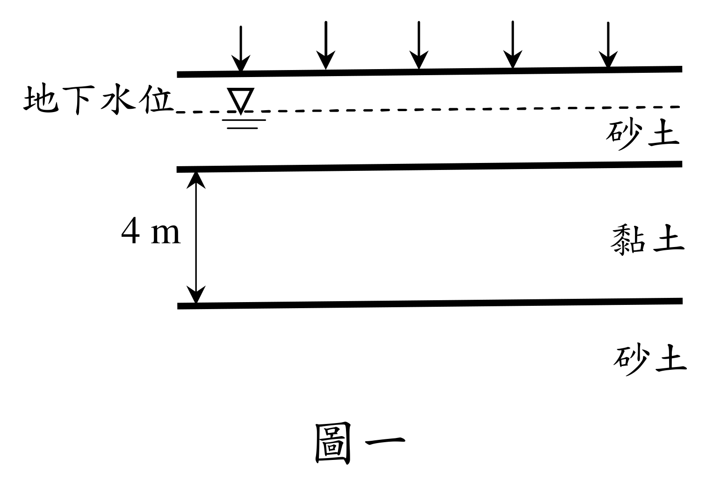
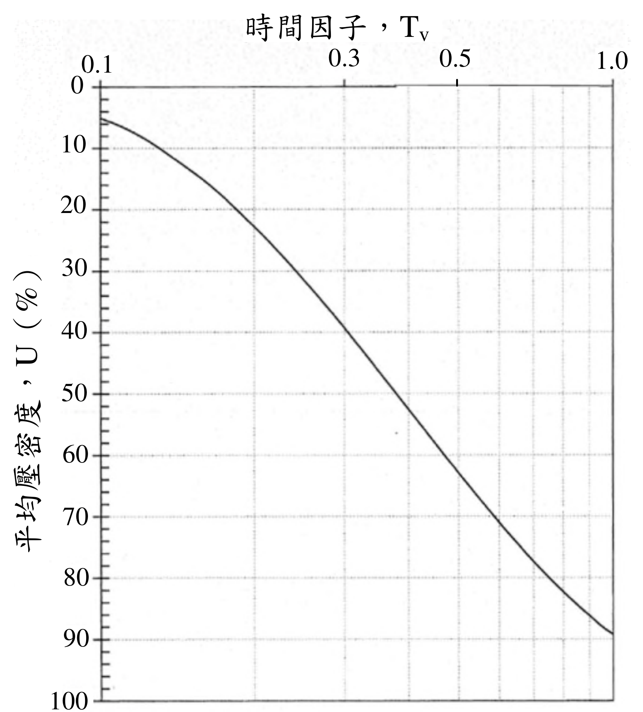

# SM-2019-2 題目正本

> 本檔只記錄**考卷上寫了什麼、圖上畫了什麼**，不含任何解法。解析見同資料夾 `SM-2019-2.md`。
> 判讀清單已確認（凍結）；本檔原則上不再修改（改動須回考卷原圖並記 log）。

| 項目 | 內容 |
|------|------|
| 考卷 | `raw/exams/SM-2019_土壤力學與基礎設計.pdf` 第 1 頁（題文、圖一）～第 2 頁（圖二、表一），第二題 |
| 考年 | 民國 108 年（2019） |
| 配分 | 20 分（㈠10、㈡10） |
| 附圖 | `SM-2019-2-fig-2.png`（圖一 地層）、`SM-2019-2-chart-2.png`（圖二 $T_v$–$U$ 曲線）；皆 2026-11-15 由考卷重新擷取 500 dpi。既有 `SM-2019-2-fig-1.png`（圖一，下方有滑鼠游標）、`SM-2019-2-chart-1.png`（圖二，游標壓在曲線 $U\approx35\%$ 處）保留不刪 |
| 判讀狀態 | **已確認**（2026-11-15 關卡一：使用者授權依建議判讀確認；轉錄 2026-11-15；PyMuPDF 110 dpi 全頁目視，附圖 500 dpi；第 1 頁文字層核對；第 2 頁文字層排版錯亂，以影像為準；盲讀後才比對既有解析） |

## 1. 考卷原文（逐字）

> 二、某大型營建工程擬建築於如下圖一的地層之地表上，該地層含 4 m 厚的軟弱正常壓密黏土（normally consolidated clay），黏土層上、下皆為排水砂層。此營建工程完工後，構造物預期作用於黏土層的平均永久荷重增加 150 kPa。施工前黏土層中間的平均有效覆土壓力為 70 kPa，且初始孔隙比 0.9，壓縮指數（compression index, $C_c$）0.25，壓密係數（coefficient of consolidation, $c_v$）0.008 m²/day。時間因子 $T_v$ 與平均壓密度 $U$ 之關係如下圖二與表一。
> ㈠試求此黏土層在此永久荷重下的主要壓密沉陷量。（10 分）
> ㈡若採用預壓工法（precompression）加速壓密沉陷，擬於地表加載均布荷重 281 kPa，需幾天可達到與㈠相同的主要壓密沉陷量？（10 分）

## 2. 考卷給的公式、附表與參數

- 黏土：厚 4 m、正常壓密、$\sigma'_0$ = 70 kPa（黏土層中間）、$e_0$ = 0.9、$C_c$ = 0.25、$c_v$ = 0.008 m²/day；上下皆為排水砂層。
- 永久荷重增量 150 kPa（作用於黏土層的平均值）；預壓荷重 281 kPa（地表均布）。
- 表一（照錄，考卷標題「時間因子，$T_v$」「平均壓密度，U(%)」）：

| $T_v$ | 0.05 | 0.10 | 0.15 | 0.20 | 0.25 | 0.30 | 0.40 | 0.50 | 0.60 | 0.70 | 0.80 | 0.90 | 1.00 | 1.50 |
|---|---|---|---|---|---|---|---|---|---|---|---|---|---|---|
| U（%） | 0.31 | 5.07 | 13.58 | 22.77 | 31.46 | 39.32 | 52.55 | 62.92 | 71.03 | 77.36 | 82.31 | 86.18 | 89.2 | 96.86 |

- 圖二：橫軸「時間因子，$T_v$」（對數，標 0.1、0.3、0.5、1.0），縱軸「平均壓密度，U（%）」0～100 向下增加；曲線由 $T_v$ = 0.1、U ≈ 5% 降到 $T_v$ = 1.0、U ≈ 89%。
- **沒有給**：砂層厚度、地下水位深度、黏土單位重（施工前有效應力已直接給 70 kPa）、預壓荷重卸除時機。
- 卷首注意事項：㈠可以使用電子計算器。㈡不必抄題，作答時請將試題題號及答案依照順序寫在試卷上，於本試題上作答者，不予計分。㈢本科目除專門名詞或數理公式外，應使用本國文字作答。

## 3. 附圖

圖面文字照錄：`地下水位`、`砂土`、`4 m`、`黏土`、`砂土`、`圖一`。

圖面文字照錄：`時間因子，Tv`、`0.1`、`0.3`、`0.5`、`1.0`、`平均壓密度，U（%）`、`0`～`100`（每 10）。

## 4. 判讀清單

| # | 項目 | 判讀 | 圖上／題文依據 | 把握 |
|---|------|------|---------------|------|
| 1 | 表一／圖二的 U 是什麼 | 考卷標「平均壓密度」，但數值**不是**Terzaghi 平均壓密度（例：$T_v$ = 0.2 理論平均 U = 50.4%，表一 22.77%），而與雙向排水層**中間面**（$z=H_{dr}$）的壓密度 $U_z$ 逐點相同（級數解重算：0.05→0.31、0.2→22.77、0.6→71.03、1.5→96.86，全部吻合到 0.01）。預壓工法（Das）以排水最慢的中間面 $U_z$ 控制，考卷附這張表正是此用法，只是標題寫成「平均」 | 程式以級數解重算表一 14 點 | 不確定（影響答案，使用者授權依建議定案：建議照考卷表一查表（即中間面 $U_z$）作主線，§5 附理論平均壓密度的對照；⚠ 考卷標題與數值不符） |
| 2 | 281 kPa 是總預壓荷重還是額外超載 | 建議讀為預壓時地表加載的**總**荷重 281 kPa（取代 150 kPa 的永久荷重先行加載）。此讀法下所需壓密度 $S_{150}/S_{281}$ = 0.710，恰為表一 $T_v$ = 0.60 的 71.03%，顯示命題即依此設計；另一讀法 150＋281 = 431 kPa 得 0.582，落在表格兩點之間 | 題文「擬於地表加載均布荷重 281 kPa」；程式重算 | 不確定（影響答案，使用者授權依建議定案：建議採總荷重 281 kPa） |
| 3 | 排水 | 黏土上下皆為排水砂層 → 雙向排水，$H_{dr}$ = 2 m | 題文、圖一 | 確定 |
| 4 | 黏土厚 | 4 m（尺寸線上下端對齊黏土頂、底線） | 圖一 500 dpi | 確定 |
| 5 | 地下水位 | 在上層砂土內、地表下不遠處（圖上未標深度）；施工前有效應力已直接給，不影響計算 | 圖一虛線 | 確定 |
| 6 | 荷重 | 150 kPa 為作用於黏土層的平均永久應力增量（大面積一維）；預壓 281 kPa 在地表均布，視同全數傳到黏土 | 題文；圖一箭頭布滿地表 | 確定（解讀） |
| 7 | 沉陷計算 | 以黏土層中間 $\sigma'_0$ = 70 kPa 單層計算 | 題文「黏土層中間的平均有效覆土壓力」 | 確定（解讀） |
| 8 | 所求㈡ | 預壓加載後達到 $S_{150}$（㈠的主要壓密沉陷量）所需天數 | 題文 | 確定 |
| 9 | 考卷沒有給 | 砂層厚度、水位深度、黏土單位重、理論平均壓密度公式 | 全題 | 確定 |

---

*轉錄：2026-11-15（SM-U1-3 題目正本推廣・批 2）*

*確認：2026-11-15 使用者授權依建議判讀確認（SM-U1-3 題目正本推廣・批 2，關卡一；使用者指示「要確認的依你建議」）*
