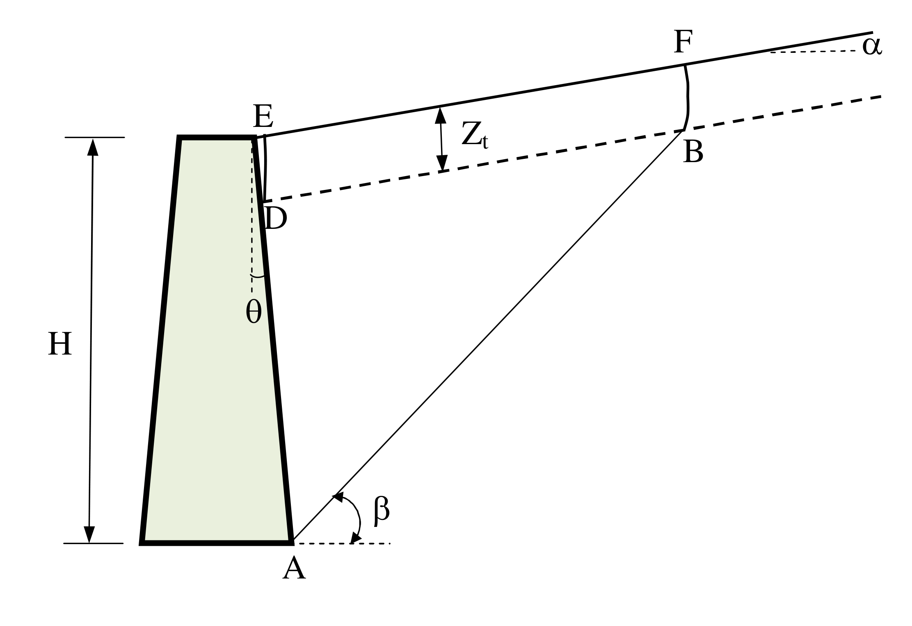

# SM-2019-4 題目正本

> 本檔只記錄**考卷上寫了什麼、圖上畫了什麼**，不含任何解法。解析見同資料夾 `SM-2019-4.md`。
> 判讀清單已確認（凍結）；本檔原則上不再修改（改動須回考卷原圖並記 log）。

| 項目 | 內容 |
|------|------|
| 考卷 | `raw/exams/SM-2019_土壤力學與基礎設計.pdf` 第 3 頁（頁次 3－3），第四題 |
| 考年 | 民國 108 年（2019） |
| 配分 | 25 分（㈠ 5、㈡ 15、㈢ 5） |
| 附圖 | `SM-2019-4-fig-2.png`（擋土牆與庫倫破壞土楔；2026-11-15 由考卷重新擷取 500 dpi）；既有 `SM-2019-4-fig-1.png` 為同一圖，滑鼠游標壓在牆趾 A 的 β 角弧上，保留不刪 |
| 判讀狀態 | **已確認**（2026-11-15 關卡一：使用者授權依建議判讀確認；轉錄 2026-11-15；PyMuPDF 110 dpi 全頁目視，附圖 400 dpi 放大並讀 PDF 向量座標；PDF 文字層核對；盲讀後才比對既有解析） |

## 1. 考卷原文（逐字）

> 四、某擋土牆如下圖所示，背填土坡度角 α，土壤單位重 γ，土壤凝聚力與摩擦角分別為 c 與 φ，牆背與鉛直線夾 θ 角，土壤與牆面間的凝聚力與摩擦角分別為 $c_a$ 與 δ。考慮張力裂縫（線段 DE 與 BF），但縫內無水，並假設主動狀態之破壞面（線段 AB）與水平線夾 β 角。
> ㈠試求張力裂縫的最大深度 $Z_t$。（5 分）
> ㈡畫出以庫倫（Coulomb）法求解主動狀態時作用於破壞土楔的力多邊形。答案需描述各已知力的計算及各力與水平或鉛直線的夾角。（15 分）
> ㈢如何求得作用於牆背的主動推力。（5 分）

## 2. 考卷給的公式、附表與參數

- 全為符號：牆高 $H$；背填土坡度角 $\alpha$；土壤 $\gamma$、$c$、$\phi$；牆背與鉛直線夾角 $\theta$；牆土介面 $c_a$、$\delta$；破壞面 AB 與水平夾角 $\beta$；張力裂縫深度 $Z_t$。
- 張力裂縫 DE（牆背側）與 BF（破壞面頂端），縫內無水。
- **沒有給**：任何數值；地下水（題意為無水）；地表超載。
- 卷首注意事項：㈠可以使用電子計算器。㈡不必抄題，作答時請將試題題號及答案依照順序寫在試卷上，於本試題上作答者，不予計分。㈢本科目除專門名詞或數理公式外，應使用本國文字作答。

## 3. 附圖

圖面文字照錄：`H`、`A`、`β`、`B`、`Zt`、`E`、`D`、`F`、`θ`、`α`。

## 4. 判讀清單

| # | 項目 | 判讀 | 圖上／題文依據 | 把握 |
|---|------|------|---------------|------|
| 1 | 牆背傾斜方向 | 牆背由牆頂 E 往下向背填土側（右）偏，牆底比牆頂寬，牆背面朝上方、背填土壓在牆背上；θ 由鉛直虛線量到牆背 | 附圖 400 dpi：牆背上端 x ≈ 497 px、下端 A x ≈ 570 px；θ 弧在鉛直虛線與牆背之間 | 確定 |
| 2 | 裂縫 DE 的位置 | 沿牆背（牆土介面）開裂，D 在牆背上、深 $Z_t$；DE 段牆面無 $c_a$、無土壓 | 附圖 DE 畫成緊貼牆背的細線，E 在牆頂、D 在牆背上 | 確定（解讀） |
| 3 | $Z_t$ 的量法 | 由地表**鉛直**量到虛線；虛線平行地表（同坡 α） | 附圖 Zt 箭頭鉛直；地表與虛線斜率 0.169／0.171 | 確定 |
| 4 | 裂縫 BF | 鉛直，由破壞面頂點 B 到地表 F | 附圖 | 確定 |
| 5 | 破壞面 AB | 平面，由牆踵 A（牆背底）起、與水平線夾 β | 附圖 β 角在 A 點水平虛線與 AB 之間 | 確定 |
| 6 | 牆高 H | 由牆頂（E 高程）鉛直量到牆底 A 高程 | 附圖左側尺寸線上下端對齊牆頂與牆底 | 確定 |
| 7 | 地表 | 由牆頂 E 起以坡角 α 向上，牆頂與填土面在 E 交會 | 附圖 | 確定 |
| 8 | 縫內無水 | 張力裂縫內不計水壓 | 題文 | 確定 |
| 9 | 所求 | ㈠ $Z_t$ 最大深度；㈡ 庫倫法破壞土楔力多邊形（各已知力計算與夾角）；㈢ 主動推力求法 | 題文 | 確定 |
| 10 | 考卷沒有給 | 數值、地下水、超載 | 全題 | 確定 |

---

*轉錄：2026-11-15（SM-U3-1 題目正本推廣・批 1）*

*確認：2026-11-15 使用者授權依建議判讀確認（SM-U3-1 題目正本推廣・批 1，關卡一；使用者指示「要確認的依你建議」）*
