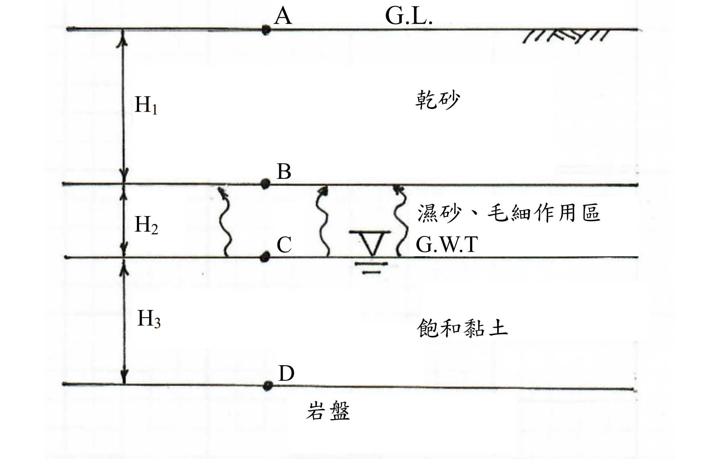

# SM-2020-1 題目正本

> 本檔只記錄**考卷上寫了什麼、圖上畫了什麼**，不含任何解法。解析見同資料夾 `SM-2020-1.md`。
> 判讀清單已確認（凍結）；本檔原則上不再修改（改動須回考卷原圖並記 log）。

| 項目 | 內容 |
|------|------|
| 考卷 | `raw/exams/SM-2020_土壤力學與基礎設計.pdf` 第 1 頁（頁次 2－1），第一題 |
| 考年 | 民國 109 年（2020） |
| 配分 | 25 分 |
| 附圖 | `SM-2020-1-fig-1.png`（土層剖面；既有證據圖完整、無雜訊，沿用） |
| 判讀狀態 | **已確認**（2026-11-15 關卡一：使用者授權依建議判讀確認；轉錄 2026-11-15；PyMuPDF 110 dpi 全頁目視，附圖 300 dpi 局部放大（內嵌點陣影像）；PDF 文字層核對逐字原文；盲讀後才比對既有解析） |

## 1. 考卷原文（逐字）

> 一、某工址之土層剖面如下圖所示。已知頂層厚度 $H_1$ = 2.1 m（乾砂），比重 $G_s$ = 2.65，孔隙比 $e$ = 0.5。第二層厚度 $H_2$ = 0.9 m（濕砂、毛細作用區），比重 $G_s$ = 2.65，孔隙比 $e$ = 0.5，飽和度 $S$ = 50%。第三層厚度 $H_3$ = 1.9 m（飽和黏土），比重 $G_s$ = 2.71，含水量 $w$ = 42%。(25 分)
> ㈠試計算 A、B、C、D 點之垂直總應力 $\sigma$、水壓力 $u$ 及垂直有效應力 $\sigma'$。
> ㈡請繪出垂直總應力、水壓力 $u$、及垂直有效應力隨深度之分布。

## 2. 考卷給的公式、附表與參數

- 第一層乾砂：$H_1$ = 2.1 m、$G_s$ = 2.65、$e$ = 0.5。
- 第二層濕砂（毛細作用區）：$H_2$ = 0.9 m、$G_s$ = 2.65、$e$ = 0.5、$S$ = 50%。
- 第三層飽和黏土：$H_3$ = 1.9 m、$G_s$ = 2.71、$w$ = 42%；**沒有給** $e$。
- **沒有給**：$\gamma_w$、毛細區孔隙水壓的計算方式（是否以 $S$ 折減）。
- 卷首注意事項：㈠可以使用電子計算器。㈡不必抄題，作答時請將試題題號及答案依照順序寫在試卷上，於本試題上作答者，不予計分。㈢本科目除專門名詞或數理公式外，應使用本國文字作答。

## 3. 附圖

圖面文字照錄：`A`、`G.L.`、`H1`、`乾砂`、`B`、`H2`、`濕砂、毛細作用區`、`C`、`G.W.T`、`H3`、`飽和黏土`、`D`、`岩盤`。

## 4. 判讀清單

| # | 項目 | 判讀 | 圖上／題文依據 | 把握 |
|---|------|------|---------------|------|
| 1 | 毛細區孔隙水壓 | 考卷只給毛細區 $S$ = 50%，未指定孔隙水壓算法；依建議採 $u = -S\,\gamma_w h$（$h$ 為距水位高度，Das 教科書做法；題目特別給 $S$ 即為此用），另以 $u=-\gamma_w h$ 作對照 | 題文 | 不確定（影響答案）；依建議定案 |
| 2 | 點位 | A 地表、B 乾砂底（毛細區頂）、C 毛細區底＝地下水位、D 黏土底＝岩盤頂 | 附圖點位與尺寸線 | 確定 |
| 3 | 層厚 | A→B 2.1 m、B→C 0.9 m、C→D 1.9 m | 題文；附圖 $H_1$、$H_2$、$H_3$ | 確定 |
| 4 | 地下水位 | 在 C 點（第二、三層交界）；毛細上升到 B（波浪箭頭由 C 畫到 B） | 附圖 G.W.T 符號與波浪箭頭 | 確定 |
| 5 | 乾砂單位重 | 由 $G_s$、$e$ 換算乾單位重 | 題文 | 確定 |
| 6 | 濕砂單位重 | 由 $G_s$、$e$、$S$ = 50% 換算 | 題文 | 確定 |
| 7 | 黏土單位重 | 飽和，由 $w$、$G_s$ 以 $S$ = 100% 先求 $e$ | 題文「飽和黏土」 | 確定 |
| 8 | 岩盤 | 只作地層底界，不求岩盤內應力 | 附圖 | 確定 |
| 9 | 所求 ㈡ | 繪 $\sigma$、$u$、$\sigma'$ 隨深度分布 | 題文 | 確定 |
| 10 | 考卷沒有給 | $\gamma_w$、黏土 $e$、毛細區水壓算法 | 全題 | 確定 |

---

*轉錄：2026-11-15（SM-U1-4 題目正本推廣・批 1）*

*確認：2026-11-15 使用者授權依建議判讀確認（SM-U1-4 題目正本推廣・批 1，關卡一；使用者指示「要我確認的請依你建議」）*
