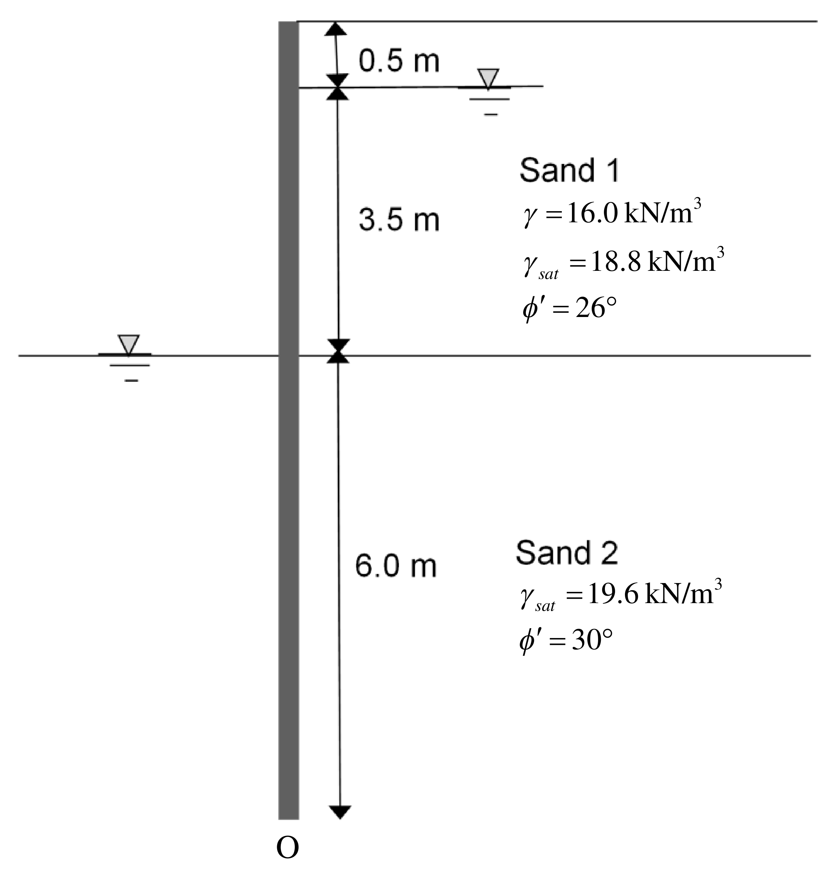

# SM-2020-2 題目正本

> 本檔只記錄**考卷上寫了什麼、圖上畫了什麼**，不含任何解法。解析見同資料夾 `SM-2020-2.md`。
> 判讀清單已確認（凍結）；本檔原則上不再修改（改動須回考卷原圖並記 log）。

| 項目 | 內容 |
|------|------|
| 考卷 | `raw/exams/SM-2020_土壤力學與基礎設計.pdf` 第 2 頁（頁次 2－2），第二題 |
| 考年 | 民國 109 年（2020） |
| 配分 | 25 分 |
| 附圖 | `SM-2020-2-fig-2.png`（懸臂版樁剖面；2026-11-15 由考卷重新擷取 500 dpi）；既有 `SM-2020-2-fig-1.png` 為同一圖，左側開挖面水位符號旁有滑鼠游標，保留不刪 |
| 判讀狀態 | **已確認**（2026-11-15 關卡一：使用者授權依建議判讀確認；轉錄 2026-11-15；PyMuPDF 110 dpi 全頁目視，附圖 400–500 dpi 局部放大（內嵌點陣影像三段拼接）；PDF 文字層核對逐字原文；盲讀後才比對既有解析） |

## 1. 考卷原文（逐字）

> 二、某共同管溝工程採用明挖覆蓋工法，基地地層主要層為砂土，如下圖所示。開挖深度為 4 m，設計長度 10 m 之懸臂式版樁作為開挖之擋土設施。請繪製作用於版樁兩側之土壓力隨深度變化圖及淨水壓力隨深度變化圖，並在相關深度標示數值？請以簡化法（以土壓力對 O 點之力矩值）估算此擋土壁之破壞安全係數？請估算此開挖擋土設施之抗砂湧安全係數，並請依據「建築物基礎構造設計規範」之規定說明此項安全係數是否符合規範需求？（25 分）

## 2. 考卷給的公式、附表與參數

- Sand 1（地表下 0～4 m，背側）：$\gamma$ = 16.0 kN/m³（水位以上）、$\gamma_{sat}$ = 18.8 kN/m³、$\phi'$ = 26°。
- Sand 2（地表下 4～10 m，兩側）：$\gamma_{sat}$ = 19.6 kN/m³、$\phi'$ = 30°。
- 開挖 4 m；懸臂版樁長 10 m（底端 O）；背側水位地表下 0.5 m、開挖側水位在開挖面。
- 題目指定：簡化法，以土壓力對 O 點力矩值求破壞安全係數；抗砂湧依「建築物基礎構造設計規範」。
- **沒有給**：$\gamma_w$、牆面摩擦角、地表超載、砂湧安全係數公式、規範版本。
- 卷首注意事項（第 1 頁）：㈠可以使用電子計算器。㈡不必抄題，作答時請將試題題號及答案依照順序寫在試卷上，於本試題上作答者，不予計分。㈢本科目除專門名詞或數理公式外，應使用本國文字作答。

## 3. 附圖

圖面文字照錄：`0.5 m`、`3.5 m`、`6.0 m`、`Sand 1`、`γ = 16.0 kN/m3`、`γsat = 18.8 kN/m3`、`φ' = 26°`、`Sand 2`、`γsat = 19.6 kN/m3`、`φ' = 30°`、`O`。

## 4. 判讀清單

| # | 項目 | 判讀 | 圖上／題文依據 | 把握 |
|---|------|------|---------------|------|
| 1 | 安全係數定義 | 「以土壓力對 O 點之力矩值」：被動側抵抗力矩 ÷ 主動側（含淨水壓）傾覆力矩；考卷未說明淨水壓是否計入 | 題文 | 不確定（解讀；影響答案，請確認）；使用者授權依建議確認 |
| 2 | 背側水位 | 地表下 0.5 m（尺寸線上端對齊地表＝版樁頂、下端對齊水位線） | 附圖 500 dpi 右側尺寸線 | 確定 |
| 3 | 開挖深度 | 4 m（0.5＋3.5），開挖面＝Sand 1／Sand 2 層界 | 題文；附圖尺寸線 | 確定 |
| 4 | 開挖側水位 | 開挖面高程（地表下 4 m） | 附圖左側水位符號與開挖面同高 | 確定 |
| 5 | 版樁 | 長 10 m，頂與背側地表齊平，底端 O 在地表下 10 m（開挖面下 6 m） | 題文；附圖 6.0 m 尺寸線到 O | 確定 |
| 6 | 層界 | Sand 1：背側 0～4 m；Sand 2：4～10 m（兩側） | 附圖水平線跨越版樁 | 確定 |
| 7 | Sand 1 單位重 | 水位以上用 $\gamma$ = 16.0、水位以下用 $\gamma_{sat}$ = 18.8 | 附圖 | 確定 |
| 8 | 所求 | 兩側土壓力與淨水壓力隨深度分布圖（標值）、對 O 點力矩的破壞安全係數、抗砂湧安全係數及是否符合規範 | 題文 | 確定 |
| 9 | 考卷沒有給 | $\gamma_w$、牆面摩擦角（採 Rankine）、地表超載、砂湧公式與規範版本、版樁下方地層 | 全題 | 確定 |

---

*轉錄：2026-11-15（SM-U2-3 題目正本推廣・批 1）*

*確認：2026-11-15 使用者授權依建議判讀確認（SM-U2-3 題目正本推廣・批 1，關卡一；使用者指示「要我確認的請依你建議」）*
