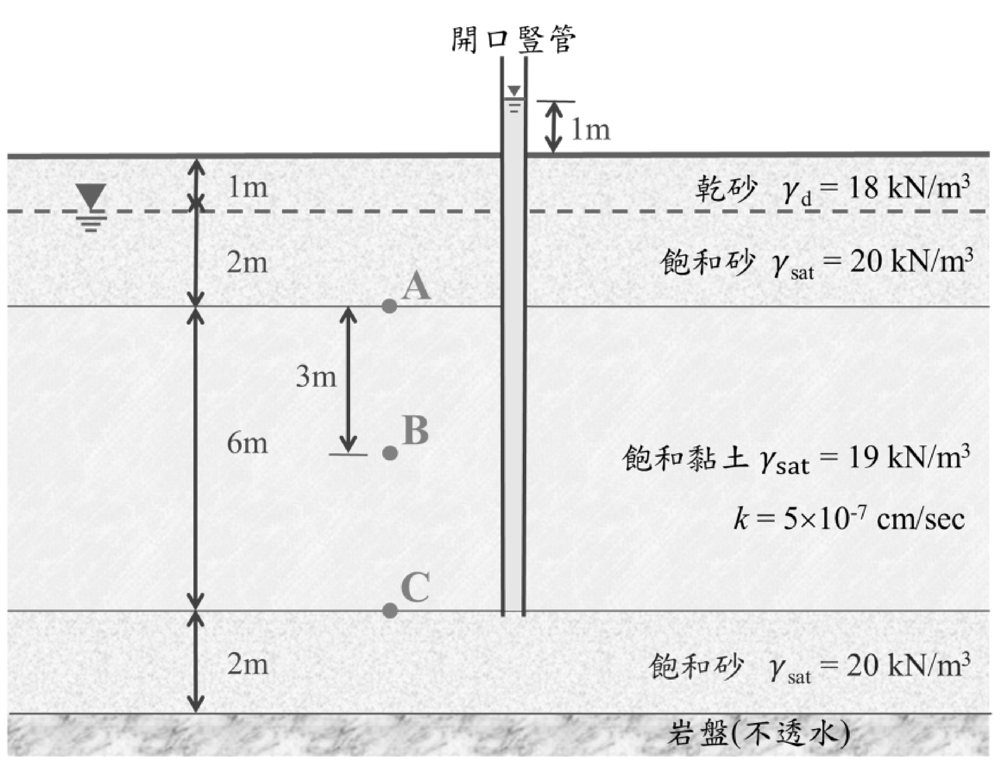

# SM-2021-1 題目正本

> 本檔只記錄**考卷上寫了什麼、圖上畫了什麼**，不含任何解法。解析見同資料夾 `SM-2021-1.md`。
> 判讀清單已確認（凍結）；本檔原則上不再修改（改動須回考卷原圖並記 log）。

| 項目 | 內容 |
|------|------|
| 考卷 | `raw/exams/SM-2021_土壤力學與基礎設計.pdf` 第 1 頁（頁次 4－1），第一題 |
| 考年 | 民國 110 年（2021） |
| 配分 | 25 分 |
| 附圖 | `SM-2021-1-fig-2.png`（土層剖面與開口豎管；2026-11-15 由考卷重新擷取 500 dpi）；既有 `SM-2021-1-fig-1.png` 為同一圖，左上角帶文字游標，保留不刪 |
| 判讀狀態 | **已確認**（2026-11-15 關卡一：使用者授權依建議判讀確認；轉錄 2026-11-15；PyMuPDF 110 dpi 全頁目視，附圖 300–500 dpi 局部放大（內嵌點陣影像）；PDF 文字層核對逐字原文；盲讀後才比對既有解析） |

## 1. 考卷原文（逐字）

> 一、有一土壤剖面及穩定滲流狀況如下圖所示，黏土層下方之砂土層內已觀察到湧泉壓力，可使開口豎管內的水上升到高於地表面 1 m：（25 分）
> ㈠計算 A 點、B 點、C 點之總應力、孔隙水壓及有效應力；
> ㈡估計黏土層中滲流之方向及速率。

## 2. 考卷給的公式、附表與參數

- 乾砂 $\gamma_d$ = 18 kN/m³（地表到水位）；飽和砂 $\gamma_{sat}$ = 20 kN/m³（水位到黏土頂）。
- 飽和黏土 $\gamma_{sat}$ = 19 kN/m³、$k = 5\times10^{-7}$ cm/sec。
- 下層飽和砂 $\gamma_{sat}$ = 20 kN/m³；其下為岩盤（不透水）。
- 開口豎管水位高於地表面 1 m。
- **沒有給**：$\gamma_w$、黏土孔隙比（換算滲流速度用）。
- 卷首注意事項：㈠可以使用電子計算器。㈡不必抄題，作答時請將試題題號及答案依照順序寫在試卷上，於本試題上作答者，不予計分。㈢本科目除專門名詞或數理公式外，應使用本國文字作答。

## 3. 附圖

圖面文字照錄：`開口豎管`、`1m`（豎管水位）、`1m`、`乾砂 γd = 18 kN/m³`、`2m`、`飽和砂 γsat = 20 kN/m³`、`A`、`3m`、`B`、`6m`、`飽和黏土 γsat = 19 kN/m³`、`k = 5×10⁻⁷ cm/sec`、`C`、`2m`、`飽和砂 γsat = 20 kN/m³`、`岩盤(不透水)`。

## 4. 判讀清單

| # | 項目 | 判讀 | 圖上／題文依據 | 把握 |
|---|------|------|---------------|------|
| 1 | 地下水位 | 地表下 1 m（虛線＋▽） | 附圖左側 `1m` 尺寸線 | 確定 |
| 2 | 上層砂 | 乾砂 0–1 m、飽和砂 1–3 m | 附圖尺寸線 `1m`、`2m` | 確定 |
| 3 | A 點 | 地表下 3 m，在上層砂／黏土交界 | 附圖 A 點在交界線上 | 確定 |
| 4 | 黏土層 | 3–9 m，厚 6 m | 附圖 `6m` 尺寸線 | 確定 |
| 5 | B 點 | A 下方 3 m（地表下 6 m，黏土層中點） | 附圖 `3m` 尺寸線由 A 量到 B | 確定 |
| 6 | C 點 | 地表下 9 m，在黏土／下層砂交界 | 附圖 C 點在交界線上 | 確定 |
| 7 | 下層砂與岩盤 | 下層飽和砂 9–11 m，其下岩盤不透水 | 附圖 `2m`、`岩盤(不透水)` | 確定 |
| 8 | 開口豎管 | 管下端止於 C 點高程（量測下層砂水頭）；管內水位高出地表 1 m | 附圖管線下端與 C 線同高；題文 | 確定 |
| 9 | 上層砂水壓 | 上層砂與地下水位連通，為靜水壓 | 題文「穩定滲流」；附圖 | 確定（解讀） |
| 10 | 所求 ㈡ | 黏土層中滲流方向與「速率」；考卷沒給孔隙比，速率以達西流速 $v = ki$ 表示 | 題文；§2 | 確定（解讀） |
| 11 | 考卷沒有給 | $\gamma_w$、黏土孔隙比 | 全題 | 確定 |

---

*轉錄：2026-11-15（SM-U1-4 題目正本推廣・批 1）*

*確認：2026-11-15 使用者授權依建議判讀確認（SM-U1-4 題目正本推廣・批 1，關卡一；使用者指示「要我確認的請依你建議」）*
